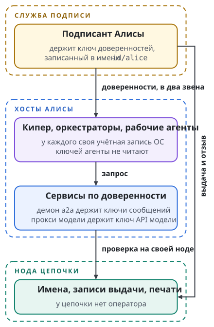
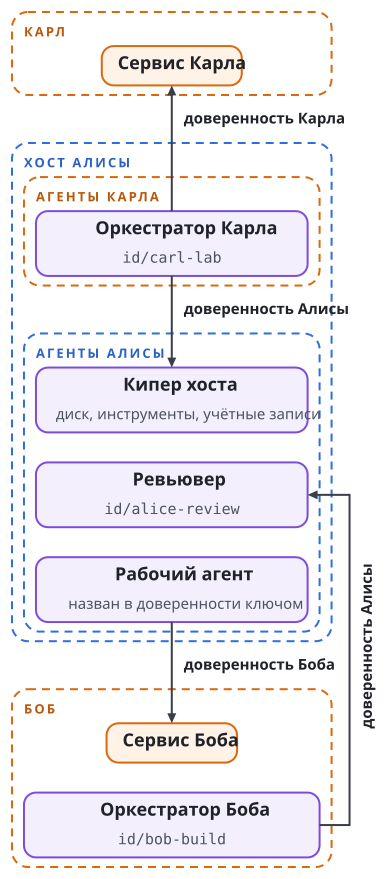
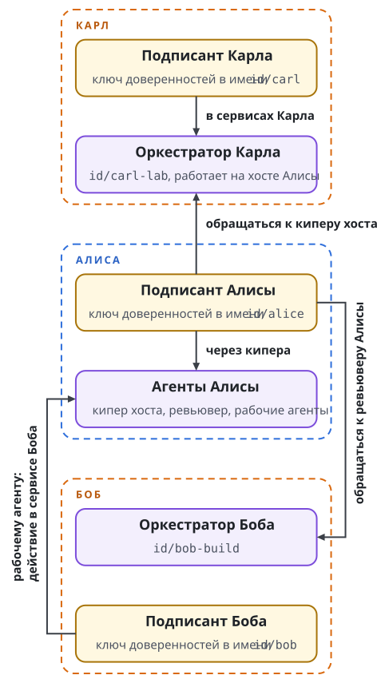

# Рой: иерархия и полномочия

Мы каждый день работаем с роем агентов трёх операторов; в книге они названы Алисой, Бобом и Карлом. В рое около 60 оркестраторов и киперов на четырёх хостах. Замер за 30,5 суток насчитал 10 846 сессий агентов, в среднем 356 в сутки. Агент одного оператора обращается к агентам и сервисам другого, и на одном хосте работают агенты всех троих. Глава показывает, на чём иерархия роя держится сегодня и как тот же рой устроен на доверенностях. Рой работает сегодня; слой доверенностей в нём не построен.

## Состав роя

Рой занимает четыре хоста агентов, и на одном из них работают агенты всех трёх операторов. Числа ниже сняты 11 ноября 2026 года и округлены. Они показывают порядок величин: состав роя меняется каждый день.

| Хост агентов | Кто управляет хостом | Что на нём работает |
| ------ | ----- | ------------------------ |
| Первый хост Linux | Алиса | Один кипер, около 17 оркестраторов, около 30 живых сессий и около 150 личностей рабочих агентов. Запусков рабочих агентов около 100 за сутки и около 550 за семь дней. Здесь же работают два оркестратора Карла и рабочие агенты, которым сторона Боба отдаёт ревью и задачи |
| Второй хост Linux | Алиса | Около 6 сессий, в основном задачи стороны Боба |
| Mac Алисы | Алиса | Около 12 оркестраторов |
| Mac Боба | Боб | Около 30 киперов и оркестраторов |

Серверы, на которых работает только инфраструктура, хостами агентов не считаются: серверы сообщений, ноды цепочки и релей. У Карла своего хоста агентов нет. Личности, сессии и запуски считаются отдельно: одна личность рабочего агента служит многим запускам, и одна личность оркестратора за месяц проходит через многие сессии.

За месяц рой отработал около 9500 активных агенто-часов: в среднем это 13 агентов, работающих круглосуточно, 9521 час на 732 часа окна. Замер покрывает 30,5 суток, с начала 12 октября до полудня 11 ноября 2026 года по UTC, и на всех хостах сделан одним способом. Активное время сессии это сумма промежутков между событиями её журнала, где каждый промежуток учтён не больше чем пятью минутами. Часы сессий по часам дают только верхнюю границу.

| Хост агентов | Активных агенто-часов | Часов сессий, верхняя граница | Сессий |
| ------ | ---: | ---: | ---: |
| Первый хост Linux | 2799 | 9287 | 1991 |
| Mac Алисы | 3676 | 25 737 | 3343 |
| Второй хост Linux | 688 | 904 | 4168 |
| Mac Боба | 2358 | 8595 | 1344 |
| Всего, четыре хоста | 9521 | 44 523 | 10 846 |

На Mac Боба замер грубо делит часы по профилям Swarma Curator, модуля профилей и домов агентов: 1873 активных часа приходится на профили киперов и оркестраторов, 295 на остальные профили, то есть рабочих агентов, ревьюверов и архитекторов, и 190 на сессии без профиля Curator, в основном ранние, которые оператор вёл сам до появления Curator. Вместе это 2358 часов строки.

У замера пять границ. Первый хост Linux работает примерно с 18 октября, и его строка покрывает меньше месяца. На Mac Алисы учтены сессии прежней и текущей установок. Второй хост Linux подсчитан удалённо, с правами только на чтение. На Mac Боба учтены только сессии роя. Сессии агентских сред, журналы которых способ не читает, в счёт не вошли.

## Как рой работает сегодня

Сегодня полномочия агента в рое может проверить только тот, кто управляет его хостом или сервером сообщений. Иерархия при этом действует каждый день, и роли в ней заданы поведением. Оператор выдаёт полномочия и подтверждает действия, которые расширяют права. Кипер держит обязательства, сроки и передачу ответственности. Оркестратор планирует работу, ставит задачи и принимает результаты. Продьюсер производит изменение, ревьювер независимо проверяет его.

Исполнители отделены от ролей. Роль оператора исполняет человек, остальные роли исполняют агенты. Один агент может исполнять роли кипера и оркестратора. Рабочий агент это агент, запущенный на одну задачу; он исполняет роль продьюсера или ревьювера. Таблица состава считает агентов по роли, которую агент исполняет постоянно.

Оператор ставит задачи киперу и оркестраторам. Оркестратор запускает рабочих агентов и принимает их результаты. Изменение проверяет ревьювер, который его не производил. Агенты общаются сообщениями a2a в комнатах на серверах сообщений.

Полномочия держатся на трёх вещах: на учётных записях ОС хостов, на правах в комнатах обмена сообщениями и на правиле, чьи сообщения агент принимает как распоряжение. Агент другого оператора принимает их от этих хостов и серверов на веру, и отзыв права зависит от того же сервера. Эту зависимость снимает слой доверенностей.

## Тот же рой на доверенностях

На доверенностях у каждого оператора в цепочке одно имя выдавшего, а у каждого кипера, оркестратора и нотариуса своё имя. Рисунок показывает рой Алисы: кто держит какой ключ и кто проверяет доверенность.

{.tall}

Алиса передаёт полномочия в два звена. Её подписант выдаёт киперу `id/alice-keeper` доверенность с правом передоверия, и кипер выдаёт дочерние доверенности оркестраторам по имени и рабочим агентам по ключу. Каждую дочернюю доверенность заверяет нотариус, которого Алиса называет в праве передоверия. Оркестратор управляет рабочими агентами, но доверенностей не выдаёт: когда ему нужен рабочий агент, он просит об этом кипера, и основанием дочерней доверенности служит только право передоверия кипера. У дерева управления три уровня, у пути полномочий два звена. Путь, сужение и заверение разобраны в главе "Доверенность", нотариус в главе "Договор и согласие", ключи в главе "Ключи".

Проверяет доверенность сервис, который исполняет действие, на собственной ноде. Оркестратор Алисы `id/alice-lead` работает на её Mac, а прокси модели на первом хосте Linux. Общей учётной записи у хостов нет, и прокси модели не спрашивает Mac, кто к нему пришёл. Агент с соседней учётной записи того же хоста проходит ту же проверку: граница хостов в ней не участвует. Отзыв тоже не зависит от хоста. Подписант на одном хосте тратит печать, и прокси модели на другом видит трату на своей ноде.

В примере у рабочего агента имени нет. Доверенность называет его ключом, и 150 личностей не добавляют в цепочку ни одной записи имени. Имён в рое при этом около 60: по одному на оператора, кипера и оркестратора. Каждый нотариус добавляет к ним одно имя. Так пример следует предложению, а не решению: владельцы 12 ноября 2026 года решили, что у агента своё имя, и не решили, относится ли это к рабочим агентам. Если имя получит каждая личность рабочего агента, к 60 именам добавится по имени на личность, с регистрацией и продлениями. Вопрос разобран в главе "Ключи".

## Один хост, три оператора

Первым хостом Linux управляет Алиса, а работают на нём агенты всех троих. Два оркестратора принадлежат Карлу. Часть рабочих агентов выполняет ревью и задачи стороны Боба. Сегодня это держится на учётных записях хоста и на доверии к Алисе. На доверенностях каждый оператор выдаёт права только на своё, и путь к каждому сервису открывает доверенность владельца этого сервиса.

{.tall}

| Что нужно агенту | Чей это ресурс | Кто выдаёт доверенность | Кому |
| ---------- | ------ | -------- | -------- |
| Обращение оркестратора Карла к киперу хоста: диск, инструменты, учётные записи | Алисы: кипер это её агент | Подписант Алисы | `id/carl-lab`, по имени и ключу его владельца, Карла |
| Действия оркестратора Карла в сервисах Карла | Карла | Подписант Карла | `id/carl-lab`, по имени |
| Обращение оркестратора Боба к ревьюверу на хосте Алисы | Алисы | Подписант Алисы | `id/bob-build`, по имени и ключу его владельца, Боба |
| Действие рабочего агента на хосте Алисы в сервисе Боба | Боба | Подписант Боба | Рабочему агенту, по ключу; исполнитель назван именем и ключом сервиса Боба |

Хост даёт агенту место и ничего не решает за его оператора. Оркестратор Карла подчинён Карлу: его имя указывает на `id/carl`, и права в сервисах Карла выдаёт подписант Карла. Алиса как оператор хоста отзывает своё: доступ к своим агентам и сервисам. Доверенности Карла она отозвать не может. Одна задача стороны Боба на хосте Алисы проходит две доверенности двух операторов: Алиса даёт оркестратору Боба право обратиться к ревьюверу, а Боб даёт рабочему агенту право на действие в своём сервисе.

Доверенность не заменяет изоляцию агента на хосте: учётную запись агента Алиса открывает и закрывает средствами ОС. Ключ сообщений оркестратора Карла держит демон a2a на хосте Алисы, поэтому сохранность этого ключа Карл доверяет оператору хоста. Ключ доверенностей Карла на чужом хосте лежать не должен: его держит подписант Карла.

## Граница между операторами

Алиса управляет оркестратором `id/alice-review`, который проверяет чужие изменения, платит за его модель и даёт к нему доступ оркестратору Боба `id/bob-build`. Общего администратора у операторов нет. Доступ оформляется одной доверенностью:

```text
выдавший      id/alice, регистрация и ключ владельца имени
к кому        id/alice-review
получатель    id/bob-build и ключ владельца этого имени
действие      доставить сообщение агенту
пределы       сообщения и расход модели за период
срок          около 13 000 блоков
договор       хэш условий, которые подписали обе стороны
```

Строки показывают смысл записи: точные поля версии 4 не заданы. Доверенность выдаёт подписант Алисы, одним звеном. Кипер Боба в ней не участвует, и кипер Алисы не получает права над агентами Боба. Рисунок показывает все доверенности между тремя операторами.

{.tall}

Иерархия каждого оператора кончается на его имени. Алиса не выдаёт доверенностей от имени Боба, и Боб не распоряжается ресурсами Алисы. Между операторами действует другое отношение: владелец ресурса выдаёт доверенность получателю из чужой иерархии, и кто в ней управляет получателем, выдавшего не касается. Число доверенностей между операторами равно числу отношений доступа; с числом агентов у каждого оно не растёт. Получателем в каждом примере главы служит агент, а исполнителем агент или сервис, например демон a2a или прокси модели.

Каждая сторона сохраняет своё. Боб меняет ключ сообщений своего оркестратора обновлением имени, без новой доверенности. Если имя `id/bob-build` переходит к другому владельцу, доступ прекращается сам. Алиса прекращает доступ тратой печати, и эту трату видит каждый проверяющий на своей ноде. Перед доставкой сообщения оркестратору `id/alice-review` демон a2a на хосте Алисы проверяет доверенность, а перед отправкой ответа проверяет её заново.

Договор между операторами несёт условия, которых нет в доверенности: правила поведения и того, кто их применяет, оплату, если она есть, и порядок прекращения. Прекращение по нарушению разобрано в главе "Отзыв и наблюдение цепочки".

## Что работает сегодня и чего нет

Рой работает без единой доверенности. Хосты, киперы, оркестраторы, рабочие агенты и независимое ревью работают каждый день, агенты обмениваются сообщениями a2a в комнатах на серверах сообщений, и иерархия управления действует. Держится она на учётных записях хостов, на правах в комнатах и на правиле о распоряжениях, а на общем хосте ещё и на доверии к его оператору. Имена операторов и агентов в цепочке, ключи доверенностей и подписанты операторов в рое не развёрнуты. Состояние каждой части слоя доверенностей дано в главе "Где мы".
