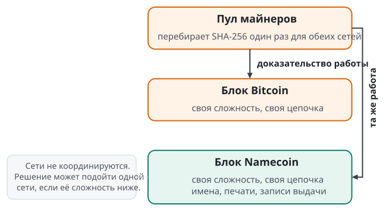

# Личность и имена

Сервис, которому предъявили доверенность, должен узнать ключ выдавшего, не спрашивая сервер выдавшего. Для этого участник записывает свой ключ в значение имени в публичной цепочке, а проверяющий читает это значение на собственной ноде. Глава определяет участников, связь ключа с именем, требования к цепочке имён и правила Namecoin, первой цепочки Swarma Link.

## Участники

Участник это тот, кто подписывает заявления своим ключом и кому можно дать право. Участников четыре вида.

Человек владеет собственной личностью. Система не знает его паспортных данных: для неё Алиса это ключ и его история.

Организация это участник с правилами. Компания "Червы" решает, кто в ней состоит и кому что доступно; каждое решение подписано названным администратором. Открытое сообщество устроено как организация, которая принимает любого по своим правилам.

Агент это программа, которая действует по поручению человека или организации. Запрос агента подписан его собственным ключом, поэтому проверяющий видит, какому агенту дано право. Юридическая ответственность за действия агента зависит от применимого права.

Устройство и провайдер участниками личности не являются. Устройство хранит ключ участника и получает ограниченные права, потому что может потеряться. Провайдер продаёт или дарит услугу: хранение, доставку сообщений, ответы на запросы к цепочке. Провайдер "Кролик" обслуживает данные Алисы, а её личность ему не принадлежит.

В аренде у участников есть роли. Арендодатель управляет агентом и выпускает доверенности на обращение к нему. Арендатор получает такую доверенность. Доверенность на обращение к агенту выпускается на ключ арендатора. Полномочия самого агента в других сервисах оформляются отдельными доверенностями на ключ агента.

Роль занимает личность: ключ и, если нужно, имя. Кто стоит за личностью, механика не различает. Арендодателем, арендатором, выдавшим и получателем может быть человек, организация или автономный агент. Агент нанимает другого агента и сдаёт в аренду агентов, которыми управляет, по тем же правилам: договор и согласие, доверенность, печать и её отзыв, оплата.

## Ключ раньше имени

Личность это постоянный ключ. Клиент Алисы создаёт корневой ключ на её устройстве без регистрации и оплаты и показывает сид: набор слов, из которого вычисляются её ключи. Сид Алиса записывает и хранит отдельно от устройств.

Имя это сменяемый псевдоним ключа. По имени участника находят, а узнают по ключу. Когда Боб добавляет Алису в контакты, его клиент запоминает её корневой ключ. Если под тем же именем появляется другой ключ, клиент Боба показывает предупреждение и не принимает нового владельца молча.

Имя можно получить двумя способами. Провайдер подписывает подтверждение: такой-то ключ у него зовётся `alice.rabbit.bit`. Это бесплатно и работает сразу, но имя принадлежит провайдеру, и он может забрать его следующей записью. Алиса при этом теряет адрес и сохраняет личность, потому что её контакты закрепили ключ. Собственное имя `alice.bit` записано в цепочке на ключ Алисы, и управлять им может только держатель этого ключа. Регистрацию может оплатить спонсор: он создаёт имя и передаёт его Алисе записью в цепочке. Клиент показывает, какое имя у Алисы сейчас: имя провайдера, регистрация в процессе или собственное имя. Старый адрес может указывать на новый: Кролик записывает, что `alice.rabbit.bit` ведёт на `alice.bit`, и старые ссылки работают при условии, что Кролик поддерживает эту запись.

Регистрация у провайдера не доказывает, что за ключом стоит человек, и один человек может завести сколько угодно ключей. Анонимная личность остаётся постоянным ключом с историей.

Собственное имя нужно продлевать. Имя, которое истекло, может зарегистрировать посторонний. Для контактов Алисы новый владелец того же написания это другой участник: клиент отличает его по истории владения и по ключу.

## Что требуется от цепочки имён

Подтверждению провайдера верят те, кто доверяет провайдеру. Для проверки без такого доверия нужен публичный журнал, которым не владеет ни один участник. Swarma Link требует от него восьми свойств.

| Требование | Зачем оно нужно |
| --- | --- |
| Уникальные имена | Одно имя принадлежит одному владельцу, иначе поиск по имени не имеет смысла. |
| Упорядоченные обновления, подписанные владельцем | Все видят одну последовательность изменений, и продолжить её может только владелец. |
| Срок жизни и продление | Брошенное имя освобождается, а регистрация стоит денег, чтобы имена не скупали впрок. |
| Небольшое значение при имени | В нём лежат ключи участника или хэш большого документа. |
| Проверка без хранения всей цепочки | Клиенту на телефоне нужны доказательства отдельных записей. |
| Выходы, которые можно потратить один раз | На них строится отзыв: трату можно показать любому. |
| Запись небольшого произвольного значения | Туда кладётся хэш выпуска доверенности. |
| Независимость от типа ключа | Ключи устройств и протоколов меняются без изменения цепочки. |

Цепочка не передаёт сообщения и не исполняет договоры. Документы лежат вне цепочки, в цепочке закрепляются их хэши. Хэш подтверждает файл и не возвращает потерянный файл.

Цепочка должна быть живой. Мессенджер Jami завёл отдельную цепочку имён; в сообщении проекта от 7 января 2022 года описано, как она перестала достигать консенсуса, после чего имена перенесли в обычную базу данных. Поэтому первая цепочка Swarma Link работает с 2011 года и не принадлежит проекту. Требования сформулированы отдельно от неё: другая цепочка с теми же свойствами подходит, а личность переносится подписанной записью о переносе, которую владелец делает раньше, чем старый ключ скомпрометирован.

## Почему UTXO и почему Namecoin

Те же правила можно записать смарт-контрактом на цепочке со счетами, например на EVM. Swarma Link строится на модели непотраченных выходов, UTXO, и на Namecoin. Причины ниже; цепочки со счетами книга не рассматривает.

Модель выходов выражает всё нужное без исполняемого кода в цепочке. Печать это выход, отзыв это его трата, выпуск это выход `OP_RETURN` с хэшем. Сами доверенности и договоры в любом случае лежат вне цепочки, в тонком слое хранения по хэшу, и смарт-контракт эту часть не решает.

Namecoin удовлетворяет всем требованиям предыдущего раздела и даёт три свойства сразу.

Первое свойство это возраст. Блок генезиса Namecoin датирован 17 апреля 2011 года: цепочка работает пятнадцать с половиной лет.

Второе свойство это общая работа. Namecoin добывается объединённым майнингом: майнер Bitcoin той же работой SHA-256 добывает блоки Namecoin. Оценка хэшрейта сети по последним 2016 блокам на 10 ноября 2026 года составляет около 611 EH/s.

Третье свойство это малый размер. Нода Namecoin Core 28.0 на высоте 850 892 10 ноября 2026 года занимает на диске около 8,9 ГБ: блоки вместе с их индексом 8,17 ГБ и состояние 0,69 ГБ. Необязательный индекс транзакций добавляет 0,48 ГБ, вместе с ним около 9,3 ГБ.

Объединённый майнинг предложил Сатоши Накамото 9 декабря 2010 года в обсуждении BitDNS, из которого вырос Namecoin:

> I think it would be possible for BitDNS to be a completely separate network and separate block chain, yet share CPU power with Bitcoin. The only overlap is to make it so miners can search for proof-of-work for both networks simultaneously.
>
> The networks wouldn't need any coordination. Miners would subscribe to both networks in parallel. They would scan SHA such that if they get a hit, they potentially solve both at once. A solution may be for just one of the networks if one network has a lower difficulty.
>
> I think an external miner could call getwork on both programs and combine the work. Maybe call Bitcoin, get work from it, hand it to BitDNS getwork to combine into a combined work.
>
> Instead of fragmentation, networks share and augment each other's total CPU power. This would solve the problem that if there are multiple networks, they are a danger to each other if the available CPU power gangs up on one. Instead, all networks in the world would share combined CPU power, increasing the total strength. It would make it easier for small networks to get started by tapping into a ready base of miners.

В переводе:

> Думаю, BitDNS мог бы быть полностью отдельной сетью и отдельной цепочкой блоков и при этом делить вычислительные ресурсы с Bitcoin. Единственное пересечение в том, чтобы майнеры могли искать доказательство работы для обеих сетей одновременно.
>
> Сетям не нужна координация. Майнеры подписываются на обе сети параллельно. Они перебирают SHA так, что при попадании потенциально решают обе задачи сразу. Решение может подойти только одной из сетей, если у неё ниже сложность.
>
> Думаю, внешний майнер мог бы вызывать getwork у обеих программ и объединять работу. Например, взять работу у Bitcoin и передать её в getwork BitDNS, чтобы получить объединённую работу.
>
> Вместо фрагментации сети делят и наращивают общие вычислительные ресурсы. Это решает проблему нескольких сетей, которые опасны друг для друга, если доступные ресурсы объединятся против одной из них. Все сети мира делили бы общие ресурсы и увеличивали общую прочность. Малым сетям было бы проще начать, опираясь на готовую базу майнеров.

Источник: сообщение "Re: BitDNS and Generalizing Bitcoin" на форуме bitcointalk.org, тема 1790, 9 декабря 2010 года, 21:02:42.



Мы разделяем эту идею. Namecoin по существу служит шардом Bitcoin: отдельной цепочкой со своими правилами, которую защищает та же работа. Фрагментация на независимые цепочки, каждая со своим майнингом, себя не оправдала. Исходное предложение почти не исследовано. Мы хотим исследовать это направление: при общем интересе с майнерами SHA-256 новые цепочки с общей работой могут быстро приносить в сеть новую функциональность, в том числе экспериментальную. Namecoin мы выбираем как цепочку, которая удовлетворяет всем требованиям и позволяет проверить гипотезу архитектуры в настоящей сети.

Сила и предел общей работы стоят рядом. Сила в том, что атака извне требует заметной доли хэшрейта Bitcoin. Предел в том, что в майнинге участвуют только те пулы, которые его включили, и добыча сосредоточена в нескольких крупных пулах. Вознаграждение за блок Namecoin мало, поэтому окончательность записи опирается на отсутствие у пулов интереса к реорганизации. Договорившись, пулы могут задерживать транзакции и откатывать недавние блоки. Подделать подпись владельца имени они не могут. Подпись защищает авторство записи, а её подтверждение и доступность зависят от состояния цепочки. Что из этого следует для отзыва, разбирает глава "Отзыв и наблюдение цепочки".

Ёмкости Namecoin хватает на миллионы участников; расчёт годовой ёмкости дан в разделе "Цена и ёмкость". Как расти дальше, дополнительными цепочками с общей работой или увеличением блока, покажет практика.

## Namecoin

Namecoin это ответвление кода Bitcoin, которое хранит имена и значения при них. Монета называется NMC. Блок появляется в среднем раз в десять минут.

### Операции с именем

Имя живёт в особом выходе транзакции. Потратить этот выход может только его владелец, и каждая трата создаёт новый выход имени с новым значением. Состояние имени после очередной такой транзакции спецификация называет поколением имени.

Регистрация идёт в два шага, чтобы имя нельзя было перехватить, увидев заявку. Транзакция `name_new` публикует только хэш имени. Не раньше чем через 12 блоков, в среднем около двух часов, транзакция `name_firstupdate` раскрывает имя и записывает первое значение. Дальше каждая транзакция `name_update` меняет значение и продлевает срок.

Выход имени держит 0,01 NMC. Эта сумма переходит от обновления к обновлению. Комиссия платится отдельно. Отправить выход имени на чужой адрес значит передать имя: это передача на уровне цепочки, и так спонсор отдаёт имя Алисе.

Имя истекает через 36 000 блоков после последнего обновления, в среднем около 250 дней. Проверяющий отказывает по истёкшему имени. Продление это обязанность владельца: одно обновление примерно каждые 220 дней на каждое имя, потому что лёгкие клиенты перестают доверять имени раньше консенсуса. Продлить имя может только ключ, который владеет выходом имени; скрипт выхода не умеет разрешить продление и запретить передачу.

### Написание имён

Имя это строка длиной до 255 байт. Консенсус не знает её смысла. Приложения договорились о префиксах: `d/alice` показывается как домен `alice.bit`, а `id/alice` означает личность. Эти два имени могут принадлежать разным владельцам.

Swarma Link записывает полномочия в имена `id/`. Префикс служит соглашением выдавших и не проверяется: проверяющий привязан к точным именам, которые он закрепил заранее.

Поддомены в Namecoin лежат в значении родителя: `alice.rabbit.bit` это строка внутри значения `d/rabbit`. Владелец родителя переписывает поддомен следующим обновлением. Отдельной собственности на поддомен консенсус не даёт.

Своё пространство, например `swarm/alice` с показом как `alice.swarm`, задаётся правилом над цепочкой. Такой зоны нет в корне DNS, поэтому без клиента Swarma Link или локального разрешения она не открывается, как и `.bit`.

### Значение имени

Значение это JSON в кодировке UTF-8 без пробелов и перевода строки. Его длина не превышает 520 байт. Этот предел задаёт консенсус: значение лежит в скрипте выхода одним элементом, а скрипт с элементом длиннее 520 байт не исполняется. Проверка транзакции с именем принимает значение до 1023 байт, поэтому выход с более длинным значением может попасть в блок, но потратить его нельзя, и имя после этого нельзя ни обновить, ни продлить.

В профиле аренды значения двух имён имеют точную форму. Имя арендодателя хранит ключ доверенностей, имя агента хранит ключ сообщений и указатель на арендодателя. Ниже значения из открытого набора проверочных данных стенда; ключи в нём это общеизвестные тестовые точки кривой, регистрировать такие имена нельзя.

Значение имени арендодателя `id/example`, 191 байт:

```json
{"nostr":{"names":{"_":"c6047f9441ed7d6d3045406e95c07cd85c778e4b8cef3ca7abac09b95c709ee5"}},"swarma":{"landlord":{"grant":"79be667ef9dcbbac55a06295ce870b07029bfcdb2dce28d959f2815b16f81798"}}}
```

Значение имени агента `id/example-cedar`, 212 байт:

```json
{"nostr":{"names":{"_":"f9308a019258c31049344f85f89d5229b531c845836f99b08601f113bce036f9"}},"swarma":{"agent":{"nostr":"f9308a019258c31049344f85f89d5229b531c845836f99b08601f113bce036f9","landlord":"id/example"}}}
```

Член `swarma` несёт полномочия. В `swarma.landlord.grant` записан ключ доверенностей арендодателя. В `swarma.agent.nostr` записан ключ сообщений агента, в `swarma.agent.landlord` имя его арендодателя. Каждый ключ это открытый ключ secp256k1 в форме BIP-340: 32 байта координаты x, 64 строчных шестнадцатеричных знака.

Член `nostr` необязателен и стоит перед `swarma`. Он называет социальный ключ, по которому участника находят клиенты Nostr: `names` с единственным членом `_` и, по желанию, `relays` с адресами релеев для этого ключа. У агента социальный ключ обязан совпадать с `swarma.agent.nostr`. У арендодателя социальный ключ независим от ключа доверенностей: в примере это разные ключи. Социальный ключ и адреса релеев доверенностей не выпускают и не расширяют. Обновление, которое меняет только член `nostr`, не закрывает ни одной доверенности. Значение без члена `nostr` начинается с `swarma` и несёт те же полномочия.

Порядок членов в этих значениях точный: тот, что показан выше. Разборщик отклоняет значение с отсутствующим, лишним, повторённым, переставленным или пустым членом, с `null` и с двумя членами, имена которых совпадают после приведения регистра. Правило о совпадении после приведения регистра действует на каждом уровне значения и на каждом ответе ноды, который проверяющий разбирает на пути к решению.

### Запись для поиска

Запись `d/` служит только поиску. Она связывает короткие метки с социальными ключами, чтобы клиент Nostr с поддержкой имён Namecoin сопоставил `example.bit` и `cedar@example.bit` с этими ключами. Значение `d/example` из того же набора, 167 байт:

```json
{"nostr":{"names":{"_":"c6047f9441ed7d6d3045406e95c07cd85c778e4b8cef3ca7abac09b95c709ee5","cedar":"f9308a019258c31049344f85f89d5229b531c845836f99b08601f113bce036f9"}}}
```

Метка `_` обозначает самого арендодателя, остальные метки обозначают его агентов. Метка состоит из 1–63 строчных латинских букв, цифр и дефисов, без дефиса в начале, в конце и подряд. Члена `swarma` в записи поиска нет.

Запись поиска полномочий не даёт, не отзывает и не расширяет. Проверка доверенности читает только имена `id/`. Устаревшая запись поиска может привести клиента к старому ключу, но права на действие от этого не появляется.

### Закрепление сети и имён

Проверяющий закрепляет сеть явно: имя сети и хэш блока генезиса. Для основной сети Namecoin это `000000000062b72c5e2ceb45fbc8587e807c155b0da735e6483dfba2f0a9c770`. Нода, которая сообщает другую цепочку или находится в начальной загрузке блоков, получает отказ. Значение сети по умолчанию из библиотеки не используется.

Имена участников проверяющий тоже берёт из собственной политики. Поля предъявленного документа их не заменяют: предъявитель управляет документом и не управляет политикой проверяющего.

### Имя и его владелец

Имя и ключ его владельца это разные вещи, и доверенность версии 4 записывает обе. Доверенность, выпущенная получателю по имени, называет имя и открытый ключ, который этим именем владеет. Если имя переходит к другому владельцу, доверенность перестаёт действовать сама: новый владелец имени прав не получает.

Для имени выдавшего правило строже. Доверенность версии 4 называет имя, ключ владельца и точный выход, в котором имя лежит при выпуске. Имя, которое истекло и зарегистрировано заново, прав прежнего выдавшего не наследует, даже при том же написании и том же ключе: это другой выход.

В версии 3 проверяющий закрепляет только строку имени. Передача выхода имени арендодателя сама по себе доверенностей версии 3 не закрывает; их закрывает подтверждённая смена ключа доверенностей в значении имени или смена указателя агента на арендодателя. Правила обеих версий даны в главах "Доверенность" и "Отзыв и наблюдение цепочки".

### Цена и ёмкость

Ноды пересылают неподтверждённые транзакции при ставке от 0,001 NMC за 1000 виртуальных байт. Это настройка нод; включения в блок она не гарантирует.

Одно имя стоит спонсору около 0,012 NMC: 0,01 NMC в выходе имени и около 0,002 NMC на комиссии. Запас в 15 NMC покрывает около 1250 первых регистраций без продлений. Рынок NMC тонкий: крупная закупка сдвигает цену.

Размеры транзакций измерены в основной сети Namecoin: значения прочитаны с ноды 10 ноября 2026 года, транзакции названы началом идентификатора. Все входы в них имеют вид P2PKH.

| Транзакция | Состав | Виртуальных байт | Откуда |
| --- | --- | ---: | --- |
| `name_new` | 1 вход, 2 выхода | 248 | Двенадцать транзакций, все по 248; первая `c5e9db54` |
| `name_firstupdate` | 2 входа, 2 выхода | 499–655 | Значение около 92 байт: 499–500 (`d18dc3cf`, `cfe382e2`). Значения профиля аренды: 605 (`78db9532`), 635 (`c1e26abc`), 655 (`42ec9c3c`) |
| `name_update` | 2 входа, 2 выхода | 565 | `6e913b78` |
| `name_update` с выходом `OP_RETURN`, закрепление первого профиля | 2 входа, 3 выхода | 801 | `05fc58ef`, `12899109` |
| Создание одной печати | 1 вход, 2 выхода | 225 | `10c6e840`, `5e826d1e` |
| Отзыв: трата печати | 1 вход, 1 выход | 191 | `389e8d30`, `7aa82a77` |
| Выпуск доверенности профиля аренды | 1 вход, выход `OP_RETURN` 72 байта, сдача | 273 | Расчёт |
| Пополнение пула на 4 печати | 1 вход, 5 выходов | 328 | Расчёт |

Две последние строки рассчитаны из состава транзакции: вход P2PKH 148 байт, выход P2PKH 34 байта, выход `OP_RETURN` с 72-байтовым скриптом 81 байт, служебные поля 10 байт. Тот же расчёт для измеренных строк расходится с измерением не больше чем на байт. Обновление имени со значением предельной длины, 520 байт, занимает около 917 байт.

Из таблицы получаются три единицы расхода. Регистрация имени со значением профиля аренды занимает 248 + 605 = 853 байта. Продление занимает 565 байт раз в 220 дней, то есть 565 × 365 / 220 ≈ 937 байт на имя в год. Доверенность с досрочным отзывом занимает 273 + 328 / 4 + 191 = 546 байт; доверенность, которая закончилась по концу окна, занимает 273 + 82 = 355 байт.

Блок вмещает миллион виртуальных байт. При измеренном среднем интервале 9,88 минуты за год выходит около 53 000 блоков, то есть 53 миллиарда виртуальных байт. Годовая ёмкость при разной доле места в блоках:

| Доля места в блоках | Регистраций в год | Доверенностей с отзывом в год | Доверенностей по концу окна в год |
| ---: | ---: | ---: | ---: |
| 10% | 6,2 млн | 9,7 млн | 15 млн |
| 50% | 31 млн | 49 млн | 75 млн |
| 100% | 62 млн | 97 млн | 150 млн |

Столбцы не складываются: каждая строка показывает, сколько операций одного вида помещается в названную долю. Продления занимают место постоянно: миллион имён требует около 937 миллионов байт в год, это 1,8% годовой ёмкости, десять миллионов имён требуют 18%.

Сейчас цепочка почти пуста. За последние 2016 блоков на 10 ноября 2026 года средний блок весит 11 400 единиц веса при пределе 4 000 000, то есть 0,28% предела; в среднем блоке 6 транзакций и 3,5 КБ, самый большой блок весил 939 776 единиц.

Вопрос роста не решён, но решён достаточно, чтобы выиграть время на решение: при нынешней загрузке цепочка вмещает миллионы регистраций и десятки миллионов доверенностей в год. Дальше выбор лежит между дополнительными цепочками с общей работой и увеличением блока. Частые короткие аренды упираются в предел раньше имён: каждая доверенность это запись в цепочке.
