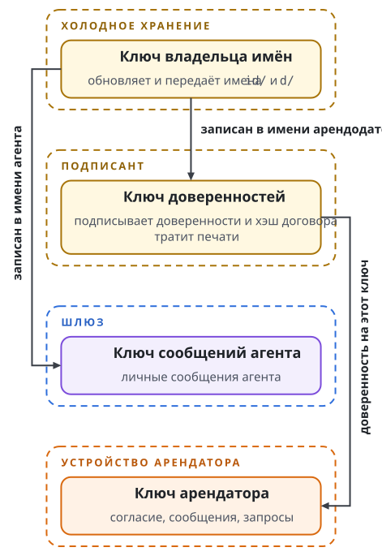

# Ключи

Кража одного ключа не должна отдавать вору всё. Поэтому в аренде у каждой роли свой ключ: один владеет именем, другой подписывает доверенности, третий оплачивает комиссии, четвёртый принимает сообщения. У каждого ключа назван держатель, то, что он подписывает, и то, что ломает его кража. Глава даёт карту ключей, правила их замены и восстановление личности.

## Почему ключ не один

Подписывать всё одним ключом из цепочки нельзя по трём причинам.

Первая причина в риске. Ключ, который владеет именем, управляет всеми привязками участника. Если он лежит на телефоне и подписывает каждое сообщение, украденный телефон отдаёт личность целиком.

Вторая причина в совместимости. Namecoin использует кривую secp256k1. TLS 1.3 не определяет её как схему подписи сервера. Secure Enclave, аппаратное хранилище ключей в устройствах Apple, подписывает кривой P-256. Заменить криптографию в существующих протоколах нельзя, поэтому участник связывает с личностью родной ключ каждого протокола.

Третья причина в сроке жизни. Кривая когда-нибудь устареет, и система, привязанная к одному типу ключа, менялась бы целиком.

Поэтому корневой ключ подписывает только короткие заявления о других ключах. Такое заявление называется аттестацией: этот ключ принадлежит ноутбуку Алисы, он подписывает сообщения в Swarma Talk, срок его действия 90 дней. Проверяющий идёт по цепочке: имя ведёт к корневому ключу, корневой ключ подписал аттестацию, аттестация разрешает ключ устройства.

## Карта ключей

Карта описывает профиль аренды и сервис кошелька. Открытые ключи и закреплённые значения, которые называют пинами, доходят до проверяющих. Секретные части горячих ключей лежат у служб под отдельными пользователями ОС, вне учётки агента.

Ключи арендодателя:

| Ключ | Где лежит | Что подписывает | Как меняется | Что ломает кража |
| --- | --- | --- | --- | --- |
| Владелец имён | Холодное хранение | Обновление и передачу имён `id/` и `d/` | Передачей выхода имени на новый ключ; прежний ключ теряет управление | Увод имён и всех привязок |
| Ключ доверенностей | Подписант | Доверенность, хэш договора, трату печатей | Владелец имён записывает новый ключ в значение имени; проверяющие, которые видели прежний, закрывают старые доверенности. Старые печати тратит только старый ключ | Поддельные доверенности и трату печатей до смены ключа в имени |
| Ключ финансирования | Подписант | Комиссии и пополнение пула печатей; свой отдельный скрипт | Новый скрипт, перенос средств, сверка учёта | Кражу средств на комиссии. Печати этому ключу недоступны |
| Ключ поставщика | Служба бронирования | Хэш договора и пакет бронирования, событие вида 8182 | Новый пин; старые пакеты отклоняются | Поддельные предложения. Согласие арендатора и выдача проверяются отдельно |
| Ключ сообщений агента | Шлюз | Личные сообщения агента по NIP-17; открытая часть записана в `id/` и `d/` | Обновить значение имени, запись поиска и пины; адрес сообщений меняется | Чтение и подделку сообщений агента. Ключ доверенностей остаётся цел |

Ключи арендатора и сервисов:

| Ключ | Где лежит | Что подписывает | Как меняется | Что ломает кража |
| --- | --- | --- | --- | --- |
| Ключ арендатора | Устройство арендатора | Согласие, событие вида 8181; личные сообщения; он же `grantee_key` доверенности | Обновить контакты; старые доверенности отозвать и выдать заново | Подмену арендатора в пределах окна и бюджета доверенности |
| Ключ получателя разовой доверенности | Клиент получателя | Трату печати 1-of-2 с хэшем запроса | Отозвать доверенность, выдать новую с новой печатью | Сумму в печати. Действие ограничивают доверенность, запрос, окно и журнал сервиса |
| Денежные ключи кошелька | Namecoin Core за сервисом кошелька | Подписи транзакций через закрытый RPC | Новые адреса, перенос средств и доступа к RPC | Кражу средств кошелька |
| Ключ квитанций | Сервис кошелька | Квитанции, которые клиент проверяет по пину | Новые пины и перенос состояния; старый журнал с новым ключом не открывается | Поддельные квитанции. Денег этот ключ не тратит |
| Токен доступа к модели | Прокси модели выдаёт слоту | Ничего: предъявляется как секрет в окне слота | Отзыв привязки; новый слот получает новый токен | Доступ к модели, ограниченный отзывом, окном и пределами слота |
| Транспортные ключи | Конечные службы | Пины сертификатов TLS, взаимный TLS шлюза и менеджера слотов, HMAC канала | Новые сертификаты и пины; старые пины дают отказ | Подмену соседней службы. Доверенность проверяется отдельно |

Путь полномочий связывает эти ключи так:

```text
холодный ключ -> id/ арендодателя -> ключ доверенностей
              -> id/ агента       -> ключ сообщений у шлюза
              -> d/               -> только поиск
арендатор  -> согласие + договор <- поставщик
ключ доверенностей -> доверенность -> печать P2PKH -> допуск в сервисах
ключ доверенностей -> трата печати -> закрытие
финансирование     -> комиссии + пул печатей
получатель         -> запрос + трата печати 1-of-2 -> кошелёк
кошелёк            -> квитанция (ключ сервиса)
слот               -> токен -> прокси модели (окно и пределы)
```

Рисунок показывает четыре ключа, на которых держится допуск арендатора, и их держателей.

{.tall}

Печать P2PKH и печать 1-of-2 принадлежат разным видам доверенности: многократной и разовой. Прокси модели хранит секрет API поставщика модели у себя, слот получает только токен. Три кражи обходят программные пределы сервисов: кража секрета API обходит пределы слота; кража секретной части ключа доверенностей обходит потолки подписанта; кража денежного ключа или доступа к RPC обходит бюджет кошелька.

## Ключ доверенностей и личный ключ

Ключ доверенностей арендодателя и его личный ключ Nostr имеют один тип, и разборщик значения имени допускает их равенство. Развёртывание держит их раздельными.

Причина в том, где лежит каждый ключ. Доверенность выдаётся сразу после подтверждённой оплаты, без человека, поэтому ключ доверенностей лежит горячим у подписанта. Личный ключ лежит на устройстве владельца. Если подписанта взломали, вор получает ключ доверенностей и не получает личную переписку и социальную личность владельца. Владелец исправляет положение одним обновлением имени: записывает новый ключ доверенностей холодным ключом.

Ключ владельца имён по той же причине отделён от обоих. Он нужен редко: при смене ключей в значении и при продлении имени. Продление остаётся осознанной процедурой на устройстве, где лежит холодный ключ.

## Подписант

Подписант это служба арендодателя, которая держит ключ доверенностей и ключ финансирования и составляет ровно три вида транзакций: выдачу доверенности, отзыв и пополнение пула печатей. Произвольной подписи, исполнения команд и продления имён у неё нет.

Подписант работает под собственным пользователем ОС, со своим каталогом состояния и своей нодой Namecoin, на машине, где нет агентов. Агент, даже взломанный, не достаёт до файлов ключей, а взлом машины с агентами не отдаёт ключ доверенностей. Оплату подписант перепроверяет сам на ноде монеты и не полагается на сообщение службы бронирования.

Журнал подписанта хранит каждую операцию и её стадию: резерв, подготовка, отметка перед подписью, подпись, отправка, запись в хранилище. Отметка перед подписью записывается на диск до первой подписи транзакции. Если после сбоя подписанных байтов нет, вторая подпись запрещена навсегда: так один сбой не создаёт двух транзакций на одну печать.

По тому же журналу подписант считает потолки оператора. Он ограничивает сумму, перемещённую одной транзакцией и за сутки, остаток на горячем кошельке, число выдач за час и за сутки и сумму бюджетов в выданных доверенностях за час и за сутки. Операция с неясным исходом остаётся учтённой и после смены окна. Потолки заданы в конфигурации подписанта; у основной сети значений по умолчанию нет, без явных потолков подписант не запускается.

Отзыв приходит к подписанту из двух источников: служба бронирования сообщает, что платёж откатился вместе с блоком, а оператор подаёт отзыв через отдельный закрытый вход. Повтор того же отзыва возвращает ту же транзакцию.

## Замена ключей

Замену ключа выполняет оператор; протокол не переносит пины и журналы сам. Правила такие.

Смена ключа доверенностей идёт через имя. Подтверждённое поколение имени с другим ключом доверенностей закрывает доверенности, подписанные старым ключом, у каждого проверяющего, который видел прежнее поколение. Смена, которая находится только в мемпуле, даёт отказ без закрытия. Возврат к старому ключу закрытую доверенность не открывает. Смена ключа доверенностей служит аварийным тормозом при утечке горячего ключа.

Проверяющий, который видит имя впервые, не может доказать смену ключа с последующим возвратом, которой он не наблюдал. Поэтому состояние наблюдений переживает перезапуск, и удалять его нельзя.

Смена ключа сообщений агента доверенностей не отзывает: меняется адрес, полномочия остаются.

В доверенности версии 4 замена ключей связана с выходом имени. Любая операция с именем выдавшего, в том числе продление тем же ключом, закрывает доверенности, выданные на прежний выход имени. Оператор после такой операции обновляет указатель агента и закреплённые значения проверяющих и выдаёт доверенности заново с новым согласием. Имя получателя устроено иначе: продление и смена ключа канала тем же владельцем доверенность сохраняют. У каждой печати версии 4 свой ключ, выведенный отдельно; правила вывода, хранения и восстановления таких ключей задаёт профиль.

Подписант и кошелёк при изменении закреплённых ключей отказываются открывать старый журнал. Журналы при замене сохраняют: удаление состояния не возвращает израсходованного права и не отменяет выполненных действий.

## Устройства и восстановление

Устройство получает собственный ключ с аттестацией корневого ключа. Если Алиса теряет ноутбук, она отзывает его аттестацию с другого устройства или корневым ключом, и ключ ноутбука перестаёт приниматься. То, что устройство успело получить до отзыва, отозвать нельзя.

Если потеряно всё, остаётся сид. Алиса вводит его на новом устройстве и получает свои ключи обратно. Клиент находит её имена по сохранённому описанию восстановления: в нём указаны правила вывода ключей и границы поиска, которых сам сид не задаёт.

Сид возвращает только то, что вычисляется из него или записано в цепочке. Контакты, договорённости и переписку возвращают зашифрованные копии на узлах хранения, которым посвящена книга о Swarma Talk. Хэш в цепочке подтверждает файл и не хранит его. Поэтому Алиса заранее проверяет две вещи: сид записан, и у важных данных есть хотя бы две копии у разных провайдеров.
