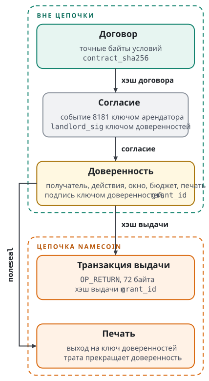
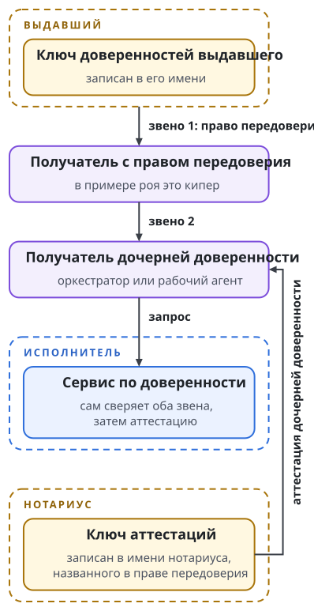

# Доверенность

Сервису предъявили файл и запрос. Сервис должен решить пять вещей: кто разрешил действие, кому, какое, до какого момента и действует ли разрешение сейчас. На первые четыре вопроса отвечает подписанный документ, на пятый отвечает цепочка. Глава разбирает документ, его подпись, транзакцию выдачи, печать и проверку на одном открытом примере доверенности версии 3. Затем она описывает версию 4, которая меняет подписанные данные.

Пример взят из набора проверочных данных стенда спецификации: каталог `experiments/rental/testdata/grant-v3` репозитория `swarma-chain-lab`. Набор собран для сети regtest, его ключи это общеизвестные тестовые точки кривой, а идентификаторы транзакций синтетические. Каждое значение ниже читатель может пересчитать из файлов набора.

## Документ

Доверенность это объект JSON с полями в точном порядке. Подписываются компактные байты без пробелов и перевода строки. В примере это файл `grant.json` длиной 1446 байт. Его поля, с сокращёнными длинными значениями:

```text
version          3
network          regtest
genesis          0f9188f1…466e2206
agent_name       id/test-agent
landlord_name    id/test-landlord
issuer_key       79be667e…16f81798
grantee_key      c6047f94…5c709ee5
contract_sha256  a4bcd58b…0b3b97ef
scope            ["names.register","pay"]
not_before       100
not_after        1000
seal             txid a85db442…b838c04d, vout 0
consent          contract_sha256, consent_event, landlord_sig
```

Каждое поле значит следующее.

| Поле | Значение |
| ------- | --------------------- |
| `version` | Число 3. Другие версии проверяющий по этому профилю отклоняет. |
| `network`, `genesis` | Имя сети и хэш блока генезиса. Проверяющий сравнивает их со своими закреплёнными значениями. |
| `agent_name` | Имя агента, к которому относится доверенность. |
| `landlord_name` | Имя выдавшего. Значение имени агента должно указывать на это имя. |
| `issuer_key` | Ключ доверенностей выдавшего. Он должен совпадать с ключом в значении имени выдавшего. |
| `grantee_key` | Ключ получателя: 32 байта в форме BIP-340. Отправитель запроса должен совпадать с этим ключом. |
| `grantee_name` | Необязательное имя получателя в Namecoin. |
| `contract_sha256` | Хэш точных байтов договора. |
| `scope` | Разрешённые действия. |
| `not_before`, `not_after` | Окно в секундах Unix. Начало включено, конец исключён. |
| `seal` | Печать: идентификатор транзакции и номер выхода. |
| `budget` | Необязательный бюджет. Отсутствующий бюджет означает нулевой. |
| `consent` | Согласие сторон с договором; разобрано в главе "Договор и согласие". |

Имена полей `landlord_name`, `landlord_sig` и `agent_name` остались от аренды, для которой версия 3 создавалась: в аренде доверенность выдаёт арендодатель. Байты этих имён не меняются. Поле `landlord_sig` лежит в согласии и несёт подпись выдавшего на хэше договора, а имя исполнителя в версии 3 лежит в поле `agent_name`. Версия 4 называет стороны по ролям: выдавший, получатель, исполнитель.

Действия в `scope` это упорядоченный набор без повторов из закрытого словаря: `deliver`, `names.register`, `pay`, `publish`, `repository.push`, `secret.release`. Подстановочных знаков и сопоставления по префиксу нет. Действие `deliver` разрешает обращаться к агенту, `pay` разрешает платёж. Слово в словаре не создаёт исполнителя: цель, сумму и остальные условия запроса проверяет сервис, который исполняет действие.

В версии 3 предел один: `budget`, бюджет в атомарных единицах NMC. Остальные пределы аренды лежат в договоре, и доверенность ссылается на них хэшем договора. Поле `grantee_name` в версии 3 служит справкой: проверяющий сверяет написание имени и ничего по нему не ищет. Пределы по видам, названного исполнителя и получателя по имени вводит версия 4; она разобрана в разделе "Версия 4".

## Подпись

Доверенность подписывает ключ доверенностей выдавшего по схеме BIP-340. Подписывается 32-байтовый хэш:

```text
SHA-256( ASCII("swarma-grant-v3") || байты grant.json )
```

Метка `swarma-grant-v3` занимает 15 байт. Между меткой и документом нет ни нулевого байта, ни длины, ни разделителя. Метка отделяет подпись доверенности от подписи любого другого объекта тем же ключом. Подпись под хэшем без метки отклоняется. В примере подписываемый хэш равен `0a258a8d1bfe143662a9c83186be1b657e9316fcbe70a8f99564d5c6d39ce420`.

Подписанная доверенность это объект из двух членов, документа и подписи:

```text
{"grant":{…},"signature":"34b95601…9b69a405"}
```

Идентификатор доверенности `grant_id` равен SHA-256 точных байтов этого объекта. В примере объект лежит в файле `signed-grant.json` длиной 1599 байт, и его идентификатор:

```text
d405189b73164fc32c0051538550c1c0b45d6791bc3548b6679a08416c847046
```

Получателю и сервисам доверенность передаётся в виде предъявления. Предъявление состоит из подписанной доверенности и идентификатора транзакции выдачи:

```text
{"signed_grant":{…},"issuance":{"txid":"9f8519ba…5214186e"}}
```

Член `issuance` не подписан и в `grant_id` не входит. Он подсказывает, где искать транзакцию выдачи; проверяющий загружает её со своей ноды и сам связывает с доверенностью. Поэтому идентификатор доверенности не зависит от транзакции, которая эту доверенность закрепляет.

## Зачем подпись, если есть запись в цепочке

Запись в цепочке и подпись отвечают на разные вопросы. Транзакция выдачи показывает, что именно закреплено и к какому блоку. Кто разрешил, она не показывает: её входы оплачивает ключ финансирования, и ключ доверенностей в ней не участвует. Подпись ключом из имени выдавшего доказывает, что доверенность выдал он.

Подпись даёт и второе свойство. Содержимое доверенности проверяется без сети, от кого бы ни пришёл файл: из хранилища, от получателя или от шлюза.

Третья подпись принадлежит получателю. Доверенность говорит, кто вправе действовать; она не доказывает, что данный запрос отправил именно этот участник. Доверенность видят хранилище, шлюз и любой, кому её показали. Поэтому каждый запрос к сервису подписан ключом получателя, и сервис сверяет этот ключ с `grantee_key`. Подпись запроса разобрана в главе "Сервисы по доверенности".

## Выдача

Выдача закрепляет в цепочке один 32-байтовый хэш. Хэш выдачи связывает договор, согласие получателя, подпись выдавшего на договоре и подписанную доверенность:

```text
SHA-256(
  ASCII("swarma-issue-v1")     15 байт
  || contract_sha256           32 байта
  || consent_event.id          32 байта
  || consent_event.sig         64 байта
  || landlord_sig              64 байта
  || grant_id                  32 байта
)
```

Склеиваются декодированные байты, без длин и разделителей: всего 239 байт. Шестнадцатеричная запись хэша в документе сначала декодируется; 64 знака текста не заменяют 32 байта. В примере хэш выдачи:

```text
5615370d11bd7420d6280488cd33b47e5c850c006011b534ec5f2bff37635a7f
```

Транзакция выдачи несёт этот хэш в единственном выходе `OP_RETURN` с нулевой суммой. Скрипт выхода занимает 72 байта. В примере:

```text
6a03534c014201
5615370d11bd7420d6280488cd33b47e5c850c006011b534ec5f2bff37635a7f
01
d405189b73164fc32c0051538550c1c0b45d6791bc3548b6679a08416c847046
```

Первая строка это служебные байты, вторая хэш выдачи, третья тип указателя, четвёртая `grant_id`. Раскладка по смещениям такая.

| Смещение | Байты | Значение |
| ----: | -------- | ---------------------- |
| 0 | `6a` | `OP_RETURN` |
| 1 | `03` | Положить следующие 3 байта |
| 2–3 | `53 4c` | Протокол `SL`, Swarma Link |
| 4 | `01` | Действие: выдача доверенности |
| 5 | `42` | Положить следующие 66 байт |
| 6 | `01` | Версия содержимого |
| 7–38 | 32 байта | Хэш выдачи |
| 39 | `01` | Где лежит доверенность: хранилище с адресацией по SHA-256 |
| 40–71 | 32 байта | `grant_id` |

Правила записи жёсткие. Проверяющий считает все выходы `OP_RETURN` транзакции и отказывает, если их больше одного. Он отказывает при другом порядке, лишнем элементе, записи через `OP_PUSHDATA1`, неизвестном действии, версии или типе указателя, неверной длине и ненулевой сумме. Указатель обязан равняться `grant_id` предъявленной доверенности. Печать не должна быть входом транзакции выдачи. Транзакция должна быть подтверждена в активной цепочке.

Проверяющий принимает ещё одну, раннюю форму: 34 байта, `6a 20` и хэш выдачи без указателя. Форму определяет точный вид скрипта. Повреждённая 72-байтовая запись не становится ранней.

Размер ограничивает правило пересылки: ноды Namecoin Core 28 пересылают выход `OP_RETURN` со скриптом не длиннее 83 байт. Это настройка нод, не консенсус.

Формат указателя общий для будущих записей. Тип `00` означает отсутствие указателя, `01` хранилище с адресацией по SHA-256, `02` BitTorrent v2, `03` BitTorrent v1, `04` отдельную сеть BitTorrent. Выдача доверенности принимает только действие `01` с типом `01`. Указатель не называет сервер, а разбор записи ничего не скачивает и права не даёт.

Хэш выдачи показывает, что связка из договора, подписей и доверенности существовала к блоку выдачи. Самих документов он не хранит: потерянный файл по хэшу не восстановить.

Рисунок собирает связи документов: какое значение каждая запись берёт из предыдущей.

{.tall}

## Печать и пул

Печать многократной доверенности это подтверждённый выход P2PKH на ключ доверенностей выдавшего. Ключ берётся в сжатой форме с чётной координатой y. В примере ключу `79be667e…16f81798` соответствует скрипт печати:

```text
76a914751e76e8199196d454941c45d1b3a323f1433bd688ac
```

Один секрет подписывает двумя схемами: доверенность по BIP-340, трату печати подписью ECDSA. Версия 4 от этого уходит; причина дана в разделе "Ключ на каждую печать".

Такую печать может потратить только выдавший, поэтому её можно создать задолго до выдачи. Подписант держит пул: одна транзакция пополнения создаёт несколько выходов-печатей, и при выдаче подписант берёт готовую. Печать разовой доверенности устроена иначе: её вправе потратить выдавший или получатель, скрипт включает ключ получателя, и создать её можно только тогда, когда получатель известен. Разовая доверенность разобрана в главе "Сервисы по доверенности". Пополнение пула и отзыв подписывают разные ключи:

```text
ключ финансирования
  +-> пополнение пула
        +-> печать 1 -> резерв в журнале -> доверенность 1
        +-> печать 2 -> резерв в журнале -> доверенность 2
        +-> сдача на скрипт финансирования

ключ доверенностей
  +-> трата выбранной печати -> отзыв её доверенности
        +-> сдача на скрипт финансирования
```

Правил пула три.

Одна печать служит одной доверенности за всё время. Подписант записывает бронь и печать в журнал до первой подписи. Сбой после записи оставляет отказ с неясным исходом и не даёт подписать вторую доверенность на ту же печать. Повтор завершённой выдачи возвращает сохранённые байты и не продлевает окно.

Финансирование никогда не использует выходы на скрипт печатей, даже если такого выхода нет в списке пула. Комиссии, сдача и пополнение идут через отдельный скрипт финансирования. Иначе обычный выбор монет потратил бы чужую печать и отозвал действующую доверенность.

После `not_after` доверенность заканчивается без транзакции. Монеты из истёкших печатей выдавший собирает позже; такая трата ничего не меняет для проверяющего.

Печати видны всем. В версии 3 все печати выдавшего платят на один адрес, выведенный из ключа доверенностей, поэтому число его доверенностей и моменты досрочных отзывов публичны. Версия 4 даёт каждой печати свой ключ. Ключ получателя в цепочку не попадает: в ней лежит только хэш выдачи.

## Проверка

Проверяющий заранее закрепляет пять значений: сеть, хэш генезиса, имя агента, имя выдавшего и скрипт печати. Из предъявления он их не берёт. Проверка идёт на собственной ноде и даёт один из трёх вердиктов: допуск, ожидание или отказ. Часть отказов записывает закрытие, постоянный отказ по этой доверенности.

| Шаг | Что проверяется | Исход при нарушении |
| -: | -------------------- | ---------------- |
| 1 | Сеть, генезис и оба имени в доверенности равны закреплённым | Отказ `GRANT_POLICY` |
| 2 | Отправитель запроса равен `grantee_key` | Отказ `GRANTEE_MISMATCH` |
| 3 | Скрипт P2PKH от `issuer_key` равен закреплённому скрипту печати | Отказ `SEAL_KEY_BINDING` |
| 4 | Согласие создано не позже момента проверки | Отказ `CONSENT_FUTURE` |
| 5 | Окно: момент проверки не раньше `not_before` и раньше `not_after` | Ожидание `NOT_YET_VALID` или отказ `EXPIRED` |
| 6 | Имя агента указывает на выдавшего из доверенности | Отказ `AGENT_LANDLORD_MISMATCH` или закрытие `AGENT_LANDLORD_CHANGED` |
| 7 | Ключ доверенностей в имени выдавшего равен `issuer_key` | Отказ `LANDLORD_KEY_MISMATCH` или закрытие `LANDLORD_KEY_ROTATED` |
| 8 | Транзакция выдачи подтверждена, не тратит печать и несёт верный хэш выдачи | Ожидание `ISSUANCE_UNCONFIRMED`; отказ `ISSUANCE_SPENDS_SEAL`, `ISSUANCE_COMMITMENT` |
| 9 | Печать подтверждена, существует и платит на скрипт печати | Ожидание `SEAL_UNCONFIRMED`; отказ `SEAL_OUTPUT`, `SEAL_BINDING` |
| 10 | Печать не потрачена ни в блоке, ни в мемпуле | Закрытие `SEAL_SPENT` |
| 11 | Имена, вершина цепочки и мемпул не изменились за время проверки | Отказ `NAME_CHANGED`, `MEMPOOL_CHANGED` |

Три подписи проверяются при разборе предъявления, до первого шага. Неверная подпись доверенности даёт отказ `GRANT_SIGNATURE`, неверное событие согласия даёт `RENTER_CONSENT_EVENT` или `RENTER_CONSENT_BINDING`, неверная подпись выдавшего на хэше договора даёт `LANDLORD_CONSENT_SIGNATURE`. В конце проверяющий сверяет окно ещё раз с учётом времени, которое заняла сама проверка.

Различие между отказом и закрытием в шагах 6 и 7 зависит от того, что проверяющий видел раньше. Несовпадение при первом наблюдении даёт отказ: проверяющий не знает, было ли значение другим. Закрытие записывается, когда проверяющий раньше видел подходящее поколение имени, блок того поколения остаётся в активной цепочке, а новое поколение не старше прежнего.

Проверяющий помнит, какую доверенность он видел на каждой печати. Вторая доверенность на ту же печать получает отказ `SEAL_ALREADY_SEEN`.

Проверка повторяется при каждом использовании. Сервис может хранить байты предъявления, чтобы получатель не присылал их каждый раз; хранение не даёт полномочий, и каждое действие проходит проверку заново. Недоступная нода даёт отказ `NODE_UNAVAILABLE`: потеря связи не превращается в разрешение.

## Что цепочка говорит о времени

Запись в цепочке ограничивает время только с одной стороны. Подтверждённая транзакция выдачи доказывает, что доверенность существовала к её блоку. Раньше этого блока сервисы её не допускают: до подтверждения проверка даёт ожидание.

Подтверждение печати времени подписи не ограничивает. Идентификатор транзакции известен до её отправки в сеть, поэтому доверенность, которая называет печать, можно подписать раньше, чем печать попала в блок. Проверяющий по профилю доверенностей без закрепления отклоняет доверенность, у которой `not_before` раньше времени блока печати. Это правило приёма; времени подписи оно не доказывает.

Нижнюю границу времени подписи даёт только значение, которого раньше не существовало. Версия 4 для этого включает в подписанную доверенность хэш недавнего блока. Проверяющий убеждается, что блок лежит в выбранной цепочке и достаточно свеж по правилу профиля. Так доверенность связана со знанием хэша этого блока: подписать её раньше появления блока нельзя. Точного времени подписи по часам хэш блока не доказывает.

## Версия 4

Версия 3 оставляет три пробела. Пределы аренды, кроме бюджета в монетах, сервис видит только вместе с текстом договора. Проверяющий, который видит имя выдавшего впервые, не замечает смену ключа с возвратом к прежнему. Один бюджет можно предъявить двум сервисам одного типа, и каждый потратит его целиком. Версия 4 закрывает эти пробелы изменениями в подписанных данных. Её описывает предложение LIP-0008; смысл полей в нём задан, а точные байты, домены подписи и кодирование доказательств в нём не заданы. Байты версии 3 как версия 4 не читаются, и сервис, который версии 4 не знает, отказывает.

Шесть разделов ниже описывают поправки к LIP-0008: имя выдавшего, получатель по ключу и по имени, окно в высотах блоков, вывод ключей печатей, подтверждение ключа печати и проверку траты печати до выдачи. Все они проекты спецификации; их состояние дано в главе "Где мы".

### Пределы по видам

Подписанная область полномочий содержит пределы с типом. У каждого предела названы исполнитель, ресурс, единица, период и правило сложения. Виды первого набора такие.

| Вид предела | Что он ограничивает |
| --- | --- |
| Монеты | Актив и сеть, атомарную единицу, разрешённых получателей и общий расход вместе с комиссиями. Цена аренды и право тратить это разные условия. |
| Запросы к модели | Выбранный сервис и модель и наибольшее число принятых запросов в окне. |
| Токены модели | Отдельные суммарные потолки входных и выходных токенов по правилам учёта этой модели. |
| Стоимость модели | Суммарный потолок стоимости с точной валютой и масштабом и правило цены или резерва, по которому она считается. |
| Наибольшая длина ответа | Наибольшее число выходных токенов на один запрос. Длина ответа по умолчанию тоже подписана и не превышает ни этот предел, ни остаток суммарного. |
| Требуемая глубина подтверждений | Наименьшую глубину в активной цепочке для названного свидетельства. Это нижняя граница; расхода она не ограничивает. |

Значение по умолчанию выбирает расход внутри подписанного предела и недостающего права не создаёт. Отсутствующий обязательный предел, неизвестный вид, повторённый или противоречивый предел и неподдержанная единица дают отказ: неограниченным доступом они не становятся. Нулевой предел расхода расхода не разрешает. Новые виды пределов и правила их учёта вводятся отдельными предложениями.

Договор повторяет все пределы доверенности: исполнителя, вид, ресурс, единицу и величину. Несовпадение даёт отказ. Конфигурация оператора может задать более низкий общий потолок или отказать в обслуживании; увеличить предел аренды или заменить предел, которого нет в доверенности, она не может. Принятый запрос помещается и в подписанные пределы, и в потолки оператора.

Для глубины подтверждений действует наибольшее из двух значений: минимума, подписанного выдавшим, и минимума оператора. Конфигурация не снижает минимум выдавшего.

### Исполнитель

Тип сервиса выбирает интерфейс и исполнителя не называет. Версия 4 называет исполнителя прямо: имя сервиса в Namecoin и его открытый ключ. Предел принадлежит этому исполнителю.

Если исполнителей несколько, доверенность делит ресурс между ними явными долями. Доли одного ресурса в сумме не превышают согласованного общего предела. Исполнитель не занимает остаток чужой доли.

Разовый запрос включает своего исполнителя в подписанные данные до траты печати. Другой сервис отклоняет такой запрос, даже если тип, действие и параметры совпадают.

Копии одного исполнителя ведут один общий журнал запросов, резервов и остатка. Раздельные журналы копий одного бюджета не удерживают. Если общий журнал недоступен, копии не допускают новых действий.

### Имя выдавшего: регистрация и ключ владельца

Доверенность версии 4 записывает три значения об имени выдавшего: само имя, его регистрацию и ключ владельца. Регистрация названа транзакцией и выходом, которыми имя было зарегистрировано. Указатель в имени агента и закреплённые значения проверяющего называют ту же регистрацию и тот же ключ.

Доверенность действует, если обновления имени не меняли ни владельца, ни член `swarma`. Проверяющий убеждается в этом по истории имени. Каждая операция с именем тратит предыдущий выход имени, поэтому транзакции имени образуют одну цепочку. Проверяющий идёт по ней назад от текущего выхода через индекс транзакций своей ноды и проверяет два условия. История доходит до записанной регистрации. На участке от недавнего блока, хэш которого записан в доверенности, до текущего выхода владелец имени равен записанному ключу, а член `swarma` тот же, с тем же ключом доверенностей.

| Что произошло с именем выдавшего | Что с доверенностью |
| -------------------- | ---------------- |
| Продление, обновление члена `nostr` или собственных данных владельца | Действует |
| Передача имени другому ключу | Отказ в цепочке, которая содержит передачу |
| Смена ключа доверенностей, в том числе с возвратом к прежнему | Отказ в цепочке, которая содержит смену; возврат к прежнему ключу доверенность не восстанавливает |
| Имя истекло и зарегистрировано заново, даже тем же ключом | Отказ: история не доходит до записанной регистрации |

Нарушение видит и тот проверяющий, который начал работать только что: оно записано в истории имени, и журнал закрытий другого проверяющего для этого не нужен. Ответ зависит только от активной цепочки. Проверяющий вычисляет его при каждой проверке и в журнал закрытий не записывает.

Отсюда следует случай реорганизации. Смена ключа попала в блок, и проверяющий отказал. Затем реорганизация заменила этот блок, и в новой цепочке смены нет. Доверенность снова проходит проверку, и ответ одинаков у проверяющего, который видел смену, и у того, который начал работать после реорганизации. Отказ, который действовал до реорганизации, остаётся отказом за то время. Трата печати устроена иначе: трату печати выдавшим, замеченную в мемпуле, проверяющий записывает в журнал, и реорганизация её не отменяет.

Прекратить одну доверенность досрочно можно только тратой её печати. Правило об имени прекращает все доверенности выдавшего, имя которого сменило владельца или ключ доверенностей.

Цена правила в индексе транзакций на ноде проверяющего и в одном чтении транзакции на каждую операцию с именем. Проверяющий без полной ноды должен получить доказательство каждого шага истории. Точку, с которой начинается проверяемый участок, отказ проверяющего, которому история недоступна, и ответ после реорганизации выбрала поправка к LIP-0008; владелец их не называл.

Правило заменило прежнее предложение, по которому доверенность называла точный выход имени и закрывалась при любой операции с именем, включая продление.

### Передоверие и дочерние доверенности

Агент выдаёт доверенность другому агенту, только если сам держит доверенность с правом передоверия, и дочерняя доверенность не бывает шире родительской. Дочерние доверенности входят в протокол. Обычное право на действие права передоверия не содержит, и управление агентами его не даёт.

Право передоверия записано в родительской доверенности: на какой ресурс, каким получателям, с какими действиями, пределами и сроком её получатель вправе выдавать дочерние доверенности. Спецификация называет его issuance capability.

Предложение LIP-0014 записывает право передоверия семью полями, и каждое из них проверяющий сверяет сам: глубина со значениями ноль и один, где ноль значит без права передоверия, а дочерняя доверенность несёт ноль; действия, которые можно передать; имена агентов и ключи получателей, которым можно выдать дочернюю доверенность; бюджет передоверия; наибольшее число дочерних доверенностей; имена нотариусов. Право передоверия без нотариуса недействительно. Бюджет передоверия отделён от собственного бюджета доверенности: выдавший рискует их суммой, а дочерние доверенности вместе получают не больше бюджета передоверия.

Доверенность агенту выдаётся одним из двух способов. Оба входят в протокол.

| Вопрос | Способ А: передоверие | Способ Б: всё выдаёт подписант оператора |
| ------ | ---------------- | ---------------- |
| Кто подписывает доверенность агенту | В версии 4 агент с правом передоверия, своим ключом. В версии 3 подписант оператора по подписанной просьбе этого агента | Подписант оператора, ключом доверенностей |
| Путь полномочий | Два звена: оператор, агент с правом передоверия, получатель | Одно звено |
| Что это даёт | В версии 4 доверенность выдаётся там, где ставится задача, и ключ доверенностей оператора в каждой выдаче не участвует. В версии 3 каждую дочернюю доверенность подписывает подписант оператора, и этого выигрыша нет; остаётся связь с родительской доверенностью: дочерняя не шире её и закрывается вместе с ней | Одна подпись и одно звено проверки; прав не создаёт никто, кроме оператора |
| Чем за это платят | Проверяющий сверяет оба звена при каждом запросе. Каждую дочернюю доверенность заверяет нотариус: это его работа, одна запись закрепления и одна печать на каждую аттестацию | Каждая доверенность проходит через подписанта оператора, и рост роя упирается в него |
| Где применять | Большие рои: основной способ | Простые системы и самые чувствительные ресурсы |

Путь полномочий считается в звеньях. Доверенность выдавшего получателю это одно звено. Доверенность с правом передоверия и дочерняя доверенность это два звена. Третье звено, повтор и цикл дают отказ. Ресурс вдоль пути один и тот же. Дочерняя доверенность называет идентификатор родительской, и другой путь её не заменяет. Выдавший дочерней доверенности должен быть получателем родительской: проверяющий сверяет ключ, которым подписана дочерняя доверенность, с получателем родительской, и одного идентификатора для этого мало. В версии 3 дочернюю доверенность подписывает ключ доверенностей оператора, и с получателем родительской проверяющий сверяет ключ, которым подписана просьба о ней. Каждое звено проходит проверку заново при каждом запросе; закрытый или недействительный предок даёт отказ потомку. У дочерней доверенности своя печать и своя запись выдачи. Отзывая родительскую доверенность в версии 3, подписант одной транзакцией тратит её печать и печати всех дочерних: проверяющий версии 3, который не читает ссылку на родительскую доверенность, иначе не увидел бы закрытия.

{.tall}

Правило "не шире" проверяется по-разному для двух видов условий. Исчисляемые условия записаны в самой доверенности: набор действий, пределы, бюджеты, число запросов и токенов, срок. Их проверяющий сверяет сам: набор действий дочерней доверенности не шире родительского, каждое её значение не больше родительского. Условие, смысла которого проверяющий не знает, даёт отказ. Сверяется и сам запрос: он проходит условия каждого звена. Расход всех потомков вместе помещается в предел предка, и считает его один исполнитель в одном журнале. Когда дочерние доверенности исполняют разные исполнители, общего журнала у них нет. Для этого случая дочерние доверенности получают доли из отдельного бюджета передоверия, и долю каждой считает её исполнитель.

Условия, записанные словами, программа не сверяет. Родительский договор разрешает "работу над проектом", дочерний разрешает "работу над проектом и его зависимостями": шире ли второе, проверяющий не вычислит. Для таких условий нужен отдельный механизм: собственная проверка проверяющего никогда не устанавливает, что словесные условия дочерней доверенности лежат в пределах родительской. Сверяет их нотариус: он сравнивает дочернюю доверенность с родительской и заверяет, что она её не превышает. Нотариус описан в главе "Договор и согласие", раздел "Нотариус и арбитр".

Нотариус заверяет каждую дочернюю доверенность, записана её область словами или нет. Дочерняя доверенность без действующей аттестации нотариуса получает отказ "не заверена", даже если все её исчисляемые условия в порядке. Правило не спрашивает, записана ли область словами: ответ на этот вопрос сам требует суждения, и общее правило его снимает.

Заверение не заменяет проверку. Проверяющий сам сверяет всё, что можно сверить: ссылку на родительскую доверенность, глубину, действия, пределы, бюджет, срок и состояние каждого звена на своей ноде. Только после этого он смотрит аттестацию. Дочерняя доверенность, которая шире родительской в исчисляемом условии, получает отказ по этому условию и с безупречной аттестацией. Поэтому украденный ключ нотариуса не расширяет ни одного предела дочерней доверенности: вор заверит лишние слова, а действий, бюджета и срока ей не прибавит. Сумму долей всех дочерних доверенностей проверяющий не видит: её держит счёт подписанта при выдаче.

Передоверие вводится через два режима из предложения LIP-0013 о доверии между собственными агентами на доверенности версии 3. В режиме наблюдения исполнитель проходит все шаги проверки и сообщает результат своему владельцу, а полномочий сообщение другого агента не получает. Режим допуска включается после первой проверки в основной сети и решения обоих владельцев, а для дочерних доверенностей каждый владелец включает его отдельным решением. На первом этапе передаются право ставить задачи, право ревью и право включать изменения; право тратить не передаётся.

Правила пути, сужения и учёта задаёт LIP-0008, раздел 12. Поля права передоверия, просьбу о дочерней доверенности, аттестацию и порядок проверки описывает предложение LIP-0014.

Пример двух звеньев даёт рой из главы "Рой: иерархия и полномочия". Оркестратор Алисы `id/alice-lead` обращается к прокси модели по дочерней доверенности, которую выдал кипер. Прокси модели проверяет её на собственной ноде:

| Шаг | Что проверяется |
| -: | ------------------------------ |
| 1 | Имя выдавшего `id/alice`, его регистрация и ключ владельца равны закреплённым; на участке истории имени от недавнего блока, хэш которого записан в доверенности, до текущего выхода ни владелец имени, ни член `swarma` не менялись. |
| 2 | Доверенность кипера несёт право передоверия для этого ресурса, а доверенность оркестратора ссылается на неё как на родительскую. |
| 3 | Получатель назван именем `id/alice-lead`: текущий владелец имени равен ключу, записанному в доверенности, а запрос подписан ключом из члена `nostr` этого имени. |
| 4 | Печати обеих доверенностей целы, транзакции выдачи подтверждены, высота вершины цепочки лежит в окнах обоих звеньев. |
| 5 | Исполнитель в доверенности и в запросе это сам прокси модели, по имени и ключу. |
| 6 | Доверенность оркестратора заверил нотариус, названный в праве передоверия кипера: аттестация подписана ключом из значения его имени, её закрепление подтверждено, печать нотариуса цела. Шаги с первого по пятый аттестация не заменяет. |
| 7 | Запрос помещается в пределы обоих звеньев и в потолки оператора. |

Те же два звена покрывают случай, когда задача идёт от оркестратора к рабочему агенту, а от него к его помощнику. Право передоверия тогда держит оркестратор. Первое звено: подписант оператора выдаёт оркестратору доверенность на право ставить задачи рабочему агенту. Второе звено: дочерняя доверенность даёт рабочему агенту право ставить задачи помощнику в пределах первой, и её заверяет нотариус. Помощник принимает задачу по той доверенности, которую предъявил рабочий агент. Дочерняя доверенность даёт рабочему агенту основание ровно для переданной работы; предъявить её вместо собственной, более широкой доверенности на того же помощника его ничто не заставляет.

### Получатель по ключу и по имени

Доверенность версии 4 называет получателя ровно одним из двух способов.

| | Получатель по ключу | Получатель по имени |
| ------ | ---------- | ---------- |
| Что подписано в доверенности | Ключ запросов | Точное имя Namecoin и открытый ключ владельца этого имени |
| Имя получателя в доверенности | Нет: в этом способе поля имени не существует | Есть, и оно служит источником истины |
| Ключ запросов | Тот, что записан в доверенности | Проверяющий читает его при каждом допуске из значения имени |
| Смена ключа запросов | Новая доверенность | Обновление имени тем же владельцем; доверенность остаётся |

Справочного имени в версии 4 нет. Поле `grantee_name` версии 3 проверяющий сверяет по написанию и в цепочке не читает. Такое имя может расходиться с ключом, и читатель доверенности не узнаёт, что имел в виду выдавший. Версия 4 этого поля не переносит: доверенность, в которой записаны и ключ запросов, и имя получателя, получает отказ, как и доверенность без обоих. Префикс имени условием допуска не служит.

У получателя по имени два ключа с разной работой. Ключ владельца управляет выходом имени. Он доказывает, какая сторона является получателем, в запросах ничего не подписывает и может лежать холодным. Ключ канала подписывает запросы и работает в сети. Потеря ключа канала стоит одного обновления имени; потеря ключа владельца означает потерю имени.

Ключ канала проверяющий берёт из того члена значения, который назван для канала связи. Для канала Nostr это ключ, который член `nostr` даёт для имени `_`: `nostr.names._` или строка с ключом. Запрос на этом канале подписан по BIP-340. Другому каналу нужен собственный профиль. Неизвестный канал и значение, которое не даёт ключа, получают отказ.

Пример показывает получателя Боба с именем `id/bob`. Доверенность называет имя и ключ его владельца, а ключ запросов записан в значении имени:

```text
доверенность, получатель по имени
  имя                   id/bob
  ключ владельца имени  ключ, который запирает выход имени id/bob

значение имени id/bob
  {"nostr":"c6047f9441ed7d6d3045406e95c07cd85c778e4b8cef3ca7abac09b95c709ee5"}
```

Строки показывают смысл записи: точные поля и байты версии 4 не заданы. Значение записано в решённой форме из главы "Личность и имена". Члена `swarma` в нём нет, потому что получатель доверенностей не выдаёт.

Проверяющий при допуске читает имя на своей ноде и доказывает, что текущий владелец имени равен записанному ключу. Затем он принимает запрос, подписанный ключом канала. Ключ и имя внутри доверенности разойтись не могут: в способе по имени ключа запросов в ней нет. Остаётся одно расхождение, между записанным ключом владельца и текущим владельцем имени. Оно даёт отказ и закрытия не записывает.

Смена ключа канала и продление имени тем же владельцем сохраняют доверенность. Ключ, убранный из имени, получает отказ; ключ, который владелец записал вместо него, действует по той же доверенности. Точный выход имени получателя в доверенность не записывается, поэтому сравнение владельца не доказывает передачу с возвратом, которой проверяющий не видел.

Адрес или ключ, записанный внутри значения имени, владения не доказывает. Владение доказывает условие траты выхода имени, и профиль должен связать с ним записанный ключ. Непонятное или неподдержанное доказательство даёт отказ.

### Окно в высотах блоков

Окно доверенности версии 3 задано в секундах Unix и сверяется с часами проверяющего. Версия 4 записывает окно двумя высотами блоков: начало включено, конец исключён. Проверяющий сравнивает их с высотой вершины цепочки, которую он проверил сам, в том же наблюдении, из которого берёт имена и печать. Часы в этом сравнении не участвуют, и запаса на расхождение часов нет. Окно не начинается ниже высоты недавнего блока, хэш которого записан в доверенности.

Причин три. Для окна проверяющему не нужны доверенные часы, и все проверяющие на одном состоянии цепочки получают одну высоту. Время в заголовке блока ставит майнер в пределах допусков консенсуса, а высоту он изменить не может. Остальные сроки доверенности уже считаются в блоках: глубина подтверждений, ссылка на недавний блок и срок жизни имени.

Цена в том, что у окна нет точной длины в часах. Блок появляется в среднем раз в десять минут. В замере одной ноды за 137,2 дня средний промежуток составил 9,88 минуты; замер разобран в главе "Отзыв и наблюдение цепочки". Окно в 12 960 блоков, по расчёту 90 дней, при таком среднем заняло бы около 89 дней. Начало и конец окна известны в блоках и только оцениваются в часах.

Когда блока долго нет, высота не растёт и окно не закрывается. Этот промежуток покрывают пороги возраста последнего блока: 60 минут для денежных и необратимых действий и 90 минут для остальных привилегированных. Возраст блока без часов не измерить, поэтому для этих порогов часы проверяющему нужны. Точную меру возраста и требования к часам спецификация оставляет открытыми.

Людям договор показывает приблизительные даты, вычисленные при выдаче: десять минут на каждый блок между вершиной в момент выдачи и названной высотой. Даты помечены как оценка и в допуске не участвуют. Сами высоты договор повторяет точно, как остальные пределы.

Запрос к сервису живёт секунды, меньше промежутка между блоками. Поэтому срок отдельного запроса остаётся подписанным временем по часам.

Одна доверенность покрывает весь срок найма: три месяца это около 13 000 блоков. Час внутри срока служит периодом предела и оплаты. Новый период не требует новой доверенности, и в цепочке на весь найм остаётся одна запись выдачи.

### Подписи по типам объектов

У каждого типа объекта своя метка подписи: доверенность, согласие с договором, подготовка выдачи, запрос, квитанция и подтверждение ключа печати подписываются в разных доменах. Подпись одного объекта нельзя предъявить как подпись другого.

Подписывающая служба принимает объект целиком, проверяет его тип и схему, приводит к каноническому виду и сама вычисляет хэш. Готовый хэш от вызывающего она не подписывает. Каноническим видом следующего формата служит JCS по RFC 8785; для сумм и счётчиков схема каждого поля выбирает либо целое в заданных границах, либо десятичную строку, чтобы разбор чисел ничего не округлил.

### Ключ на каждую печать

В версии 3 печать платит на ключ доверенностей, поэтому один секрет подписывает доверенности по BIP-340 и траты печатей подписью ECDSA. BIP-340 советует так не делать. Для подписей без свежей случайности он называет самой надёжной защитой отказ от одного секретного ключа в разных схемах подписи и приводит пример: детерминированные одноразовые числа RFC 6979 в обеих схемах раскрывают ключ. Версия 4 разделяет эти применения. У каждой печати свой ключ, а ключ доверенностей транзакций не подписывает.

Выдавший подписывает подтверждение ключа печати, которое связывает открытый ключ и скрипт печати с точным выходом и с доверенностью. Проверяющий сверяет это подтверждение по закреплённому ключу выдавшего до того, как принять печать. Откуда взят ключ печати, проверяющий не знает и не проверяет. Что названо в подтверждении и в каком порядке оно сверяется, описывает раздел "Подтверждение ключа печати".

Откуда берётся ключ, описывает поправка к LIP-0008. Она относится к печати многократной доверенности, которую вправе потратить только выдавший. Ключи таких печатей выводятся по BIP-32 в отдельном счёте сида подписанта, в котором других ключей нет. В Namecoin раскладку выбирает способ построения транзакций из следующего раздела:

| Способ | Скрипт печати многократной доверенности | Путь вывода в Namecoin |
| --- | ------ | -------------------- |
| W | P2WPKH | `m/84'/7'/<счёт печатей>'/0/<i>`, раскладка BIP-84 |
| L | P2PKH | `m/44'/7'/<счёт печатей>'/0/<i>`, раскладка BIP-44 |

Печать разовой доверенности в таблицу не входит. Её скрипт даёт две ветви, которые различает криптография: отзыв выдавшим и использование получателем. Выход на один ключ второй ветви не несёт. С разными ключами получатель не может его потратить, а с общим ключом две траты неразличимы. Скрипт такой печати в версии 4, подтверждение к нему и источник ключа выдавшего не определены. Требования способа W к входам транзакций от этого не меняются.

Число 7 это тип монеты Namecoin в реестре SLIP-0044; другая цепочка берёт свой тип монеты. `<i>` это номер печати. Номер не используется дважды: журнал подписанта записывает номер вместе с печатью до первой подписи. Счёт печатей отделён от счёта финансирования, а ключ владельца имён и ключ доверенностей лежат вне обоих. Расширенный секретный ключ счёта держит только подписант. Наблюдающая нода оператора может держать расширенный открытый ключ счёта, чтобы следить за печатями.

У раскладки есть известная слабость. Номера печатей выводятся обычным способом, без усиления (в BIP-32 такие ключи называются non-hardened). По BIP-32 расширенный открытый ключ вместе с любым секретным ключом, выведенным из него без усиления, раскрывает расширенный секретный ключ. Кто получил расширенный открытый ключ счёта и секретный ключ одной печати, вычисляет ключи всех печатей счёта. Он может потратить печати: досрочно закрыть доверенности и забрать суммы в печатях. Подписать доверенность, увести имя или потратить средства финансирования он не может, потому что эти ключи лежат вне счёта.

Усиленные номера убирают слабость. Вместе с ней пропадает вывод открытых ключей: по расширенному открытому ключу ключи печатей больше не вычисляются. Наблюдающая нода тогда получает скрипт каждой печати отдельно, а потерянный журнал нельзя восстановить просмотром цепочки по открытому ключу. По решению владельца номера остаются без усиления, а расширенный открытый ключ хранится как секрет оператора. Проверяющему разница не видна: он сверяет подтверждение.

Разные адреса печатей убирают один способ связать доверенности одного выдавшего между собой. Имена, транзакции финансирования, время и раскрытые доверенности по-прежнему позволяют связать его действия. Расширенный открытый ключ связывает все печати счёта, поэтому его не публикуют.

### Подтверждение ключа печати

В версии 3 проверяющий сам вычисляет скрипт печати из ключа доверенностей и сравнивает его с закреплённым. В версии 4 у каждой печати свой ключ, и из ключа доверенностей его не вывести. Выдавшего с печатью связывает подтверждение ключа печати: только по нему проверяющий принимает печать и относит её трату к выдавшему. Подтверждение называет восемь значений.

| Что названо | Смысл |
| ------- | --------------------- |
| Выдавший | Выдавший, от которого исходит подтверждение, в том виде, в каком его закрепляет доверенность: имя, регистрация этого имени и ключ владельца. |
| Сеть и генезис | Цепочка, в которой существует печать. |
| Профиль | Правила, по которым читается скрипт: способ построения транзакций и вид печати. |
| Выход | Точная транзакция печати и номер выхода. |
| Открытый ключ печати | Ключ, на который платит печать. |
| Скрипт | Точные байты скрипта печати. |
| Ссылка | Доверенность или подписанная подготовка выдачи, к которой относится печать. |
| Подпись | Подпись BIP-340 ключом доверенностей под хэшем этих значений, с меткой, которая принадлежит только подтверждениям. |

Проверяющий сверяет подтверждение в таком порядке и отказывает на первом нарушении.

| Шаг | Что проверяется |
| -: | ------------------------------ |
| 1 | Скрипт выхода, названного в подтверждении, прочитан на собственной ноде проверяющего и побайтно равен скрипту из подтверждения. |
| 2 | Скрипт из подтверждения это скрипт на один ключ своего профиля для открытого ключа из подтверждения. |
| 3 | Подпись проходит проверку по ключу доверенностей закреплённого выдавшего. |
| 4 | Доверенность называет своей печатью тот же выход. |
| 5 | После четырёх шагов проверяющий относит трату этого выхода к выдавшему. |

Пятый шаг связывает подтверждение с отзывом. Трата печати выдавшим закрывает доверенность навсегда (глава "Отзыв и наблюдение цепочки", раздел "Закрытие в версии 4"), и отнести трату к выдавшему проверяющий вправе только по подтверждению, которое прошло четыре шага.

Порядок относится к печати многократной доверенности. Подтверждение для печати разовой доверенности следует за её скриптом с двумя ветвями (раздел "Ключ на каждую печать").

### Проверка траты печати до выдачи

Печать, которую выдавший не может потратить, даёт доверенность, которую никто не может отозвать. Неверный номер печати при выводе ключа, ключ, который не был сохранён, и скрипт, которым подписант не управляет, остаются незамеченными до дня, когда нужен отзыв. Поэтому подписант проверяет трату печати до выдачи.

До подписи доверенности подписант строит и подписывает транзакцию, которая тратит печать этой доверенности, и в сеть её не отправляет. Подписанную транзакцию подписант записывает в журнал вместе с доверенностью, к которой она относится, и делает это до подписи доверенности. Так подписант показывает, что может потратить печать.

Записанная транзакция служит и отзывом. Отправить записанную транзакцию в сеть может каждый, кто её держит, поэтому оператор отзывает доверенность и тогда, когда подписант остановлен или его ключ недоступен.

У правила два предела. Комиссия записанной транзакции зафиксирована в момент подписи, и подтвердится ли транзакция позже, зависит от комиссий того дня. Транзакция показывает, что ключ работает, и остаётся запасом для отзыва; гарантии отзыва она не даёт. Журнал хранит транзакцию, которая прекращает доверенность, поэтому журнал лежит там же, где остальные записи подписанта, вне досягаемости агента.

Проверяющий записанной транзакции не видит. Правило обязывает подписанта, и доказательства для проверяющего оно не требует.

### Два способа построить транзакции

Доверенность называет печать идентификатором транзакции. Идентификатор должен остаться прежним после подписи, иначе подписанная доверенность укажет на несуществующий выход. Версия 4 задаёт два способа построения, и способ выбирает закреплённая цепочка.

Способ W, от слова witness, предназначен для цепочек с SegWit: Namecoin, Bitcoin, Litecoin. Каждый вход транзакции печати и транзакции выдачи имеет вид P2WPKH, и каждая подпись имеет вид `SIGHASH_ALL`, то есть покрывает всю транзакцию. Подпись такого входа в идентификатор транзакции не входит, поэтому третья сторона не меняет идентификатор. Обычные входы берутся из подтверждённых выходов. Неподтверждённых зависимостей разрешено две: выход связи, созданный вместе с печатью, и выход оплаты в той же цепочке. К каждому такому неподтверждённому родителю требования те же: его тело зафиксировано, все его входы это полностью подписанные P2WPKH с `SIGHASH_ALL`, а его финансирование заканчивается подтверждёнными выходами. Иначе у неподтверждённого предка мог бы оказаться вход другого вида, подпись которого входит в идентификатор. Третья сторона изменила бы идентификатор такого предка, и ссылки на него в зависимых транзакциях перестали бы действовать. Транзакция печати и транзакция выдачи могут попасть в один блок.

Способ L, от слова legacy, предназначен для цепочек без SegWit. Доверенность называет только подтверждённые выходы. Выдавший ждёт подтверждения печати, затем подписывает доверенность и строит транзакцию выдачи. Печать и транзакция выдачи попадают в разные блоки: сначала печать, потом транзакция выдачи.

Транзакции в обоих способах связаны одинаково:

```text
T   создаёт печать и выход связи
    стороны подписывают доверенность с печатью из T
A   тратит выход связи и несёт хэш выдачи
    печать остаётся непотраченной
```

Транзакция `T` создаёт печать, транзакция `A` закрепляет доверенность, и `A` не тратит печать. Транзакций две, потому что одна дала бы круг ссылок: доверенность называет печать идентификатором транзакции `T`, а хэш выдачи включает `grant_id` этой доверенности. Транзакция, которая сразу создаёт печать и несёт хэш выдачи, должна была бы содержать хэш документа, в котором записан её собственный идентификатор. В способе W транзакция `A` может тратить неподтверждённый выход связи; в способе L она строится после подтверждения `T`.

Изменённая или заменённая родительская транзакция делает подготовленную доверенность недействительной в обоих способах. Выдавший выдаёт доверенность заново из подтверждённых выходов; подставить другой идентификатор в подписанный документ нельзя. Отзыв от идентификатора транзакции отзыва не зависит: он следует за потраченным выходом печати. Цепочкам со счетами, таким как Ethereum и Tron, ни один способ не подходит.

### Порядок допуска

Проверяющий версии 4 делает одно согласованное наблюдение цепочки и идёт по пяти шагам.

| Шаг | Что проверяется |
| -: | ------------------------------ |
| 1 | Имя выдавшего, его регистрация и ключ владельца в доверенности, в указателе агента и в закреплённых значениях проверяющего совпадают. История имени доходит до этой регистрации, и на участке от недавнего блока, хэш которого записан в доверенности, до текущего выхода ни владелец, ни член `swarma` не менялись. Для получателя по имени текущий владелец имени равен записанному ключу. |
| 2 | Получатель по имени: запрос подписан ключом, который имя получателя сейчас перечисляет для выбранного канала. Получатель по ключу: запрос подписан ключом, записанным в доверенности, и имя получателя не читается. |
| 3 | Наблюдения исправны и свежи, имена не истекли. Недоступные, устаревшие и противоречивые данные действия не разрешают. |
| 4 | Журнал закрытий, окно в высотах блоков, выдавший и цель, подтверждённая транзакция выдачи, печать, ссылка на недавний блок и точное действие. Имя и ключ сервиса равны исполнителю, названному в доверенности и в запросе. |
| 5 | Доля ресурса этого исполнителя, потолки оператора, пользователь ОС на другом конце и общий журнал. После этого сервис резервирует расход. |

Верное имя и верный тип сервиса сами права на действие не дают.

## Первый профиль: одна доверенность на имя

Спецификация Swarma Link версии 0.1 нормативно описывает более ранний профиль. Он прошёл два полных цикла в основной сети Namecoin 8 ноября 2026 года, и его значения опубликованы в наборе спецификации.

В первом профиле доверенность закрепляется обновлением имени. Имя владельца хранит его открытый ключ P-256, а после выдачи ещё хэш конверта доверенности и печать. Имя получателя хранит его открытый ключ. Выдача занимает две транзакции: печать, затем закрепление. Закрепление это транзакция `name_update`, которая записывает в значение имени хэш и печать и несёт выход `6a20` с тем же хэшем. Печать платит на адрес, который владеет именем.

Имена и транзакции первого цикла основной сети опубликованы в файле спецификации `conformance/v0.1/mainnet-2026-11-08.json`.

| Событие | Транзакция | Высота блока |
| --- | --- | ---: |
| Печать | `5e826d1ec2fddf46c0e269590eb4bc6e6518a4bd58b1f34556633ca6cb80c068`, выход 0 | 850659 |
| Закрепление | `1289910906421eab137d7e988c2fd41aa07bb56c650c2ac8fee097dbf1996e99` | 850661 |
| Отзыв | `389e8d300779ed3ca9238fe52fe56a2c9b9504b9efeee75b323ae269cba14209` | 850663 |

Профили различаются так:

| | Первый профиль | Профиль аренды |
| --- | --- | --- |
| Что хранит имя | Ключ владельца, хэш конверта и печать | Только ключи и указатель на выдавшего |
| Сколько доверенностей | Одна на имя владельца: новое закрепление заменяет прежнее | Сколько угодно, по одной печати на каждую |
| Транзакции на выдачу | Печать и обновление имени | Одна запись с хэшем выдачи; печать берётся из пула |
| Ключ получателя | P-256 в значении его имени | Ключ Nostr в самой доверенности |
| Конец | Отзыв или следующее закрепление | Окно; трата печати только для досрочного отзыва |

Правила отзыва у профилей разные. Их сравнивает глава "Отзыв и наблюдение цепочки".
