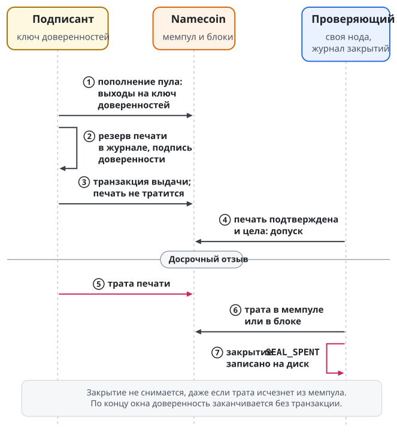
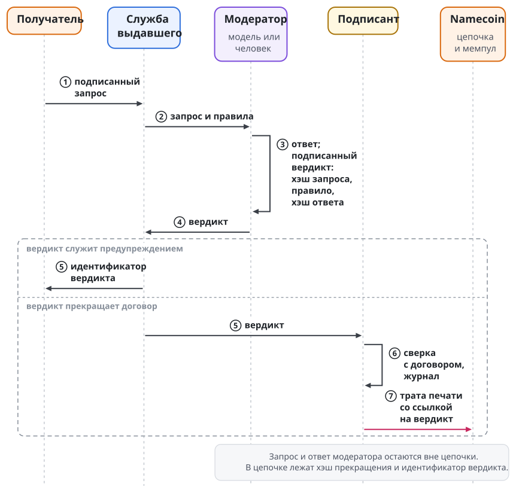

# Отзыв и наблюдение цепочки

Алиса тратит печать. С этого момента каждый проверяющий должен перестать допускать Боба, но узнаёт он о трате только через собственную ноду. Правило короткое: проверяющий отказывает, как только его нода видит трату, в мемпуле или в блоке, и отказывает навсегда. Верхней границы времени, за которое трата дойдёт до каждой ноды, нет. Глава даёт точные правила отзыва для двух профилей, состояния наблюдателя печати, цену защитных правил, порядок прекращения по нарушению и пределы лёгкого клиента.

## Отзыв

Выдавший отзывает доверенность тратой её печати. Транзакция отзыва тратит печать и возвращает остаток на адрес выдавшего. Потратить печать может только держатель её ключа, поэтому посторонний не может закрыть чужую доверенность.

Отзыв действует на будущее. Всё, что получатель сделал до траты, остаётся сделанным.

Проверяющий различает два исхода. Отказ относится к одной проверке: следующая проверка той же доверенности может дать допуск. Закрытие это постоянный отказ по одной доверенности. Проверяющий записывает закрытие на диск до того, как сообщает отказ, и после этого отказывает по этой доверенности в каждой проверке, в том числе после перезапуска. Закрытие не снимается. Восстановление одно: новая доверенность с новой печатью.

Рисунок показывает жизнь печати в профиле аренды от пополнения пула до закрытия.

{.tall}

## Два профиля

Проверяющий по первому профилю и проверяющий по профилю аренды закрывают доверенность по разным причинам. Смешивать правила двух профилей нельзя.

| Что видит проверяющий | Первый профиль | Профиль аренды |
| --- | --- | --- |
| Трата печати в мемпуле | Закрытие `seal-spent-or-unknown` | Закрытие `SEAL_SPENT` |
| Трата печати в блоке | Закрытие `seal-spent-or-unknown` | Закрытие `SEAL_SPENT` |
| Состояние печати прочитать не удалось | Закрытие `seal-spent-or-unknown` | Отказ без закрытия |
| Подтверждённое новое поколение имени выдавшего | Закрытие `confirmed-issuance-replacement` при любом новом поколении: обновлении или передаче | Закрытие только при смене ключа доверенностей; обновление, которое меняет лишь социальный ключ, ничего не закрывает |
| Подтверждённая смена указателя агента на арендодателя | Не применяется | Закрытие `AGENT_LANDLORD_CHANGED` |
| Смена значения имени находится в мемпуле | Не различается | Отказ без закрытия |
| Имя или вершина цепочки изменились за время проверки | Закрытие | Отказ без закрытия |
| Блок закрепления вытеснен из активной цепочки | Закрытие `canonical-block-displacement` | Отказ: выдача считается неподтверждённой |
| Неверная подпись, чужие имена, истёкшее имя, неверное значение имени | Отказ без закрытия | Отказ без закрытия |

По первому профилю проверяющий закрывает доверенность и при сбое чтения печати, и при новом блоке во время проверки. Оба случая дают ложный отказ: доверенность не отозвана, но закрыта. Вызвать их может только собственная нода проверяющего или обычный рост цепочки, посторонний через данные цепочки этого не сделает. Первый профиль назначает такую цену, чтобы проверяющий ни в каком случае не допустил отозванную доверенность. По профилю аренды проверяющий в этих случаях отказывает и оставляет доверенность открытой для следующей проверки.

Приостановки с возвратом к допуску нет ни в одном из профилей. По первому профилю проверяющий закрывает доверенность навсегда уже при трате в мемпуле, даже если эта трата никогда не подтвердится. По профилю аренды он поступает так же. Промежуточное состояние между целой и окончательно потраченной печатью различает только наблюдатель печати, отдельная программа для операторов.

Закрытия первого профиля перечислены полностью:

| Закрытие | Причина |
| ---------- | ------------------ |
| `seal-spent-or-unknown` | Проверка печати вернула трату, неизвестное состояние или не удалась |
| `confirmed-issuance-replacement` | Текущее подтверждённое поколение имени владельца отличается от закреплённого: более позднее обновление, передача или проверка, начатая до подтверждения закрепления |
| `confirmed-owner-generation-change` | Имя владельца сменило поколение за время проверки |
| `confirmed-requester-generation-change` | Имя получателя сменило поколение за время проверки |
| `canonical-block-displacement` | Доказано, что блок закрепления вытеснен из активной цепочки |
| `observed-tip-change` | Вершина цепочки сменилась за время проверки |

Из таблицы следует правило для выдавшего в первом профиле: начинать проверки только после подтверждения закрепления. Проверка, начатая раньше, закрывает доверенность.

В профиле аренды закрытие по смене ключа или указателя требует памяти. Проверяющий закрывает доверенность, только если раньше видел прежнее поколение имени, блок того поколения остаётся в активной цепочке, а новое поколение не старше прежнего. Проверяющий, который видит несовпадение впервые, отказывает без закрытия. Закрытие записывается у каждого проверяющего отдельно: оно не рассылается остальным. Возврат к старому ключу или указателю закрытую доверенность не открывает.

## Наблюдатель печати

Наблюдатель печати следит за одной печатью в течение ограниченной операции и сообщает её состояние. Он читает мемпул и блоки на собственной ноде. Допуску соответствует только состояние `UNSPENT`; результат с этим состоянием действителен не дольше одной секунды.

| Состояние | Значение |
| ----- | ----------------------- |
| `UNSPENT` | Печать не потрачена на вершине цепочки и не тратится в мемпуле |
| `SUSPEND` | Транзакция, которая тратит печать, находится в мемпуле и не попала в блок; либо трата, замеченная раньше, больше не видна. Из этого состояния нет возврата в `UNSPENT` |
| `FINALREVOKED` | Транзакция, которая тратит печать, находится в одном из первых шести блоков после начальной вершины операции |
| `UNKNOWN` | Состояние установить не удалось: реорганизация, недоступная нода, неоднозначный или повреждённый ответ |
| `STOP` | Операция закончилась без вердикта: шесть блоков без траты, 30 минут без нового блока, срок операции, отмена или истёкшее доказательство |

У каждой операции есть начальная вершина, срок и граница действия доказательства. Наблюдатель, который переходит к следующей операции, переносит в неё прежнюю вершину как начальную и прежний вердикт `SUSPEND` или `FINALREVOKED` как исходный. Ни один блок между операциями не пропускается.

Второй цикл основной сети 8 ноября 2026 года показывает на настоящих блоках три состояния из пяти: `UNSPENT`, `SUSPEND` и `FINALREVOKED`, то есть путь от целой печати до окончательного отзыва. Состояний `UNKNOWN` и `STOP` в этом цикле нет. Печать этого цикла: транзакция `10c6e840edee875f7767662f2cefeba22c85f7ddd0f49db0d56a1f4cd2d31cfa`, выход 0. Наблюдения по времени:

```text
блок 850666   печать создана
блок 850669   закрепление 05fc58ef…da20e786
06:18:54Z     вершина 850669: допуск, наблюдатель UNSPENT
              отзыв 7aa82a77…104e80d8 отправлен в сеть
06:26:43Z     вершина 850670, отзыв в мемпуле:
              отказ, закрытие seal-spent-or-unknown,
              наблюдатель SUSPEND (MEMPOOL_SEAL_INPUT)
06:26:57Z     вершина 850671, блок без траты:
              закрытие прежнее, наблюдатель SUSPEND
06:38:43Z     вершина 850672, трата в блоке:
              закрытие прежнее, наблюдатель FINALREVOKED
              (FIRST_ACTIVE_BLOCK_SPEND)
```

В первом цикле отзыв попал в блок примерно через 20 секунд после отправки, и стадию мемпула проверяющий не увидел: состояние сменилось с `UNSPENT` сразу на `FINALREVOKED`. Отказ при этом верен. Перезапущенный процесс с тем же состоянием на диске отказал по сохранённому закрытию.

## Сколько ждать блока

Трату в мемпуле видит только нода, до которой она дошла. Гарантию для всех нод даёт блок, а блок появляется в среднем раз в десять минут. Это случайный процесс, и среднее не ограничивает ожидание сверху. В модели, где интервалы между блоками независимы со средним 600 секунд, а трата попадает в первый же блок, ожидание распределено так:

| Сколько блоков ждём | Медиана | 95% случаев | 99% случаев |
| ---: | ---: | ---: | ---: |
| 1 | 7 минут | 30 минут | 46 минут |
| 3 | 27 минут | 63 минуты | 84 минуты |
| 6 | 57 минут | 105 минут | 131 минута |

Модель не учитывает конкуренцию комиссий, задержки распространения и отказ майнеров включать транзакцию. Верхней границы у ожидания нет.

## Возраст последнего блока и риск действия

Сервис останавливает привилегированные действия, когда последний блок слишком стар. Причина в том, что по одной тишине проверяющий не отличает ноду, которая ждёт редкого блока, от ноды, которой блоки не показывают. Нода, которой не показывают новые блоки, не покажет и трату печати.

Порог зависит от риска действия. Денежные и необратимые действия останавливаются, когда последний блок старше 60 минут. Остальные привилегированные действия останавливаются при 90 минутах. Риск действия определяет сервис по своему профилю действий; запрос снизить его не может.

У порога есть цена в доступности, и она измерена. Замер на одной ноде Namecoin 10 ноября 2026 года охватил 20 000 блоков за 137,2 дня при среднем интервале 9,88 минуты. Таблица показывает, какую долю этого времени последний блок был старше порога:

| Возраст последнего блока | Доля времени | В среднем за сутки |
| --- | ---: | ---: |
| 30 минут | 4,908% | 70,7 минуты |
| 60 минут | 0,229% | 3,3 минуты |
| 90 минут | 0,001% | 0,01 минуты |

При пороге в 60 минут денежные действия стоят в среднем 3,3 минуты в сутки без всякой атаки, при пороге в 90 минут остальные действия почти не стоят. Единый порог в 30 минут стоил бы 70,7 минуты в сутки; такой порог исполняет наблюдатель печати первого профиля. Числа описывают одну выборку и будущих задержек не ограничивают.

Возраст последнего блока и исправность ноды это разные сигналы, и сервис проверяет оба. Исправность ноды он проверяет по заголовкам от соседних нод и сравнением вершины не меньше чем с двумя независимыми нодами. Совпадение вершин находит отставшую ноду, но не защищает от общего источника и от изоляции ноды.

## Окончательность

Одно подтверждение это правило приложения. Консенсус его окончательным не считает: реорганизация цепочки может убрать блок с тратой. Состояние `FINALREVOKED` означает одно подтверждение по принятой политике, и доверенность, закрытую по трате, реорганизация не открывает.

В Namecoin вознаграждение за блок мало, а блоки добывают пулы Bitcoin попутно. Поэтому окончательность записи опирается на то, что крупным пулам невыгодна реорганизация. Стоимость работы, вложенной именно в Namecoin, её не обеспечивает. Для отзыва это безопасная сторона: исчезнувшая трата оставляет доверенность закрытой. Для выдачи и для оплаты это риск: запись, принятая после одного подтверждения, может исчезнуть. Поэтому доверенность версии 4 подписывает наименьшую глубину подтверждений, а сервис берёт наибольшее из этой глубины и минимума оператора. Проверяющий аренды при исчезнувшем блоке выдачи возвращается к ожиданию, а подписант получает от службы бронирования отзыв по причине отката платежа. Второе правило принадлежит стенду. По решению владельца от 11 ноября 2026 года платёж, который вытеснен из цепочки и остаётся действительным, отзыва не вызывает; правило дано в главе "Договор и согласие".

## Закрытие в версии 4

Версия 4 меняет три правила закрытия.

Закрытие по имени выдавшего видит любой проверяющий. Доверенность называет регистрацию имени и ключ владельца, и смену владельца или ключа доверенностей проверяющий находит в истории имени сам. Память о прежних поколениях имени для этого не нужна. Продление имени доверенностей не закрывает.

Трата печати ключом выдавшего, замеченная в мемпуле, закрывает доверенность навсегда. Исполнитель проверяет саму транзакцию: выход печати, скрипт и ветвь скрипта, по которой она тратит. Идентификатор транзакции, сообщённый другим участником, доказательством не служит. Закрытие переживает перезапуск, вытеснение транзакции из мемпула, её замену и реорганизацию. Трата получателем по разовой доверенности закрытием выдавшего не считается и идёт по правилам разового использования.

Сбой чтения, смена вершины и несогласованные ответы ноды закрытия не создают. Проверяющий повторяет чтение или отказывает. Ложные закрытия первого профиля в версию 4 не переходят.

## Прекращение по нарушению

Получатель нарушил правила, и выдавший прекращает доверенность. Третья сторона должна проверить, что прекращение следовало договору. Для этого решены четыре правила; ни одно из них не построено.

Договор несёт хэш правил модерации и называет того, кто их применяет. Применять правила может модель или человек. В обоих случаях договор называет ключ модератора, которым подписываются вердикты. Для модели договор называет ещё саму модель и хэш её конфигурации.

Каждое нарушение оформляется вердиктом. Вердикт это подписанная запись с такими полями:

| Поле вердикта | Значение |
| ---------- | ------------------------ |
| Доверенность и договор | `grant_id` и хэш договора, к которым относится вердикт |
| Хэш правил | Тот же, что в договоре |
| Нарушенное правило | Идентификатор одного правила в тексте правил |
| Хэш запроса | SHA-256 точных байтов запроса, о котором вынесен вердикт |
| Хэш ответа модератора | SHA-256 точных байтов ответа: вывода модели или письменного решения человека |
| Номер и предыдущий вердикт | Порядковый номер вердикта по этой доверенности и идентификатор предыдущего |
| Подпись | Подпись ключа модератора |

Хэш запроса, нарушенное правило и хэш ответа модератора названы решением владельца. Остальные поля, цепочку вердиктов, номер действия и формулу хэша прекращения предлагает LIP-0011.

В записи лежат хэши. Сам запрос и ответ модератора остаются у сторон: в споре сторона раскрывает их, и любой пересчитывает хэши. Запрос подписан ключом получателя, поэтому раскрытый запрос показывает и отправителя. Вердикты одной доверенности связаны в цепочку, и последний доказывает предыдущие.

Транзакция, которая тратит печать по нарушению, ссылается на вердикт. Она несёт один выход `OP_RETURN` того же вида, что запись выдачи, с действием `03`:

```text
6a 03 53 4c 03 42 01 <хэш прекращения> 01 <идентификатор вердикта>

хэш прекращения = SHA-256( ASCII("swarma-terminate-v1")
                           || grant_id
                           || contract_sha256
                           || идентификатор вердикта )
```

Хэш прекращения и идентификатор вердикта занимают по 32 байта. Скрипт занимает 72 байта и добавляет к транзакции отзыва 81 байт. Запись выдачи связывает договор с началом доверенности; запись прекращения связывает тот же договор и вердикт с её концом.

Рисунок показывает весь путь: шаги вне цепочки и шаги в ней.

{.tall}

Закрытие от ссылки не зависит. Проверяющий закрывает доверенность по трате печати выдавшим, какие бы выходы ни были у транзакции. Отсутствующая или неверная ссылка доверенность открытой не оставляет.

Вердикт ничего не закрывает. Доверенность прекращает только трата печати. Вердикт, который по правилам служит предупреждением, записывается и доставляется получателю без транзакции.

Ссылка служит свидетельством. Получатель или арбитр идёт от транзакции к вердикту, сверяет подпись модератора по ключу из договора, хэш правил и цепочку вердиктов, затем сверяет раскрытые запрос и ответ с их хэшами. Вердикт доказывает, что ключ модератора подписал это заявление. Правоту суждения он не доказывает.

Возврат предоплаты зависит от договора. Протокол даёт свидетельство, по которому применяется условие договора, и возврата не предписывает.

Выдавший может потратить печать в любой момент, и правило его в этом не ограничивает. Оно делает видимым прекращение без основания: трату печати, которая заявляет нарушение и не имеет действительного вердикта.

Сегодня устроено иначе. Шлюз считает явные запреты своей проверки содержания и завершает слот на втором; счётчик живёт в шлюзе. Подписант принимает отзыв от службы бронирования при откате платежа и от оператора, и причины "нарушение" у него нет. В договоре нет поля правил, а транзакция отзыва не несёт выхода `OP_RETURN`. Порядок описан предложением LIP-0011, которое ждёт согласия соавтора спецификации.

## Гонки и пределы

Трата получателем и отзыв выдавшим могут состязаться за одну печать. Консенсус не даёт отзыву приоритета: в блок попадает одна из двух транзакций.

Трата, добытая через секунды после отправки, может не появиться в мемпуле данной ноды вовсе. Наблюдатель тогда переходит из `UNSPENT` в `FINALREVOKED`. Трата, впервые замеченная позже шестого блока от начальной вершины, заканчивает операцию наблюдателя состоянием `STOP`; проверяющий всё равно отказывает по собственной проверке печати.

Чтения ноды идут одно за другим и не атомарны. Изменение туда и обратно между двумя чтениями проверяющий может не заметить.

Допуск безопасен при условии, что нода проверяющего видит свежую цепочку. По первому профилю проверяющий убеждается только в том, что нода не находится в начальной загрузке; правила для отставшей ноды, которая выглядит синхронной, в профиле нет. Операторы сверяют вершины двух независимых нод.

Если все пути к проверяющему скрывают трату, отзыв не дойдёт до него до конца окна. Поэтому последней линией защиты служит само окно: чем важнее поручение, тем короче его выбирают.

## Нода проверяющего

Проверяющий читает цепочку с полной ноды, которой доверяет, по пути без права записи: без вызовов кошелька, без отправки транзакций, без записи имён. Нода ведёт индекс транзакций (`txindex=1`), потому что проверяющий ищет подтверждённые транзакции по идентификатору без хэша блока.

Проверяющий использует методы `getblockchaininfo`, `getblockhash`, `getblockheader`, `getrawtransaction`, `gettxout` с учётом мемпула и `name_show`. Наблюдатель печати использует `getblockchaininfo`, `getblockhash`, `getrawtransaction`, `gettxout`, `getrawmempool` и `getblock`. Доступ ограничивается отдельным пользователем RPC со списком разрешённых методов.

В первом профиле спецификация рекомендует перед каждой проверкой убедиться, что путь к ноде исправен: цепочка и генезис верны, заголовок и транзакция закрепления читаются, имена читаются. Неисправный путь отказа не даёт и закрытия не создаёт: проверка не начинается. Сверка пути проверки не заменяет. Потраченную или непрочитанную печать проверяющий видит в самой проверке и записывает закрытие `seal-spent-or-unknown`. Текст спецификации версии 0.1 называет в сверке пути и целость печати. По решению 0003 спецификации слова об отсутствии закрытия относятся только к готовности пути. Проверяющий, который внутри сверки нашёл печать потраченной, неизвестной или непрочитанной, обязан отказать и записать закрытие. Целая печать, прочитанная в сверке, допуска не даёт: в самой проверке проверяющий читает печать заново. Профиль аренды предварительной сверки не определяет: проверяющий читает печать в самой проверке и при потраченной печати закрывает доверенность. Готовность ноды в профиле аренды задают пороги возраста последнего блока и согласие двух независимых нод о вершине из раздела "Возраст последнего блока и риск действия"; их нарушение даёт отказ без закрытия.

Поиск траты печати читает только входы посторонних транзакций и строго разбирает лишь те, что тратят печать. Иначе посторонняя транзакция непривычного вида могла бы вызвать отказ, а отказ, который может вызвать любой участник сети, становится атакой на доступность.

## Лёгкий клиент

Полная нода Namecoin с индексом транзакций, который нужен проверяющему, занимает на диске около 9,3 ГБ; замер дан в главе "Личность и имена". Сервис держит такую ноду. Клиент на телефоне проверяет записи без неё, способом SPV.

Лёгкий клиент хранит только заголовки блоков. За записью он обращается к серверу, который держит цепочку и её индекс. Сервер присылает транзакцию и доказательство включения: цепочку хэшей от транзакции до заголовка. Клиент проверяет доказательство сам. Для имени он проверяет ещё историю переходов владения: доказательство включения одной транзакции её не заменяет.

Заголовки Namecoin несут данные объединённого майнинга, и проверка всей истории тяжела. Поэтому приложение поставляется с контрольной точкой: подписанной издателем записью о том, какой блок считать верным на дату выхода приложения. Дальше клиент проверяет заголовки сам. При 4032 заголовках после контрольной точки по 1600 байт получается около 6,45 МБ. Контрольную точку цепочка не подтверждает: это доверие к издателю приложения. Издатель сверяет её на двух независимых нодах, а установленный клиент отвергает откат назад.

Граница SPV в том, что сервер может умолчать. Он не может подделать запись, но может показать настоящую старую: позавчерашнее значение имени вместо вчерашнего. Доказать включение можно, доказать отсутствие более новой записи нельзя, потому что консенсус Namecoin не закрепляет хэш текущего состояния всех имён.

Клиент сужает этот риск четырьмя правилами. Он спрашивает не меньше двух независимых операторов, при расхождении третьего. Голоса ничего не решают: верное доказательство более нового значения побеждает любое число старых ответов. Клиент помнит, что уже видел, и не принимает откат. Трату печати с доказательством может принести кто угодно, поэтому отзыв доставляется и в обход сервера, например сообщением.

Для уже известных выходов клиент использует компактные фильтры: скачивает короткую сводку каждого блока и сам ищет в ней траты печатей и обновления имён, за которыми следит. Фильтры не закреплены консенсусом, поэтому клиент сравнивает независимые потоки фильтров и спорные блоки проверяет целиком. Незнакомое имя и повторную регистрацию истёкшего имени фильтры не находят.

Сервер знает, какие имена и выходы отслеживает клиент и когда тот на связи. По этому списку восстанавливается круг общения. Клиент не переходит на прямое соединение незаметно; для защиты адреса подключается Tor, а организация может держать собственный сервер.

Если доказательств не хватает, клиент показывает последнюю проверенную точку и останавливает действия, которым нужна свежесть. Полученную переписку можно читать с пометкой о дате проверки. Новые полномочия ждут достаточной проверки. Потеря связи не превращается в разрешение.
