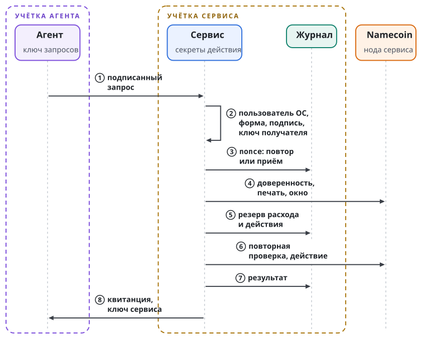

# Сервисы по доверенности

Агент получил право заплатить небольшую сумму. Если кошелёк работает под той же учёткой ОС, что и агент, никакая проверка в программе кошелька агента не удержит: взломанный агент читает файл с ключом и тратит всё. Поэтому ключ и исполнение уходят в отдельную службу, а у агента остаётся только право попросить. Такая служба называется сервисом по доверенности. Глава определяет его, разбирает запрос, журнал и квитанцию на примере кошелька и описывает разовую доверенность, прокси модели и подписанта.

## Определение

Сервис по доверенности это служба с пятью свойствами.

- Она держит секреты, нужные для действия, под собственным пользователем ОС. Агент их не читает.
- Она принимает подписанный запрос на действие из закрытого набора. Произвольных команд, вызовов RPC и путей к файлам она не принимает.
- Она сама проверяет доверенность на собственной ноде перед каждым привилегированным действием. Доставка команды, наличие файла доверенности и верная подпись сами по себе действия не разрешают.
- Она записывает привилегированное действие в журнал и резервирует расход до исполнения.
- Она отвечает квитанцией, подписанной собственным ключом.

Привилегированным называется действие, которое тратит ресурс или меняет состояние. Чтение без расхода профиль сервиса может разрешать без доверенности: кошелёк так отдаёт баланс, историю и адрес для пополнения, и требует для них подписи, закреплённого ключа и верного пользователя ОС.

Кошелёк агента и прокси модели служат двумя первыми сервисами по доверенности. По той же схеме строятся шлюз сообщений или почты, хранилище файлов, менеджер слотов, регистратор имён, доступ к репозиторию, оплата сторонних API, календарь и бронирование, администрирование комнат. У каждого свои действия, параметры и единицы бюджета.

Доверенность называет исполнителя: сервис, который её исполняет. Без этого один бюджет можно было бы потратить дважды, предъявив одну доверенность двум сервисам: каждый ведёт собственный счёт и о расходе в соседнем не знает. Исполнитель назван именем сервиса в Namecoin и его открытым ключом; правила разобраны в главе "Доверенность", раздел "Версия 4".

## Типы сервисов

Тип сервиса выбирает набор действий и их формат. Тип записан строкой, например `wallet.nmc`. Тип не называет ни оператора, ни адрес, ни ключ, которому можно верить.

| Тип | Что делает сервис и что он обязан привязать |
| ----- | ----------------------- |
| `wallet.nmc` | Платежи и чтения кошелька; пять действий профиля v1 из этой главы |
| `model.proxy` | Вызов явно выбранной модели; учёт запросов, входных и выходных токенов, стоимости и длины одного ответа |
| `slot.station` | Допуск к названному слоту аренды и завершение допуска; арендатор, ресурсы и окно |
| `mail.send` | Отправка почты; личность отправителя, разрешённые получатели и пределы отправки |
| `store.blob` | Чтение, запись и удаление объектов; разрешённая область хранилища и пределы ресурсов |
| `names.nmc` | Регистрация и обновление имён; разрешённые имена, стадии операции, комиссии и правила владения |
| `repo.git` | Чтение репозитория и запись в него; репозиторий, ветки и разрешённые изменения |

Точный набор действий задан только у `wallet.nmc`. У остальных типов таблица называет смысл действий; строки действий, параметры и единицы учёта задаёт профиль каждого типа. Неизвестный тип и неизвестное действие получают отказ. Общее слово вроде "чтение" точную схему сервиса не заменяет. Новые типы и новые значения действий вводятся отдельными предложениями; значение развёрнутого типа молча не меняется.

Сервис объявляет о себе в значении своего имени Namecoin. Объявление называет четыре вещи: тип, поддержанные действия этого типа, открытый ключ квитанций и адрес интерфейса. Клиент читает объявление на своей ноде, выбирает известный ему тип и убеждается, что нужное действие есть и в профиле типа, и в объявлении.

Объявление прав не даёт. Сервис проверяет доверенность и запрос на собственной границе действия. Ключ квитанций, прочитанный из произвольного имени, закреплённым не становится: клиент сначала решает, какому имени сервиса и какому владельцу имени он доверяет, и только под этим правилом принимает объявленный ключ. Адрес из объявления это недоверенная подсказка. Чтение значения не открывает соединения и не передаёт секретов; перенаправление и передача имени сервиса не меняют молча того, кому клиент доверяет.

## Запрос

Формат запроса и квитанции задан для кошелька: это профиль v1 в предложении LIP-0006. Пример взят из открытого набора `experiments/agent-wallet/testdata/service-v1` репозитория `swarma-chain-lab`; ключи в нём общеизвестные тестовые.

Запрос это объект JSON с восемью полями в точном порядке. В примере это файл `balance.json` длиной 222 байта:

```json
{"v":1,"service":"wallet.nmc","action":"balance","params":{},"grant":{"kind":"none"},"nonce":"aaaaaaaaaaaaaaaaaaaaaaaaaaaaaaaa","created_at":500,"grantee":"c6047f9441ed7d6d3045406e95c07cd85c778e4b8cef3ca7abac09b95c709ee5"}
```

Запрос из примера читает баланс и доверенности не требует. Поля запроса значат следующее.

| Поле | Значение |
| --- | --- |
| `v` | Число 1. |
| `service` | Тип сервиса. |
| `action` | Действие из закрытого набора сервиса. |
| `params` | Параметры действия. |
| `grant` | Вид доверенности и её идентификатор. |
| `nonce` | 16 случайных байт, 32 строчных шестнадцатеричных знака. |
| `created_at` | Время создания в секундах Unix. |
| `grantee` | Ключ получателя доверенности. |

Запрос подписывает получатель доверенности:

```text
request_hash  = SHA-256(байты запроса)
action_digest = SHA-256( UTF8("swarma-action-v1") || request_hash )
signature     = подпись BIP-340 ключом grantee над action_digest
```

За меткой сразу идут 32 двоичных байта хэша, без длины и разделителя. Хэш в шестнадцатеричной записи дал бы другой результат, и такая подпись отклоняется. В примере:

```text
request_hash
  f3fb78db4d8324dfc4537b2822c51ae9c44c3554d82ef30666b5779a6aab7763
action_digest
  fe5351a4aef1ba65173f49dc6d828f83e5bdddd02cd917520df1f4fef4ef9e10
```

По каналу идёт обёртка `{"request":…,"signature":…}`. Запрос устроен иначе, чем событие Nostr, и идентификатор события его хэш не заменяет.

Подпись получателя нужна, потому что доверенность не секрет. Её видят хранилище, шлюз и каждый, кому её показали. Доверенность говорит, кто вправе действовать; подпись запроса доказывает, что именно этот запрос отправил именно этот ключ. Запись выдачи в цепочке тоже не заменяет подпись: она подтверждает существование доверенности и ничего не говорит о конкретном запросе.

Транспорт это сокет Unix. На одно соединение приходится один запрос и один ответ. Телу сообщения предшествуют четыре байта длины в порядке от старшего к младшему; длина тела от 1 до 65536 байт. Сервис до чтения тела узнаёт у ядра пользователя и группу процесса на другом конце и сверяет их с закреплёнными. Один экземпляр сервиса обслуживает одного пользователя ОС и один ключ получателя. Сокет имеет права `0660` и лежит в каталоге сервиса с правами `0750`.

## Действия кошелька

| Действие | Параметры | Доверенность |
| --- | --- | --- |
| `spend` | `to`, `amount_sat`, `fee_limit_sat` | `standing` или `single-use` с идентификатором |
| `balance`, `history`, `receive` | Пустой объект | `none` |
| `budget` | Пустой объект | `standing` или `single-use` с идентификатором |

Многократная доверенность обозначается `standing`, разовая `single-use`. Идентификатор это `grant_id`; сервис находит доверенность только в собственном каталоге объектов, путь из запроса он не принимает.

Адрес `to` это адрес P2PKH закреплённой сети. Сумма `amount_sat` положительна и задана целым числом атомарных единиц NMC; дробных сумм нет. Предел комиссии `fee_limit_sat` лежит в пределах от 1 до 1 000 000.

Чтения `balance`, `history` и `receive` не требуют доверенности, но требуют подписи, закреплённого ключа получателя и верного пользователя ОС. Права тратить они не дают. Действие `budget` сообщает остаток по доверенности и может ответить, что доверенность не действует; успешный ответ допуска не даёт. Запросы на регистрацию и обновление имён кошелёк по этому профилю отклоняет.

Платёж по многократной доверенности проверяет действие `pay` в `scope`, получателя, окно и суммарный бюджет вместе с комиссией. Условия кошелька это отдельный объект с полями `version`, `recipients`, `spend_cap_sat`, `name_cap_sat`, `name_count`; его хэш должен совпадать с `contract_sha256` доверенности и согласия. Полный договор аренды имеет другой формат и условия кошелька не заменяет.

## Порядок приёма

Сервис обрабатывает запрос в шесть шагов, и порядок шагов фиксирован.

| Шаг | Что делает сервис |
| -: | ------------------------------ |
| 1 | Проверяет пользователя ОС, форму запроса, тип сервиса, действие, подпись и закреплённый ключ получателя. |
| 2 | Ищет `nonce` в журнале. Тот же `nonce` с другим хэшем запроса получает отказ `NONCE_CONFLICT`. Повтор завершённого запроса получает прежнюю квитанцию байт в байт, даже вне допустимого сдвига часов и после конца окна; нового действия нет. |
| 3 | Для нового запроса сверяет `created_at` с часами в пределах настроенного сдвига, от 1 до 300 секунд, и записывает приём в журнал. |
| 4 | Находит доверенность и условия, проверяет доверенность на своей ноде, затем правила действия: получателя, сумму, бюджет. |
| 5 | Перед тратой записывает резерв расхода и действия, ещё раз проверяет доверенность и входы транзакции и после этого отправляет транзакцию. |
| 6 | Записывает результат и подписанную квитанцию. |

Рисунок показывает те же шаги между учёткой агента, учёткой сервиса и нодой.

{.tall}

Резерв не снимается. Отказ после резерва оставляет резерв в журнале. Запрос, прерванный после резерва, при повторе получает вердикт `uncertain` с причиной `DURABLE_RESERVATION_NO_RETRY`: сервис не отправляет транзакцию второй раз. Смена `nonce`, ключа или журнала ради повтора действия с неясным исходом запрещена.

Проверка цепочки и отправка транзакции не атомарны. Отзыв или реорганизация после последней проверки могут опередить платёж, и реорганизация не отменяет уже выполненного внешнего действия.

## Квитанция

Квитанция это объект с полями в точном порядке: `v`, `service`, `grantee`, `request_hash`, `verdict`, `reason`, `effect`, `journal_seq`, `observed_height`, `peer`. Квитанция из того же набора, файл `receipt.json`:

```json
{"receipt":{"v":1,"service":"wallet.nmc","grantee":"c6047f9441ed7d6d3045406e95c07cd85c778e4b8cef3ca7abac09b95c709ee5","request_hash":"f3fb78db4d8324dfc4537b2822c51ae9c44c3554d82ef30666b5779a6aab7763","verdict":"executed","reason":"READ","effect":{},"journal_seq":1,"observed_height":100,"peer":{"uid":1001,"gid":1002}},"signature":"f4b23381…72eaf0a1"}
```

Сервис подписывает по BIP-340 хэш `SHA-256( UTF8("swarma-action-receipt-v1") || байты квитанции )`. В примере он равен `90a94a1cf305f07bb595ae073597baa45c295d34de4a89112af6eeee38049d72`.

| Вердикт | Значение |
| --- | --- |
| `executed` | Действие вернуло результат, записанный сервисом. Сюда входят и чтения. |
| `pending` | Тот же запрос нужно проверить позже; траты не было. |
| `refused` | Сервис отклонил действие. Резерв мог остаться. |
| `uncertain` | Исход неясен. Это не доказательство успеха и не доказательство отсутствия действия. |

Клиент закрепляет ключ квитанций заранее, отдельно от канала: квитанция не выбирает ключ, которому ей верить. Ключ квитанций отличается от ключа получателя, и сервис отказывается работать с одинаковыми. Клиент сверяет ключ, тип сервиса, ключ получателя и хэш запроса; верная квитанция на другой запрос и неподписанная ошибка успехом не становятся.

Поле `journal_seq` это номер приёма в журнале, начиная с единицы; ноль означает отказ до приёма. Поле `observed_height` это высота блока, которую сервис видел; ноль означает, что высота не наблюдалась. Причина это строка из заглавных латинских букв, цифр и подчёркиваний; сырые ошибки, ввод и секреты в неё не попадают.

Квитанция это подписанное заявление сервиса. Состояния внешнего мира она не доказывает.

## Журнал и бюджет

Расход в окне считает сервис, который исполняет действие. Перед каждой тратой он записывает её в журнал по этой доверенности и отказывает, когда сумма превысила бы бюджет. У каждого сервиса журнал свой: у кошелька, у прокси модели, у подписанта.

Журнал это доверенное состояние. Цепочка не знает, сколько потрачено по доверенности; если журнал потерян, счётчик начинается с нуля. Из этого следуют три правила. Журнал лежит у пользователя ОС сервиса, вне досягаемости агента. Бюджеты в доверенностях малы, чтобы потеря журнала стоила немного. Журнал не очищается: ни автоматической очистки, ни сброса, возвращающего израсходованное право, нет.

Сервис кошелька держит журнал под блокировкой на всё время работы, в файлах с правами `0600` в каталоге `0700`. В профиле v1 журнал вмещает 32 записи и 65536 байт. Повреждённый журнал, изменённая конфигурация или другой ключ квитанций не дают сервису открыть журнал. Сбой записи останавливает приём запросов до вмешательства оператора.

Журнал даёт не больше одного исполнения на запрос. Ровно одного исполнения он не обещает: сбой между резервом и действием оставляет резерв, а действие может не состояться.

## Разовая доверенность

Разовая доверенность расходуется при использовании. Правило одно: сначала трата печати, потом действие.

Печать разовой доверенности это выход P2SH, который тратит один из двух ключей, в порядке выдавший, получатель:

```text
OP_1 <ключ выдавшего> <ключ получателя> OP_2 OP_CHECKMULTISIG
```

Ключи различны. Выдавший тратит печать, чтобы отозвать доверенность. Получатель тратит печать, чтобы использовать её, и в той же транзакции кладёт хэш своего запроса в выход `OP_RETURN`:

```text
вход       печать, подпись получателя
вход       монеты получателя на комиссию, если нужны
выход      OP_RETURN 20 <хэш запроса, 32 байта>, сумма ноль
выход      сдача, если есть
```

Подпись получателя покрывает всю транзакцию, поэтому трата навсегда связана с одним запросом. Комиссию оплачивают монеты печати или дополнительный вход получателя.

Исполнитель действует так. Он считает хэш предъявленного запроса, находит трату этой печати с этим хэшем и определяет по подписи, какой из двух ключей её сделал. Трата получателя с верным хэшем, подтверждённая в блоке, разрешает одно действие. Трата в мемпуле даёт ожидание без действия. Трата выдавшего означает отзыв, даже если хэш совпал. Трата с другим хэшем означает отказ для любого другого запроса. Высоты блоков печати, закрепления и использования строго возрастают; две стадии в одном блоке дают отказ.

Перед действием исполнитель записывает запрос в журнал. Второй раз потратить печать не даёт консенсус, а второй раз исполнить запрос не даёт журнал. Гарантия ограничена исполнителями, которые соблюдают правило "сначала трата": исполнитель, который действует без траты, позволяет использовать то же право ещё раз у другого.

Полный цикл прошёл в основной сети Namecoin 8 ноября 2026 года: печать на высоте 850684, закрепление на высоте 850686, использование с хэшем запроса на высоте 850690. Исполнитель сообщил ожидание при трате в мемпуле, исполнил действие один раз после первого подтверждения, на повтор ответил, что запрос уже исполнен, и отклонил второй верный запрос.

Хэш в `OP_RETURN` у двух профилей берётся от разных байтов. В профиле LIP-0002, по которому шёл этот цикл, транзакция использования несёт SHA-256 от точных байтов подписанного конверта запроса: запроса вместе с подписью. В профиле кошелька v1 она несёт `request_hash`: SHA-256 от канонических байтов запроса без подписи. В профиле кошелька хэш обёртки `{"request":…,"signature":…}` для этого не подходит. Идентификатор события Nostr не подходит ни одному из профилей. В профиле кошелька получатель добавляет к обёртке член `proof` с идентификатором транзакции использования; он не подписан и служит подсказкой, а трату сервис проверяет сам. Запрос без `proof` получает окончательный отказ `USE_PROOF_REQUIRED`; запрос с тратой в мемпуле получает `USE_PENDING` и проходит после подтверждения.

Печать разовой доверенности нельзя взять из пула: её скрипт включает ключ получателя, поэтому она создаётся при выдаче. Печать многократной доверенности платит только на ключ доверенностей и создаётся заранее.

## Кошелёк в два уровня

Основные средства и малый рабочий остаток лежат за разными границами:

```text
учётка сервиса
  основной кошелёк, доступ к RPC, журнал, ключ квитанций
       ^
       | подписанный запрос по доверенности
       | проверка получателя, суммы и комиссии
       v
учётка агента
  ключ запросов и клиент сервиса
  малый кошелёк со своим ключом

пополнение: сервис -> адрес малого кошелька
```

Малый кошелёк работает под учёткой агента. Его программа проверяет доверенность перед своими операциями, но агент может прочитать данные своей учётки и обратиться к кошельку напрямую. Поэтому предел риска на этом уровне задаёт сумма на кошельке: программа кошелька взломанного агента не удержит. Доверенность не ограничивает задним числом ключ, который уже держит агент.

Пополняет малый кошелёк основной сервис по отдельному запросу на разрешённый адрес, с проверкой доверенности и бюджета. Запрет учётке агента читать файлы сервиса и менять его программу задаёт ОС.

## Прокси модели

Прокси модели держит ключ API поставщика модели. Для каждого слота прокси выдаёт случайный токен на 32 байта, привязанный к брони, идентификатору доверенности, окну не длиннее часа и пределам. Токен действует только в окне и на адресе своего слота; его можно отозвать.

Перед каждым запросом к модели прокси записывает в журнал резерв худшего случая: один запрос, всё окно контекста модели как входные токены, запрошенный предел выходных токенов и их стоимость по закреплённым ценам. Если резерв не помещается в оставшиеся пределы по входным токенам, выходным токенам, числу запросов или стоимости, прокси отказывает. Ровно предел допустим; на единицу больше даёт отказ. После полного ответа резерв заменяется настоящим расходом. Оборванное соединение, истёкшее время и неполный ответ оставляют резерв целиком: возврата по обрыву нет.

Если поставщик сообщил расход больше зарезервированного, прокси замораживает слот. Счёт поставщика это уже не отменяет.

Прокси модели сам работает как сервис по доверенности. Он проверяет доверенность по цепочке на собственной ноде и останавливает слот, когда печать потрачена. На вердикт шлюза он не полагается: ошибка или взлом шлюза тогда продлили бы доступ к модели, а ключ API и счёт поставщика лежат у прокси.

## Подписант и передача права выдачи

Подписант из главы "Ключи" устроен по той же схеме: отдельный пользователь ОС, закрытый набор из трёх операций, журнал с резервом до подписи, потолки оператора.

Подписант может сам стать сервисом по доверенности. Тогда право выдавать доверенности получает отдельная личность, которой владелец выдал доверенность на выдачу, а подписант исполняет запросы этой личности в пределах её доверенности. Так владелец поручает выдачу, не передавая ключа доверенностей.

Право выдачи требует собственного типа действия и собственных правил: что может содержать дочерняя доверенность, кому она выдаётся, на какой срок и с какими пределами, как закрытие родительской доверенности закрывает дочерние и как проверяется вся цепочка. Действия `deliver` и `pay` права выдачи не содержат, и пределы доверенности версии 4 его не подразумевают.

Предложение о доверенности версии 4 описывает и второй способ: получатель с правом выдачи сам подписывает дочерние доверенности, и путь полномочий при этом не длиннее двух звеньев. Способ предложен и не принят: выдача дочерних доверенностей агентом остаётся отдельным решением обоих владельцев. Его правила даны в главе "Доверенность", раздел "Право выдачи и путь из двух звеньев", пример в главе "Рой: иерархия и полномочия".

Без такой доверенности право не передаётся дальше. Получатель доверенности на обращение к агенту не становится выдавшим, а ключ сообщений агента доверенностей не выдаёт.
