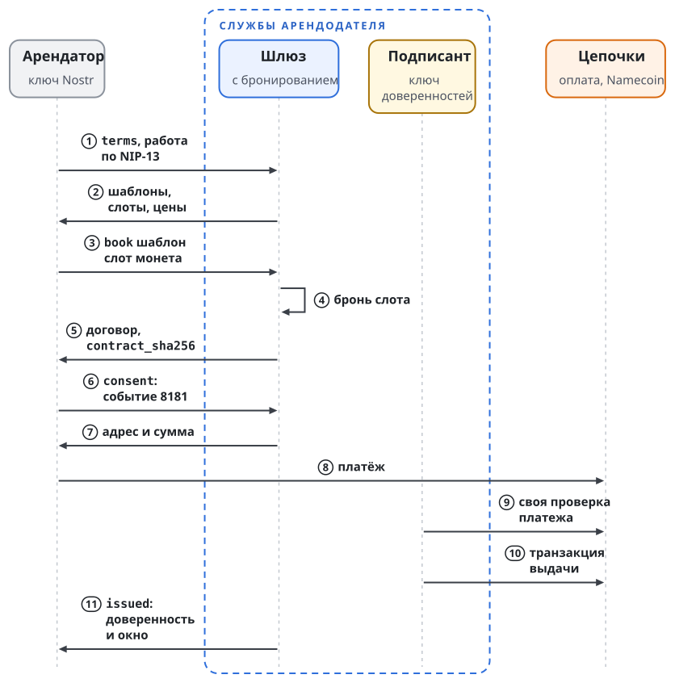
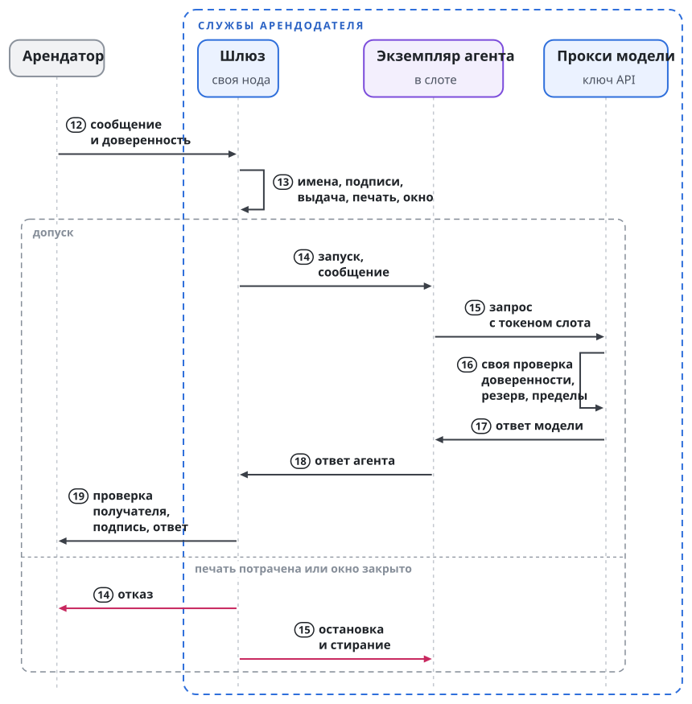

# Доступ к агенту: команда и аренда

Участник, который управляет экземпляром агента и платит за него, даёт к нему доступ другим участникам. Сценариев два, и они равноправны: доступ команде без платы и аренда за плату. Объекты в обоих одни: имена, доверенность, печать и договор. Глава проходит оба сценария, затем показывает сторону, которая управляет агентом: сообщения, шлюз, слот и службы. Третий сценарий, рой нескольких операторов, разобран в главе "Рой: иерархия и полномочия".

## Агент команды

Алиса управляет экземпляром агента, платит за его модель и машину и даёт к нему доступ участникам команды. Команда может быть рабочей группой проекта, участниками открытого проекта или сотрудниками внутри закрытого периметра. Платы между участниками нет.

Каждый участник получает доверенность на свой ключ или своё имя. В ней записаны действие, обращение к агенту, пределы расхода модели за период и срок в блоках. Перед доставкой сообщения агенту и перед отправкой ответа служба Алисы проверяет доверенность заново. Прокси модели считает расход каждого участника отдельно, потому что предел записан в его доверенности.

Сценарий отличается от аренды четырьмя строками:

| | Агент команды | Аренда |
| ------ | ---------- | ---------- |
| Кто платит за модель и машину | Участник, который управляет агентом | Арендатор, по договору |
| Договор | Условия без цены: пределы, правила, срок | Те же условия и цена |
| Бронь и оплата | Нет | Есть: доверенность выдаётся после согласия и подтверждённой оплаты |
| Конец доступа | Конец срока или трата печати | То же |

Участник выходит из команды так: Алиса тратит печать его доверенности. Остальные доверенности это не затрагивает, потому что у каждой своя печать. Ключ участника Алисе для этого не нужен.

В закрытом периметре сервисы проверяют доверенности по той же публичной цепочке, и нода Namecoin должна быть им доступна. Имена участников, печати и записи выдачи видны всем; текст доверенностей и договоров в цепочку не попадает.

Стенд этого сценария целиком не исполняет. Его обмен выдаёт доверенность только после подтверждённого платежа, а договор аренды требует условий оплаты. Формат договора без цены не определён.

## Аренда: полный пример

Боб нанимает агента Cedar на трёхмесячный проект. Агентом Cedar управляет Алиса, и найм оформляется договором аренды между Бобом и Алисой. Алиса и Боб не знакомы. В найме участвуют два имени в цепочке, договор, согласие Боба, доверенность, печать и транзакция выдачи. Раздел проходит найм по шагам и показывает каждый объект один раз. Точные форматы, правила проверки и отказы разобраны в главах "Доверенность", "Отзыв и наблюдение цепочки" и "Договор и согласие".

### Срок и периоды

Найм оформляется одной доверенностью на весь срок. Срок задан в высотах блоков: три месяца это около 13 000 блоков. В цепочке на весь найм остаётся одна запись выдачи. Найм кончается в конце срока или раньше, когда Алиса тратит печать.

Час внутри срока это период. Договор называет период предела: столько-то запросов и токенов модели за час. Он же называет период оплаты. Новый период не требует ни новой доверенности, ни новой печати, ни новой записи выдачи. Платёж за период может быть транзакцией в цепочке: это запись о платеже. Что следует за неоплаченным периодом, говорит договор; протокол даёт Алисе одно средство, трату печати.

Стенд исполняет прежний порядок: его обмен бронирует, оплачивает и выдаёт доверенность на одно окно, и прокси модели принимает окно не длиннее часа. Шаги ниже показывают обмен стенда. Одна доверенность на срок решена владельцем и в стенде не исполнена.

### Участники и ключи

Арендодатель управляет агентом и выдаёт доверенности на обращение к нему. В примере это Алиса. Арендатор получает доверенность на свой ключ и пишет агенту. В примере это Боб. Агент Cedar работает на машине Алисы.

У Алисы и у агента есть имена в цепочке Namecoin. Значение имени хранит открытые ключи. У Боба имени нет: арендатору достаточно ключа Nostr, которым он подписывает события и личные сообщения. Имена и их значения в примере такие:

```text
Имя Namecoin                    Что записано в значении имени
id/alice        (арендодатель)  grant: ключ доверенностей Алисы
id/alice-cedar  (агент)         nostr: ключ сообщений агента
                                landlord: id/alice
Боб             (арендатор)     имени нет; ключ Nostr на его устройстве
```

В примере у стороны Алисы три ключа личности и полномочий, и держат их разные программы. Остальные секреты её служб, ключ финансирования и ключ API модели, перечисляет глава "Ключи". Ключ владельца имён меняет значения `id/alice` и `id/alice-cedar` и хранится отдельно от служб. Ключ доверенностей подписывает доверенности и тратит печати; его держит подписант, служба Алисы, которая выдаёт и отзывает доверенности. Ключ сообщений агента держит шлюз, служба аренды на стороне Алисы, которая принимает сообщения для агента. Сам агент не держит ни одного из трёх ключей.

Имя агента указывает на имя арендодателя, а имя арендодателя хранит ключ доверенностей. По этой цепочке любой проверяющий находит ключ, которым должна быть подписана доверенность на обращение к агенту, без сервера Алисы.

### Обмен до доверенности

Отправитель без действующей доверенности не достигает модели. Шлюз отвечает ему только на три точные команды и только заранее заданными форматами. Первое сообщение незнакомого ключа должно нести доказательство работы по NIP-13, по умолчанию 16 бит: так шлюз отсекает поток пустых обращений до того, как тратит на них ресурсы.

| Команда Боба | Ответ шлюза | Что в ответе |
| ---------- | ---- | ------------------ |
| `terms` | `terms` | Имена агента и арендодателя, шаблоны договора, слоты, цены, уведомление о приватности и его хэш. |
| `book <шаблон> <слот> <монета>` | `contract` | Идентификатор брони, точные байты договора, `contract_sha256`, срок брони. |
| `consent <событие>` | `pay` | Адрес, сумма в единицах монеты, требуемое число подтверждений, срок брони. |
| (платёж подтверждён, доверенность выдана) | `issued` | Идентификатор доверенности, сама доверенность, её окно. |
| (наступило начало окна) | `ready` | Проверка доверенности даёт допуск; можно писать агенту. |

Слот это место под одну аренду агента; он определён в разделе "Слот". Монета оплаты выбирается из набора `nmc`, `btc`, `ltc`. Любая другая строка получает заранее заданный текст подсказки. В этом обмене шлюз не подписывает ключом агента ни произвольные тексты ошибок, ни вывод модели.

Рисунок показывает тот же обмен по шагам; служба бронирования стоит в нём за шлюзом.

{.tall}

### Договор и согласие

Команда `book` возвращает договор: объект с ключом Боба, ключом и именем агента, окном, разрешёнными и запрещёнными действиями, бюджетом и условиями оплаты. Хэш SHA-256 точных байтов договора называется `contract_sha256`. Всё дальнейшее ссылается на этот хэш.

Боб соглашается подписью. Он подписывает событие Nostr вида 8181 с пустым содержимым и четырьмя тегами: метка `swarma-rental-consent-v1`, `contract_sha256`, хэш брони, хэш уведомления о приватности. Событие подписано ключом Боба, поэтому оно доказывает две вещи: Боб согласился именно на эти байты, и Боб владеет ключом, на который будет выдана доверенность.

Алиса отвечает своей подписью: ключ доверенностей подписывает те же 32 байта `contract_sha256`. Согласие Боба и подпись Алисы входят в доверенность.

### Оплата

Команда `consent` возвращает адрес и сумму. Боб платит в выбранной монете. Служба бронирования наблюдает платёж на ноде этой монеты и засчитывает его после требуемого числа подтверждений, по умолчанию после одного. Платёж, который находится только в мемпуле, оставляет бронь в ожидании: неподтверждённую транзакцию отправитель может заменить другой.

### Выдача

После подтверждённого платежа подписант выдаёт доверенность. Он записывает в свой журнал бронь и печать из пула до первой подписи, чтобы сбой не привёл к двум доверенностям на одну печать. Печать это заранее созданный и подтверждённый выход на ключ доверенностей Алисы. Доверенность называет её парой `txid` и `vout`.

Затем подписант подписывает доверенность ключом доверенностей и отправляет транзакцию выдачи. В ней ровно один выход `OP_RETURN` с нулевой суммой. Он несёт хэш выдачи, который связывает договор, согласие Боба, подпись Алисы и доверенность, и указатель на саму доверенность в хранилище. Схема показывает имена, доверенность и транзакции вместе:

```text
Имена Namecoin                    Транзакции
id/alice-cedar  (агент)           [пополнение пула]
  nostr: ключ сообщений агента      выходы-печати на ключ доверенностей
  landlord: id/alice --+
id/alice  (арендодатель) <-+      [выдача]
  grant: ключ доверенностей         OP_RETURN, 72 байта:
                                    "SL" 01 | версия 01 |
Доверенность (вне цепочки)          хэш выдачи (32 байта) |
  кому: ключ Боба                   где лежит: 01, grant_id (32 байта)
  агент: id/alice-cedar
  что можно: действия, бюджет     хэш выдачи = SHA-256(
  окно: начало и конец              "swarma-issue-v1" + хэш договора +
  договор: contract_sha256          согласие Боба + подпись Алисы +
  печать: txid и номер выхода       grant_id)
  подпись: ключ доверенностей
                                  [отзыв] трата печати
```

Слева стоят имена и документ вне цепочки, справа три вида транзакций. Идентификатор доверенности `grant_id` равен SHA-256 подписанной доверенности. Под этим идентификатором она лежит в хранилище с адресацией по содержимому. Боб получает доверенность в ответе `issued` вместе с идентификатором транзакции выдачи.

Печать и транзакция выдачи разделены намеренно. Доверенность называет печать, а транзакция выдачи содержит хэш от доверенности; если бы транзакция выдачи создавала печать, идентификатор транзакции зависел бы от собственного содержимого.

### Работа в пределах срока

Окно доверенности стенда задано двумя моментами: `not_before` включён, `not_after` исключён. В начале окна шлюз проверяет доверенность и при допуске отправляет Бобу `ready`.

Первое сообщение Боба несёт доверенность. Шлюз проверяет её на собственной ноде Namecoin:

- Значения имён `id/alice-cedar` и `id/alice` имеют точную форму, и имя агента указывает на арендодателя, названного в доверенности.
- Доверенность подписана ключом доверенностей из имени арендодателя.
- Транзакция выдачи подтверждена в активной цепочке и несёт хэш выдачи для этой доверенности.
- Печать платит на ключ доверенностей, подтверждена и не потрачена с учётом мемпула.
- Окно открыто.
- Отправитель сообщения совпадает с получателем, названным в доверенности.

При допуске шлюз запускает для Боба экземпляр агента и передаёт сообщение. Проверка повторяется на каждом сообщении: результат прошлой проверки не становится разрешением на следующее.

Доверенность на обращение к агенту не разрешает агенту внешних действий. Когда агент по просьбе Боба платит или вызывает модель, запрос приходит в отдельный сервис по доверенности, например в кошелёк или в прокси модели. Сервис сам читает цепочку, сверяет действие с пределами доверенности, записывает расход в свой журнал и только потом исполняет. Кошелёк стенда так и работает. Прокси модели стенда цепочку не читает: окно и пределы он получает от шлюза, а собственная проверка цепочки в нём решена и не построена.

Рисунок продолжает нумерацию шагов предыдущего и показывает одно сообщение и завершение слота.

{.tall}

### Конец найма

Найм заканчивается одним из двух способов. В конце срока доверенность перестаёт действовать без транзакции: проверка окна даёт отказ. Досрочно найм прекращает трата печати. Подписант тратит печать, и проверяющий, который видит эту трату в мемпуле или в блоке, записывает закрытие доверенности. Закрытие постоянно: если трата потом исчезнет из мемпула, доверенность не откроется. Досрочный отзыв проходит такие стадии:

```text
блок N     пополнение пула создаёт печать: txid и номер выхода
           подписант подписывает доверенность с этой печатью
блок N+k   транзакция выдачи несёт хэш выдачи
...        печать цела, срок идёт: шлюз и сервисы допускают Боба
мемпул     подписант тратит печать: проверяющие закрывают доверенность
блок M     трата в блоке
```

После закрытия шлюз останавливает экземпляр агента, запущенный для Боба, а прокси модели перестаёт принимать запросы этого экземпляра.

### Что даёт цепочка

Польза цепочки зависит от того, кто проверяет доверенность; таблица во введении показывает её для каждой расстановки участников, и она верна для аренды, для агента команды и для роя. В примере шлюз Алисы проверяет доверенность самой Алисы. Защиты Алисе цепочка здесь не добавляет, а Боб получает свидетельство для спора: договор, обе подписи и доверенность связаны записью, сделанной до начала аренды, а момент отзыва виден в цепочке. Кошелёк и прокси модели Алисы работают под другой учётной записью ОС, от шлюза и агента не зависят и сами видят трату печати.

Цепочка не показывает, что ответил агент, исполнено ли внешнее действие и как оператор обращается с данными арендатора. Эти вопросы решают журналы сервисов, квитанции и договор.

Сервис ждёт подтверждённой записи выдачи. Внутри одного оператора возможен и другой режим: действие без ожидания блока выдачи. Такой режим стороны выбирают явно и подписью, и свидетельства о публикации до допуска в нём нет. Сам он не включается: если запись в цепочке недоступна, сервис отказывает.

## Службы арендодателя

| Служба | Что делает | Что держит |
| --- | --- | --- |
| Шлюз | Принимает и отправляет сообщения агента, ведёт обмен аренды, проверяет доверенность, направляет сообщение в слот | Ключ сообщений агента |
| Служба бронирования | Показывает условия, создаёт бронь и договор, принимает согласие, наблюдает платёж | Ключ поставщика |
| Подписант | Выдаёт и отзывает доверенности, пополняет пул печатей | Ключ доверенностей, ключ финансирования |
| Хранилище доверенностей | Хранит подписанные доверенности по их хэшу | Список ключей, которым разрешены запись и чтение |
| Менеджер слотов | Создаёт и уничтожает учётные записи слотов, запускает и останавливает экземпляры агента | Секрет канала каждого слота |
| Прокси модели | Пропускает запросы слота к модели в пределах аренды | Ключ API поставщика модели |
| Ноды | Namecoin для имён, выдачи и печатей; ноды монет оплаты | Только данные цепочек |

Шлюз не держит ключей цепочки и не подписывает ни договоров, ни доверенностей, ни транзакций. Подписант не принимает сообщений из сети. Взлом одной службы не отдаёт ключи соседней.

## Сообщения

Арендатор и агент общаются личными сообщениями Nostr по NIP-17. Сообщение упаковано в три слоя: внутреннее сообщение с текстом, запечатанное сообщение, подписанное ключом отправителя, и внешняя обёртка, подписанная одноразовым ключом. Релей видит только обёртку.

Личностью отправителя шлюз считает ключ запечатанного слоя. Ключ внешней обёртки одноразовый и личности не задаёт. Ключ, записанный внутри текста, шлюз на веру не принимает: при несовпадении с запечатанным слоем сообщение отклоняется.

На стороне агента сообщения Nostr принимает и отправляет транспортный модуль шлюза; отдельного клиента у агента нет, и ключ сообщений остаётся у шлюза. Арендатор пользуется любым клиентом с поддержкой NIP-17.

Согласие с договором обычный клиент личных сообщений не подпишет: это событие особого вида. Наименьший путь арендатора такой. В браузере стоит расширение, которое хранит ключ Nostr и подписывает события по NIP-07. На веб-странице аренды арендатор выбирает условия, подписывает согласие расширением и платит. Дальше он пишет агенту из любого клиента личных сообщений с тем же ключом. Веб-страница служит одним из клиентов обмена аренды; сам обмен идёт теми же личными сообщениями.

Этот путь рассчитан на человека. Формат согласия от браузера не зависит: событие подписывает любой держатель ключа, в том числе программа. Арендатор-агент ведёт тот же обмен личными сообщениями и подписывает согласие своим ключом.

## Первое обращение

Шлюз доступен любому ключу Nostr, поэтому первое обращение должно чего-то стоить отправителю. Сообщение незнакомого ключа несёт доказательство работы по NIP-13: тег `nonce` с числом и заявленной сложностью. По умолчанию требуется 16 бит, настройка допускает от 1 до 32.

Работа считается по идентификатору внутреннего сообщения и привязана к ключу запечатанного слоя. Она лежит внутри зашифрованных слоёв: релей её не видит и не может ни проверить, ни подделать. Повторный или повреждённый тег даёт отказ.

Дальше шлюз ограничивает каждый ключ отдельно. У ключа есть запас команд, по умолчанию восемь, который пополняется на одну команду за десять секунд. Сообщение действительно 300 секунд, идентификаторы принятых сообщений запоминаются, и повтор отбрасывается. Перегрузка, неверная работа и повтор отбрасываются молча: ответ на каждое такое сообщение сам стал бы усилителем потока.

Обычный клиент личных сообщений тега работы во внутреннее сообщение не добавляет. Поэтому первое обращение и согласие идут через веб-страницу аренды, а публичная демонстрация требование работы снимает.

Работа не отменяет стоимости расшифровки сообщения и не защищает от перегрузки на уровне соединений. Ограничения по адресам и соединениям задаёт оператор на своём релее: событие Nostr не несёт адреса отправителя.

## Что шлюз делает с сообщением

Порядок обработки входящего сообщения фиксирован:

```text
строгая распаковка: отправитель = ключ запечатанного слоя
  -> поиск действующего слота этого отправителя
  -> окно слота
  -> разбор предъявленной доверенности
  -> свежая проверка доверенности на ноде
  -> запуск экземпляра агента, если он не запущен
  -> запись в журнал повторов
  -> проверка содержания
  -> очередь доставки в слот
```

Доверенность арендатор прикладывает к первому сообщению тегом `grant-cert` с идентификатором доверенности и предъявлением в base64, не длиннее 16384 байт. Шлюз проверяет предъявление и при допуске запоминает его байты. Следующие сообщения того же ключа проверяются заново по сохранённым байтам: сохранённое предъявление вердикта не заменяет. Шлюз хранит предъявления не более чем 64 отправителей; сообщение без известного предъявления отклоняется.

Тег с доверенностью шлюз снимает: проверка содержания и агент видят только текст. Отказы по доверенности шлюз сообщает арендатору заранее заданными строками и никогда текстом модели.

Отправитель без действующей доверенности в этот путь не попадает. Его сообщения идут в обмен аренды из раздела "Обмен до доверенности" и не достигают ни проверки содержания, ни слота.

## Проверка содержания

Перед доставкой сообщение проходит проверку содержания. Её выполняет отдельный проверяющий компонент шлюза, который отвечает разрешением или запретом. Доставляется только сообщение с явным разрешением. Ошибка, истёкшее время и неразборчивый ответ проверки дают отказ по этому одному сообщению с просьбой повторить; нарушением они не считаются.

Явный запрет считается нарушением. Счётчик нарушений записывается на диск до действия и переживает перезапуск. После первого нарушения арендатор и агент получают предупреждение. Второе нарушение завершает слот.

Так шлюз завершает слот, когда арендатор дважды присылает запрещённое. У сторон остаются сообщения, подписанные ключом арендатора, договор, подписанный обеими сторонами, и запись выдачи, которая связала договор с доверенностью до начала аренды.

Счётчик шлюза завершает слот на машине арендодателя и доверенность в цепочке не прекращает. Решённый порядок связывает нарушение с отзывом: каждое нарушение оформляется подписанным вердиктом, а трата печати ссылается на вердикт. Он дан в главе "Отзыв и наблюдение цепочки", раздел "Прекращение по нарушению", и в стенде не построен.

## Слот

Слот это место под одну аренду агента на одно окно. Арендодатель перечисляет слоты в условиях, арендатор бронирует один из них, и доверенность этой аренды привязана к забронированному слоту. Число одновременных аренд ограничено числом слотов на машине; от числа имён оно не зависит.

Слот связывает три объекта. Окно слота это окно доверенности, выданной на эту аренду. Учётная запись слота это отдельный пользователь ОС с собственным домашним каталогом; она отделяет файлы и процессы одной аренды от остальных. Экземпляр агента это процесс агента, запущенный в учётной записи слота. Учётная запись существует от команды создания до команды уничтожения, а экземпляр работает от запуска до остановки, поэтому слот с созданной учётной записью и остановленным экземпляром остаётся тем же слотом.

Каждой действующей доверенности соответствует один экземпляр агента. Шлюз направляет сообщение в экземпляр по ключу отправителя, поэтому несколько арендаторов работают с одним агентом параллельно и не видят друг друга.

Менеджер слотов обращается к привилегированной службе машины с пятью командами: создать учётную запись слота, запустить в ней экземпляр, остановить экземпляр, узнать состояние, уничтожить учётную запись. Команда создания несёт срок и закрытый блок начальных данных; путей, имён пользователей, аргументов запуска, переменных окружения и сетевых правил в ней нет. Разрешённые пути, исходящую сеть, пределы процессора и памяти, срок и стирание задаёт политика этой службы, которой владеет администратор машины. Агент и арендатор на неё не влияют.

Исходящую сеть слота ограничивают два фильтра одновременно, и оба действуют с первого запуска. Первый это фильтр адресов менеджера служб на юните слота (в systemd параметры `IPAddressAllow` и `IPAddressDeny`). Юнит это единица, в которой менеджер служб запускает процессы слота. Он видит каждый пакет процессов юнита и обрывает соединения с адресами вне разрешённого списка. Второй это пакетный фильтр ядра по учётной записи слота (правила nftables с условием по UID). Он видит каждый пакет процессов этой учётной записи, из какого бы юнита пакет ни вышел, и закрывает обход первого фильтра процессом той же учётной записи вне юнита. Каждый фильтр страхует отказ другого.

Начальные данные слота содержат идентификатор брони, имя слота, секрет канала, токен доступа к модели, адрес прокси модели и хэш его сертификата. Ключа сообщений агента среди них нет.

Экземпляр агента сам открывает соединение к шлюзу. Шлюз присылает случайное число, экземпляр отвечает кодом HMAC-SHA256 от секрета канала, этого числа, идентификатора слота и своего имени. Секрет канала длиной 32 байта создаётся вместе с учётной записью слота и уничтожается вместе с ней.

Ответ агента подписывает шлюз, потому что ключ сообщений у него. Перед подписью каждого ответа шлюз заново проверяет доверенность арендатора: ответ уходит только действующему получателю.

Слот завершается по одной из трёх причин: наступил конец окна, печать потрачена, проверка содержания насчитала второе нарушение. При завершении менеджер останавливает экземпляр и уничтожает учётную запись слота: домашний каталог, токен и секрет канала стираются. Прокси модели отзывает токен независимо от остановки на машине, поэтому сбой остановки не оставляет доступа к модели.

## Доставка между агентами

Аренда это частный случай. Когда агент одного владельца пишет агенту другого, доверенность проверяет демон a2a, служба доставки сообщений на машине агента; его программа называется `a2ad`. Демон держит ключи и состояние агентов под собственным пользователем ОС; агент обращается к нему через сокет и ключей не читает.

Проверка в `a2ad` возвращает один из трёх исходов: допуск, отказ или передачу в обмен аренды. Действие `deliver` в доверенности разрешает соседнюю операцию: запись входящего сообщения в ящик агента или отправку ответа. Перед записью `a2ad` проверяет отправителя, перед отправкой проверяет получателя, и обе проверки свежие. Вердикт не ставится в очередь как разрешение на будущее: после задержки, повтора или переподключения проверка идёт заново.

Отказы, которые могут пройти позже, `a2ad` держит в ограниченной очереди и проверяет снова: недоступная нода, занятое состояние, неподтверждённая выдача. `a2ad` принимает полное предъявление доверенности и не скачивает доверенность из хранилища по указателю.

Разрешение `deliver` не разрешает агенту действий в других сервисах. Доставить команду и исполнить её это разные границы.

## Хранилище доверенностей

Подписанная доверенность лежит в хранилище с адресацией по содержимому: её адрес это `grant_id`. Хранилище работает по протоколу Blossom. Каждая запись и каждое чтение требуют события Nostr вида 24242, подписанного ключом из списка: записывают ключи арендодателей, читают ключи, названные при записи. Срок действия такого события не больше 300 секунд.

Доверенность в хранилище неизменна: тот же хэш повторно записывает только прежний автор с тем же списком читателей. Отсутствующий объект и объект без права чтения дают одинаковый ответ.

Возможность скачать доверенность ничего не говорит о её действии. Проверяющий после загрузки сверяет хэш и заново проверяет цепочку. Права доступа хранилища не являются шифрованием от его оператора.
