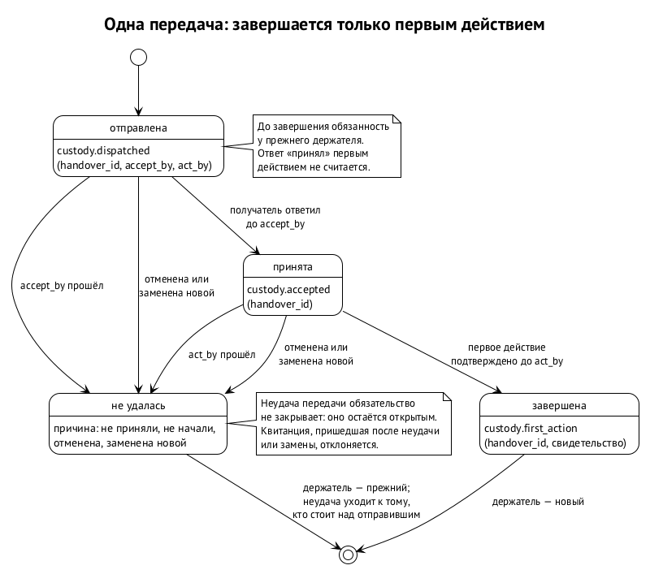
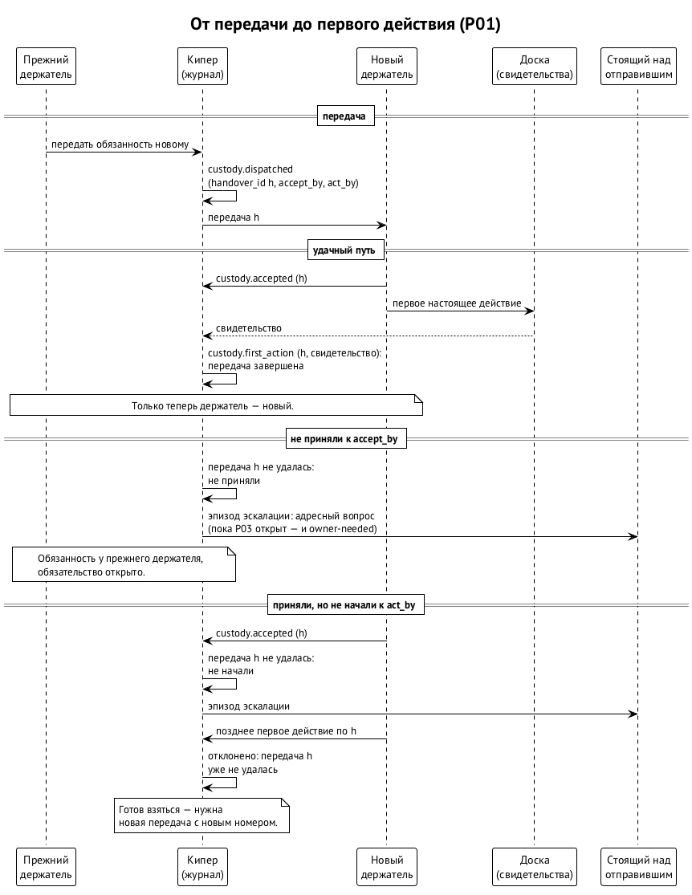

# Передача ответственности

Обязанность переходит от держателя к держателю: дежурство передают сменщику, задачу — другому оркестратору, раннер — тому, кто его починит. У передачи одно жёсткое правило, урок P01: **передача завершается только первым действием нового держателя**. До этого момента обязанность остаётся у прежнего, что бы ни было сказано в чате. ⟦предложено⟧

## Три шага

Передача проходит три шага: ⟦предложено⟧

1. **Отправлена.** Прежний держатель объявляет передачу и называет два срока: к какому времени новый должен её принять (`accept_by`) и к какому — сделать первое действие (`act_by`).
2. **Принята.** Новый держатель подтвердил, что берёт.
3. **Начата.** Новый держатель сделал первое настоящее действие, и оно подтверждено свидетельством доски или исполнения.

«Принял» и «взялся» — разные квитанции, и смешивать их нельзя. Ответ в чате первым действием не считается: нужен след работы.

## Если сроки прошли

Если к `accept_by` передачу не приняли или к `act_by` не сделали первого действия, передача считается неудавшейся. Обязанность при этом никуда не девается: она всё время оставалась у прежнего держателя. Неудача поднимается выше, к тому, кто стоит над отправившим, чтобы он решил, кому передавать. ⟦предложено⟧

В первой редакции неудавшаяся передача называлась так же, как истёкшее обязательство. Это путаница: у передачи свой провал, у обязательства свой срок, и истечение обязательства никогда не закрывает работу (глава 5). Во второй редакции у неудачи передачи своя запись с причиной: не приняли, не начали, отменили, заменили новой. Само обязательство при этом остаётся открытым. ⟦предложено (вторая редакция)⟧

## Зачем передаче свой номер

В первой редакции принятие и первое действие привязаны к паре «обязательство и получатель». Этого мало. Представим, что передачу тому же получателю повторили: старая квитанция о принятии может закрыть новую передачу, потому что записи неотличимы. Оба ревью требуют одного и того же: у каждой передачи свой номер, который никогда не повторяется (`handover_id`). Принятие и первое действие ссылаются на него, на получателя, на его сессию или исполнение и на свидетельство готовности. ⟦предложено (вторая редакция)⟧

С номером приходят и остальные правила. ⟦предложено (вторая редакция)⟧

- **Одна активная передача** на обязательство.
- **Сроки упорядочены:** принять раньше, чем начать, и начать не позже срока самого обязательства.
- **Поздние квитанции отклоняются.** Квитанция, пришедшая после неудачи или после замены передачи новой, не засчитывается и не перетолковывается.
- **Точная формулировка.** Передача завершается, когда первое действие допущенного получателя проверено и надёжно записано в журнал. До этого обязанность у прежнего держателя. Неудавшаяся передача обязательство не закрывает.

## Путь от передачи до первого действия

Схема показывает удачный путь и два неудачных. В первом получатель не подтвердил передачу к `accept_by`. Во втором подтвердил, но к `act_by` ничего не сделал, а его позднее первое действие журнал уже не засчитал. В обоих случаях обязанность не двигается, а неудача поднимается к тому, кто стоит над отправившим. ⟦предложено⟧

## Источники

Первая редакция §10.8: схема записей, «Передача»; ревью PR #9 (sol: находка 2; muse: находка 3) о номере передачи и поздних квитанциях; BUG-261012-on69s4 (P01).
