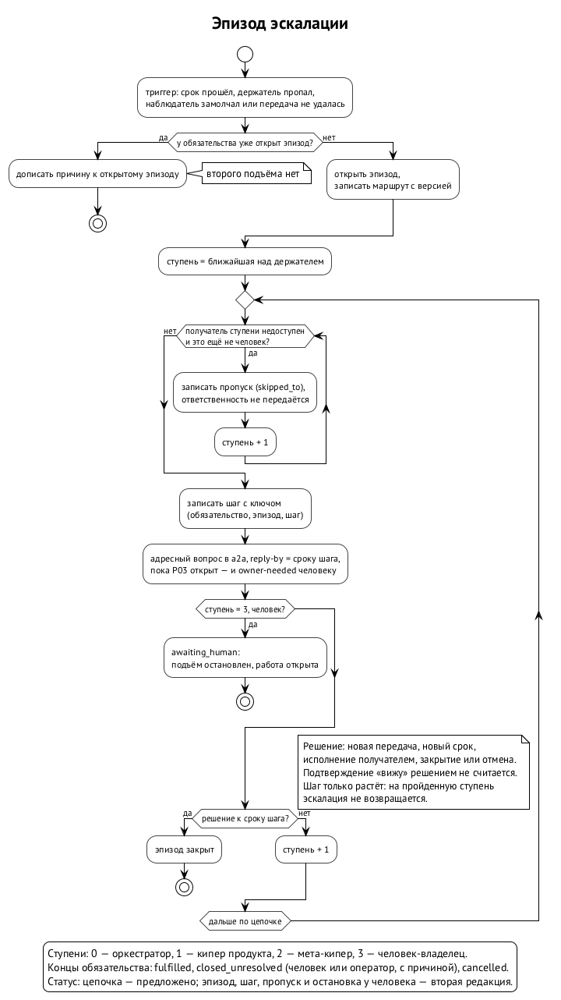

# Эскалация

Срок прошёл, а работа открыта. Держатель пропал. Наблюдатель замолчал. Передача не состоялась. Во всех этих случаях обязательство поднимается вверх, к тому, кто может решить, что с ним делать. Это и есть эскалация. Она не делает работу и не закрывает её, а ищет того, кто примет решение.

## Цепочка

Первая редакция задаёт одну цепочку из четырёх ступеней: ⟦предложено⟧

| Ступень | Кто | Что может решить |
| --- | --- | --- |
| 0 | оркестратор, который отвечает за держателя | передать работу другому, перепланировать внутри своего продукта |
| 1 | кипер продукта | перераспределить работу между оркестраторами продукта |
| 2 | мета-кипер стороны владельца | решить между продуктами, позвать другую сторону |
| 3 | человек-владелец | всё, включая «не делаем» |

Каждый шаг — запись в журнале с полем `escalated_to`. Получатель узнаёт о шаге из сообщения в a2a с пометкой вопроса и сроком ответа `reply-by` (это делает пакет D, глава 11).

Как эти роли называются в спецификации кипера, пока не сведено. Черновик v0.5.1 знает кипера узла и главного кипера пасеки, а цепочка говорит о кипере продукта и мета-кипере. Вторая редакция должна связать одно с другим. ⟦открыто⟧

## Что было не так в первой редакции

Оба ревью нашли одно и то же.

- **Два триггера — две эскалации.** Истёкший срок и пропавший держатель поднимают обязательство независимо друг от друга. Если держатель ушёл на паузу через минуту после срока, наверх уйдут два вопроса об одном и том же.
- **Записи не знают, где они в цепочке.** В записи есть получатель, но нет ни номера шага, ни срока для получателя, ни его ответа, ни ключа, по которому можно отличить повтор. После перезапуска кипер, переигрывая журнал, не поймёт, отправлял ли он уже этот шаг, и может отправить его снова.
- **Два маршрута.** Неудавшаяся передача поднимается к тому, кто стоит над отправившим, а истёкший срок — по цепочке выше. Это разные пути, и между ними возможен пинг-понг.
- **Недоступный получатель.** Если кипер продукта сам на паузе, а родителя у держателя нет, что делать, не сказано.
- **Нет конца.** Истечение срока только поднимает вопрос и никогда не закрывает работу, а отмены нет. Обязательство, на которое человек не ответил, остаётся открытым навсегда, и ничто не мешает поднимать его снова.

## Эпизод и шаг

Вторая редакция чинит это одной конструкцией: эпизодом эскалации. ⟦предложено (вторая редакция)⟧

**Эпизод** открывается первым триггером для обязательства, у которого открытого эпизода нет. Пока эпизод открыт, новые триггеры не открывают второй: они дописываются к нему как дополнительные причины. Эпизод закрывается решением, а если обязательство потом снова попадёт в беду, откроется новый эпизод.

**Шаг** — это номер ступени цепочки, от 0 до 3. Эпизод начинается со ступени сразу над держателем. Если держатель сам оркестратор, первый шаг — 1, кипер продукта. Шаг только растёт: эскалация никогда не возвращается на пройденную ступень, поэтому пинг-понга нет.

**Ключ** шага — тройка «обязательство, эпизод, шаг». На один ключ приходится ровно один переход и ровно одно уведомление, сколько бы триггеров ни сработало одновременно. Истёкший срок, пропавший держатель и замолчавший наблюдатель делят один ключ.

**Маршрут** записывается при открытии эпизода, с версией и с постоянными идентификаторами участников. Переигрывание журнала через месяц поставит шаг на ту же ступень, даже если состав ролей с тех пор сменился.

## Как идёт шаг

Получателю шага приходит адресный вопрос в a2a (пока открыт P03, с копией человеку, см. ниже). Его `reply-by` равен сроку шага: к этому времени получатель должен решить, что делать с обязательством. Подтверждение «вижу» подъём не останавливает: останавливает решение, как и в передаче, где ответ «принял» не заменяет первого действия. ⟦предложено (вторая редакция)⟧

Решение — одно из: ⟦предложено (вторая редакция)⟧

- новая передача с новым номером передачи (глава 4);
- новый срок, назначенный тем, кому обязаны;
- решение подождать пропавшего держателя до названного срока (глава 7);
- исполнение получателем самим, например ответ на вопрос;
- закрытие без решения или отмена (ниже).

Если к сроку шага решения нет, сверка пишет следующий шаг. Кто вправе назначать новый срок и есть ли у этого предел, ещё не решено. ⟦открыто⟧

**Недоступный получатель пропускается.** Если получатель шага стоит на паузе, его хост лежит или он упёрся в лимит провайдера, шаг переходит к следующей доступной ступени, а в журнале остаётся запись с `skipped_to`. Ответственность за работу при этом никому не передаётся: эскалация ищет того, кто решит, а не нового держателя. Когда пропущенный получатель вернётся, он снова доступен для следующих эпизодов, но к нему не возвращается шаг текущего эпизода. ⟦предложено (вторая редакция)⟧

## Пример

Время в примере условное, а срок шага в два часа выбран для наглядности.

- **12:00Z.** Сессия под оркестратором продукта должна ответить на адресный вопрос к 2026-10-13T12:00:00Z и не ответила. Сверка открывает эпизод 1 и пишет шаг 0: оркестратору, срок шага 14:00Z. Оркестратору приходит адресный вопрос с `reply-by` 14:00Z.
- **12:20Z.** Держателя ставят на паузу. Это второй триггер: обязательство осиротело. Запись об этом появляется, но эпизод уже открыт и шаг 0 уже записан, поэтому второго подъёма нет.
- **14:00Z.** Оркестратор не решил. Следующая ступень — кипер продукта, но он сам стоит на паузе. Сверка пишет пропуск и шаг 2: мета-киперу, срок шага 16:00Z.
- **14:40Z.** Мета-кипер передаёт обязательство другой сессии с новым номером передачи. Эпизод закрыт, а обязательство живёт дальше у нового держателя по правилам главы 4.

## У человека эскалация останавливается

Ступень 3 — человек-владелец. Дойдя до него, обязательство переходит в состояние «ждёт человека» (`awaiting_human`): автоматический подъём прекращается, а работа остаётся открытой. Человек видит такие обязательства среди вопросов к владельцу и решает сам. Система за него не решает и молчание его согласием не считает. ⟦предложено (вторая редакция)⟧

## Чем кончается обязательство

Концов у обязательства три, и других нет: ⟦предложено (вторая редакция)⟧

- **исполнено** (`fulfilled`) — работа сделана, свидетельство записано;
- **закрыто без решения** (`closed_unresolved`) — закрыл человек или оператор и назвал причину; это единственный способ закрыть обязательство, не исполнив его;
- **отменено** (`cancelled`) — обязательство открыли по ошибке или оно повторяет другое; у отмены тоже есть автор и причина.

Отмена существует для неверно открытых обязательств, а не для неудобных. Ни срок, ни молчание, ни перезапуск обязательство не закрывают.

## «Сразу» — значит до ближайшей сверки

Первая редакция говорит: обязательство осиротевает сразу и сразу поднимается вверх. Но «сразу» — не время. Вторая редакция уточняет: пока кипер работает, последствия записываются в пределах одного прохода сверки, а после простоя кипера — первой сверкой при старте. Какой интервал сверки считать допустимым, ещё не решено. ⟦открыто⟧

## Одно уведомление и его квитанция

Уведомление о шаге получает свой номер и записывается в журнал до отправки. Повторная отправка после сбоя идёт с тем же номером, а при переигрывании журнала кипер отправляет шаг заново, только если квитанции о доставке нет. Состояние доставки уведомления хранит журнал кипера, а не транспорт. ⟦предложено (вторая редакция)⟧

Пока не закрыта зависимость P03, проверенного способа разбудить простаивающую сессию нет: в случае P03 кипера разбудил человек. Поэтому каждый шаг приходит адресным вопросом в a2a и одновременно видимым человеку вопросом к владельцу (`owner-needed`), а тихое пробуждение эскалация не использует. ⟦согласовано⟧ Оба сообщения несут ключ шага, и квитанции обоих записываются в журнал. ⟦предложено (вторая редакция)⟧

Остаются два шва, которые вторая редакция должна закрыть. ⟦открыто⟧

- **Носитель.** Черновик v0.5.1 требует, чтобы кипер говорил с корневыми оркестраторами только через waggle (§10.4), а первая редакция ядра шлёт эскалацию через a2a. Ревью предлагает правило: одна запись и одно уведомление на шаг, а если участвуют оба носителя, запись хранит квитанции обоих.
- **Таймеры a2a.** Правило 32 a2a само поднимает блокирующий вопрос: напоминает на половине срока, а по сроку отдаёт киперу области, причём никогда не оператору, потому что совет не решение. Ядро же поднимает обязательство до человека. Как два механизма делят один вопрос, разобрано в главе 11.

## Источники

Первая редакция §10.8: «Передача» (пропущенные сроки), «Эскалация», «Недоступность держателя»; ревью PR #9 (sol: находки 1 и 3, находка 10 о ролях; muse: находки 2, 4 и 5); заметка 1 мета-кипера Алексея от 12.10 о зависимости P03; уведомление мета-кипера Ивана от 12.10: ключ шага и `reply-by`, равный сроку шага; протокол a2a, правило 6 и правило 32, пункты 4 и 5; спецификация кипера v0.5.1, §4 и §10.4.
