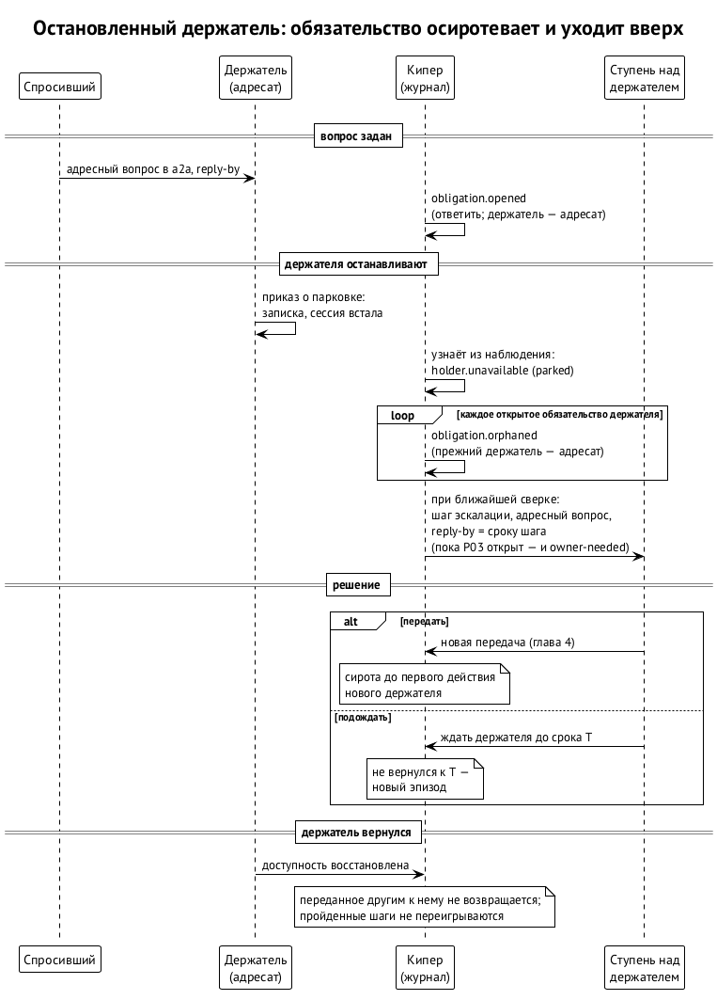

# Когда держатель пропал

Держатель может перестать работать по многим причинам: его поставили на паузу, сессию заменили новой, у провайдера кончился лимит, машина легла. Всё, что он держал, в этот момент никто не держит. Первая редакция отвечает на это одним правилом: **все открытые обязательства пропавшего держателя сразу становятся осиротевшими и поднимаются вверх.** ⟦предложено⟧

В журнале это две записи. Сначала `holder.unavailable` с причиной, затем по `obligation.orphaned` на каждое открытое обязательство держателя. Дальше работает эскалация из главы 6. Если в это время у обязательства уже идёт эпизод, например потому что срок прошёл минутой раньше, второго подъёма не будет: сиротство допишется к открытому эпизоду причиной.

## Адресный вопрос не ждёт

Правило выросло из случая 8–12 октября (глава 1). Сессию остановили, а вопросы к ней продолжали приходить и четыре дня лежали без ответа. Никто их не забрал и никуда не поднял, потому что для системы остановленный держатель ничем не отличался от занятого.

С ядром адресный вопрос — это обязательство ответить, и его держатель — адресат. Когда адресата ставят на паузу, обязательство осиротевает и уходит к ступени над ним при ближайшей сверке. Спросивший не ждёт четыре дня ответа, который не придёт. Этот случай вошёл в приёмку как проверка-ловушка: «остановленный держатель с открытым адресным вопросом». ⟦предложено⟧

## Причины

Первая редакция различает пять причин. Обязательства сиротеют при любой из них, но дальше они ведут себя по-разному. ⟦предложено⟧

| Причина | Что случилось | Что важно дальше |
| --- | --- | --- |
| парковка (`parked`) | сессию остановили приказом, она оставила записку о парковке | вернётся по команде; когда — неизвестно |
| ротация (`rotated`) | сессию заменили новой | см. ниже: правило для плановой ротации не решено |
| лимит провайдера (`rate_limited`) | провайдер перестал отвечать до конца окна | окно обычно известно; сторож кипера ставит зависимые сессии на паузу и возобновляет их после окна |
| хост лёг (`host_down`) | машина или хост сессий недоступны | ни записки, ни процесса |
| неизвестно (`unknown`) | держатель молчит, причина неясна | записывается как неизвестность и выясняется, а не додумывается |

Кипер сам о недоступности не догадывается. Он узнаёт о ней из наблюдения: из приказа о парковке, из статуса в a2a, от сторожа, который видит лимиты провайдеров. Как наблюдение устроено и что бывает, когда оно само ломается, — глава 10.

После перезагрузки машины есть соблазн взять сохранённые записи о ранах за живое держание. Это соседний случай P07 (BUG-261012-1v1sw2): запись о том, что ран держал работу, не доказывает, что его процесс жив. В пакет ядра P07 не входит, но правило то же: доступность держателя устанавливается наблюдением, а не старыми записями. ⟦предложено⟧

## Что решает получатель эскалации

Получатель шага решает так же, как в главе 6. Для осиротевшего обязательства обычно есть два разумных ответа. ⟦предложено (вторая редакция)⟧

- **Передать.** Обязательство уходит новому держателю по правилам главы 4. Сиротой оно остаётся до первого действия нового держателя: ответ «принял» его не закрывает.
- **Подождать.** Если держатель скоро вернётся, например закончится окно лимита, получатель записывает решение и срок, к которому держатель должен вернуться. Не вернулся к этому сроку — откроется новый эпизод.

## Ротация: открытый вопрос

Первая редакция считает ротацию недоступностью. Для внезапной потери сессии это верно. Но ротации бывают и плановыми: 8 октября по приказу Ивана сессии передали дела и пересели в новые сессии на Mac mini, а арбитр при этом сохранил свой идентификатор и ключи. По правилу первой редакции такой переезд разом сделал бы сиротами все обязательства переезжающих и поднял бы всё наверх.

Кандидат для второй редакции: плановая ротация — это передача внутри одного участника, от старой сессии к новой. Как любая передача, она завершается первым действием новой сессии, а до этого обязанность остаётся у старой. Внезапная потеря сессии остаётся недоступностью. ⟦открыто⟧

## Возвращение

В первой редакции нет записи о том, что держатель вернулся, поэтому однажды недоступный держатель так и остаётся недоступным для журнала. Вторая редакция добавляет переход «доступность восстановлена». ⟦предложено (вторая редакция)⟧

- Вернувшийся держатель снова может получать передачи и шаги эскалации.
- Обязательства, которые за время его отсутствия передали другим, сами к нему не возвращаются.
- Обязательства, по которым решили подождать, остаются у него.
- Пройденные шаги эскалации не переигрываются: цепочка идёт только вперёд.

## Если кипер упал посередине

Запись о недоступности и записи о сиротах — несколько отдельных записей подряд. Кипер может упасть между ними. Вторая редакция считает главной запись о недоступности: если после неё не хватает записей о сиротах, сверка при старте дописывает недостающие и ссылается на ту же причину. Повторно уже записанные записи она не создаёт. Подробнее о восстановлении — глава 9. ⟦предложено (вторая редакция)⟧

## Сломанный общий ресурс

Случай P13 — раннер, который почти сутки не брал задачи, — ядро тоже видит как обязательство: «держатель X должен вернуть ресурс R в строй, следующая проверка к сроку D». Первая редакция ставит инвариант: у сломанного общего ресурса всегда есть держатель и срок повторной проверки. ⟦предложено⟧

Вторая редакция делает из этого исполнимую жизнь. ⟦предложено (вторая редакция)⟧

- **Своя поломка — свой эпизод.** У каждой поломки свой номер. Запись о восстановлении закрывает только поломку со своим номером и только с проверенным свидетельством, например раннер снова взял задачу. Сроков у восстановления нет: они нужны только открытой поломке.
- **Поломка без держателя не теряется.** Сообщение о поломке без держателя журнал как есть не принимает, но и не выбрасывает. Кипер открывает обязательство на заранее назначенного запасного владельца ресурса и поднимает это как происшествие.
- **Держатель пропал — как у любого обязательства.** Если тот, кто чинил ресурс, остановился, обязательство осиротевает и поднимается вверх. В случае P13 именно этого не хватило: продолжение остановилось, и никто не вернулся проверить.

Кто запасной владелец у каждого общего ресурса, ещё не решено. ⟦открыто⟧

## Источники

Первая редакция §10.8: «Недоступность держателя», записи `holder.unavailable`, `obligation.orphaned`, `resource.degraded`, `resource.restored`, приёмка; поправка 4 владельца спецификации, принятая мета-кипером Алексея 12.10 (сирота и немедленный подъём, ловушка с остановленным держателем); ревью PR #9 (sol: находки 3 и 4; muse: находки 3, 4 и 7); спецификация кипера v0.5.1, §12.2 (сторож); BUG-261012-wysevu (P13), BUG-261012-1v1sw2 (P07); переписка в `#session-platform` за 8–12.10.
