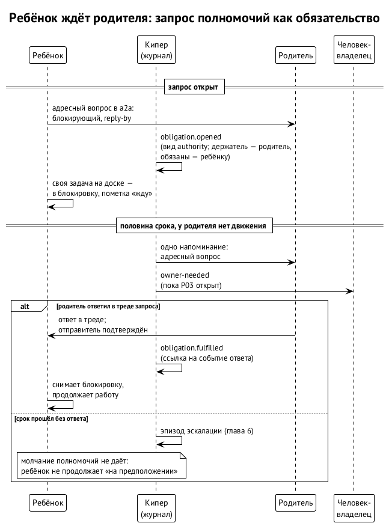

# Ребёнок ждёт родителя

Дочерняя сессия упёрлась в решение, на которое у неё нет полномочий: можно ли трогать чужой модуль, брать ли дорогую модель, расширять ли задачу. Решить может только родитель, и ребёнок ждёт. В случае P04 родитель в это время простаивал и об ожидании не знал (глава 1). Нигде не было записано, что ребёнок ждёт и до какого срока, поэтому и следить было не за чем.

## Запрос полномочий

Первая редакция вводит запись `authority.requested`: какой ребёнок, какой родитель, какой вопрос, какая пометка и к какому сроку. Ожидание ребёнка становится видимым. Родитель должен к сроку ответить или поднять вопрос выше, а простаивающего родителя с открытым запросом кипер будит. ⟦предложено⟧

У этого текста три проблемы, и вторая редакция решает каждую. ⟦предложено (вторая редакция)⟧

1. **Запрос жил отдельно от обязательств.** У него свой номер, но ни сроков, ни эскалации, ни концов, как у обязательства. Во второй редакции запрос полномочий — вид обязательства (`authority`, глава 3). Держатель — родитель, тот, кому обязаны, — ребёнок. Половина срока, сам срок, эскалация и концы — общие для всех обязательств.
2. **Не сказано, что считается ответом.** Ответ засчитывается, когда родитель или получатель эскалации отвечает в треде запроса и a2a подтверждает, кто отправитель. Так же a2a считает вопрос открытым, пока адресат не ответит в его треде (правило 32, пункт 5). Ответ по другому каналу или пересказ запрос не закрывают. Ответ записывается в журнал как исполнение обязательства со ссылкой на событие a2a.
3. **«Кипер будит» — двух вещей не хватает.** Нет полномочий будить любого родителя и нет проверенного способа будить. Об этом ниже.

**Молчание полномочий не даёт.** Для обычного вопроса a2a разрешает неблокирующий режим: спросивший продолжает работу на своём предположении, если ответа нет к сроку. Для запроса полномочий так нельзя: ребёнок не может «предположить» разрешение, которого у него нет, даже если срок прошёл. По сроку запрос поднимается вверх, а не превращается в согласие. ⟦предложено (вторая редакция)⟧

## Кто вправе будить

В таблице полномочий кипера (глава 2) кипер будит только зарегистрированных корневых оркестраторов. Родитель ребёнка часто сам суб-оркестратор, и будить его может только его корневой оркестратор. Поэтому во второй редакции путь пробуждения идёт через того, кто на это уполномочен: кипер просит корневого оркестратора, а тот будит своего суб-оркестратора. ⟦предложено (вторая редакция)⟧

На платформе Swarma к этому добавляется второе правило. Любой физический старт или возобновление сессии делает только диспетчер (находки F-4 и F-20, решения владельца 12 октября). ⟦решено⟧ Хост сессий просит диспетчера о старте по разрешению, выданному на одну логическую сессию, и по прямому приказу кипера ничего не запускает. ⟦решено⟧

## Будить пока нечем

Есть проблема глубже полномочий. Проверенного способа разбудить простаивающую сессию сегодня нет. Это случай P03 (глава 1): кипер продукта простоял 19 минут при 70 непрочитанных событиях, фоновое ожидание срабатывало, но простаивающую сессию Codex не будило. Разбудил его человек.

Поэтому мета-кипер Алексея попросил назвать P03 явной зависимостью ядра, и стороны договорились: пока P03 не закрыт, ядро не обещает пробуждения. Эскалация приходит адресным вопросом в a2a и видимым человеку вопросом к владельцу (`owner-needed`): сегодня только человек надёжно будит простаивающую сессию. Приёмка первого среза не заявляет пробуждения, которого ядро доставить не может. ⟦согласовано⟧

## Как идёт запрос

1. **Запрос открыт.** Ребёнок задаёт адресный вопрос родителю, кипер открывает обязательство вида `authority` со сроком. Ребёнок ставит свою задачу на доске в блокировку с пометкой, чего он ждёт, по правилу 32 a2a. Доску ребёнка кипер не трогает. ⟦предложено (вторая редакция)⟧
2. **Половина срока.** Если от родителя нет движения, кипер отправляет одно напоминание: адресный вопрос родителю, а пока P03 открыт, и вопрос к владельцу. ⟦предложено (вторая редакция)⟧
3. **Ответ.** Родитель отвечает в треде. Кипер записывает исполнение, ребёнок или его оркестратор снимают блокировку. ⟦предложено (вторая редакция)⟧
4. **Срок прошёл.** Ответа нет: открывается эпизод эскалации (глава 6), и решение ищут выше. ⟦предложено (вторая редакция)⟧

## Как это проверить

В приёмке первой редакции есть проверка-ловушка «простаивающий родитель и ждущий ребёнок», но без ожидаемого результата. Оба ревью требуют для каждой ловушки начальное состояние, вносимый сбой, ожидаемую цепочку записей и предел времени.

Одно ревью предложило ожидаемый результат: «на половине срока родитель разбужен ровно один раз». Пока P03 открыт, такая проверка требовала бы обещания, которое ядро не может выполнить. Вторая редакция проверяет то, что ядро действительно делает. ⟦предложено (вторая редакция)⟧

- На половине срока ушло ровно одно напоминание родителю и один вопрос к владельцу, оба с квитанциями доставки.
- Ответ родителя в треде запроса закрыл обязательство, и в журнале есть ссылка на событие ответа.
- Если ответа нет, к сроку открыт ровно один эпизод эскалации.

Когда P03 закроют, в приёмку вернётся пробуждение: родитель разбужен один раз, и его первое действие подтверждено свидетельством.

## Источники

Первая редакция §10.8: «Ребёнок ждёт родителя», запись `authority.requested`, приёмка; ревью PR #9 (sol: находки 4, 6 и 9; muse: находки 3, 7 и 8); заметка 1 мета-кипера Алексея от 12.10 о зависимости P03; протокол a2a, правило 32, пункты 3–5; решения владельца 12.10: F-4 и F-20; BUG-261012-3grk0w (P04), BUG-261012-3pgnyd (P03).
