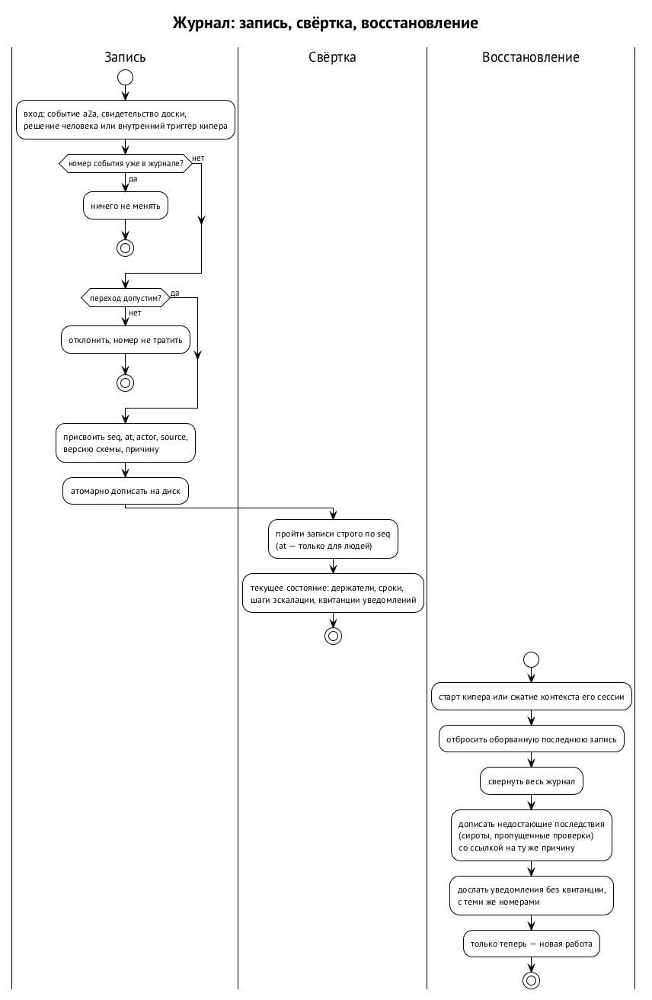

# Журнал и восстановление

Журнал — память ядра. Всё, что ядро знает об обязательствах, оно знает из журнала, а не из разговора: разговор сжимается, сессия останавливается, машина перезагружается. Журнал переживает всё это, если правильно записан и правильно прочитан. Эта глава о том, как его писать и как по нему восстанавливаться.

## Кто ведёт журнал

Спецификация кипера делит его на две части: роль и модуль. Роль — модель в сессии, она решает. Модуль — команда `keeper` и её библиотека, она делает детерминированную работу. «Модель решает, команда делает» (§7.1). ⟦предложено⟧

Ядро целиком относится к модулю. Журнал пишет и сверку ведёт детерминированный процесс кипера, а не модель. Поэтому проверки сроков идут, даже когда сессия кипера простаивает или её контекст сжимается: молчание модели часы не останавливает. ⟦предложено (вторая редакция)⟧

## Запись

Записи только дописываются. У каждой есть общие поля: ⟦предложено⟧

- `seq` — номер записи, строго растущий внутри журнала;
- `at` — время записи, полная дата в UTC;
- `actor` — от чьего имени запись;
- `source` — что её вызвало: событие a2a, событие доски или коммит.

Подписи — шов на будущее. Первая версия записывает только автора и источник, а позже каждая запись будет подписываться через модуль доверия и брокер учётных данных. ⟦предложено⟧

Вторая редакция добавляет к записи версию схемы и номер события и задаёт сам порядок записи. ⟦предложено (вторая редакция)⟧

1. **Проверить переход до записи.** Запись, которая нарушает правила, отклоняется и номера не получает: срок без даты, квитанция о принятии чужой передачи, исполнение уже закрытого обязательства.
2. **Записать атомарно и надёжно.** Запись либо целиком на диске, либо её нет. Если машина упала посреди записи, при старте кипер узнаёт оборванную последнюю запись и не принимает её за настоящую.
3. **Повтор входа ничего не меняет.** То же событие a2a, доставленное дважды, даёт одну запись: номер события уже есть в журнале.

## Свёртка

Текущее состояние — кто что держит, какие сроки, на каком шаге эскалация — вычисляется проходом по записям. Первая редакция называет это свёрткой, но правил не даёт. Вторая редакция их задаёт. ⟦предложено (вторая редакция)⟧

- **Порядок — по номеру, не по времени.** Записи сворачиваются строго по возрастанию `seq`. Поле `at` — для людей. Часы могут шагнуть (глава 5), а номер не может.
- **Таблица переходов явная.** Для каждой пары «состояние, запись» сказано, принимается ли запись. Это нужно, потому что ответы не очевидны. Квитанция о принятии после неудачи передачи отклоняется (глава 4). А исполнение после истёкшего срока принимается: истечение работу не закрывает (глава 5).
- **Отклонённое не перетолковывается.** Запись, не прошедшая проверку, не подгоняется под «что, наверное, имелось в виду».
- **У внутренних записей есть причина.** Проверку на половине срока и истечение срока никто извне не присылал, их пишет сам кипер. В первой редакции поле `source` такую запись описать не может. Во второй каждая внутренняя запись называет свой триггер и запись-причину.

## Падение посередине

Некоторые последствия занимают несколько записей подряд. Пропал держатель — нужно записать его недоступность и по записи о сироте на каждое его обязательство. Наступил срок — нужно записать шаг эскалации и отправить уведомление. Кипер может упасть в любой точке. Вторая редакция делает восстановление детерминированным. ⟦предложено (вторая редакция)⟧

- **Первая запись — главная.** Если после записи о недоступности не хватает записей о сиротах, сверка при старте их допишет со ссылкой на ту же причину. Уже записанные записи она не повторяет.
- **Уведомление сначала записывается, потом отправляется.** У уведомления свой номер, и повторная отправка идёт с тем же номером. При восстановлении кипер досылает только те уведомления, на которые нет квитанции доставки. Знание о том, что уведомление было, хранит журнал кипера, а не транспорт.
- **Проверки не повторяются.** Результат каждой проверки записан. Выполненные проверки при восстановлении не повторяются, а пропущенные за время простоя выполняются один раз (глава 5).
- **Итог.** Состояние после падения — последняя целая запись плюс последствия, пересчитанные детерминированно.

## Старт и сжатие контекста

Кипер восстанавливает своё состояние из журнала при каждом старте и после каждого сжатия контекста своей сессии. Обязательства и сроки он никогда не берёт из памяти разговора. После сжатия переигрывание запускает сторож (§12.2). Это прямой ответ на P06, где после сжатия сессия продолжила работать по устаревшему состоянию. ⟦предложено⟧

Вторая редакция уточняет это правило с учётом разделения на роль и модуль. Модуль сжатия контекста не замечает: журнал и сверка живут вне модели. Переигрывание после сжатия нужно модели: она получает текущее состояние из свёртки, а не из пересказа. После старта процесса кипера всё начинается со сверки незавершённых последствий — сирот, недосланных уведомлений, пропущенных проверок, — и только потом идёт новая работа. ⟦предложено (вторая редакция)⟧

Где лежит файл журнала и как он попадает в резервную копию, первая редакция не говорит. Ревью предлагает держать его в корне пасеки, сохранять вместе с ним и восстанавливать до шага 2 команды `keeper up`, то есть до возобновления сессии кипера. На платформе Swarma файл принадлежит пользователю ОС кипера (глава 3). ⟦открыто⟧

## Как это проверить

Приёмка первой редакции называет проверки-ловушки одними существительными: «сравнение по времени без даты», «переигрывание, потерянное после перезапуска». Нет ни начального состояния, ни ожидаемых записей, ни предела времени, ни того, что считается провалом. Оба ревью требуют таблицу: начальное состояние, вносимый сбой, ожидаемая цепочка записей, предел времени, запрещённый исход. Направление второй редакции: ⟦предложено (вторая редакция)⟧

| Случай | Сбой | Ожидаем | Запрещено |
| --- | --- | --- | --- |
| P06, срок без даты | открыть обязательство со сроком «15:00» | запись отклонена, номер не потрачен | обязательство со сроком без даты |
| P06, сжатие | сжать контекст кипера при открытых сроках | после сжатия состояние перечитано из журнала и совпадает с прежним | срок, взятый из пересказа |
| P01, нет первого действия | передача отправлена, к `act_by` первого действия нет | обязанность у прежнего держателя, одна запись о неудаче передачи, один эпизод эскалации | засчитанная поздняя квитанция |
| P05, перезапуск | перезапустить кипера на журнале из N записей | свёртка совпадает с прежней | повторное уведомление |
| P05, наблюдатель | наблюдатель не прислал квитанции к своему сроку | наблюдатель «потерян», эскалация как для сироты | тишина, неотличимая от «всё хорошо» |
| P04, родитель простаивает | запрос полномочий открыт, родитель простаивает | на половине срока одно напоминание и один вопрос к владельцу | второе напоминание; продолжение «на предположении» |
| остановленный держатель | держателя с открытым адресным вопросом ставят на паузу | сирота и шаг эскалации в пределах одного прохода сверки | вопрос без движения после сверки |
| P13, поломка без держателя | сообщить о поломке без держателя | обязательство открыто на запасного владельца, поднято как происшествие | молча принятая или выброшенная поломка |

Кроме того, в каждую цепочку вносятся падения между зависимыми записями, повторные входы, поздние квитанции, недоступные получатели эскалации и переход даты в UTC. Для каждого перехода нужна и положительная проверка: удачная передача, ответ родителя, восстановление ресурса, переигрывание без потерь. Везде, где это уместно, проверяется, что держатель не сменился и что на каждый шаг пришёлся ровно один переход.

## Источники

Первая редакция §10.8: «Что держит журнал», общие поля, «Переигрывание и сжатие», приёмка; спецификация кипера v0.5.1, §7.1–§7.2 (роль и модуль), §12.2 (сторож); ревью PR #9 (sol: находки 1, 7 и 8; muse: находки 3, 4, 7 и 13); BUG-261012-1ikhxj (P05), BUG-261012-2f684f (P06).
