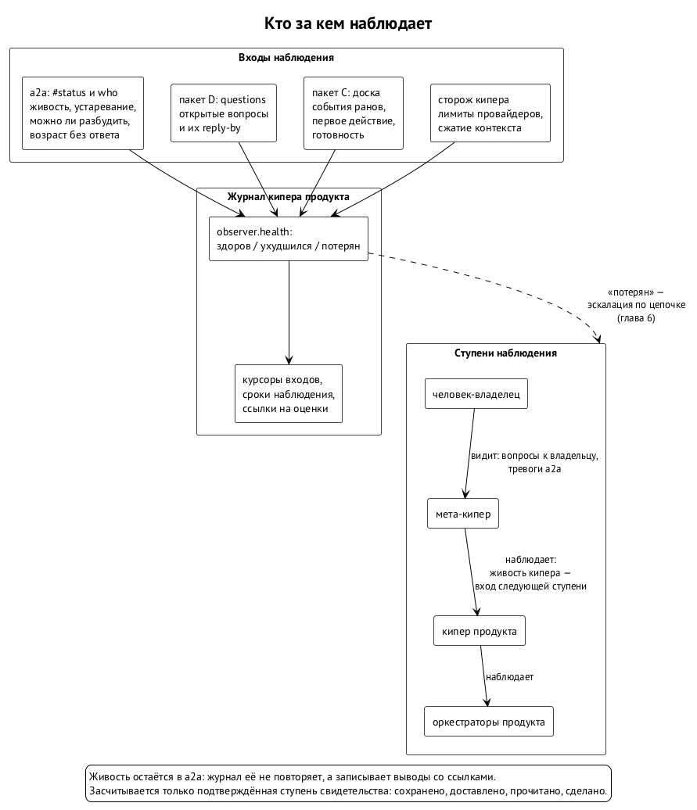

# Наблюдатели

Обязательство, за которым никто не следит, ничем не лучше обязательства, которого нет. Следят наблюдатели: кипер, который смотрит на оркестраторов своего продукта; фоновое ожидание, которое ловит новые сообщения; монитор живости a2a. В случае P05 у наблюдения не было ни восстановления после перезапуска, ни состояния «нездорово», поэтому сломанное наблюдение выглядело так же, как «всё хорошо» (глава 1).

Первая редакция вводит запись о здоровье наблюдателя (`observer.health`) с тремя состояниями: здоров, ухудшился, потерян. Наблюдатель потерян, когда к сроку не пришли ни квитанция, ни сигнал живости. Потерянного наблюдателя кипер поднимает вверх так же, как осиротевшего держателя. Живость остаётся в a2a: журнал её заново не изобретает. ⟦предложено⟧

## Что уже умеет a2a

Протокол a2a умеет больше, чем кажется по первой редакции. ⟦работает сегодня⟧

- **Комната `#status`.** Каждый агент пишет туда свою запись живости: состояние (работает, простаивает, ждёт человека, заблокирован, останавливается), когда был последний сигнал и как часто он должен приходить, какая среда, установлены ли хуки, есть ли звонок.
- **`a2a who`.** Показывает, кто упал, чей сигнал устарел, у кого часы ушли в будущее и чья запись испорчена. Порог устаревания задаёт тот, кто смотрит.
- **Раздельные столбцы.** Можно ли разбудить среду, установлены ли хуки и сколько ждёт ответа последний запрос — разные столбцы. Свежий сигнал от фонового ожидания не доказывает ни того, что среду можно разбудить, ни того, что на запрос ответили. Простаивающая сессия Codex без проверенного пробуждения так и показывается недоступной. Это урок P03, уже встроенный в a2a.
- **Возраст без ответа.** `who` умеет находить запросы, вопросы и вопросы к владельцу, оставшиеся без ответа. Ответ засчитывается, только если его прислал настоящий отправитель, которому вопрос был адресован.
- **Тревоги.** В режиме наблюдения `who` пишет одно событие на каждое изменение: происшествие в комнате или вопрос к владельцу для киперов, когда сессия ждёт человека или простаивает и её некому разбудить.

Ядру всё это не нужно повторять. Ему нужно то, чего у a2a нет: долговременная память о том, за чем следили, до какого места досмотрели и что из этого следует для обязательств.

## Что добавляет ядро

Вторая редакция поручает журналу кипера три вещи. ⟦предложено (вторая редакция)⟧

- **Курсоры.** До какого места прочитан каждый вход: статус, открытые вопросы, свидетельства доски. После перезапуска наблюдение продолжается с курсора, а не с нуля и не «с сейчас».
- **Сроки наблюдения.** К какому времени ждать следующую квитанцию или следующий сигнал. Наблюдатель потерян не «когда стало тихо», а когда прошёл записанный срок.
- **Ссылки на оценки.** Каждый вывод «здоров», «ухудшился» или «потерян» ссылается на то, по чему он сделан.

Порядок наблюдений фиксирован, чтобы два переигрывания одного журнала дали одно и то же состояние (глава 9).

## Четыре ступени свидетельства

Главный урок P03 и P05: отправить, доставить, прочитать и сделать — четыре разных факта. Сообщение отправлено, но не доставлено. Доставлено, но среда простаивает и его не видит. Показано фоновым ожиданием, но модель его не обработала. Обработано, но ничего не сделано. Случай с 70 непрочитанными событиями — именно такая лестница, на которой всё остановилось между второй и третьей ступенью.

Вторая редакция записывает для каждого свидетельства, до какой ступени оно доказано. ⟦предложено (вторая редакция)⟧

| Ступень | Что это значит | Чем доказывается |
| --- | --- | --- |
| сохранено | сообщение принято сервером | идентификатор события a2a |
| доставлено | сообщение дошло до получателя: лежит в его почтовом ящике или звонок принят средой | состояние получателя; снаружи видно не всегда |
| прочитано | получатель обработал сообщение | квитанция его почтового ящика; ожидание, которое только показало сообщение, её не даёт |
| сделано | получатель действовал | ответ в треде, событие доски, коммит, событие рана |

Засчитывается только верхняя ступень, подтверждённая свидетельством. Первое действие (глава 4) и исполнение обязательства — это всегда ступень «сделано». Если какую-то ступень снаружи не видно, она записывается как неизвестная. Из соседней ступени её не выводят: «отправили, значит, прочитали» — ровно та ошибка, из-за которой кипер простоял 19 минут.

## Три состояния

- **Здоров.** Квитанции и сигналы приходят к своим срокам, курсоры движутся. ⟦предложено⟧
- **Ухудшился.** Часть входов недоступна: доска или a2a не ответили на чтение. Кипер записывает это и повторяет попытку с растущей паузой. Наступление сроков ухудшение не останавливает никогда (глава 3). ⟦предложено (вторая редакция)⟧
- **Потерян.** Срок наблюдения прошёл, а квитанции или сигнала нет. Это состояние, а не тишина: оно записано и поднимается вверх, как осиротевшее обязательство (главы 6 и 7). ⟦предложено⟧

## Кто следит за самим кипером

Если кипер упал, эскалировать некому: журнал некому вести, сроки некому проверять. Мета-кипер Алексея заметил это в своём чтении первой редакции и предложил правило, которое вторая редакция принимает: живость самого кипера — вход наблюдения для следующей ступени, мета-кипера, с тем же правилом «потерян — поднять вверх». ⟦согласовано⟧

Лестница не обрывается ни на одной ступени. Кипер продукта смотрит за оркестраторами, мета-кипер — за киперами продуктов, а мета-кипера видит человек: в вопросах к владельцу и в тревогах a2a. ⟦предложено (вторая редакция)⟧

## Сторож

У кипера есть свой сторож (спецификация кипера, §12.2): он видит заполненность контекста каждой сессии, сигнал о скором сжатии и лимиты провайдеров. Для ядра он — ещё один источник наблюдений: сообщает, что держатель упёрся в лимит (глава 7), и после сжатия контекста запускает переигрывание журнала (глава 9). Работу сторож не двигает никогда, он ставит на паузу и докладывает. ⟦предложено⟧

## Источники

Первая редакция §10.8: «Здоровье наблюдателя», запись `observer.health`; заметка 2 мета-кипера Алексея от 12.10 о живости самого кипера; ревью PR #9 (sol: находка 5; muse: находки 3 и 10); документация a2a (`docs/cli.md` на 12.10): живость, `#status`, `who`, возраст без ответа, тревоги, почтовый ящик и квитанции; спецификация кипера v0.5.1, §12.2; BUG-261012-1ikhxj (P05), BUG-261012-3pgnyd (P03).
