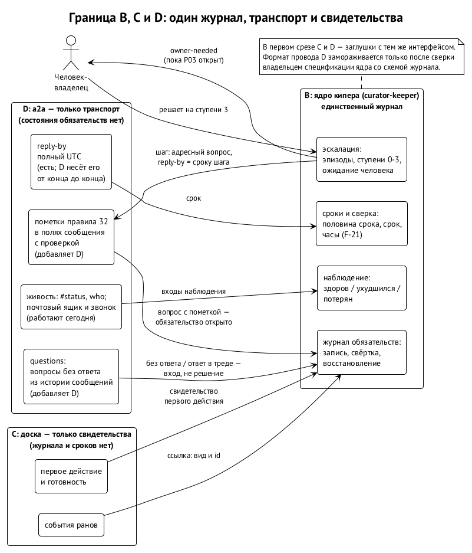

# Ядро кипера и a2a

Ядро кипера и протокол a2a работают с одним и тем же материалом. Вопросы задаются в a2a, ответы приходят в a2a, срок ответа `reply-by` едет в a2a, живость видна в a2a. При этом протокол a2a уже содержит правила о сроках и открытых вопросах: правило 32 говорит, что таймеры живут в a2a и что a2a считает вопрос открытым, пока на него не ответили. Если ничего не развести, у системы появятся два места правды о том, кто кому что должен, и два механизма, которые поднимают один и тот же вопрос. Эта глава о том, как их развели и что ещё не разведено.

## Три пакета

12 октября Иван выбрал, где живёт ядро (решение R243, «берем это»): ⟦решено⟧

- **B, ядро кипера** — в репозитории `curator-keeper`, как первый срез спецификации кипера;
- **C, доска** — только адаптеры свидетельств, без своего журнала обязательств;
- **D, a2a** — только если оркестратор a2a подтвердит, что правилу 32 не хватает поддержки в коде.

Оркестратор a2a подтвердил это в тот же день. В версии a2a cc1d79e у сообщений нет полей для пометок правила 32 и их проверки, нет команды `questions`, а живость меряется общим порогом возраста на получателя, а не сроком каждого вопроса. Правило 32 действует как договорённость между агентами, но машиной не проверяется. Добавить это — работа пакета D.

Затем стороны согласовали границу: ⟦согласовано⟧

- **D — только транспорт.** Пометки правила 32 в полях сообщения с проверкой, полный `reply-by` в UTC от отправителя до получателя и чтение открытых вопросов `questions`. Долговременного состояния обязательств у D нет, и таймеров, которые решают эскалацию, тоже нет.
- **B — единственный журнал.** Он владеет исполнением сроков и потребляет контракт D, а до его готовности — заглушку с тем же интерфейсом.
- **C — только свидетельства.** События ранов, свидетельства первого действия и готовности, которые доска отдаёт в журнал.

В первом срезе ядра C и D — заглушки с тем же интерфейсом, что и настоящие адаптеры. ⟦согласовано⟧

## Что едет через границу

| Откуда | Куда | Что |
| --- | --- | --- |
| D | B | пометки вопросов, `reply-by`, вопросы без ответа, ответы в тредах с подтверждённым отправителем |
| a2a (живость) | B | `#status` и `who` как входы наблюдения (глава 10) |
| C | B | ссылки на свидетельства: вид из закрытого списка и идентификатор |
| B | D | шаги эскалации: адресные вопросы с `reply-by`, равным сроку шага; пока P03 открыт, ещё и вопросы к владельцу |

Обратных записей нет. B не пишет на доску и не хранит состояния сообщений, D не пишет в журнал. Журнал хранит ссылки на события a2a, а не их копии (глава 3).

## Правило 32 сегодня

Правило 32 приняли 30 сентября по замыслу Алексея. Каждый вопрос несёт пометку и явный `reply-by`. ⟦работает сегодня⟧

- **Неблокирующий вопрос** (`non-blocking`) с предположением (`assume`): «продолжаю на X, если до срока не скажут иначе». Это обычный выбор.
- **Блокирующий вопрос** (`blocking`) с указанием, что именно блокировано (`blocks`). Только когда ни одно предположение не безопасно: ошибка была бы необратимой, внешней, опасной или выбросила бы работу.
- **Блокировка — задачи, а не агента.** Спросивший ставит в блокировку свою задачу на доске и работает над другими. Если работать не над чем, заканчивает ход. Спать, опрашивать и крутиться в цикле нельзя: разбудит ответ.
- **Раны и удалённые исполнители не ждут.** Они останавливаются с вопросом, а спрашивает их оркестратор.

Для ядра первая редакция берёт только имена пометок. Вторая редакция должна дать им смысл. У `blocks` должна быть цель, у `assume` — само предположение. У обязательств, которые родились не из сообщения, нужны пометки по умолчанию. И отдельный запрет: предположение по истечении срока никогда не даёт полномочий (глава 8). ⟦предложено (вторая редакция)⟧

## Шов первый: таймеры

Пункт 4 правила 32 говорит: «таймеры живут в a2a, а не в модели». На половине срока a2a напоминает о блокирующем вопросе. По сроку он отдаёт вопрос киперу области — киперу продукта или арбитру общего ресурса — и никогда оператору. Для неблокирующего вопроса он напоминает один раз, после чего спросивший продолжает на своём предположении. Граница пакетов говорит обратное: у D нет таймеров, которые решают эскалацию.

Противоречие меньше, чем кажется. Правило 32 требует, чтобы таймеры не жили в модели, и ядро с этим согласно: сверка — детерминированный код, а не модель (глава 9). Расходятся они в другом: в том, где живёт этот код и кто решает, куда поднимать вопрос.

Направление второй редакции разделяет факт и решение. ⟦предложено (вторая редакция)⟧

- **Факты — дело транспорта.** a2a может сообщать, что наступила половина срока или что срок прошёл. Это события, а не решения.
- **Решения — дело журнала.** B принимает эти события как входы, сверяет со своим журналом и решает, поднимать ли обязательство и к кому, по цепочке главы 6.
- **Лёгкое правило остаётся.** Для вопроса, который не стал обязательством в журнале, например для совета, остаётся лёгкое правило самого a2a: одно напоминание, потом повторный вопрос в комнате.

Окончательно это нужно договорить со стороной a2a. ⟦открыто⟧

## Шов второй: открытый вопрос и открытое обязательство

Пункт 5 правила 32 говорит, что a2a считает вопрос открытым, пока адресат не ответит в его треде. Ревью первой редакции предложило обратное: открытость выводит только B, а чтение `questions` в D опрашивает журнал B.

Направление второй редакции: это два разных факта, и путать их не нужно. ⟦предложено (вторая редакция)⟧

- **Вопрос без ответа** — факт транспорта. D выводит его из истории сообщений и долговременного состояния для этого не держит.
- **Открытое обязательство** — состояние журнала B.
- **Ответ в треде** закрывает вопрос в D и становится входом для B. Для обязательства «ответить» ответ и есть исполнение. Для обязательства «доставить» ответ «сделаю» не исполнение.
- **D не зависит от B.** a2a живёт и без кипера, а транспорт, который опрашивает кипера, перевернул бы зависимость.

Договорить со стороной a2a нужно и это. ⟦открыто⟧

## Шов третий: человек

Правило 32 никогда не поднимает блокирующий вопрос до оператора, потому что совет не решение. Ядро поднимает обязательство до человека-владельца на ступени 3 (глава 6). Пока открыт P03, оно ещё и показывает человеку каждый шаг вопросом к владельцу. На самом деле это разные вещи: человек получает не совет на решение, а решение по обязательству или просьбу разбудить сессию. Но во второй редакции это различие нужно записать явно, иначе два правила будут читаться как противоречащие. ⟦открыто⟧

## Шов четвёртый: носитель

Черновик кипера v0.5.1 требует, чтобы кипер говорил с корневыми оркестраторами только через waggle, даже на одной машине: тогда при переходе между машинами меняется только носитель (§4, §10.4). Первая редакция ядра шлёт эскалацию через a2a. Ревью предлагает правило: одна запись и одно уведомление на шаг, а если участвуют оба носителя, запись хранит квитанции обоих. ⟦открыто⟧

На платформе Swarma носитель уходит от агентов совсем. Участник комнаты — не агент, а провайдер моста. Мост проверяет сообщение и звонит, а агент читает его из почтового ящика (решения владельцев 7 октября, книга Swarma, глава 6). ⟦решено⟧ То, чем a2a является сегодня, — у каждого агента свой вход в Matrix и своя команда `a2a` — на платформе станет мостом и почтовым ящиком. Контракт B и D описывает поля сообщения: пометки, `reply-by`, открытые вопросы. О носителе он ничего не говорит, поэтому переезд переживёт. ⟦предложено⟧

## Формат провода D

Пакет D начали делать до того, как появилась первая редакция ядра, по решению арбитра от 12 октября. Чтобы он не разошёлся с журналом, стороны договорились о воротах: ⟦согласовано⟧

- разработка D продолжается;
- имена полей, кодировка `reply-by` и форма вывода `questions` не замораживаются и не попадают в основную ветку, пока владелец спецификации ядра, мета-кипер Ивана, не сверит их со схемой журнала;
- сверка — в течение шести часов после того, как оркестратор a2a опубликует формат, и до совета по протоколу и приземления D;
- D не должен пересечься с необратимым окном чистки истории a2a-swarm: он приземляется либо до заморозки базы, либо после чистки, но никогда посередине.

Для формата D важны две перемены второй редакции, о которых сторону Алексея уже предупредили. Запросы полномочий и поломки ресурсов становятся видами обязательств. Каждый шаг эскалации получает ключ «обязательство, эпизод, шаг», а `reply-by` уведомления равен сроку шага. ⟦предложено (вторая редакция)⟧

## Где живут спецификации

12 октября мета-кипер Ивана предложил Алексею собрать все спецификации ядра в одно место: папку `spec/keeper-core/` в `curator-keeper` с одним журналом изменений. ⟦предложено⟧

- `obligation-ledger.md` — журнал обязательств, нормативная спецификация B;
- `wire-contract.md` — контракт B и D: пометки, `reply-by`, `questions`; он нормативен для a2a, а a2a-swarm его реализует и ссылается обратно;
- `evidence-adapters.md` — контракт B и C для доски;
- раздел §10.8 спецификации кипера сжимается до краткого изложения со ссылкой.

Репозиторий `curator-keeper` закрытый, поэтому исполнителям и ревьюерам со стороны Алексея нужен доступ на чтение, который даёт Иван. Если Алексей предпочтёт другой дом, например контракт D внутри a2a-swarm, структура перестроится до приземления второй редакции. Ответа пока нет. ⟦открыто⟧

## Источники

Решение R243 от 12.10; подтверждение пробела правила 32 оркестратором a2a от 12.10 (a2a cc1d79e, BUG-261012-2e1g7z); граница B, C и D, согласованная 12.10, и решение арбитра о порядке работ D; ворота формата провода, подтверждённые мета-кипером Ивана 12.10; предложение единого дома спецификаций от 12.10; протокол a2a, правило 32, пункты 1–5; документация a2a (`docs/cli.md` на 12.10): поля сообщения и `--reply-by`; первая редакция §10.8: «Три пакета, один журнал»; ревью PR #9 (sol: находки 5 и 9; muse: находки 2 и 10); спецификация кипера v0.5.1, §4 и §10.4; книга Swarma, глава 6.
