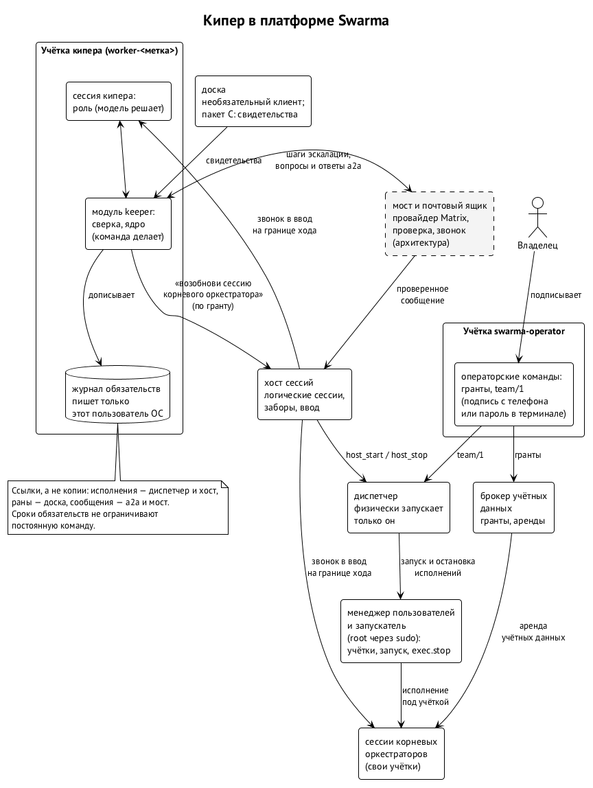

# Кипер в платформе Swarma

Ядро кипера проектируется для платформы Swarma. Там каждый агент — отдельный пользователь ОС, физически запускает только диспетчер, сессиями ведает хост сессий, учётные данные держит брокер, сообщения доставляет мост, а доска — необязательный клиент. Эта глава ставит кипера и его ядро в эту картину: что платформа даёт ядру, что ядро от неё требует и где картина ещё не сведена.

## У кипера своя учётка

Каждый автономный агент, включая киперов и мета-кипера, работает под своим пользователем ОС (решение владельцев 7 октября). ⟦решено⟧ Для ядра это значит, что правило «один писатель» становится буквальным. Файл журнала принадлежит пользователю ОС кипера, и ни у какого другого пользователя права записи в него нет. Границу держит ядро ОС, а не договорённость. ⟦предложено (вторая редакция)⟧

Всё, что приходит в журнал извне — вопросы и ответы из a2a, свидетельства доски, решения людей, — кипер дописывает сам. В записи он указывает проверенного отправителя (`actor`) и событие-источник (`source`). На платформе отправителя проверяет мост: кипер получает сообщение из почтового ящика вместе с записью проверки (книга Swarma, глава 6). ⟦предложено (вторая редакция)⟧

## Физически запускает только диспетчер

Привилегированные запуски делает только диспетчер (находка F-4). Хост сессий просит его о старте операцией `host_start` по разрешению, выданному на одну логическую сессию. Об остановке он просит операцией `host_stop`, и диспетчер останавливает исполнение тем же путём, что и любую остановку, через `exec.stop` у менеджера пользователей (находка F-20). Обе находки владелец принял 12 октября. ⟦решено⟧ Форматы разрешения и проверка подлинности `host_start` и `host_stop` ещё не опубликованы, и пока их нет, эта связка выключена. ⟦открыто⟧

Для ядра отсюда следует правило второй редакции. Кипер ничего не запускает сам. Возобновить сессию корневого оркестратора он просит у хоста сессий по своему гранту, а физический старт хост сессий просит у диспетчера. Суб-оркестратора кипер будит только через его корневого оркестратора (глава 8). ⟦предложено (вторая редакция)⟧

## Как платформа будит

7 октября владельцы решили, как сообщение попадает в сессию. Сообщение должно приходить прямо в ввод сессии, как будто его набрали на клавиатуре, без tmux, и не через Matrix и не через собственные хуки среды. ⟦решено⟧ Хост сессий ставит элемент в очередь сессии и на границе хода кладёт в ввод агента короткое уведомление, а тело агент забирает из почтового ящика (книга Swarma, главы 6 и 7). Хост сессий описан в своей спецификации. ⟦спецификация⟧ Мост и почтовый ящик пока существуют как архитектура. ⟦предложено⟧

Для ядра это путь к закрытию P03. Сегодня проверенного способа разбудить простаивающую сессию нет, и эскалация полагается на человека (глава 8). Когда доставка в ввод простаивающей сессии будет работать и пройдёт проверку, эскалация сможет будить сама, а вопрос к владельцу на каждом шаге станет не нужен. ⟦предложено⟧

## Хост без целей и без доски

Хост сессий работает без целей и без доски. Цель сессии ставит только доска или оркестратор, а при запуске — тот, кто запускает; у учётки агента права ставить цели нет (решение D-GOALS от 10 октября). ⟦решено⟧

Ядру цели и не нужны. Держатель обязательства — участник с постоянным идентификатором, а не сессия. Сессия и исполнение — свидетельства того, кто сейчас действует, и журнал хранит на них ссылки: номера исполнений принадлежат диспетчеру и хосту сессий (глава 3). ⟦предложено (вторая редакция)⟧

## Сроки не ограничивают постоянную команду

12 октября владелец решил: учётки постоянной команды — оркестратора и закреплённых ролей — не истекают. Вывести или пересоздать их может только оператор подписанной записью, а поднимает команду диспетчер по подписанному оператором описанию `team/1`. У сессий постоянной команды нет заранее заданного предела по времени: остановить их может только явная команда или оператор, а предел исполнения в 12 часов касается остальных исполнений. ⟦решено⟧

Ядро это правило уважает. Срок обязательства может поднять вопрос выше, но не может ограничить ни учётку, ни исполнение постоянного участника (глава 5). ⟦предложено (вторая редакция)⟧

## Утро после перезагрузки

Книга Swarma описывает это утро так. Диспетчер сверяет свои записи с реальностью: исполнения, шедшие до перезагрузки, помечаются потерянными, а учётки постоянных участников остаются с тем же поколением. Затем для каждого постоянного участника — кипера, оркестраторов, закреплённых специалистов — диспетчер просят запустить его долгую сессию. ⟦спецификация⟧ Кто именно просит после перезагрузки, спецификация платформы пока не называет. ⟦открыто⟧

У спецификации кипера есть кандидат на этот ответ: команда `keeper up`, которая там уже отвечает за подъём машины после перезагрузки (глава 2). На платформе она не запускала бы сессии сама, а просила бы диспетчер, как любой вызывающий с грантом. ⟦предложено⟧ Под какой учёткой она работает и кто её запускает, если человек ещё не вошёл в систему, не решено. ⟦открыто⟧

Часть ядра в этом утре простая. Поднявшись, кипер переигрывает журнал и сверяет незавершённые последствия до любой новой работы (глава 9). Книга Swarma формулирует принцип рантайма: «журнал — истина, сессия — кэш». Ядро применяет его к обязательствам буквально. ⟦предложено⟧

## Подписи

Записи журнала несут автора и источник, а подписи — шов на будущее. Первая редакция говорит, что позже записи будут подписываться через модуль доверия и брокер учётных данных. ⟦предложено⟧ На платформе брокер учётных данных описан в спецификации, но кода у него ещё нет. ⟦спецификация⟧ Подписи по идентичности агента — дело ключника, а ключник пока существует только как архитектура. ⟦предложено⟧ Кто подписывает записи журнала, брокер или ключник, и каким ключом, не решено. ⟦открыто⟧

## Подписанные сообщения: waggle и мост

Черновик кипера требует, чтобы кипер говорил с корневыми оркестраторами только через waggle, протокол подписанных сообщений и аренд (глава 11). В послесловии книги Swarma подписанные сообщения waggle соответствуют мосту: подпись над точными байтами поверх шифрования носителя и почтовый ящик. Направление второй редакции: на платформе требование «всегда через waggle» читается как «всегда через мост», и уведомления ядра идут тем же путём. ⟦предложено (вторая редакция)⟧

## Доска

Запуски уходят с доски в среду исполнения, а сама доска становится удалённой (решения владельцев 7 октября) и необязательной: хост сессий работает и без неё (D-GOALS, 10 октября). ⟦решено⟧ Для ядра доска — пакет C: она отдаёт свидетельства и не ведёт ни журнала обязательств, ни сроков (решение R243). ⟦решено⟧ Собственные факты доски о доставке её изменений остаются фактами доски, а журнал ссылается на них по идентификатору (глава 3). ⟦предложено (вторая редакция)⟧

## Кто есть кто сегодня

Над ядром работают участники обеих сторон. ⟦работает сегодня⟧

| Участник | Сторона | Роль в работе над ядром |
| --- | --- | --- |
| `ivmbp_ivan_meta-keeper` | Иван | мета-кипер Ивана на ivmbp; владелец спецификации ядра (B); сверяет формат провода D |
| `ivan-tb-keeper` | Иван | арбитр стороны Ивана на Mac mini; записал решение R243 и порядок работ D |
| `m1max_meta-keeper_keeper` | Алексей | мета-кипер Алексея; собрал пакет случаев P01–P13, вместе с мета-кипером Ивана согласовал границу B, C и D |
| `m1max_a2a-swarm_orch` | Алексей | оркестратор a2a; ведёт пакет D |
| `m1max_skill-project-management_keeper` | Алексей | кипер доски задач; принимает и разбирает входящие баги, в том числе P03 |
| `m1max_swarm_keeper` | Алексей | кипер роя; вёл восстановление раннера #21 по случаю P13 |
| `macmini_skill-project-management_orch-infra-exit` | Иван | оркестратор infra-exit на Mac mini; через него идёт пакет C и исправление P03 |

Исполнитель пакета B работает на стороне Ивана, на Mac mini, поэтому доступ к закрытому репозиторию `curator-keeper` стороне Алексея для этого не нужен. ⟦согласовано⟧ Для ревьюеров стороны Алексея доступ на чтение даёт Иван, если они понадобятся (глава 11).

## Источники

Книга Swarma: главы 2, 3, 6, 7, 9, 10, 13 и послесловие; решения владельцев 7–12 октября: пользователь ОС на агента, два канала в сессию, запуски вне доски, удалённая доска, D-GOALS, F-4, F-20, постоянная команда без предела по времени; решение R243 и переписка о ядре кипера за 12.10; первая редакция §10.8: «Три пакета, один журнал», общие поля; ревью PR #9 (sol: находка 6; muse: находки 8, 9 и 11); спецификация кипера v0.5.1, §10.4 и §10.6.
