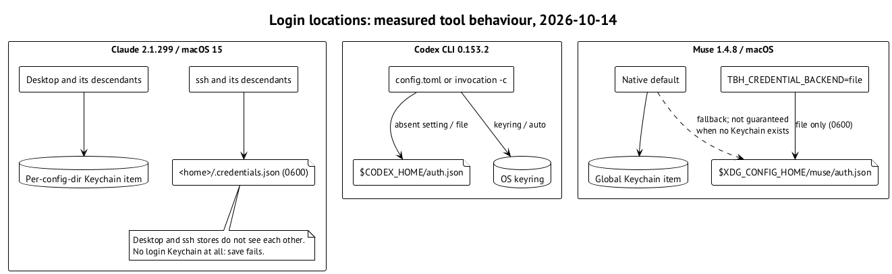

# Claude Code: один home, два разных store

## Desktop и всё, что он запустил

В Claude Code 2.1.299 на macOS 15 login из сессии с доступом к login Keychain сохраняется в отдельный item для `CLAUDE_CONFIG_DIR`. Имя item имеет вид `Claude Code-credentials-<first 8 hex of sha256(CLAUDE_CONFIG_DIR)>`. Credential file при этом не появляется; login native home остаётся нетронутым. Это объясняет, почему новый managed home просит войти снова. ⟦работает сегодня⟧

Значение имеет происхождение процесса. tmux server и daemon, запущенные desktop-сессией, наследуют её доступ к Keychain. Сам факт, что команда работает без окна, ещё не делает её ssh-сессией. ⟦работает сегодня⟧

## ssh и отсутствие Keychain — разные случаи

В ssh-сессии без доступа к существующему login Keychain команда `security show-keychain-info` в опыте завершалась с кодом 36. Login попадал в `<home>/.credentials.json` с mode 0600, без нового Keychain item. После скрытия файла инструмент отвечал «Not logged in». Потомки ssh-сессии следовали тому же пути. ⟦работает сегодня⟧

Desktop-store и ssh-store друг друга не видят: home с desktop login показывал `loggedIn=false` из ssh, и наоборот. Копирование файлов конфигурации не делает эти два store общими. ⟦работает сегодня⟧

Совсем другой опыт — OS user, у которого вообще нет login Keychain, с запуском в launchd Background session. Login завершался «Couldn't save your login»; file fallback не происходил. Поэтому из успеха ssh нельзя вывести успех для пользователя без Keychain. ⟦работает сегодня⟧

## Env token и Linux

`CLAUDE_CODE_OAUTH_TOKEN`, полученный через `claude setup-token`, даёт `authMethod=oauth_token`, выигрывает у login в home и ничего не записывает в home или Keychain. Это inference-only authentication: Remote Control его отвергает. Сам механизм проверен; его передача через Curator — отдельный Draft, разобранный в главе 8. ⟦работает сегодня⟧ ⟦предложено⟧

`claude auth status --json` показывает `loggedIn` и `authMethod` без model call. Для диагностики достаточно этих полей; credential bytes в отчёт не нужны. ⟦работает сегодня⟧

На Linux Claude хранит login в `<home>/.credentials.json`. Там Curator может связать этот файл с native login для `shared`. Это не отменяет запрета `shared` для Claude на macOS. ⟦работает сегодня⟧

{.landscape}
