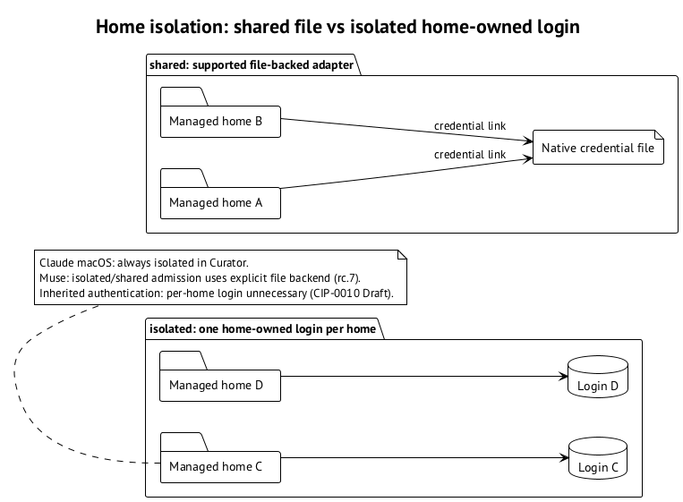

# Curator: shared и isolated

Пара `profile × environment` получает managed home. Machine knob `isolation.<profile>.<env-id>` выбирает `shared` или `isolated`: в `shared` credential file home связан с native file, в `isolated` у каждого home свой login. Эта изоляция работает в rc.6. ⟦работает сегодня⟧

`shared` экономит повторный login, но оба home зависят от одного native credential file. `isolated` отделяет login между homes, но требует войти в каждый из них, если источник authentication принадлежит home. Изоляция папок сама по себе не создаёт отдельный глобальный Keychain item Muse. ⟦работает сегодня⟧

Claude на macOS всегда `isolated`: Keychain item зависит от `CLAUDE_CONFIG_DIR`, поэтому обычного file link недостаточно. Curator отвергает `shared` с `environment_shared_unsupported`. Наличие ssh file login не является исключением из этого ограничения Curator. На Linux file storage Claude позволяет `shared`. ⟦работает сегодня⟧

## Кто за что отвечает

По D1 Curator владеет содержимым home, проверкой, repair, login readiness и snapshots. agents-management собирает argv и env из fragment и plan; task-board и session host ведут свои private session folders с policy, trust, resume, goals и input. Они не дублируют проверку файлов Curator. D2 задаёт `curator-run` как вход для Claude, Codex и Muse с начала интеграции. D3 объясняет приоритет: переход с agents-infra на Curator. ⟦решено⟧

По D4 live session должна использовать собственный snapshot: managed home может переписываться при resolve repair, profile use или skill sync. D5 задаёт `env materialize --into <dir>`: regular files и manifest с digests. Временная task-board copy между двумя resolve с одинаковым digest, byte compare и linked native `auth.json` уйдёт после materialize. Сами managed snapshots решены для rc.7. ⟦решено⟧

По D6 caller materializes snapshot, plan покрывает digest архива, dispatcher переносит архив без знания адреса Curator home, а `curator-run exec` проверяет digest, распаковывает read-only и выставляет config variables в agent account. Это контракт переноса окружения; отдельный секрет не должен появиться в plan или fragment. ⟦решено⟧
