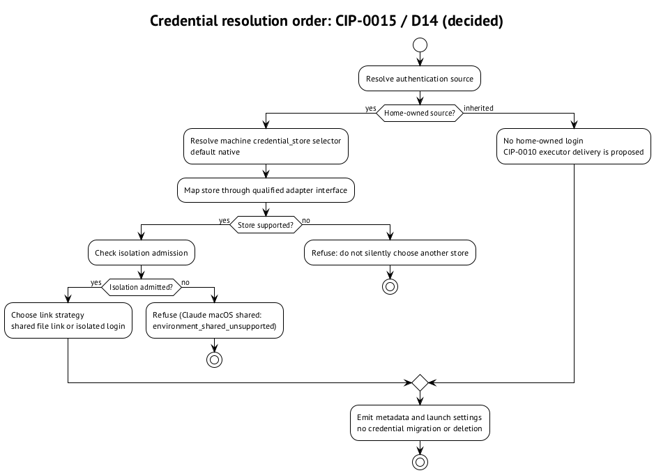

# Store выбирает машина

## Почему появилось D14

D9 требует выбирать store для пары `profile × environment` и применять выбор в launcher. Сначала CIP-0018 мог читаться как разрешение пакету задать `cli_auth_credentials_store` вместе с прочими Codex settings. Это противоречило machine ownership в CIP-0015 §2. D14 от 16 октября разрешил конфликт: нормативный порядок CIP-0015 сохранён; общий транспорт CIP-0018 остаётся, credential store уходит из package vocabulary. ⟦решено⟧

Причина практическая: доступ к Keychain зависит от машины, OS и происхождения сессии — desktop или ssh. Допуск `shared` тоже зависит от adapter и store. Переносимый профиль не знает этих условий. Пакет не должен решать за владельца машины, что токены теперь окажутся на диске. ⟦решено⟧

Единственный selector — user-owned machine knob `credential_store.<profile>.<env-id>` со значениями `native | file | keychain`, default `native`:

```bash
curator env config set credential_store.P.codex_cli file
```

Packages, overlays, locks и repositories store не выбирают. Команда и selector решены для rc.7; это не рецепт для установленного rc.6. Смена selector ничего не мигрирует и не удаляет: login может остаться в прежнем store и оказаться невидимым при новом выборе. ⟦решено⟧

## Порядок разрешения

Сначала выбирается источник authentication: home-owned или inherited. Затем store, допустимость isolation и стратегия link. Этот порядок не позволяет сначала сделать symlink, а потом надеяться, что инструмент его прочитает. Inherited source снимает потребность в per-home login в предложенной модели CIP-0010. ⟦решено⟧ ⟦предложено⟧

{.landscape}

## Mapping по CIP-0015 §2

Все строки таблицы — нормативный контракт, а не отчёт о выпуске rc.7. ⟦решено⟧

| Adapter | `native` | `file` | `keychain` |
| --- | --- | --- | --- |
| Codex | Native `config.toml`; absent → file; без override | `-c cli_auth_credentials_store='"file"'` при login и launch | `-c cli_auth_credentials_store='"keyring"'` только на qualified macOS backend; иначе отказ |
| Muse | Native global Keychain с file fallback | `TBH_CREDENTIAL_BACKEND=file` при login и launch | Отказ до qualification force-Keychain interface |
| Claude | Session-qualified native choice | Отказ: нет force-file interface | Отказ: нет force-Keychain interface |

`native` не означает «обязательно Keychain» и не означает «обязательно file». Claude умеет оба наблюдавшихся native пути, но у Curator нет интерфейса принудительного выбора. Аналогично Muse fallback не даёт квалифицированного force-Keychain режима. ⟦решено⟧

CIP-0018 сохраняет D13: profile-level settings с наследованием и typed `-c`, без rewrite `config.toml`. Только credential-store override Curator заполняет из machine knob. CIP-0017/D12 отдельно вводит явный `root_context` в Muse fragment, чтобы launcher не изучал layout файлов; file backend передаётся через `TBH_CREDENTIAL_BACKEND=file`. ⟦решено⟧
