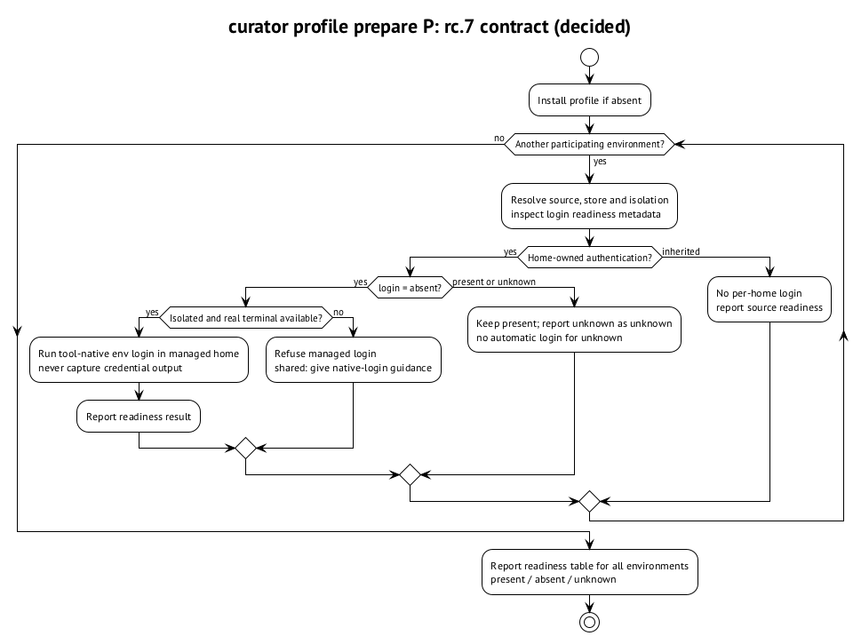

# Подготовить профиль к запуску

D7 вводит status row `login: present | absent | unknown`. Это metadata, без secret bytes. `unknown` нельзя подменять `absent`: если проверка не может установить состояние, это не разрешение молча начать новый login. Команды этой главы решены в CIP-0015 для rc.7. ⟦решено⟧

## `env login`

`curator env login <env> --profile P` запускает собственную login-команду инструмента в managed home. Команда допустима только для `isolated` и home-owned authentication, из настоящего terminal. Она не захватывает credential output. В `shared` Curator отказывает и объясняет, как войти в native home. Это сохраняет одного владельца общего login. ⟦решено⟧

## `profile prepare`

`curator profile prepare P` устанавливает профиль, если его ещё нет, и перечисляет все participating environments. Затем разрешает их окружения, входит только там, где home-owned login отсутствует, и показывает readiness table. Уже присутствующий login не нужно получать повторно; inherited authentication не требует per-home login. ⟦решено⟧

{.landscape}

Таблица сообщает результат по каждой среде, а не только успех одной из них. Для shared нужен native login, для unknown — выяснение причины. Такой статус нельзя выдавать за подтверждённую готовность. Это описание контракта, а не запуск будущей команды на rc.6. ⟦решено⟧

Для Claude уже есть проверка `claude auth status --json` без model call; она даёт `loggedIn` и `authMethod`. Для остальных строк книги конкретные readiness probes не выдуманы. Их qualification остаётся частью реализации rc.7. ⟦работает сегодня⟧ ⟦открыто⟧
