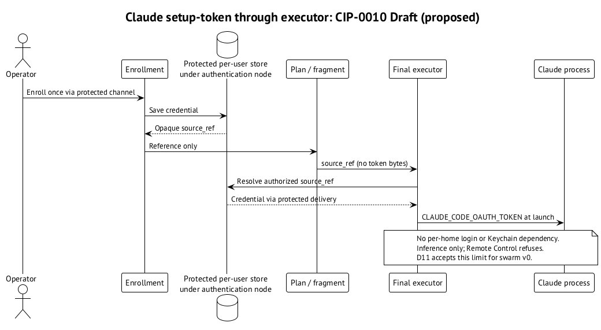

# Setup-token: authentication без login в каждом home

`claude setup-token` выдаёт credential, который Claude принимает через `CLAUDE_CODE_OAUTH_TOKEN`. Проверено, что env token выигрывает у login в home, не записывает home или Keychain и работает как `authMethod=oauth_token`. Это позволяет обойти зависимость от per-home Keychain item, desktop/ssh split и наличия login Keychain у OS user. ⟦работает сегодня⟧

Цена — inference only. Remote Control отказывает с таким token. D11 принимает это для swarm agents: им Remote Control не нужен, а долгоживущие credentials допустимы в v0. Это не обещание, что setup-token заменит любой interactive login в любом инструменте. ⟦работает сегодня⟧ ⟦решено⟧

## Как должен доставлять Curator

В CIP-0010 (Draft) credential один раз enroll в protected per-user store под authentication node. Профиль ссылается на него через opaque `source_ref`; token не находится в plan или fragment. Только final executor получает значение и передаёт его процессу Claude как `CLAUDE_CODE_OAUTH_TOKEN`. Homes с inherited authentication обходятся без собственного login. ⟦предложено⟧

{.landscape}

Владелец требует поддержать этот путь, но в срезе facts pack ему ещё нужны нормативный текст и реализация. Он не входит в список работающих возможностей установленного rc.6. Здесь намеренно нет выдуманной CLI-команды enrollment. ⟦предложено⟧

Источник и store — разные вопросы. Machine selector регулирует выбор credential store инструмента; он не разрешает пакету вложить token в profile. Даже если home snapshot переносится через dispatcher, это не повод переносить в его plan secret bytes. ⟦решено⟧ ⟦предложено⟧
