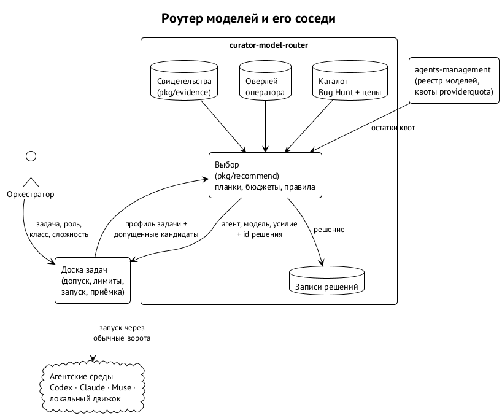

# Роутер целиком

{.tall}

Роутер — это Go-библиотека `curator-model-router` и её командная строка `cmr`. Модуль публичный, лицензия Apache-2.0, текущая версия v0.3.2. ⟦работает сегодня⟧

Оркестратор описывает работу: роль, класс задачи, сложность, режим бюджета, закреплённые значения. Роутер получает этот набор меток и список кандидатов, которых доска уже допустила, выбирает одну конфигурацию (или несколько для параллельного поиска), записывает, почему, и отдаёт результат обычному механизму запуска. Сам он ничего не запускает, ничего не резервирует и никогда не переключает учётные записи или выход в сеть. ⟦решено⟧

## Четыре вопроса, четыре хозяина

Чтобы запустить задачу на конфигурации, нужно ответить на четыре разных вопроса. На каждый отвечает свой хозяин, и высокая оценка роутера никогда не перебивает остальные три ответа.

| Вопрос | Кто отвечает | Чем |
| --- | --- | --- |
| Разрешено? | доска задач, по политике оператора | потолки ролей, допущенные пары, расписание, политика оплаты |
| Технически совместимо? | реестр моделей agents-management и каталог | словарь уровней рассуждений, инструменты, окно контекста, платформа |
| Подходит для этой работы? | роутер | требования задачи против замеров |
| Доступно сейчас? | предварительная проверка доски | установлена ли среда, есть ли квота, не упёрлись ли в лимит |

Отсюда главное свойство роутера: он **ранжирует только внутри допущенного**. Если для роли разрешены три конфигурации, роутер выбирает одну из трёх и никогда не предложит четвёртую. Если подходящих кандидатов нет, ответ — отказ `no_qualified_candidate`, а не «лучшее из запрещённого». ⟦решено⟧

## Факты, решение, исполнение

Решение владельца от 30 сентября делит ответственность на три части. ⟦решено⟧

- **Факты** держит agents-management: реестр моделей, данные бенчмарков, машинный каталог, записи использования квот (`pkg/providerquota`).
- **Решение** держит роутер: свидетельства, оценку пригодности, стратегии выбора, записи решений.
- **Исполнение** держит доска: допуск, лимиты, запуск, повторы, приёмку работы.

Поэтому роутер не импортирует доску и не знает её внутренностей. Вызывающий переводит свои структуры в нейтральные входные данные роутера, а результат получает обратно как обычные флаги запуска: `--agent`, `--model`, `--reasoning-effort`.

## Из чего состоит модуль

| Часть | Работа |
| --- | --- |
| `pkg/recommend` | выбор: допуск и закрепки, уровни, бюджеты, правила, объяснение, воспроизводимое решение |
| `pkg/routing` | замороженные общие контракты: кандидаты, снимки, политика, проекция квот |
| `pkg/evidence` | формат свидетельств, импорт Bug Hunt и собственных прогонов, детерминированный оценщик пригодности |
| `pkg/canonical` | канонический JSON, дайджесты SHA-256, типизированные отказы |
| встроенный каталог | публичные замеры Bug Hunt Bench (MIT) и прайсовые цены вендоров |
| `cmd/cmr` | `recommend`, `spawn`, `shadow report`, `usage`, `local`, `evidence` |

## Чего роутер не делает

- Не запускает процессы и не держит сессии.
- Не расширяет допуск: высокая оценка не делает запрещённое разрешённым.
- Не вызывает LLM, когда решает. ⟦решено⟧
- Не читает текст задачи: только метки, которые ему передали.
- Не меняет модель внутри работающего агента: одно решение — один запуск.
