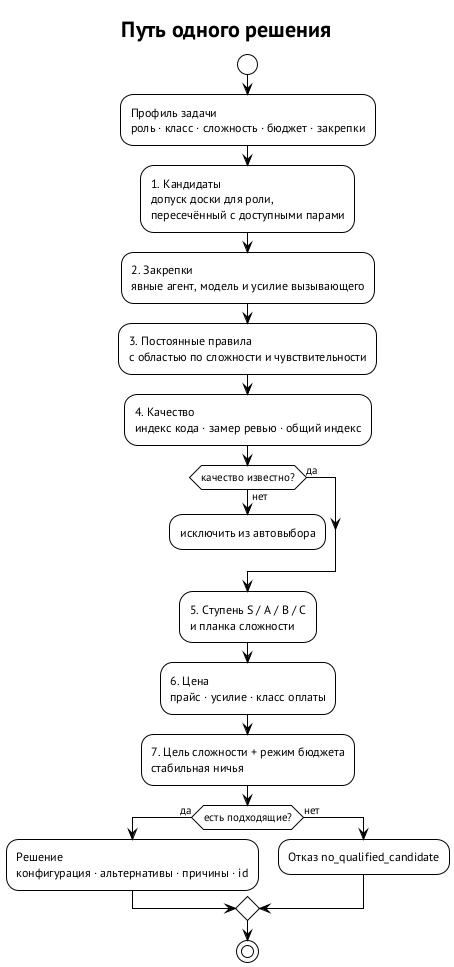

# Как принимается решение

{.tall}

## Что роутер знает о задаче

Роутер не читает описание задачи. Он получает её профиль — несколько меток, которые ставит тот, кто запускает:

| Метка | Пример | Откуда |
| --- | --- | --- |
| роль | `developer`, `reviewer`, `researcher` | флаг `--role` доски |
| класс задачи | `code.implement`, `review.code`, `research` | `--task-class`; словарь доски (`implementation`, `review`, `mechanical`) переводится детерминированно |
| сложность | `trivial`, `routine`, `standard`, `hard`, `critical` | `--difficulty`; без него — значение класса по умолчанию |
| деликатность | да или нет | `--delicate`: нужна сильнейшая подходящая конфигурация |
| режим бюджета | `economy`, `balanced`, `burn` | `--budget` или политика |
| закрепки | агент, модель, усилие | явные флаги вызывающего |
| контекст правил | машина, история (story), семейство автора | `--host`, `--story`, `--producer-family` |

Отсюда первое следствие: **качество выбора не лучше качества разметки**. Трудная задача, помеченная как `trivial`, уйдёт на дешёвую конфигурацию. Поэтому в теневую неделю мы смотрим не только на выбор роутера, но и на то, как оркестраторы ставят метки.

## Семь шагов

1. **Кандидаты.** Конфигурации, которые реально можно запустить: доска отвечает на запрос `spawn-preflight` для роли, роутер пересекает потолок роли с доступными парами. Если доски нет, берутся строки каталога, чьи среды найдены в `PATH`, и это записывается в решение.
2. **Закрепки.** Явные `--agent`, `--model`, `--reasoning-effort` оставляют только совпадающих кандидатов. Роутер никогда не заменяет явное значение.
3. **Жёсткие правила.** Постоянные правила оператора отсеивают кандидатов: исключить семейство автора на ревью, исключить конкретную модель, закрепить ревьюера на машине. Правило с областью действия срабатывает только для своих сложностей и чувствительности.
4. **Качество.** Каждому кандидату назначается качество по оси, которая важна для класса: индекс кода для `code.*`, замер ревью для `review.*`, общий индекс для остального. Если основной оси нет, берётся замер Bug Hunt, и это отмечается в объяснении. Если нет ничего — качество неизвестно, и автоматически такой кандидат не выбирается.
5. **Уровень.** Качество переводится в ступень S, A, B или C по порогам политики. У каждой сложности есть минимальная ступень; всё, что ниже, отсеивается.
6. **Цена.** Для оставшихся оценивается стоимость: прайс модели, объём рассуждений на этом усилии, класс оплаты (подписка, локальная, по токенам). Оплата по токенам по умолчанию запрещена.
7. **Выбор.** Цель сложности и режим бюджета выбирают одну конфигурацию; ничья разрешается стабильным порядком. Результат — конфигурация, альтернативы с причинами, применённые правила и идентификатор решения.

## Сложность задаёт планку и цель

Политика по умолчанию:

| Сложность | Минимальная ступень | Цель |
| --- | --- | --- |
| trivial | C | самая дешёвая |
| routine | B | самая дешёвая |
| standard | B | дешёвая, но допускается подъём до A, если он дороже не больше чем в 1,5 раза |
| hard | A | качество |
| critical | S | качество, цена не важна |

Деликатная задача (`--delicate`) получает сильнейшую подходящую конфигурацию независимо от сложности. Для трудных и критичных задач планка сильнее ручной закрепки ревьюера на машине: закрепка «ревью на Astra medium» действует только для обычной работы. ⟦работает сегодня⟧

## Режим бюджета

| Режим | Как выбирает |
| --- | --- |
| economy | самую дешёвую конфигурацию, прошедшую планку, на любой сложности; подъёма до A для standard нет |
| balanced | по умолчанию; поведение из таблицы выше |
| burn | наивысшее качество на любой сложности; внутри равного качества тратит подписку, у которой больше всего остатка; параллельный поиск — до четырёх семейств |

Планки сложности, допуск и закрепки действуют во всех режимах: economy не опустит критичное ревью ниже S. ⟦работает сегодня⟧

## Пример

Ревьюер, `review.code`, на одной и той же машине и одних и тех же данных:

| Сложность | economy | balanced | burn |
| --- | --- | --- | --- |
| trivial | `codex/gpt-6-astra/medium` | `codex/gpt-6-astra/medium` | `codex/gpt-6-astra/medium` |
| standard | `codex/gpt-6-astra/medium` | `codex/gpt-6-astra/medium` | `codex/gpt-6-astra/medium` |
| hard | `codex/gpt-6.1-sol/high` | `claude/claude-sonnet-5-5/max` | `claude/claude-sonnet-5-5/max` |
| critical | `codex/gpt-6.1-sol/max` | `claude/claude-sonnet-5-5/max` | `claude/claude-sonnet-5-5/max` |

Простые ревью держит закрепка машины на Astra medium. Трудные и критичные выходят из-под неё: в экономном режиме роутер берёт самое дешёвое, что проходит планку, в остальных — самое сильное.

## Объяснение

Каждое решение печатается вместе с тем, почему: выбранная конфигурация, ранжированные альтернативы, откуда взято качество, какие правила применились (`rule=... source=...`), какие пропущены и по какому признаку, точные флаги запуска и источник допуска. Объяснение строится из структурированных причин, а не из свободного текста. ⟦работает сегодня⟧
