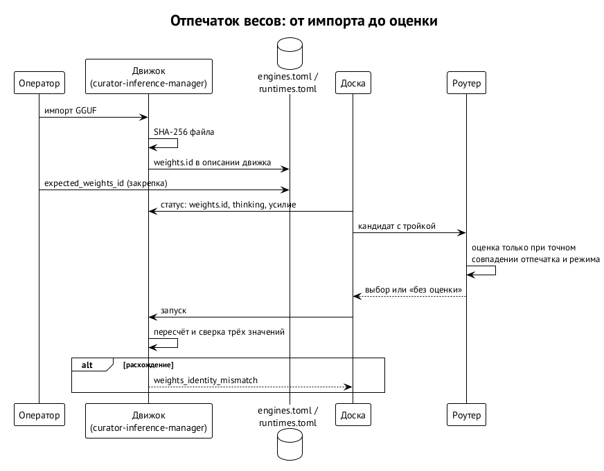

# Локальные модели и точные веса

Облачная модель — это имя, за которым стоит вендор. Локальная модель — это файл на диске, и под одним именем «Qwen 3.8 27B» живут разные файлы: Q4 и Q8, разные сборки и конвертации, разные встроенные шаблоны чата. Если оценивать локальную модель по имени, оценка одного файла незаметно применится к другому.

## Отпечаток файла

Каждый файл весов получает отпечаток — SHA-256 всего файла: `gguf-sha256:<64 шестнадцатеричных символа>`. Тот же файл даёт тот же отпечаток, где бы он ни лежал; изменение одного байта даёт другой. Отпечаток покрывает токенизатор и встроенный шаблон чата. Первая версия поддерживает только один неразбитый GGUF. ⟦решено⟧

## Пять шагов

1. **Импорт.** Движок считает отпечаток и записывает его в описание движка в `~/.curator/engines.toml`. ⟦предложено⟧
2. **Закрепка.** В локальном `~/.curator/runtimes.toml` у строки модели стоит `expected_weights_id`: «под этим именем разрешаю только этот файл». Закрепка обязательна для каждой локальной модели. Q4 и Q8 — две разные строки с разными именами. ⟦решено⟧
3. **Запуск.** Движок пересчитывает отпечаток открытого файла и сверяет три значения: закрепку, записанное при импорте и фактическое. Любое расхождение — отказ с типизированной ошибкой. ⟦предложено⟧
4. **Оценка.** Роутер применяет оценку, только если совпадают и отпечаток, и режим рассуждений. ⟦работает сегодня⟧
5. **Без оценки — без автовыбора.** Неоценённый файл роутер сам не выберет; явная полная закрепка вернёт его с пометкой «без оценки». ⟦работает сегодня⟧

## Откуда оценка

- **Перенос:** публичная оценка базовой модели, умноженная на коэффициент квантизации, с намеренно расширенной погрешностью. Базовые оценки берутся сначала из источников без ключей (`cmr local import-base`), источники подключаемые. Коэффициенты задаёт оператор (`cmr local coefficients` проверяет таблицу); основой служат опубликованные таблицы KLD и perplexity llama.cpp, помеченные как оценки.
- **Замер:** набор задач, прогнанный на этом самом файле. Для той же оси и области задач замер главнее переноса.

Первая версия оценивает только режим с включённым мышлением (thinking) и точной меткой усилия. ⟦решено⟧

## Кто что делает

| Часть | Работа | Статус |
| --- | --- | --- |
| движок (curator-inference-manager) | отпечаток при импорте, проверка при каждом запуске, фактический режим рассуждений | на ivmbp, в работе ⟦предложено⟧ |
| схема `~/.curator` (agents-management) | поля `expected_weights_id` и блока весов движка | после ревизии схемы ⟦решено⟧ |
| доска | передаёт отпечаток, режим и усилие кандидата роутеру и пишет их в запись запуска | после формата статуса движка ⟦предложено⟧ |
| роутер | применяет оценку только к точному файлу в нужном режиме | ⟦работает сегодня⟧ |

Первый срез: Qwen 3.8 27B в одном GGUF под llama.cpp на ivmbp, только с мышлением, и первый собственный замер этого файла. Подробно, простыми словами, — в `docs/local-weights.ru.md` модуля.
