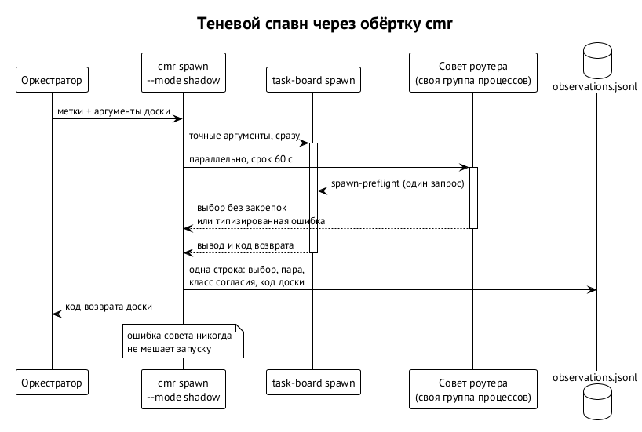

# Подключение к доске сегодня: обёртка

Пока шов внутри доски не влит, роутер подключается снаружи: оркестратор запускает задачу не через `task-board spawn`, а через `cmr spawn`, который оборачивает тот же вызов. ⟦работает сегодня⟧

```text
task-board spawn TASK --role developer --background
cmr spawn --task-class code.implement --difficulty standard -- TASK --role developer --background
```

Всё после `--` — обычные аргументы доски. Задача, её описание, критерии приёмки и ресурсы по-прежнему живут на доске; промпт агента собирает доска из шаблона роли и состояния задачи.

## Три режима

| Режим | Что происходит |
| --- | --- |
| `select` | роутер заполняет недостающие `--agent`, `--model`, `--reasoning-effort` и вызывает доску |
| `recommend` | роутер печатает полную команду и ничего не запускает |
| `shadow` | доска запускается с аргументами вызывающего без изменений, роутер рядом считает свой выбор и записывает его |

В `select` и `recommend` явные флаги вызывающего — закрепки. Каждый запуск всё равно проходит обычные ворота доски: допуск, лимиты, проверку пары. Вывод и код возврата доски передаются без изменений.

## Теневой режим

{.tall}

Теневой режим отвечает на вопрос «что выбрал бы роутер», не меняя того, что запускается. Его главное свойство — он **никогда не мешает запуску**. ⟦работает сегодня⟧

- **Сначала запуск.** Доска стартует с точными аргументами вызывающего до того, как роутер прочитает хоть что-то. Совет считается параллельно со своим сроком (60 секунд), поэтому запуск не задерживается.
- **Без закрепок.** Для сравнения роутер считает свой выбор без пересланных флагов вызывающего: иначе его «выбор» совпадал бы с выбором человека по построению. Роль, допуск, политика и планки действуют.
- **Отказ открыт (fail-open).** Ошибка роутера — неверная политика, сбой предварительной проверки, тайм-аут — не останавливает запуск. Она записывается как отдельный класс наблюдения и никогда не засчитывается как согласие.
- **Без сирот.** Подпроцессы совета живут в своей группе процессов. Если доска завершилась, а совет не готов, он переходит в отложенный процесс с остатком срока; если передать не удалось, группа завершается.
- **Честный код возврата.** Обёртка возвращает код доски; гибель от сигнала — `128 + сигнал`.

## Наблюдения

После завершения доски обёртка дописывает одну строку в `observations.jsonl`: время, идентификатор решения, профиль задачи, выбор роутера, пара вызывающего, класс согласия, код выхода доски и, при сбое, типизированный код ошибки без путей и диагностики провайдеров.

| Класс согласия | Значение |
| --- | --- |
| `exact` | среда, модель и усилие совпали |
| `same_model_other_effort` | модель та же, усилие другое |
| `same_runtime_other_model` | среда та же, модель другая |
| `different_runtime` | другая среда |
| `unknown_caller_default` | вызывающий не задал часть пары, доска выбрала сама — сравнивать не с чем |
| `no_cmr_pick` | отказ или ошибка совета |

`cmr shadow report [--since ВРЕМЯ] [--json]` сводит наблюдения: сколько сравнений, сколько точных совпадений, какие расхождения чаще всего, какие отказы и какие запуски прошли без совета, сгруппированные по коду ошибки.

## Первая неделя

Неделя в тени — условие перед включением `select` (решение R195). Её история поучительна. ⟦работает сегодня⟧

- **Первые данные были пустыми.** Вызывающие пересылали явные флаги, и роутер принимал их за закрепки: согласие 100 % по построению. Ошибку нашли аудитом журнала, исправили, часы недели перезапустили 7 октября.
- **Дальше 60 наблюдений, из них 19 без совета.** Предварительная проверка доски отвечала 23 секунды при сроке 15 и семи запросах на спавн; словарь классов доски отклонялся. Версия v0.3.1 (10 октября) запускает доску первой, делает один запрос со сроком 60 секунд и переводит словарь.
- **Из 41 сравнения точно совпали 3.** Самое частое расхождение — Muse max против Sol medium у вызывающего.
- **После v0.3.1 наблюдений не было.** Кампании запускали задачи мимо обёртки. 11 октября владелец решил: «все режимы по моделям должны остаться как есть, но надо начать собирать статистику». Все кампании на mini переведены на `cmr spawn --mode shadow`.
- **Следующие 37 наблюдений тоже были пустыми.** Спавн с `--background` возвращается примерно за секунду, а запрос допуска к доске на нагруженной машине занимает около 20 секунд. Обёртка ждала совет после выхода доски только 250 мс и записывала «не успел». Версия v0.3.2 (11 октября) передаёт недосчитанный совет отдельному отсоединённому процессу `cmr shadow-finish`: он живёт в своей сессии без унаследованного ввода-вывода, ограничен по времени, ничего не запускает и дописывает наблюдение с кодом выхода доски. Обёртка при этом возвращается сразу. Чистая статистика считается с 11:40 UTC 11 октября; сводка будет, когда наберётся около 50 наблюдений.

Урок недели: теневой режим измеряет не только роутер, но и то, как рой им пользуется. Обёртка, которую нужно не забыть вызвать, — слабое место; поэтому настоящий ответ — шов внутри доски.
