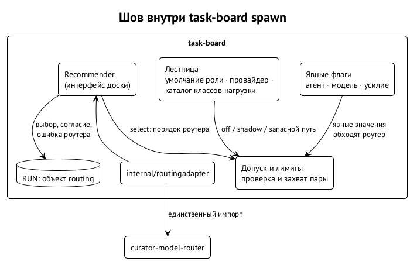

# Шов внутри доски

Обёртка доказала, что роутер можно подключить, не трогая доску. Но у неё два изъяна: её нужно не забыть вызвать, и она видит доску снаружи — через медленный запрос предварительной проверки. Шов переносит вызов роутера внутрь `task-board spawn`, в то место, где доска выбирает пару модели и усилия. ⟦предложено⟧

{.tall}

## Что остаётся доске

Выбор конфигурации в доске сегодня — это «лестница»: явные флаги, затем умолчание роли, затем распределение и сродство провайдеров, затем каталог классов нагрузки. Вокруг неё стоит всё, что делает выбор исполнимым:

| Часть доски | Что делает | После шва |
| --- | --- | --- |
| потолки ролей | что роли разрешено запускать | остаются, роутер ранжирует только внутри |
| допуск и лимиты провайдеров | проверка и захват пары, откат при лимите | остаются, каждая пара роутера проходит их |
| справочник усилий | какие усилия есть у модели | остаётся |
| выбор провайдера (`preferred_agent`) | агент по умолчанию | заменяется порядком роутера в `select` |
| умолчания ролей | модель и усилие роли по умолчанию | заменяются в `select`, остаются запасным путём |
| каталог классов нагрузки | ручной список пар на класс | заменяется в `select`, остаётся запасным путём |

Иначе говоря, роутер забирает только ранжирование, а всё, что отвечает на вопросы «разрешено» и «доступно», остаётся доске. ⟦решено⟧

## Как устроен шов

- **Настройка `spawn.routing`** в конфигурации проекта: режим `off`, `shadow` или `select`, политика, бюджет, оверлей. По умолчанию `off`, и тогда поведение совпадает с прежним байт в байт: ни чтения, ни вызова, ни поля в записи запуска.
- **`shadow`.** Решает и запускает лестница; выбор роутера без закрепок записывается в запись запуска с классом согласия против лестницы и против фактически запущенной пары.
- **`select`.** Порядок роутера заменяет умолчания, распределение и сродство. Явные `--agent`, `--model`, `--reasoning-effort` всегда обходят роутер. Если захват пары не удался, пробуется следующая по порядку роутера, затем исходная лестница. Каждый кандидат проходит замороженный снимок допуска и проверки подтверждения до любой записи.
- **Отказ открыт в обоих режимах.** Ошибка роутера — возврат к лестнице с отметкой в записи запуска. Никогда — запуск без подтверждения, никогда — расширение допуска.
- **Одна точка импорта.** Роутер стоит за интерфейсом `Recommender`, которым владеет доска; модуль импортирует только пакет `internal/routingadapter`.
- **Запись запуска.** Объект `routing` в записи RUN проходит через очередь, перезапуск по лимиту и завершение; поле `rationale_source` отличает выбор вызывающего от выбора роутера.
- **Флаги:** `--route`, `--difficulty`, `--delicate`, `--routing-budget`.

## Где шов сейчас

Код написан и подписан, ревью при разработке пройдено; зависимость на модуль — отдельным коммитом. Он ждёт своей очереди на влитие в общий main доски (третий уровень приоритета в очереди изменений), затем полный CI и ревью панелью из двух провайдеров, потому что он меняет выбор модели в спавне. ⟦предложено⟧

После влития порядок такой: включить `shadow` в проектах вместо обёртки, собрать статистику, показать сводку владельцам, включить `select` для ограниченных классов задач. Каталог классов нагрузки и умолчания ролей переводятся в запасной режим, а удаляются отдельной задачей доски позже. ⟦предложено⟧

## Передача локальных весов

Для локальных моделей шов передаст роутеру тройку кандидата — отпечаток весов, режим мышления и метку усилия — из статуса движка и запишет её в запись запуска. Формат статуса движка согласуется с владельцем движка. ⟦предложено⟧
