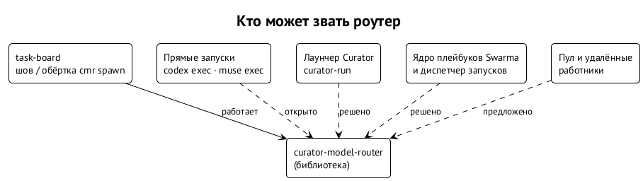

# Другие запуски

Доска — первый, но не единственный, кто запускает агентов. Роутер с самого начала задуман как библиотека с адаптерами вызывающих: он не знает, кто его позвал, и одинаково работает для любого запуска, который может дать ему профиль задачи и список допущенных кандидатов. ⟦решено⟧

## Что нужно вызывающему

Чтобы подключить роутер к любому запуску, вызывающему нужно четыре вещи.

1. **Профиль задачи.** Роль, класс, сложность, режим бюджета, закрепки — метки из главы 3.
2. **Допущенные кандидаты.** Список конфигураций, которые этот вызывающий разрешает запускать. Если своего допуска нет, это файл `--candidates` или строки каталога, чьи среды есть в `PATH` — с пометкой в решении.
3. **Применение результата.** Перевести выбор в свои флаги запуска и проверить, что запустилось именно оно.
4. **Запись.** Сохранить идентификатор решения рядом с записью о запуске, чтобы исход потом можно было связать с решением.

Всё остальное — данные, политика, правила, объяснение, воспроизведение — общее.

## Прямые запуски сред

Сегодня часть работы идёт мимо доски: ревью, которые кампании запускают прямо через `codex exec` или `muse exec`, разовые исследования. Это как раз те трудные ревью, на которых роутер интереснее всего сравнивать. Их можно обернуть так же, как доску, например командой вида `cmr exec --mode shadow --task-class review.code -- codex exec ...` (имя условное, такой команды ещё нет). Обёртке нужен свой допуск (список разрешённых конфигураций роли), и она должна уметь читать и подставлять флаги модели и усилия каждой среды. Это средняя по объёму работа. ⟦открыто⟧

## Лаунчер Curator

`curator-run` — второй вызывающий из спецификации (R10). Он сначала разрешает окружение, закрепки и явные значения, отдаёт оставшийся набор роутеру, затем строит обычный план запуска и отдельно проверяет доступность. Доска не запускает задачи через `curator-run`; оба пользуются одной библиотекой через собственные адаптеры. ⟦решено⟧

## Платформа Swarma

В архитектуре Swarma запуск разделён на модули: ядро плейбуков решает, какую роль запустить; роутер моделей — какую модель и усилие; Curator собирает план; диспетчер запусков отвечает за ёмкость и учёт. Роутер в этой картине — сервис слоя запуска, который зовут и ядро плейбуков, и оркестраторы без доски. Отсюда требования, которые роутер уже выполняет: он не создаёт процессов, не держит состояния между решениями и не знает своего вызывающего. ⟦решено⟧

## Кипер

Кипер маршрутизирует запросы владельца между ульями (проектами) и для этого держит свой быстрый классификатор. Это другой уровень: кипер решает, *какой улей и какой процесс*, роутер — *на какой конфигурации исполнить конкретную задачу*. Общее у них — подход: подсказки как данные, типизированный результат, объяснимые причины. ⟦предложено⟧

## Пул и удалённые работники

Позже кандидатом станет не только локальная привязка среды, но и предложение агента из пула — чужая машина с чужой подпиской. Тогда вариант исполнения — это конфигурация плюс предложение плюс совместимое окружение; машина, где думает модель, и машина, где работают инструменты, разные. Правила независимости ревьюера применяются до подсчёта оценок, а резервирует размещение координатор, а не роутер. ⟦предложено⟧
