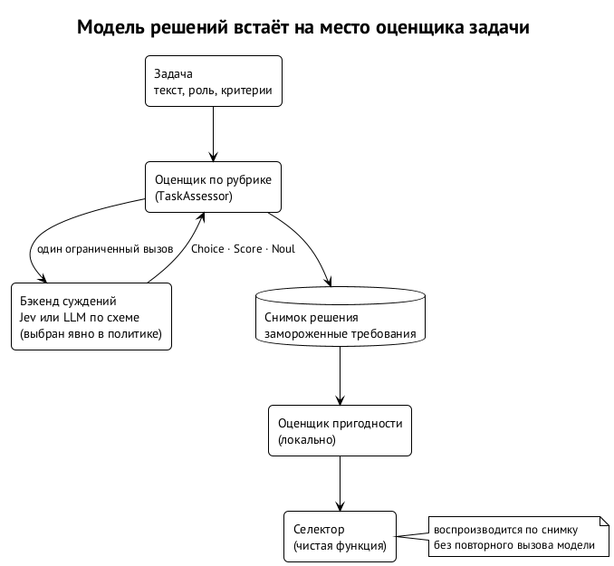

# Модели решений: Jev и что дальше

Детерминированный роутер не понимает задачу. Самое слабое место сегодня — метки: сложность и класс ставит оркестратор, и роутер верит им на слово. Естественное улучшение — дать задачу модели, которая оценит её требования. Мы к этому готовимся, но не спешим. ⟦предложено⟧

## Что такое модель решений

Под моделью решений мы понимаем быстрый типизированный классификатор: он принимает текст и возвращает не рассуждение, а структурированный ответ одного из заранее объявленных типов — выбор из списка (Choice), оценку по шкале (Score) или отказ отвечать (Noul). Jev — такой классификатор: 70–500 мс на решение. Запасной вариант — небольшая LLM с выводом строго по схеме.

Чем это отличается от «спросить модель»: ответ ограничен типом, его можно закэшировать по содержимому задачи, его уверенность — отдельное поле, а не тон текста.

## Куда она встаёт

Модель решений встаёт на место оценщика задачи, а не селектора (глава 11). ⟦решено⟧

1. Задача, роль и критерии передаются оценщику по рубрике.
2. Рубрика задаёт вопросы с типами: «трудность: trivial … critical», «деликатность: да/нет», «нужен ли длинный контекст», «есть ли изменение формата данных».
3. Бэкенд суждений (`JudgmentBackend`) — Jev или структурированная LLM — отвечает. Бэкенд выбирается **явно** в политике, чтобы роутер никогда не выбирал модель, которая выбирает модель роутера.
4. Ответ замораживается в снимке решения; дальше работает обычный детерминированный выбор.

Правила, которые для этого уже записаны в спецификации:

- уверенность классификатора — не вероятность успеха агента: уверенность, покрытие свидетельствами и калибровка — разные поля;
- требования определяются одним ограниченным вызовом, а не пятью платными;
- подготовка решения с внешним оценщиком — явно платная операция, а не скрытый вызов при запросе;
- кэши разделены: оценка задачи, оценки кандидатов и выбор кэшируются отдельно и соблюдают границы проектов и политику данных.

## Порядок внедрения

Это этап C спецификации, и он идёт в теневом режиме. ⟦предложено⟧

1. **Копим данные.** Теневая неделя и журнал исходов: что выбрал человек, что выбрал бы роутер, чем кончилась задача — принята, вернулась с ревью, сколько раундов и токенов стоила.
2. **Сравниваем метки.** Модель решений ставит свои метки рядом с метками оркестратора, ничего не меняя. Расхождения показывают, где оркестраторы ошибаются и где ошибается модель.
3. **Калибруем.** Только по накопленным исходам: если по меткам модели роутер выбирал бы конфигурации, на которых задачи принимаются с первого раза дешевле, — это довод включать.
4. **Включаем для ограниченных классов.** Модель решений заполняет только недостающие метки; явная метка оркестратора выигрывает.

Этап C не нужен для включения `select`: детерминированный выбор по честным меткам уже даёт пользу. ⟦решено⟧

## Что ещё даёт накопленная статистика

Модель решений — не единственное, что ждёт данных.

- **Свои замеры вместо чужих.** Наши рабочие конфигурации (`high`, `low`) на публичной доске не замерены. Журнал исходов и контрольный набор — около 20 архивных диффов с подтверждёнными major и 10 чистых — дадут свои цифры: новая модель проверяется за 90 прогонов.
- **Третий ревьюер-претендент.** На выборке раундов ревью — дополнительный ревьюер за счёт квоты, которая иначе сгорит, с заранее записанной метрикой («подтверждённые major, которых не нашёл базовый») и правилом остановки. Итог — одно из трёх: лучше, хуже или взаимозаменяем.
- **Стоимость до приёмки.** Не цена одного запуска, а полная цена принятого изменения с повторами и раундами ревью.
- **Пороги.** Числовые пороги «не хуже базовой линии больше чем на допуск» появятся только после этих замеров. Сегодня их нет сознательно.

## Чего не делать сейчас

Пятимодельные сравнения, судейские панели, Elo, бандиты и обучаемый роутер; числовые пороги без данных; новые механизмы раньше, чем данные покажут, что старых не хватает. Главный риск — решать по шуму: разница меньше шума бенчмарка не разница, и выборка в несколько раундов ничего не доказывает. ⟦решено⟧
