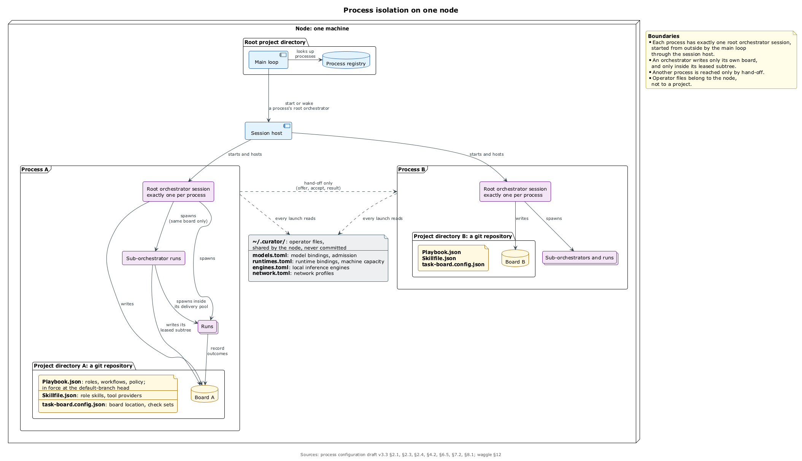

# Зачем всё это и на чём оно стоит

## Задача

Один человек или маленькая команда работает с десятками агентов в разных harness'ах — Claude Code, Codex, Muse, agy, Pi, Qwen — и на разных подписках. Работа бывает не только про код: семейный календарь, умный дом, кафе, патентная заявка. Сегодня это держится на одной борде, в ядро которой зашит процесс разработки, и на ручном труде оператора. ⟦работает сегодня⟧

Что мешает ⟦работает сегодня⟧:

- **Процесс зашит в код.** Типы, статусы и роли скомпилированы в task-board, и кафе не опишет закупки, не меняя борду.
- **Агент работает под пользователем ОС оператора**, поэтому ему доступно всё, что доступно аккаунту: файлы, настройки, ключи, сам бинарник `task-board`.
- **Сессия хрупкая**: контекст сжимается, демон перезапускается, машина перезагружается.
- **Агенты не говорят друг с другом безопасно**: между оркестраторами ходят только уведомления о завершённых run'ах, и ничего не подписано.
- **Настройки у всех свои**, а допуски моделей лежат прямо в `task-board.config.json` проекта.

## Куда идём

Направление задаёт роадмап. ⟦решено⟧

- **agents-infra уходит в архив.** Контексты, скиллы и MCP приходят из Curator, человек запускает агента через `curator run`, дочерние run'ы собираются через модуль agents-management.
- **Каждый harness — адаптер session host** с одним контрактом: старт, цель с подтверждением точной ревизии, звонок в сессию, события.
- **Процесс — это конфигурация** в `Playbook.json`, а борда — универсальный трекер.
- **В проекте — потребности ролей**, а конкретные модели — в личных файлах оператора.
- **Агенты говорят подписанными сообщениями** через waggle.
- **Текущая борда на поддержке**, новое приходит модулями.

## Картина целиком

Одна машина — точка. На ней Кипер говорит с человеком, раскладывает запросы по ульям и поднимает маток. Улей — отдельный репозиторий с `Playbook.json`, бордой и одной маткой, которая запускает внутри под-оркестраторы и run'ы. Важное человек подтверждает с телефона, а всё, что выходит за машину, идёт через waggle. ⟦предложено⟧

## Семь принципов

Принципы ядра утверждены 25 сентября. ⟦решено⟧

1. **Агенты предлагают, решают правила.** Двигать авторитетное состояние могут только детерминированные правила: guard'ы, сравнения ядра, компонент доверия. Вердикт модели — не разрешение.
2. **Журнал — это состояние, сессия — кэш.** Цель, записка парковки и решения лежат на борде, поэтому сессию можно потерять без потери работы.
3. **Полномочия только сужаются**: делегирование не шире прав того, кто делегирует.
4. **Область записи — примитив безопасности и конкурентности**: run пишет только в свою область. Первая форма уже есть — граница записи run'а и worktree на каждую story. ⟦работает сегодня⟧
5. **Интеграция связана с точным деревом**: тесты привязаны к проверенному дереву, а посадка — compare-and-set. Для story это уже работает. ⟦работает сегодня⟧
6. **Транспорт не даёт полномочий.**
7. **Привилегированные операции — вне агентских оболочек**: платежи, публикации, деплой, секреты агент только запрашивает, а выполняет доверенный исполнитель.

## Ограждение и граница

**Ограждение (guardrail)** останавливает послушного агента: команда отказывается работать в агентской сессии, ядро смотрит на `TASK_BOARD_RUN_ID`. **Граница (boundary)** остановит и враждебного: подпись ключом, который требует присутствия человека, или отдельный пользователь ОС для агентов. ⟦решено⟧ Пока агенты работают под пользователем оператора, почти всё вокруг — ограждения, и спеки это честно пишут. ⟦работает сегодня⟧
