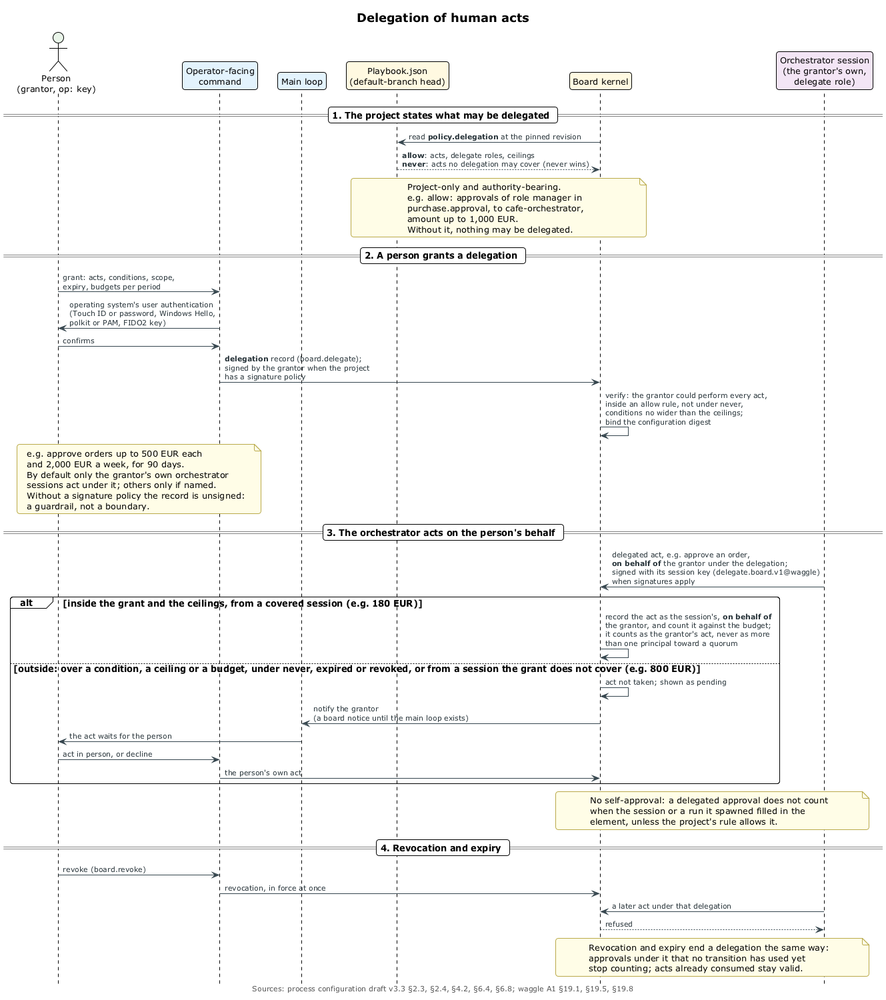

# Доверие

## Корень проблемы

Агенты работают под пользователем ОС оператора, поэтому им доступно всё, до чего дотягивается аккаунт: файлы проекта, `~/.curator/`, `ssh-agent`, любой ключ без присутствия человека, сам бинарник `task-board`. Проверка внутри аккаунта — только ограждение. ⟦работает сегодня⟧ Граница — присутствие человека, а долгосрочная граница — отдельный пользователь ОС для агентов. Каркас доверия оператор принял 25 сентября; спека живёт в приватном `curator-trust` и проходит свои раунды опровергателя. ⟦решено⟧

## Девять принципов

Принципы утверждены 25 сентября. ⟦решено⟧

- **(a)** Подтверждает только человек — подписью ключом, который требует его присутствия, и никакая настройка проекта эту планку не снижает.
- **(b)** Устройство подписи само показывает изменение и подписывает показанное, а не отпечаток, посчитанный где-то ещё.
- **(c)** Подтверждения образуют цепочку, и старое не оживает после отката.
- **(d)** Сужение от человека действует сразу.
- **(e)** Одно подтверждение для всех машин: это подписанная запись на борде, и каждая машина проверяет её сама по ростеру действующей версии, без CM2.
- **(f)** Первый ключ регистрируется защищённо, дальше работает веб доверия.
- **(g)** Ступени: L0 — один оператор и одна борда (сейчас), L1 — несколько операторов и M из N, L2 — публичные участники. Инварианты одни и те же.
- **(h)** Транспорт не даёт полномочий. **(i)** Секреты не попадают к агентам.

## Ключи с присутствием

Присутствие доказывают три класса ключей: FIDO2-ключ с проверкой пользователя (флаг виден в каждой подписи), ключ аттестованного приложения-компаньона в защищённом чипе телефона и ключ Secure Enclave, Windows Hello или TPM за аутентификацией ОС. ⟦решено⟧

- **Якорь.** `task-board trust init` в локальной сессии под аутентификацией ОС регистрирует первый ключ и делает оператора первым подтверждающим. В агентской сессии команда не работает (ограждение), а без человека не завершится (граница). ⟦решено⟧
- **Веб доверия.** Доверенный ключ человека заверяет его новый ключ, например новый телефон. Ключ, отозванный как скомпрометированный, тянет за собой всё, что заверил. ⟦решено⟧
- **Восстановление.** Если ключи всех подтверждающих потеряны, якорь ставится заново локально, и это записывается и объявляется. ⟦предложено⟧

## Подтверждения

- **Одно подтверждение покрывает всю пачку** изменений процесса с момента действующей версии, если права не покрыли их сами. ⟦решено⟧
- **Проверка идёт по действующей версии**, а не по предлагаемой, поэтому пачка не может сама добавить себе подтверждающего. Машина не исполняет версию, которую другая машина всего лишь объявила. ⟦решено⟧
- **Устройство подписи** получает обе конфигурации целиком, само считает отпечатки и отчёт о полномочиях и подписывает показанное. ⟦решено⟧ Системный запрос показывает короткий отпечаток и число отмеченных изменений. ⟦предложено⟧

## Права: как разрешения на телефоне

Процесс один раз просит право на вид изменений, как приложение на iPhone просит разрешение, а человек отвечает «всегда», «один раз» или «нет». Изменения в пределах выданного права вступают в силу без касания. ⟦решено⟧

| Право | Что покрывает | По умолчанию |
| ------------ | -------------------- | -------- |
| `preferences`, `estimates`, `helpers` | пожелания к моделям, оценки, помощники-агенты | выдано |
| `wip`, `fields` | лимиты на состояния агентов; поля, которые не читает ни один guard | выдано |
| `schedules` | расписания в пределах интервала и числа задач | спрашивается |
| `tools:<имя>` | названный инструмент и его проверенные обновления | спрашивается |
| `skills` | новые проверенные версии скиллов ролей, где меняются только инструкции | по `policy.enable.skills` |

- **Никогда не бывает правом**: люди и ростер, пороги и деньги, состояния людей и инструментов, делегирование, допуск моделей, подписи, наборы проверок, композиция. ⟦решено⟧
- **Структура процесса** всегда ждёт касания, но касания собираются в пачку: неделя правок проектировщика — одно касание на телефоне с пояснением аналитика правок. ⟦решено⟧
- **Ревью раз в месяц.** Оператор попросил «запечатывать решение после пары напоминаний»; автор предлагает запечатывать право после двух подтверждений подряд, а неотвеченное ревью оставляет право в силе с пометкой. ⟦предложено⟧ Право `dreams` пускает оркестраторов процесса в сон и по умолчанию не выдаётся (глава 10). ⟦предложено⟧

## yolo и сужения

**yolo** — явный режим, в котором любое изменение процесса вступает в силу без касания. Он включается одним касанием для улья или всей точки, можно на срок (`24h`), висит громким баннером везде и запрещён на общей борде и там, где делегирование касается денег. Каждая версия всё равно пишется в цепочку. ⟦решено⟧ Потолок срока не решён. ⟦открыто⟧

**Сужений ровно три**, и действуют они сразу: отозвать ключ, отозвать доверенность или право (включая yolo), выключить инструмент. Аварийная остановка и сужения работают всегда, в том числе в yolo. ⟦решено⟧

## Делегирование

Если шаг принадлежит человеку — одобрение, выход из его состояния, исключение, установка скилла, — человек может поручить его своим сессиям оркестратора. ⟦решено⟧

- **Что можно поручать**, говорит проект в `policy.delegation`: действия, роли оркестратора, жёсткие потолки. `never` сильнее `allow`. ⟦решено⟧
- **Доверенность** задаёт действия, условия, область, срок и бюджеты. Пример: менеджер кафе разрешает своему оркестратору одобрять заказы до 500 € каждый и до 2 000 € в неделю при проектном потолке 1 000 €. Всё, что выходит за доверенность, ждёт человека, и ему приходит уведомление. ⟦решено⟧
- **Детали** — как считаются бюджеты, как делегированный акт идёт в кворум, запрет самоодобрения без явного `self_approval` — предложены автором. ⟦предложено⟧
- **Подтверждение и выдачу права** человек всегда делает сам, никакая доверенность их не покрывает. ⟦решено⟧

## Подписи и приложение-компаньон

- **Подписи на борде.** Проект может потребовать подпись для одобрений, трат, остановок, переопределений, делегирования и установок. Тогда ключ по умолчанию не слабее `hardware-bound`, а проверка пользователя обязательна для одобрений, ослаблений, остановок и делегирования. Аттестованный ключ приложения-компаньона годится для любого акта на борде. Формы подписей даёт поправка waggle A1 вместе с CM2. ⟦решено⟧
- **Приложение-компаньон** — обычный способ подтверждать и единственный для машины без экрана. Ключ живёт в защищённом чипе за биометрией. Отдельный трек, iOS первым, пока не начат. ⟦решено⟧
- **Сопряжение**: QR-код в терминале с запасным кодом; без экрана — короткий код и сравнение строки на обоих экранах; через сопряжённую рабочую станцию или tailnet. Аттестация проверяется каждый раз, секрет одноразовый. Транспорт — tailnet или ретранслятор со сквозным шифрованием. ⟦предложено⟧
- **Пока приложения нет**, машину без экрана подтверждают с рабочей станции FIDO2-ключом и никогда через проброшенный `ssh-agent`. ⟦предложено⟧

## Привилегированные операции и отдельный пользователь ОС

- **Привилегированные операции** — платежи, публикации, деплой, секреты, сообщения от имени человека, физические устройства, удаления, миграции. Агент просит, доверенный исполнитель выполняет после проверки полномочий, и секреты попадают только в окружение исполнителя. ⟦решено⟧
- **Настоящая граница** — отдельный пользователь ОС для агентов. Хранилища, ключи, память и бинарники `task-board` и `curator` принадлежат аккаунту оператора, а немногие разрешённые правки делает посредник (broker). sudo не подходит: он либо спрашивает на каждую запись, либо кэширует пароль для любого процесса аккаунта. ⟦решено⟧ Устройство посредника открыто. ⟦открыто⟧

## Как это поставляется

PC1 даёт заглушку-ограждение: подтверждения, права, доверенности и сужения — неподписанные команды оператора вне run'а, записанные с полями будущих подписанных, и только на локальной борде одной машины. PC3 приносит ключи, веб доверия и подписанные записи на борде; CM2 — формы A1 и бюджеты между машинами; L1 — подписи M из N. ⟦решено⟧ Трек доверия расписан вехами TR0–TR6, от черновика до отдельного пользователя ОС. ⟦предложено⟧
