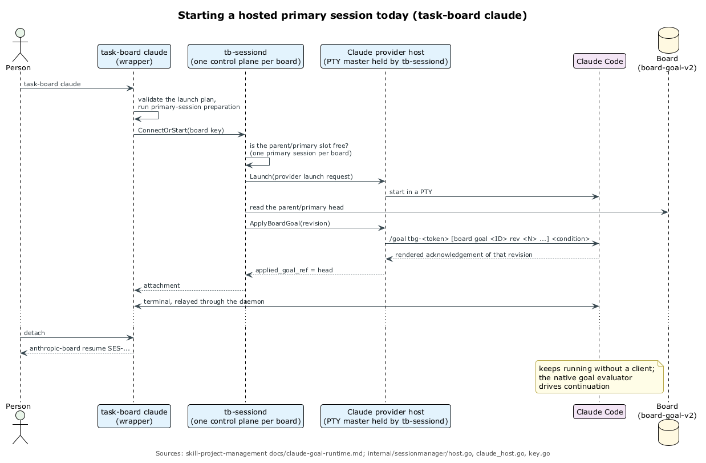
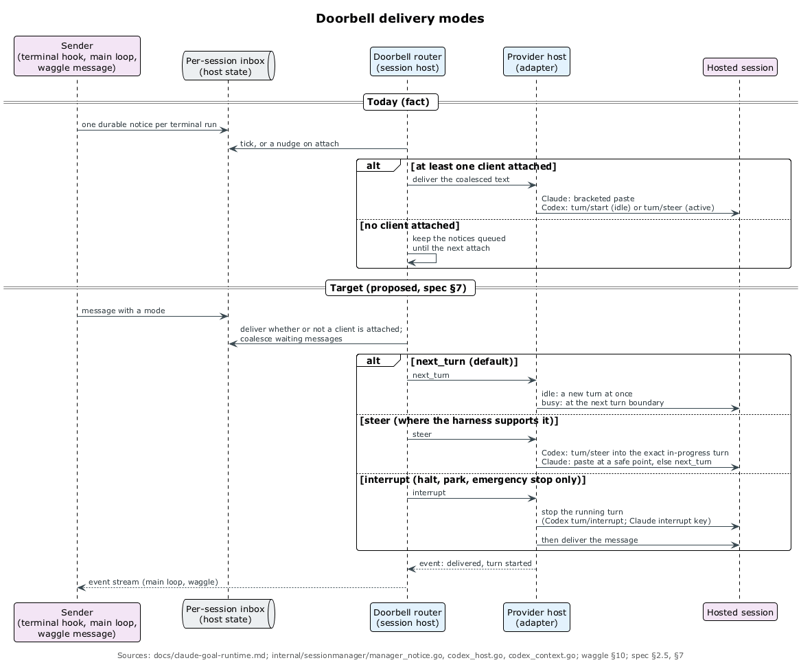
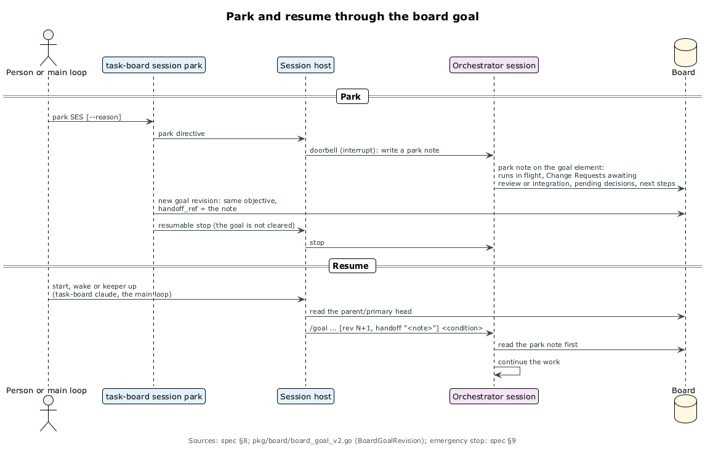
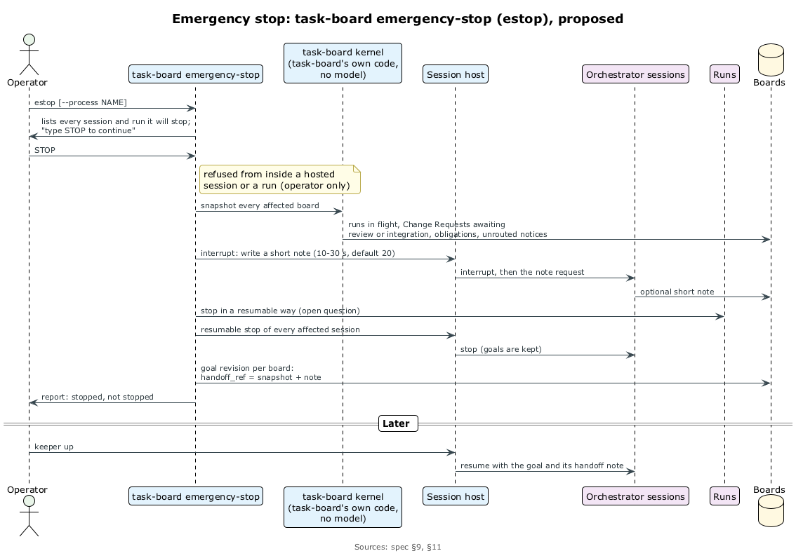
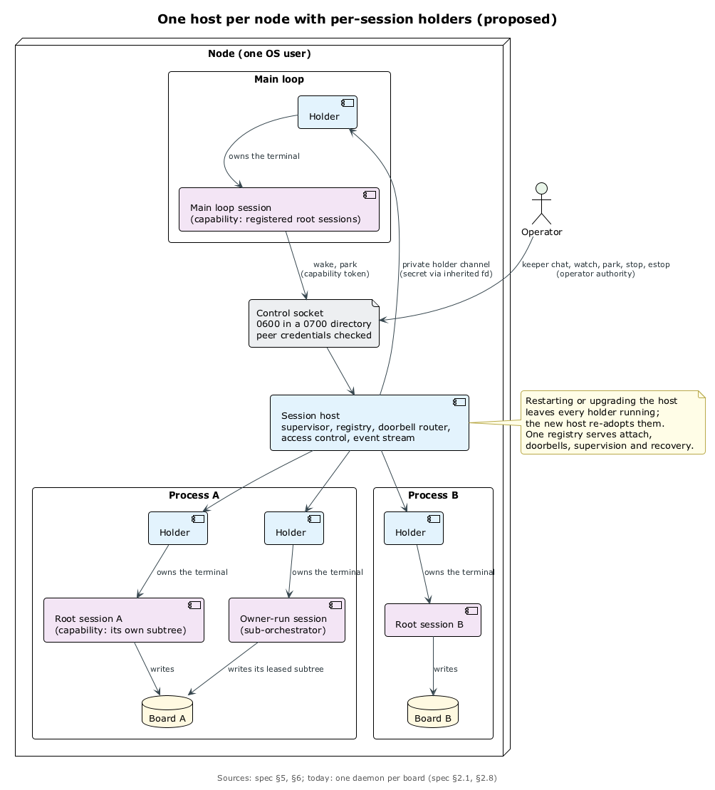
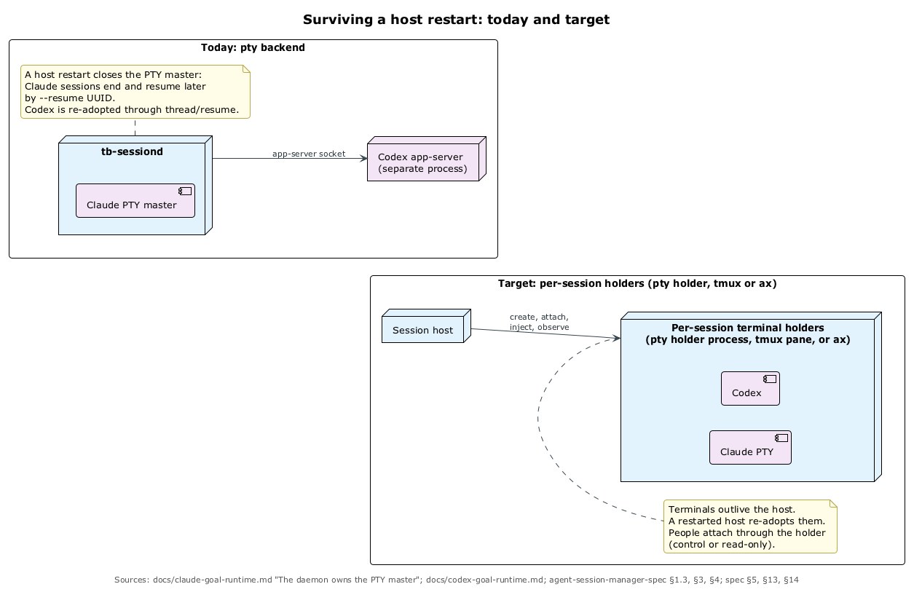

# Запуск: матрёшка и session host

## Матрёшка запуска

Спека Кипера описывает старт сессии как пять слоёв, у каждого одна задача. ⟦предложено⟧

1. **`curator`** — зонтичная команда; `curator run` передаёт работу провайдеру `curator-run` из доверенного каталога.
2. **`curator-run`** превращает профиль в фрагмент окружения: управляемый дом, контекст, скиллы, MCP, системный промпт.
3. **Плоскость запуска agents-management** превращает harness, модель и effort в argv и окружение, и получается ровно один план запуска.
4. **Session host** держит процесс, привязывает сессию к цели борды и вписывает цель вместе с запиской парковки.
5. **Harness** работает в папке улья в фоне, пока кто-нибудь не подключится.

Слои 1–3 работают для прямого запуска. ⟦работает сегодня⟧ Хостинг «с рождения» через контракт `ax start --launch-plan` решён как веха M3. ⟦решено⟧ Форма моста к нему открыта. ⟦открыто⟧ Дверей две: человек заходит через `curator run`, а дочерние run'ы запускает `task-board spawn`. ⟦решено⟧

Модуль agents-management (`v0.5.22`) — это реестр моделей, плагин запуска на каждый harness (claude-code, codex, qwen-code, gemini-cli, antigravity, muse) и учёт лимитов провайдеров; процессов он не запускает. ⟦работает сегодня⟧

## Демон сессий сегодня

Сегодня эту роль играет `tb-sessiond` внутри task-board. ⟦работает сегодня⟧

- **Один демон на борду**; `task-board claude|codex` поднимает главную сессию или подключается к ней, а слот `parent/primary` один.
- **Цель — нативная цель harness'а**: Claude получает `/goal tbg-<token> [board goal <ID> rev <N> …] <условие>` через bracketed paste, Codex — через app-server. Продолжение ведёт оценщик самого harness'а.
- **Под-оркестраторы** живут в своих сессиях, подключиться к ним нельзя, только читать транскрипт и события.
- **Уведомления** о завершённых run'ах доставляются, только если к сессии подключён клиент.
- **Перезапуск**: Claude-сессия умирает вместе с демоном и потом возобновляется по UUID, Codex подхватывается через `thread/resume`.
- **Доступ**: один bearer-токен на борду, и прочитать его может любой агент пользователя оператора.

## Фаза 1 и доступ

Session host становится отдельным модулем `agent-session-host`, и это первый приоритет всей работы. Фаза 1 переносит код, а не поведение: хосты Claude и Codex, подключения, уведомления, записи сессий и восстановление уходят в модуль, а борда, реестр целей и команды остаются в task-board. Готово, когда тесты сессий, целей и уведомлений проходят без изменений, а golden-файлы совпадают. Потом адаптеры Muse, agy, Pi и Qwen. ⟦решено⟧ Внешняя форма контракта повторяет протокол плагинов ax: построчный JSON через stdio, манифест и проба, отказ при ошибке. ⟦предложено⟧

Закрытие доступа — первый рефакторинг после выноса. ⟦решено⟧ Предлагается сокет в каталоге 0700 с проверкой учётных данных процесса, свой токен возможностей у каждой сессии и команды оператора только из терминала вне любой сессии, пока нет компонента доверия. Токены дают минимальные права среди послушных агентов, но не границу. ⟦предложено⟧

| Кто | Будить и парковать | Останавливать | Подключаться | Стоп-кран |
| ----- | ---------- | ----------- | --------- | ------ |
| оператор | любую сессию | любую | с управлением или только смотреть | да |
| Кипер | маток своих ульев | с подтверждением или по доверенности | нет | по доверенности с поводом |
| матка | своё поддерево | своё поддерево | нет | нет |
| run | ничего | ничего | нет | нет |

## Звонок: три режима

Сообщение должно работать без подключённого человека и не ломать текущую работу. ⟦предложено⟧

- **`next_turn`** (по умолчанию) — на границе следующего хода; свободная сессия получает ход сразу.
- **`steer`** — в текущий ход, где harness умеет: у Codex `turn/steer`, у Claude вставка в безопасный момент.
- **`interrupt`** — только для остановки, парковки и стоп-крана: сначала ход останавливается.

Доставка больше не ждёт клиента, ждущие сообщения склеиваются, каждый ход даёт событие, а waggle §10 нужна поправка. Собственные механизмы harness'а, например Claude Mods, адаптер может использовать, но никогда для полномочий. ⟦предложено⟧

## Парковка и аварийная остановка

`task-board session park` — упорядоченная остановка. ⟦решено⟧ Хост звонит в режиме `interrupt`, оркестратор пишет записку (run'ы в полёте, Change Request'ы, решения для человека, следующие шаги), task-board добавляет ревизию цели с полем `handoff_ref`, и сессия останавливается без очистки цели. Следующий старт первым делом читает записку, а без записки ею становится снимок ядра. Тот же механизм пишет передачу дел перед сжатием контекста. ⟦предложено⟧

Аварийную остановку оператор потребовал сделать отдельной командой, которую нельзя ни с чем спутать. Нажать её может оператор всегда, а Кипер — только по доверенности, где назван повод («кончились лимиты», «что-то пошло вразнос»); маткам и run'ам нельзя. ⟦решено⟧ Команда требует набрать фразу, ядро пишет снимок каждой борды, оркестраторы за ~20 секунд добавляют записки, run'ы и сессии останавливаются так, чтобы продолжить, а `keeper up` всё поднимает. ⟦предложено⟧ Черновики расходятся в форме — `task-board emergency-stop` с фразой `STOP` против `keeper estop` с «EMERGENCY STOP», — и как приостановить run с продолжением, не решено. ⟦открыто⟧

## Сессия — это кэш

Авторитетное состояние — борда, цель и записка, а не контекст harness'а. ⟦решено⟧ Адаптеры сообщают телеметрию (`PreCompact` у Claude, расход токенов у Codex), перед сжатием хост просит записать передачу дел, а наблюдатель Кипера следит за событиями. Это спроектировано сейчас и будет построено позже. ⟦предложено⟧

## Один хост на машину

Сегодня на каждую борду свой демон. Предлагается один хост на пользователя ОС и отдельный держатель терминала на каждую сессию: маленький процесс с PTY, панель tmux или ax. Упавший harness роняет только своего держателя, а перезапуск хоста не роняет ни одной сессии: новый хост подхватывает держателей. ⟦предложено⟧ Оператор этот вариант ещё не принял. ⟦открыто⟧

Держатели бывают `pty`, `tmux` и `ax`; это записано как архитектура, но в фазе 1 не строится. ⟦решено⟧ Долгосрочный бэкенд — ax: его спека v0.7.0 описывает терминал, подключение и продолжение, а в коде пока только фундамент. Контракт устроен так, чтобы переход на ax был настройкой, а не переписыванием. ⟦предложено⟧

Вехи: SH0 — спека, SH1 — вынос как есть. ⟦решено⟧ Дальше SH2 — доступ, звонки, парковка, стоп-кран, события; SH3 — один хост, выбор сессии, восстановление после перезагрузки; SH4 — tmux; SH5 — телеметрия; SH6 — ax; SH7 — Muse, agy, Pi, Qwen. ⟦предложено⟧

