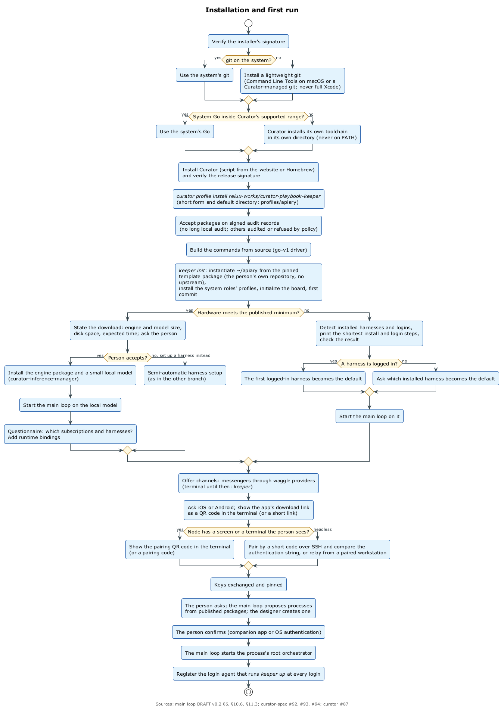
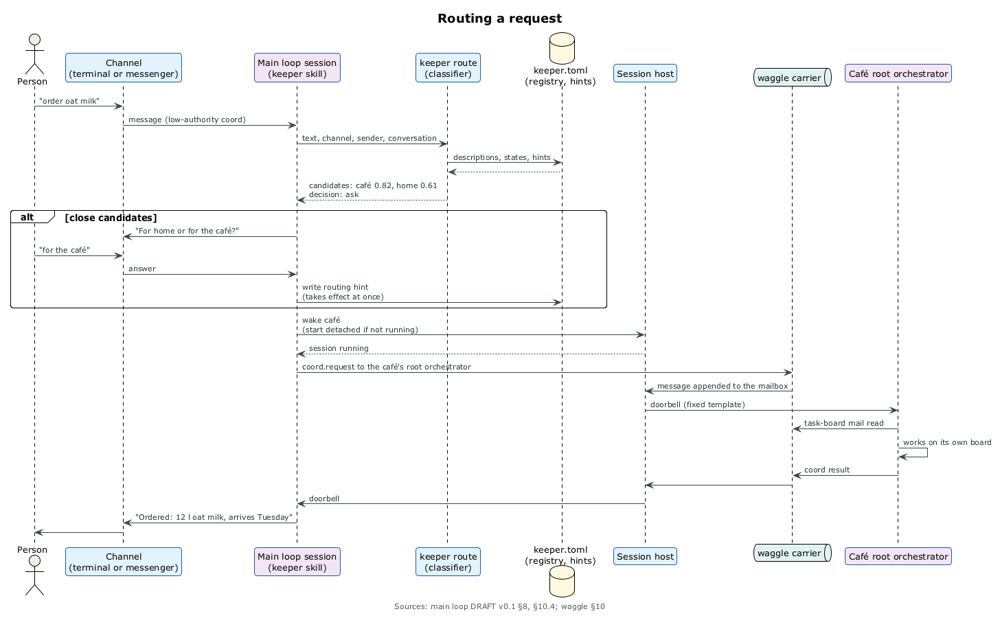
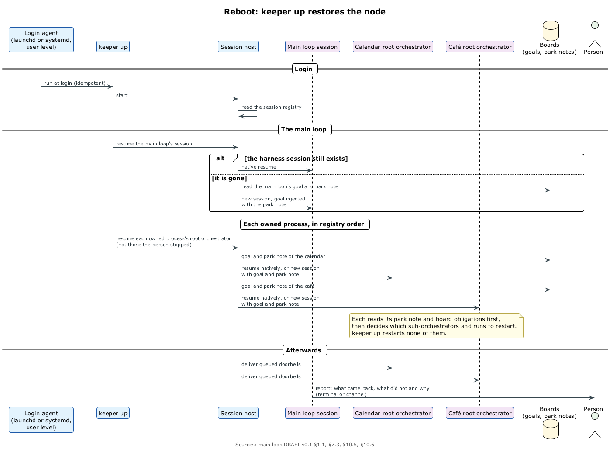

# Кипер: главный цикл точки

У человека на одной машине несколько ульев: семейный календарь, умный дом, хобби-проект, кафе. Над ними нужен кто-то, кто знает все ульи, принимает запрос простыми словами («закажи овсяное молоко»), понимает, куда его отнести, поднимает или будит нужную матку, приносит результат, спрашивает человека о том, что может решить только он, и поднимает машину после перезагрузки. Это Кипер. ⟦предложено⟧

Спека `curator-keeper` — DRAFT v0.4, почти всё в ней предложения, и кода Кипера нет. Из того, на чём он стоит, сегодня есть Curator, `curator run`, task-board с демоном сессий и `task-board spawn`. ⟦работает сегодня⟧

## Что делает и чего не делает

- **Один Кипер на машину**: он управляет ульями, но не делает их работу — не пишет в их борды и не запускает внутри run'ы. ⟦предложено⟧
- **Одна матка на улей**, запущенная снаружи; всё внутри улья запускает она сама. ⟦решено⟧
- **Ульи изолированы**: оркестратор пишет только в свою борду, а другой улей достаёт только передачей работы. ⟦решено⟧
- **Что может решить только человек, идёт к человеку**, с доказательством там, где процесс требует. ⟦решено⟧

Пример. Человек пишет: «перенеси субботнего стоматолога на 11 и закажи овсяное молоко». Кипер делит запрос на два, будит запаркованную матку календаря и поднимает незапущенную матку кафе. Покупка выше делегированного лимита ждёт одобрения на телефоне, а потом Кипер отвечает обоими результатами. ⟦предложено⟧

## Корень, реестр, установка

- **`~/apiary`** — собственный git-репозиторий человека без связи с нами: `keeper.toml` с реестром ульев, `Playbook.json` собственного процесса Кипера, его борда, `persona/` и `memory/`. Ульи — отдельные репозитории, а не submodule'и: submodule закрепляет устаревший коммит и связывает хостинг всех ульев. ⟦предложено⟧
- **Записи реестра, которые решают, куда идут запросы и полномочия** — добавить или перенести улей, привязать канал, — вступают в силу после подтверждения человеком. Описания и подсказки маршрутизации действуют сразу. ⟦предложено⟧
- **Отвязано от нас**: корень создаётся из закреплённого проверенного шаблона, а наш код попадает на машину только через реестр Curator. Сборка идёт из исходников, системные Go и git не перетираются, полный Xcode не ставится. ⟦решено⟧
- **Одна установка ставит всё**: установка профиля из закреплённого проверенного источника доставляет профиль `apiary`, а `keeper init` — профили системных ролей. ⟦предложено⟧ Внешний обзор CLI нашёл дыру: профиль не может доставить исполняемые `curator-*`, а `keeper up` нужен `curator-run`. ⟦открыто⟧
- **Первый запуск**: если железа хватает, установщик называет размер скачивания, место и время, спрашивает и запускает Кипера на маленькой локальной модели; иначе находит залогиненные harness'ы и берёт первый. Дальше QR-коды приложения-компаньона прямо в терминале, первый улей и агент входа, который запускает `keeper up`. ⟦предложено⟧

## Роль плюс модуль

Кипер — это роль и модуль. Роль — скилл Кипера, который исполняет любой harness с адаптером session host: модель решает. Модуль — команда `keeper` и библиотека с выводом `--json`: команда делает. Всё работает на существующих harness'ах, а свой лёгкий цикл понадобится позже. Команды из спеки: `keeper` (разговор, при необходимости сначала `up`), `up`, `down`, `ls`, `chat`, `watch`, `park`, `stop`, `estop`, `status`, `hive …`, `route`, `create`, `wake`; их имена пересматриваются (глава 13). ⟦предложено⟧

## Маршрутизация

Порядок решён 24 сентября. ⟦решено⟧

1. Явная ссылка побеждает: «для кафе» или ответ в треде улья.
2. Канал, привязанный к улью, ведёт в этот улей.
3. Один уверенный кандидат — выше порога и с запасом.
4. Близкие кандидаты — один короткий вопрос, и ответ становится видимой подсказкой.
5. Ни одного кандидата — проектировщик предлагает новый улей.
6. Запрос для двух ульев делится на два.

Подсказки — данные, а не память модели. Классификатор спека не навязывает: хорошо подходят быстрые типизированные классификаторы вроде Jev (70–500 мс на решение), запасной вариант — маленькая модель с выводом по схеме. `keeper route` отдаёт кандидатов с оценками и причинами и решение `route`, `ask`, `split` или `design`. ⟦предложено⟧

## Жизнь ульев

- **Сначала шаблоны**: запрос сверяется с опубликованными нуками и своими шаблонами. ⟦решено⟧
- **Проектировщик** начинает с самого простого процесса, который работает, добавляет сложность только по фактам, измеряет ульи и предлагает улучшения как правки `Playbook.json` на подтверждение. ⟦решено⟧ Новый процесс он сначала прогоняет во сне и прикладывает отчёт. ⟦предложено⟧
- **Библиотекарь** по расписанию ищет почти одинаковые playbook'и и сливает их только после одобрения человека. ⟦решено⟧

## Надзор и перезагрузка

- **Всё общение Кипера с оркестраторами идёт через waggle**, даже на одной машине, а дочерние run'ы с Кипером не говорят. Звонки должны доходить до сессий, к которым никто не подключён. ⟦предложено⟧
- **`keeper down`** паркует всё, сначала маток, Кипера последним. ⟦предложено⟧
- **После перезагрузки** агент входа (LaunchAgent на macOS, пользовательский unit systemd на Linux) запускает `keeper up`: хост, сессия Кипера, матки по реестру (остановленные человеком остаются остановленными), накопившиеся звонки и отчёт человеку. Под-оркестраторы матки поднимают сами, прочитав записки. Одну точку входа попросил оператор, форма предложена. ⟦предложено⟧

## Человек и системные роли

- **Каналы**: сначала терминал, потом мессенджеры через провайдеров waggle. Это ненадёжные трубы: там можно спросить и ответить, но нельзя одобрить. ⟦предложено⟧
- **Одобрения и подтверждения** идут через приложение-компаньон или аутентификацию ОС: Touch ID или пароль, Windows Hello, polkit или PAM, FIDO2-ключ. ⟦решено⟧
- **Сисадмин** бэкапит пасеку только в собственный remote человека, одним репозиторием: `main` для корня, ветки `hive/<имя>` для ульев, `mirror/` с пакетами на точных коммитах и `curator/` с объявлениями профилей. Секреты в бэкап не попадают: токены лежат в связке ключей машины, а приложение держит их зашифрованное зеркало. Восстановление — та же установка с другим корнем: `keeper restore <remote>`, профили из зеркала, сопряжение приложения и перенос токенов после подтверждения на телефоне. Ещё он ведёт учёт токенов и обновляет скиллы по политике. ⟦предложено⟧
- **Наблюдатель** следит за заполненностью контекста и лимитами провайдеров, просит записку перед сжатием, паркует сессии при исчерпанном лимите и сообщает о странностях. Работу он не двигает. ⟦предложено⟧

Направление системных ролей решено 25 сентября. ⟦решено⟧ Вехи Кипера: KP1 — одна машина на существующих harness'ах, KP2 — каналы и приложение, KP3 — проектировщик, сны и память, KP4 — сисадмин и наблюдатель, KP5 — несколько машин. ⟦предложено⟧ В общем порядке Кипер идёт после session host, процессов и ухода с agents-infra. ⟦решено⟧
