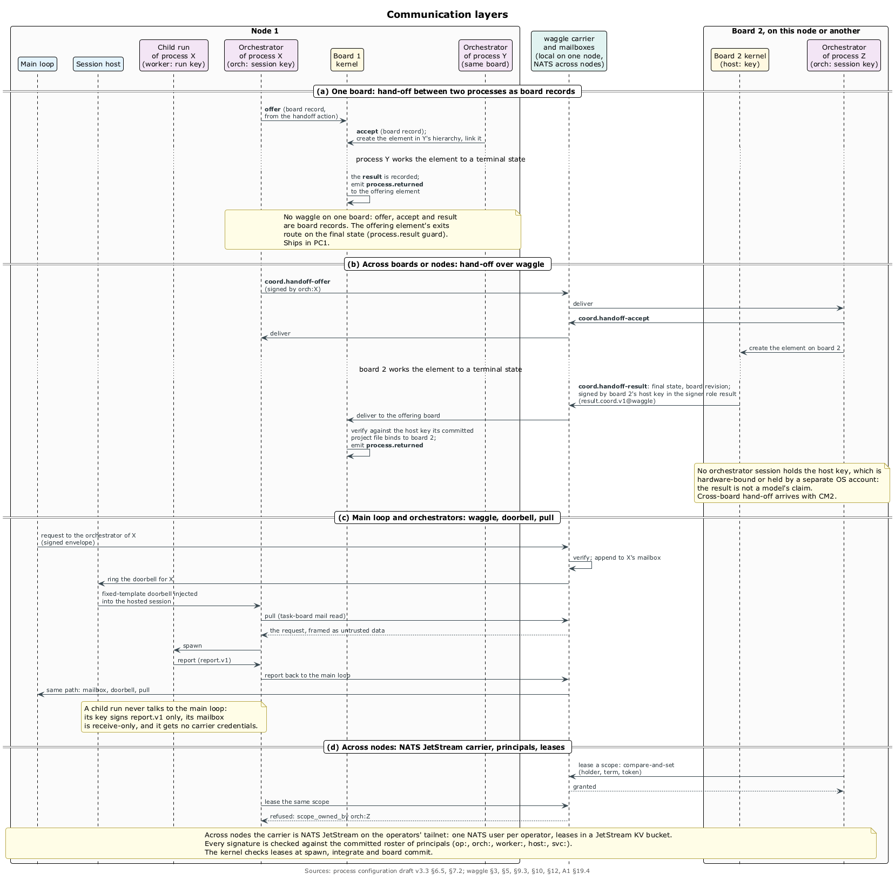

# waggle: как агенты говорят друг с другом

## Зачем

Нужен один протокол для двух случаев: координация оркестраторов над общим проектом — сначала на одной машине, потом между 2–3 операторами в разных местах, позже с другими организациями — и односторонние команды оркестратора исполнителю: «уточни», «смени приоритет», «отмени», «остановись». Исполнители оркестраторами не командуют никогда. ⟦решено⟧

Сегодня между оркестраторами ходят только уведомления о завершённых run'ах, ничего не подписано, а дочерний процесс может унаследовать переменные менеджера сессий родителя; эту утечку закрывают первой. ⟦работает сегодня⟧ waggle назван по виляющему танцу пчёл. Это публичный Go-модуль под Apache-2.0, спека DRAFT v5.2, реализации пока нет. ⟦решено⟧

## Два слоя

У протокола два слоя. ⟦решено⟧

- **Слой общения** отвечает на вопрос «кто что сказал кому, кто одобрил и дошло ли»: ключи, конверты, подписи, проверка, почтовые ящики, доставка в сессии, провайдеры.
- **Слой координации** отвечает на вопрос «кто над чем работает и как договариваемся»: переговоры, захват работы, lease на области, решения кворумом. Полномочия он держит в lease'ах и проверках, а не в том, как модель прочитала сообщение.

Метафора координации — рой, который выбирает новый дом кворумом разведчиц (T. D. Seeley, *Honeybee Democracy*). ⟦решено⟧

## Кто и как подписывает

- **Принципалы** — оператор `op:`, сессия оркестратора `orch:` (эфемерный ключ, заверенный ключом оператора на 12 часов), run исполнителя `worker:` (ключ до дедлайна run'а), хост `host:`, а с поправкой A1 — сервисы `svc:`. ⟦решено⟧
- **Ростер** — обычный файл OpenSSH `allowed_signers` в проекте со списком отзыва. Каждому принципалу разрешены свои пространства имён, поэтому ключ исполнителя не сделает действительную подпись `coord` или `cmd` ни через какой транспорт. ⟦решено⟧
- **Конверт** — байты сообщения и одна или несколько подписей SSHSIG по ролям: автор, одобряющий, поручитель. Пространство имён связывает класс и роль, так что подпись одной роли не выдать за другую, а изменённый байт ломает все подписи. ⟦решено⟧

```json
{
  "schema": "waggle-v1", "type": "cmd.halt",
  "from": "orch:alpha@acme", "to": "worker:RUN-260924-abc123@acme",
  "signers": { "approver": "op:owner@acme" },
  "delivery": "interrupt",
  "body": { "reason": "stop before integration; wrong base" }
}
```

- **Агент ключа не держит**: он вызывает `task-board mail send`, а хост заполняет поля и подписывает ключом сессии. Нужна подпись человека — оператор запускает `task-board mail approve <id>`, видит все поля и подписывает то, что видит. ⟦решено⟧
- **Проверка одна для всех провайдеров**: подписи по ростеру, политика подписей, полномочия через слой координации (автор `cmd` должен держать lease на область), срок, дубликаты, порядок. Не прошедшее проверку сообщение до агента не доходит. ⟦решено⟧

## Классы и защита

Классы сообщений: `coord` (просьбы, предложения, вопросы, передача работы между оркестраторами), `cmd` (команды исполнителю), `report` (отчёты исполнителя) и `receipt` (квитанции хоста). `cancel` и `halt` выполняет супервизор, а модель исполнителя только узнаёт о них. ⟦решено⟧

От инъекций защищают слоями: полномочия вне модели, типизированные тела с рамкой «это данные, а не инструкции», детерминированные инспекторы, по желанию охранник-модель и изолированный читатель, карантин с ручным выпуском, лимиты частоты. ⟦решено⟧

## Провайдеры — ненадёжные трубы

Провайдер возит байты или показывает сообщения людям: локальная папка, NATS JetStream, IRC, XMPP, Matrix, Slack, Telegram, почта. Полномочия дают подписи, ростер и политика, а не провайдер, поэтому закрытые чаты годятся как адаптеры, но не как ядро. ⟦решено⟧

- **Carrier** доставляет подписанные конверты байт в байт, и только он возит `coord` и `cmd`. **Консоль** показывает сообщения людям, а написанное в ней входит как `coord` с низкими полномочиями. ⟦решено⟧
- **Первый интернет-carrier** — NATS JetStream на отдельном Mac mini в tailnet операторов, отдельным сервисом, который не трогает общий вход этого хоста. Первая консоль — свой терминальный интерфейс `task-board mail tail`. Ящик в старом board-server не возрождаем. ⟦решено⟧ Федерация через XMPP и шлюз A2A — позже. ⟦предложено⟧
- **Доставка — звонок и забор**: хост кладёт проверенное сообщение в ящик и звонит в сессию фиксированным текстом, а агент сам забирает почту через `task-board mail read`. Своего кода для harness'ов у waggle нет: он звонит через session host. ⟦решено⟧

## Координация

- **Lease на область** говорит, кто сейчас владеет частью проекта: держатель, монотонный срок, токен, истечение, запись через compare-and-set. Ядро проверяет lease при запуске run'а, интеграции и коммите борды. Альфа держит эпик Auth, Бета — Billing; запуск Альфой разработчика на story из Billing отвергается с `scope_owned_by orch:beta`, пока Бета не передаст lease с большим сроком. ⟦решено⟧
- **Решения кворумом** — предложение, поддержка или возражение и запись `decide` с подписями поддержавших. ⟦предложено⟧
- **Протокольная лаборатория** — одноразовый проект на трёх машинах с примитивным каналом, где агенты сами придумывают, как договариваться; находки попадают в спеку через ревью. ⟦решено⟧

## Поправка A1

A1 добавляет то, что нужно процессам на борде: подписанные акты людей (`board.approve`, `board.relax`, `board.transition`), подписанные внешние события от мостов `svc:`, результат передачи работы с подписью хоста принимающей борды, ключи приложения-компаньона и делегирование актов сессиям оркестратора. Направление принято 24 сентября, реализация — с CM2; waggle держит формы на проводе, а что они значат, решает `curator-trust`. ⟦решено⟧



Вехи: CM1 — одна машина, библиотека, локальный carrier, `task-board mail`, звонок через session host; это первый приоритет вместе с session host. CM2 — 2–3 оператора через NATS, lease'ы, A1. CM3 — удалённый исполнитель. CM4 — другие организации. ⟦решено⟧
