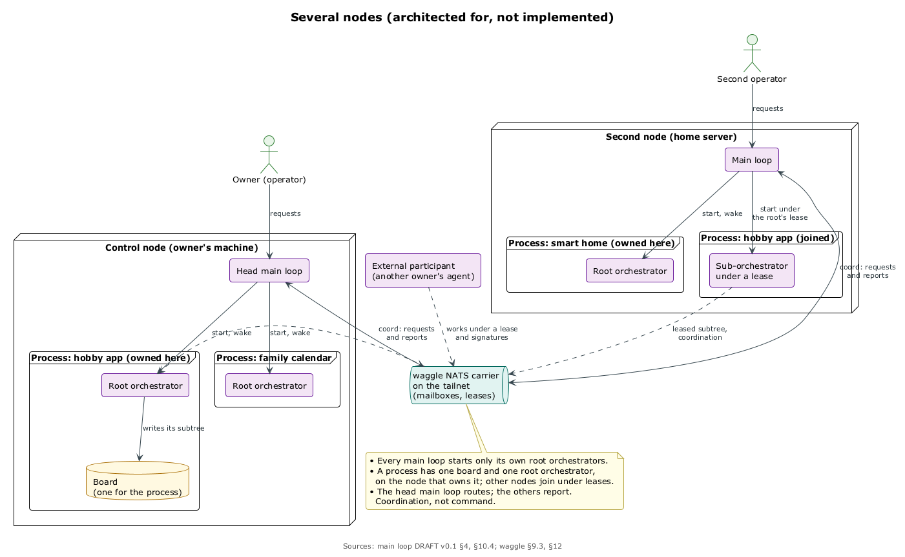

# Несколько машин и людей

## Четыре способа вырасти

Схема для одной машины не должна мешать росту. Спека Кипера называет четыре способа выйти за одну точку; под них всё спроектировано, но ничего не реализовано. ⟦предложено⟧

1. **Один улей, несколько машин.** У улья одна борда и одна матка на машине-владельце, а другие машины запускают под-оркестраторы по lease, но никогда вторую матку.
2. **Разные ульи, одна пасека.** Один Кипер становится главным, остальные отчитываются ему через waggle и принимают запросы, которые он направляет. Это координация, а не командование.
3. **Несколько операторов.** Операторы — принципалы waggle, со ступени L1 подтверждения бывают M из N. Иерархия операторов открыта.
4. **Дикие пчёлы.** Агенты другого владельца работают над частью улья по lease и подписям, если их пустил ростер. Это CM4 и ступень L2.

Все четыре пути держат открытыми три выбора: запись реестра называет машину-владельца и постоянный id; всё общение Кипера с оркестраторами идёт через waggle даже на одной машине, так что переход на несколько машин меняет только carrier; ульи — отдельные репозитории. ⟦предложено⟧

## Что уже решено

- **Одно подтверждение для всех машин**: каждая машина проверяет подписанную запись сама и не исполняет версию, которую другая машина всего лишь объявила. ⟦решено⟧
- **Транспорт — абстракция**: сегодня tailnet, завтра другая сеть или ретранслятор со сквозным шифрованием. Транспорт узнаёт машину, но не решает, что ей можно. ⟦решено⟧
- **Общее состояние требует хранилища lease'ов** waggle (NATS JetStream KV, CM2). До него общая борда запускает `tick` на одной машине, а делегирование с бюджетом на борде нескольких машин запрещено. ⟦решено⟧
- **Форки с одной бордой.** Форк — отдельный владелец кода, а upstream остаётся владельцем борды, и история у борды одна. При каждой посадке story форк подтягивает upstream и меряет конфликт; большой конфликт останавливает линию сообщением `coord`; в конце вехи форк открывает pull request. Прежде чем форкать, ищут шов или модуль — так waggle стал модулем. ⟦решено⟧

## Пасека как распределённый пул

В `curator-agent-runtime` лежит информативный дизайн: сначала адаптер AgentHost поверх локального запуска run'ов, потом один удалённый исполнитель, потом доверенный пул машин и людей, где маршруты playbook'ов служат программой координатора. ⟦предложено⟧ Кода рантайма нет, трек идёт после вех M4 и M7. ⟦решено⟧
