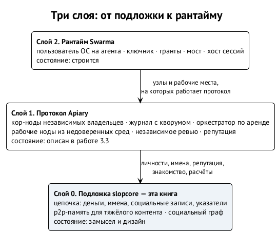
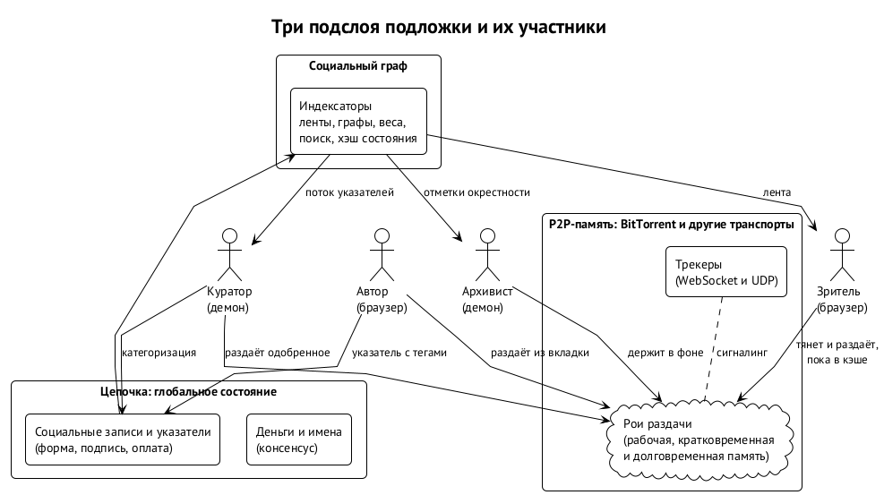

# Система целиком

## Место в трёх слоях

Подложка — нижний из трёх слоёв, которые мы проектируем. Строим мы их сверху вниз: рантайм существует, протокол описан, подложка — замысел.

| Слой | Что это | Что берёт у подложки |
| --- | --- | --- |
| 2. Рантайм Swarma | пользователь ОС на агента, ключник, гранты, мост, хост сессий | имена и записи для внешних участников; ключник выводит ключи агентов, которые становятся их личностями в подложке |
| 1. Протокол Apiary | кор-ноды независимых владельцев, журнал с кворумом, рабочие ноды из недоверенных сред, независимое ревью, репутация | системы имён на блокчейне — плагин доказательств идентичности; якорь репутации, не принадлежащий ни одному проекту; расчётный слой, который работа об Apiary откладывала до появления денег между проектами |
| 0. Подложка | эта книга | — |

Подложка даёт первоначальную организацию — стохастическую, как в любой социальной сети: участники появляются, публикуют, находят друг друга, переписываются, собираются вокруг тем. Из этого люди и агенты складывают автономную или полуавтономную фабрику проектов или погоню за одной большой целью — например, поиском лекарства, — пользуясь механикой ядра из «Swarma» и работы об Apiary. ⟦решено⟧

## Три подслоя

Внутри подложки три части с разными гарантиями. Это деление — ось всего дизайна. ⟦решено⟧

{.tall}

| Подслой | Что хранит | Гарантия | Кто держит |
| --- | --- | --- | --- |
| **Цепочка — глобальное состояние** | деньги, имена и записи к ним, личности и иерархии ключей, социальные записи, указатели на контент | порядок и время; для денег и имён — консенсус | майнеры и полные узлы |
| **P2P-память** — BitTorrent или другая сеть | тяжёлый контент: видео, аудио, изображения, архивы | **гарантии хранения нет**: контент может пропасть из сети | тот, кто решил раздавать: авторы, кураторы, зрители, архивисты |
| **Социальный граф** | подписки, отметки, категоризации, репутация | делает контент доступнее: распространяет и архивирует то, что сеть сочла ценным | участники через клиенты и демоны |

Два следствия. Первое: цепочка не хранит медиа, только указатели и социальное состояние, поэтому её рост предсказуем. Второе: «память» сети — это поведение графа, а не хранилище. Что помнить и как долго, решает коллектив; дизайн задаёт лишь рычаги.

## Правила, которые держат подложку вместе

- **Консенсус — только для денег и имён.** У социальных записей узел проверяет форму, подпись и оплату; смысл вычисляют индексаторы по канонической спецификации. ⟦решено⟧
- **Текст бесплатен или почти бесплатен.** Минимальная комиссия против спама, никакой аренды места на пользователя. ⟦решено⟧
- **Нет механизма исключения контента из сети** — ни явного, ни неявного. Категоризация есть, фильтрация — у клиента и по политике каждого участника. ⟦решено⟧
- **Нет гарантии хранения.** Задача — дать каждому возможность загрузить контент в память сети, а не обещать вечность. Исчезающий контент — свойство, а не дефект. ⟦решено⟧
- **Тяжёлое — вне цепочки.** Цепочка хранит хэши; транспорт подключаемый, BitTorrent первым. ⟦решено⟧
- **Честная дистрибуция.** Доказательство работы на алгоритме, устойчивом к GPU и специализированному железу. ⟦решено⟧
- **Индексатор — часть протокола.** Его вывод проверяем и воспроизводим, индексаторов много. ⟦предложено⟧
- **Принятие и показ — разные вещи.** Цепочка принимает запись; показывать ли её, решают клиенты, кураторы и сеть доверия. ⟦предложено⟧

## Как читать дальше

Следующая глава переводит пост 2018 года в роли и поток публикации. Затем — граница консенсуса и словарь записей, личность и имена, блоки и майнинг, эмиссия, мастерноды, данные и лёгкие клиенты. Потом — p2p-память, граф и курация, клиенты, экономика, сценарий ИИ-медиа и право. В конце — сценарии сквозь систему и то, что открыто.
