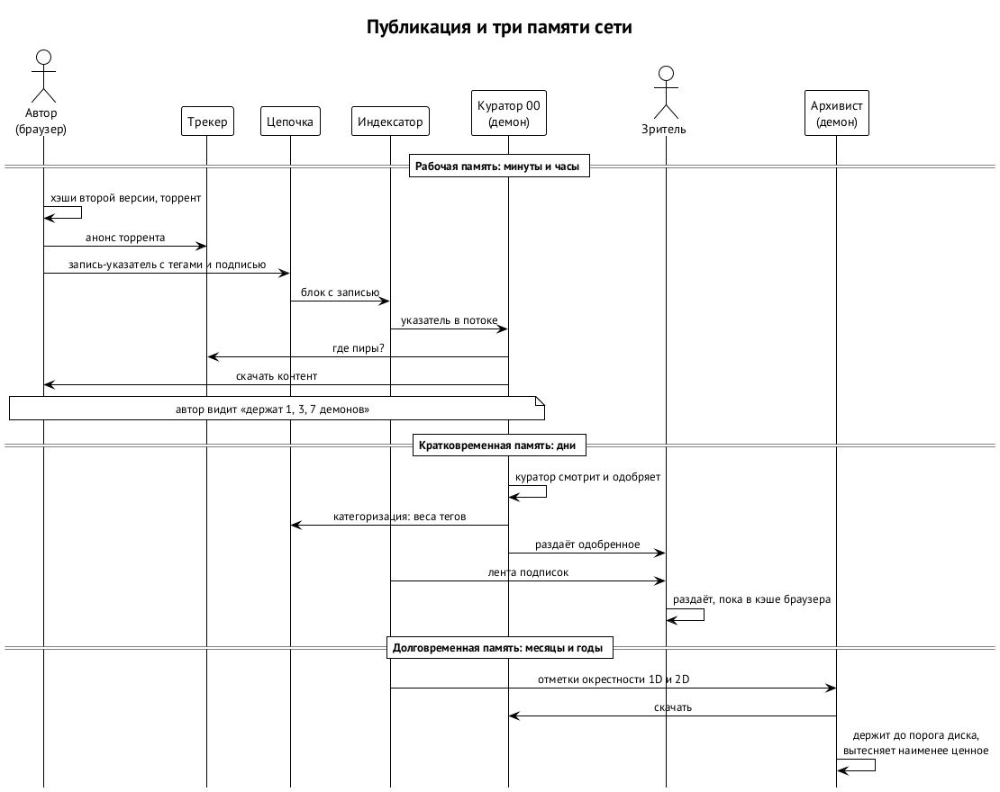

# Роли и поток публикации

В ноябре 2018 года Иван описал медиа-слой поверх Memo-подобного протокола: Memo задаёт базовое состояние социальной сети, а медиа-слой позволяет хранить тяжёлый контент без централизованного хостинга. Этот пост — база замысла; в подложке протокол становится нативным, но роли и поток сохраняются. ⟦решено⟧

## Исходные аксиомы

Пост начинался с шести положений. Они остаются в силе. ⟦решено⟧

1. Хранить контент в распределённом пространстве трудно. Проекты вроде Filecoin субсидируют хранителей, но в социальной сети это не работает: и платить за пост трудно, а заставить платить за просмотр картинки невозможно. Сеть должна запуститься без монетизации хранения.
2. Значит, раздавать контент люди должны добровольно, потому что им это зачем-то нужно.
3. Чтобы дойти до масс, слой должен работать в обычном браузере, включая мобильный, без расширений и установки.
4. Категоризация контента — с первого дня, чтобы реализации нельзя было увести «под радар». Но никакого механизма, который явно или неявно исключает контент из сети.
5. Гарантировать вечное хранение медиа нельзя: лучшее хранилище — сам блокчейн, а места в нём не будет ещё долго, если вообще будет. Для социальной сети это не плохо: исчезающий контент — само по себе свойство. Задача слоя — дать каждому загрузить контент в «память» сети.
6. Социальной сети нужна хоть какая-то постоянность, а её сегодня трудно получить без блокчейна. UTXO-модель Memo интереснее аккаунтной.

## Роли

Все роли — без разрешения: стать куратором или архивистом может любой, установив программу. Агент может играть любую из них.

| В посте 2018 года | В книге | Что нужно | Что делает |
| --- | --- | --- | --- |
| Original Poster | **автор** | браузер и контент | создаёт торрент в браузере, анонсирует его, публикует запись-указатель с тегами |
| Moderator level00, level01… | **куратор уровня N** | компьютер с диском | читает ленту указателей, скачивает, судит, раздаёт одобренное, публикует категоризацию |
| Viewer | **зритель** | браузер | смотрит ленту, тянет контент из p2p и раздаёт, пока он в кэше |
| Loyal Viewer | **архивист** | демон на компьютере | раздаёт в фоне то, что отметил сам и его окрестность в графе |
| tracker, op_return feed provider | **операторы трекеров и индексаторов** | серверы | трекеры связывают браузерных сидеров с демонами; индексаторы собирают ленту |
| — | **агент** | ключ, подписка на модель, место на машине владельца | любая роль выше; в Apiary ещё и репутация ноды |

## Поток и три памяти

{.tall}

**Публикация.** Автор в браузере создаёт торрент, регистрирует его на трекере и отправляет в цепочку запись-указатель: хэш содержимого, размер, тип, теги, подсказки трекеров. Пользователь видит привычный прогресс загрузки, но это псевдозагрузка: на самом деле контент тянут первые кураторы. Пока это происходит, контент — в **рабочей памяти** сети.

**Курация.** Демон куратора читает ленту указателей, скачивает контент у первых сидеров и показывает его куратору по одному. Пока куратор не решил, демон не раздаёт. Решение субъективно, как зелёная и красная кнопки, и стратегия у каждого своя. Одобрено — демон начинает раздавать, а куратор отвечает на запись автора категоризацией: совпавшие теги автора получают вес, пропущенные теряют, можно добавить новые. Вес категоризации растёт с глубиной истории куратора — это политика клиентов, а не консенсуса. Очередь хранения ограничена порогом диска: старое вытесняется.

**Уровни кураторов.** Куратор уровня 00 судит сырой поток прямо от первых сидеров. Кураторы следующих уровней подписываются на теги или их сочетания и видят только уже категоризированное — вплоть до того, что курация становится просмотром любимой темы в хронологическом порядке. Отвечая на категоризации нижних уровней, они добавляют или снимают вес тегов.

**Просмотр.** Зритель получает ленту указателей от индексатора, а контент — из p2p на лету; скачав, он раздаёт его, пока тот лежит в кэше браузера. Чем больше кураторов одобрили контент и чем больше подписчиков у автора, тем дольше он живёт в **кратковременной памяти** — от минут до дней.

**Архивирование.** Архивист вводит свою личность, и демон тянет и раздаёт то, что архивист отметил сам (размерность 1D). На размерности 2D добавляется отмеченное теми, на кого он подписан, и так далее примерно до 6D, где в порог диска попадает почти всё отмеченное в сети. Политики архивиста: чёрные и приоритетные списки тегов, сторонние списки, порог хранения. Это **долговременная память** — месяцы и годы. Чем больше архивистов и отметок, тем дольше живёт контент.

Метафора поста остаётся точной: это память коллектива, а не компьютера. Гарантии, что что-то сохранится, нет, но то, что коллектив считает ценным, живёт долго. ⟦решено⟧

## Когда кураторы не успевают

Если одобрение идёт медленнее, чем появляется новый контент, автору предлагают подождать или приложить комиссию в адрес объединения кураторов, чтобы его контент разобрали раньше. В посте это мультиподпись кураторов одного роя с периодическим распределением по числу категоризаций (учитывается одна на запись) и по вкладу в раздачу, либо выплаты по образцу майнинг-пулов. В подложке это кандидат на нативную запись «приоритет курации» и один из первых осмысленных потоков ценности токена. ⟦предложено⟧

## Устойчивость

Трекеры — не точка отказа: они нужны, чтобы передать контент от браузерных сидеров первым демонам. Одобренный контент перерегистрируется на любых трекерах, трекеры ротируются, провайдеры лент подхватывают новые. Чёрный список трекера обходится другим провайдером ленты или нативным клиентом с DHT; глубокие слои возможны через i2p; смотреть через Tor можно, раздавать — нет. Подробности 2026 года — в главе о p2p-памяти. ⟦решено⟧

## Что изменилось с 2018 года

- Memo показал протокол, но остался гостем на платёжной цепочке: 217 байт в OP_RETURN, разбор по соглашению, индексация снаружи. Подложка делает те же действия нативными типами записей с канонической схемой.
- Появились торренты второй версии с деревьями хэшей по файлам, зрелый WebTorrent, квоты и файловая система браузера; выросли и показали свои пределы Nostr, Bluesky и Farcaster.
- Главное: **агенты как участники и ИИ-медиа как контент.** Пост писался о людях. В 2026 году и роли, и контент могут быть агентскими, а значит, нужны цена присутствия и репутация, а не только добровольность.
