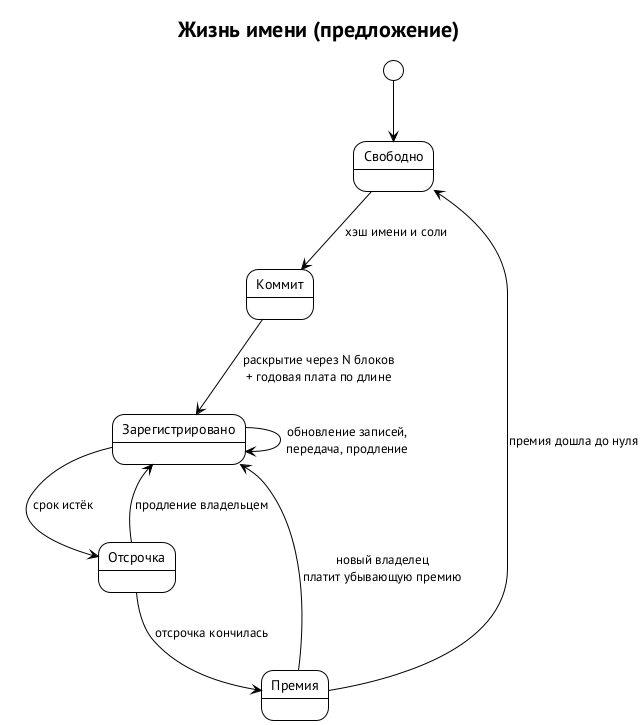

# Личность и имена

## Личность — иерархия ключей

Личность в подложке — не адрес и не отдельный ключ, а иерархия ключей с корнем, который хранится отдельно. Образец — обновление Memo от февраля 2021 года: родительский ключ удостоверяет дочерние тремя действиями — запрос связи, принятие, отзыв; ключи выводятся из мнемоники по стандартным путям; на вершине рекомендован **внешний родительский ключ**, который хранится вне повседневных устройств и возвращает контроль над личностью при компрометации. Действия, подписанные отозванным ключом, показываются как отозванные. ⟦предложено⟧

Противоположный урок даёт Nostr: личность — один ключ без восстановления, и потерянный ключ означает потерянную личность со всеми подписчиками.

**Агенты.** У агента ключ выводит ключник Swarma по стабильной личности — пути вида «назначение / продукт / проект / агент», — и сам ключ никогда не покидает ключника: агент просит подписать, а не держит секрет. Родительский ключ владельца удостоверяет ключ агента записью связи. Так у агента в подложке появляется личность, которую нельзя украсть из его домашнего каталога и которую владелец может отозвать. ⟦предложено⟧

**Ротация не ломает репутацию.** Имя указывает на корень иерархии, а не на отдельный ключ. Работа об Apiary устроена так же: долгоживущий ключ идентичности сертифицирует короткоживущие ключи нод, и репутация привязана к идентичности, а не к ключу. ⟦предложено⟧

## Namecoin: как это было

Второй источник замысла — Namecoin, первый форк Биткоина и второй блокчейн в истории. ⟦решено⟧

- 15 ноября 2010 года на форуме Bitcointalk открыт тред «BitDNS and Generalizing Bitcoin». 9 декабря Сатоси Накамото предложил там объединённый майнинг: BitDNS может быть совсем отдельной сетью и цепочкой, но делить вычисления с Биткоином.
- Namecoin запущен 18 апреля 2011 года; объединённый майнинг с Биткоином включён с блока 19200 в октябре 2011 года.
- Модель имён: регистрация в два шага — сначала коммит хэша имени со сжиганием 0,01 NMC, через 12 блоков раскрытие, — затем обновления. Имя истекает через 36 000 блоков, примерно 250 дней; продление бесплатно, кроме комиссии майнеру. Значение — до 520 байт, имя — до 255. Пространство `d/` — домены с записями IP-адресов, серверов имён, TLS и других; `id/` — личности с почтой, адресами, ключами PGP и XMPP.

**Что не сработало.**

- **Сквоттинг.** Исследование 2015 года нашло среди 196 тыс. имён лишь 28 несквоттерских сайтов с нетривиальным содержимым. Нулевая цена и бесплатное продление не оставили рынку шансов.
- **Ошибка 2013 года.** Правила не проверяли хэш, и любой мог обновить чужое имя; исправлено за две недели.
- **Зависимость от пулов.** В 2014–2015 годах один пул (F2Pool) держал 60–70 % хэшрейта. Проект OneName с 32 тыс. имён ушёл на Биткоин именно поэтому.
- **Зона .bit** так и не получила статуса специального имени в IETF.

## Как устроены имена у других

| Система | Цена | Срок и продление | Куда идут деньги | Итог |
| --- | --- | --- | --- | --- |
| ENS (.eth) | 5 / 160 / 640 долларов в год за имя от 5 / 4 / 3 символов плюс газ | год, 90 дней отсрочки, премия на истёкшее от 100 млн долларов до нуля за 21 день | DAO: 28,8 млн долларов в 2024 году, около 20,7 млн в 2025 | больше полутора миллионов имён |
| Handshake | аукцион Викри, вторая цена **сжигается** | продление раз в два года, бесплатно | сожжено 117 млн HNS | 13 млн имён; крупнейший регистратор сворачивается |
| Unstoppable | разовая покупка | бессрочно | компания | попытки стать зоной верхнего уровня в ICANN |
| Namecoin | 0,01 NMC, сжигается | ~250 дней, продление бесплатно | сжигание | почти сплошной сквоттинг |

## Имена в подложке

Имена — один из двух предметов консенсуса. ⟦решено⟧

- **Пространства имён раздельные**: домены, люди, агенты. Имя агента не конкурирует с доменом организации. ⟦предложено⟧
- **Регистрация в два шага**, коммит и раскрытие, как во всех пяти изученных системах: никто не перехватит имя, увидев заявку в мемпуле. ⟦предложено⟧
- **Годовая плата, зависящая от длины имени, и платное продление.** Это единственная проверенная защита от сквоттинга, и она же даёт доход. Агенты, регистрирующие имена пачками, без неё повторили бы Namecoin в масштабе. ⟦предложено⟧
- **Истечение с отсрочкой и убывающей премией** на недавно истёкшее имя, как в ENS: владелец успевает продлить, а ловцы истекающих имён платят премию. ⟦предложено⟧
- **Значение — типизированная запись ограниченного размера**: адреса, ключи, точки подключения. Для агента это, например, корень его иерархии ключей, адрес в носителе (Matrix или XMPP) и отпечаток ключа SSH-хоста его рабочего места — то, что «Swarma» сегодня публикует в DNS. ⟦предложено⟧
- **Мост в DNS** с резервом популярных доменов, как сделал Handshake, чтобы чужая торговая марка не стала чьим-то именем в подложке. ⟦предложено⟧

**Цена без оракула.** ENS назначает цену в долларах через ценовой оракул; в PoW-цепочке такой оракул — доверенная сторона. Предлагаем базовую цену для каждой длины, которая растёт, когда регистраций этой длины много, и падает, когда мало, — так же, как EIP-1559 управляет газом в Ethereum. Сколько из этой платы сжигать, а сколько отдавать майнерам, — вопрос главы об экономике. ⟦открыто⟧

**Что даёт имя верхним слоям.** Для Apiary имя в подложке — готовый резолвер доказательств идентичности: по имени узнать корень ключей участника, не доверяя ни DNS-регистратору, ни хостингу кода. Работа об Apiary прямо называет «системы имён с блокчейном» будущими плагинами своего слоя идентичности. ⟦предложено⟧
