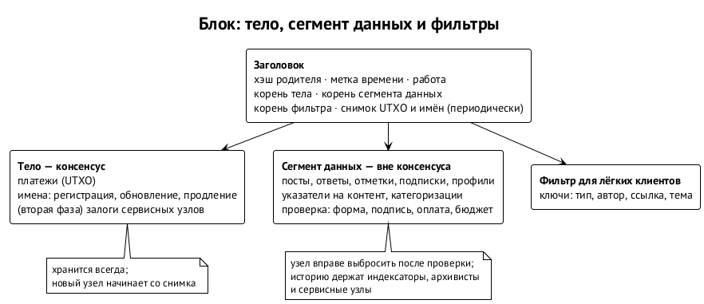
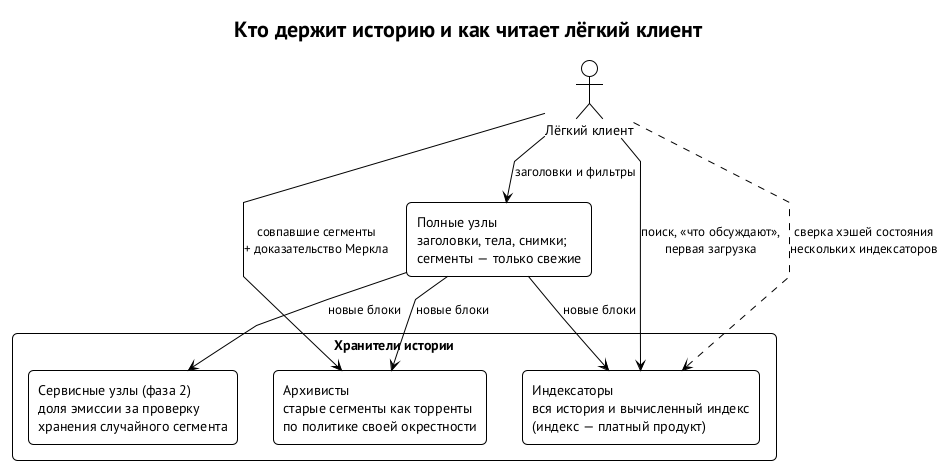

# Данные, история и лёгкие клиенты

## Вопрос Ивана

Если полные узлы выбрасывают социальные записи, кто хранит историю? Иван сформулировал опасения так. Индексаторы, возможно, могут брать деньги за исходную историю — но тогда нужны деньги на запуск сети; майнеры не хранят активность социальной сети; и консенсус не сможет восстановиться, если не останется ни одной полной копии. А если индексаторы зарабатывают на предоставлении индекса клиентам-зеркалам, а не тем, кто запускает новые узлы, — как отличить одних от других?

Ответ — разделить данные так, чтобы консенсус от них не зависел вообще.

## Сегмент данных

Блок состоит из двух частей. **Тело** несёт то, что проверяет консенсус: платежи, имена, залоги. **Сегмент данных** несёт социальные записи. Заголовок блока коммитит корни обеих частей и фильтр для лёгких клиентов. ⟦предложено⟧

- Новый узел синхронизируется без сегментов: по заголовкам и снимку UTXO-набора и базы имён, как это делает режим assumeUTXO в Bitcoin Core.
- Потеря сегментов теряет социальную историю, но никогда — консенсус: деньги и имена целиком в телах блоков.
- Сегменты нужны консенсусу только в момент проверки нового блока: что запись оплачена, что форма верна и что бюджет данных в блоке не превышен. Дальше узел вправе их выбросить.

## Три хранителя истории

{.tall}

Хранитель истории не один, а три. ⟦предложено⟧

1. **Индексаторы** — по экономике: без истории у них нет продукта.
2. **Архивисты через p2p-память.** Старые сегменты раздаются как обычные торренты по той же политике графа, что и контент: сегменты, где много записей твоей окрестности, архивист держит дольше.
3. **Сервисные узлы второй фазы** с долей эмиссии и проверкой хранения случайного сегмента. Это ответ на вопрос о деньгах на запуск: эмиссия и есть эти деньги, цепочка сама платит за свою память.

**Сырая история бесплатна, индекс — продукт.** Сырые сегменты проверяются по корням в заголовках, их бессмысленно продавать — они идут бесплатно через торренты. Продукт индексатора — вычисленный индекс: ленты, графы, поиск, ранжирование. За него можно брать деньги, а его честность проверяется хэшем состояния. Вопрос «как отличить зеркало от нового узла» исчезает: новому узлу сырая история вообще не нужна. ⟦предложено⟧

**Цепочка — нотариус, память — снаружи.** У кого есть копия поста, тот докажет, что пост был включён в блок N, даже если все узлы выбросили сегмент: достаточно доказательства Меркла до корня в заголовке. ⟦предложено⟧

## Лёгкий клиент: SPV для социального графа

Компактные фильтры блоков (BIP 157/158) работают так: узел публикует маленький вероятностный фильтр на каждый блок, клиент сам проверяет, есть ли в блоке что-то для него, и скачивает только совпавшие блоки. Сервер не знает, что клиент ищет, и не может соврать: каждый ответ проверяется по заголовку. ⟦предложено⟧

В подложке ключи фильтра расширяются до социальных: **тип записи, автор, ссылка на запись, тема**. Тогда «все посты участника X» и «все ответы на мой пост» — скан фильтров по одному ключу, без индексатора. Лента по подпискам у клиента независимая. ⟦предложено⟧

Чего фильтры не умеют: поиск, ранжирование, «что сейчас обсуждают». Это работа индексаторов. Поэтому клиент ходит к индексаторам за открытием нового и за быстрой первой загрузкой, а массовое PWA ради скорости будет ходить к ним почти всегда — но сможет их проверить. Демон архивиста естественно становится индексатором своей окрестности в графе: граф как память распространяется и на индекс.

## Задел на будущее

Аккумулятор UTXO-набора (Utreexo) позволяет узлу проверять блоки, не храня сам набор, ценой примерно четверти дополнительного трафика на доказательства. Реализация пока в бете, поэтому на старте её не включаем, но поле для коммитмента аккумулятора стоит зарезервировать с генезиса, чтобы потом обойтись без хардфорка. ⟦предложено⟧
