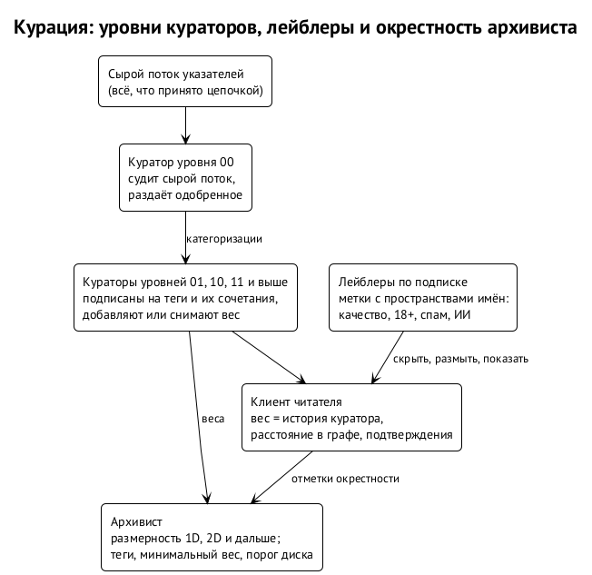

# Граф, курация и спам

Социальный граф — третий подслой. Он ничего не хранит сам, но решает, что сеть помнит и что показывает: подписки, отметки, категоризации и репутация направляют раздачу и архивирование. ⟦решено⟧

## Категоризация как запись

Категоризация из поста 2018 года — это ответ куратора на запись автора с тегами и весами. По форме она совпадает с метками Nostr (NIP-32): у метки есть пространство имён и значение, и цель — запись, автор или тема. Урок оттуда: меткам нужны **пространства имён**, чтобы тег автора не путался с вердиктом куратора, а «#музыка» от автора — с «музыка, вес +1» от куратора уровня 01. ⟦предложено⟧

**Веса считают индексатор и клиент, не консенсус.** Вес категоризации зависит от истории куратора, от его расстояния до читателя в графе и от подтверждений кураторами уровней выше. Формула у каждого клиента своя. ⟦предложено⟧

{.tall}

## Модерация лейблерами по подписке

Bluesky в 2024 году ввёл составную модерацию: лейблеры — сервисы, которые ставят метки, — подписываются, как аккаунты, и клиент скрывает или размывает контент по меткам выбранных лейблеров. Для подложки это естественная форма уровней курации: куратор уровня 00 — лейблер сырого потока, кураторы выше — лейблеры, подписанные на метки нижних. Одиночные записи заглушения, как в Memo, остаются минимумом; при масштабе агентов к ним добавляются общие списки заглушения и лейблеры по подписке. ⟦предложено⟧

**Никакого голосования, взвешенного стейком.** Урок Steem: такие голоса становятся рынком, а управление уходит к тем, у кого стейк на кастодиальном хранении. Репутация живёт в записях и клиентах. ⟦предложено⟧

## Окрестность архивиста

Политика архивиста — эскиз ⟦предложено⟧:

| Параметр | Смысл |
| --- | --- |
| максимальная размерность | до какого шага по графу подписок брать отмеченное: 1D — своё, 2D — плюс подписки, и далее |
| разрешённые и запрещённые теги | что брать и что не брать никогда |
| минимальный вес | ниже какого веса категоризации не хранить |
| порог диска | сколько места отдано |
| вытеснение | старейшее, давно не нужное или с наименьшим весом |

Опыт реле Nostr, построенных на сети доверия (wot-relay): двух шагов по графу хватает для фильтра, дальше растёт шум от фальшивых личностей; поэтому там есть порог числа подписчиков и раз в сутки граф пересчитывается. Размерность 6D из поста — предел, а не норма.

## Спам при бесплатном тексте

Текст бесплатен или почти бесплатен — это слово владельца. Значит, спам — задача памяти и показа, а не консенсуса. ⟦решено⟧

Что говорят предшественники. Бесплатная личность — бесплатный спам: Nostr в 2023 году пережил волну спама и ответил платными реле, в 2024-м — волну ботов-ответчиков и ответил реле на сети доверия. Farcaster брал аренду за место — и всё равно в январе 2025 года 46 % авторов Warpcast были помечены как вероятный спам. Все работающие лекарства облагают налогом новичков.

Наши инструменты:

- **Минимальная комиссия**, фиксированная протоколом. ⟦решено⟧
- **Работа на запись** по образцу Hashcash и NIP-13 в Nostr: чтобы запись приняли, у её хэша должно быть столько-то ведущих нулей. Цена — процессорное время, а не деньги, что в духе майнинга на CPU. Агенту, который пишет много, это дорого; человеку, который пишет пост в день, незаметно. ⟦предложено⟧
- **Обрезка и забвение.** Узлы выбрасывают сегменты данных, архивисты держат то, что ценит их граф. Спам, на который никто не подписан, испаряется сам. ⟦предложено⟧
- **Метки и сеть доверия у клиента.** Новые пустые аккаунты по умолчанию видны только тем, кто на них подписан. ⟦предложено⟧

Отсюда главное различие: **плата за существование и плата за видимость**. Сеть без механизма исключения продаёт только существование: запись принята цепочкой. Видимость решают клиенты, кураторы и сеть доверия. Обещание «без банов» при спаме выполнимо именно так: запись есть, но показать её — чьё-то решение. ⟦предложено⟧
