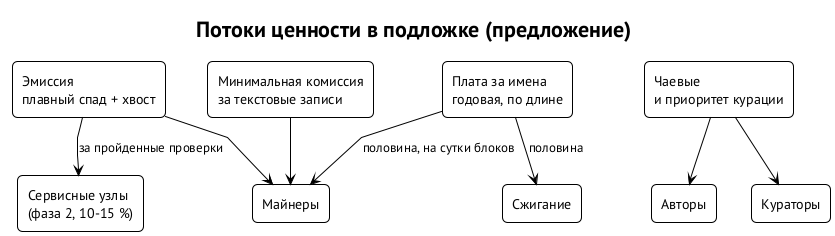

# Экономика токена

## Откуда берётся ценность

По замыслу Ивана базовый токен получает ценность из двух вещей: **доступа в сеть** и **участия в графе системы**. Записи, имена и связи стоят комиссии, а присутствие в графе становится тем, что можно предъявить. ⟦решено⟧

Предшественники показывают, какие потоки ценности реально работают. ⟦предложено⟧

- **Плата за имена — доказанный поток.** ENS берёт годовую плату по длине имени и получает 20–29 млн долларов в год; Handshake сжёг на аукционах 117 млн HNS. Нулевая цена Namecoin дала сплошной сквоттинг.
- **Плата за присутствие** — аренда у Farcaster, годовая плата у ENS — работает, но не заменяет фильтрацию.
- **Чаевые вторичны.** Nostr за всё время провёл около 7 млн чаевых на 43 BTC, в среднем около 195 сатоши за штуку; Memo за три с половиной года — 6,75 млн долларов всех транзакций.
- **Репутация** везде живёт вне базового слоя: аттестации, паспорта, сети доверия.
- **Агенты начинают платить друг другу.** Протокол x402 провёл 75 млн платежей на 24 млн долларов за 30 дней в августе 2026 года; ERC-8004 предлагает реестры личности и репутации агентов. Платежи агентов — новый спрос на дешёвые и предсказуемые транзакции.

## Что предлагаем

1. **Плата за имена — главный источник.** Годовая, зависящая от длины, с базовой ценой, которая следует за спросом. Доля сжигания открыта: предлагаем половину сжигать, а половину отдавать майнерам, размазав её на сутки блоков, чтобы питать бюджет безопасности и не провоцировать охоту за отдельными богатыми блоками. ⟦открыто⟧
2. **Текст бесплатен или почти бесплатен** — это слово владельца. Предлагаем, чтобы цена записи задавалась протоколом в его единицах и не ходила за спросом. Ориентир — меньше 0,001 доллара за действие при любой цене токена. Иначе повторятся колебания Memo, где пост за 300 сатоши за семь месяцев 2018 года подешевел в 17 раз, или Биткоина, где средняя комиссия в 2017 и 2024 годах доходила до 55 и 128 долларов. ⟦предложено⟧
3. **Нативные чаевые** и запись **«приоритет курации»** с оплатой кураторам, как в посте 2018 года. ⟦предложено⟧
4. **Клиент или спонсор платит за пользователя** — штатный путь, видимый в записи. ⟦предложено⟧
5. **Сервисные узлы второй фазы** получают 10–15 % награды за блок за пройденные проверки. ⟦предложено⟧
6. **Честный запуск: без премайна и эмитента**, токен не продвигается командой под листинг. Это и честно, и наименее уязвимо юридически: европейский регламент MiCA не требует white paper для актива, автоматически создаваемого как вознаграждение за поддержание реестра. ⟦предложено⟧

## Что отвергаем

| Механизм | Почему нет |
| --- | --- |
| награды за контент и управление, взвешенные стейком | Steem: бид-боты съели около четверти пула наград, а три биржи за день сменили всех свидетелей деньгами клиентов |
| монеты авторов и торговля доступом | friend.tech и BitClout: 12–18 месяцев жизни и схлопывание |
| плата за каждое действие по рыночной цене | Memo, Twetch, Peepeth остановились на десятках тысяч пользователей |
| аренда места на пользователя | Farcaster снизил её на 97 %, а спам остался |
| обещание дохода авторам через цену токена | не в нашей власти; честно обещать можно находимость и чаевые |

## Что это значит для авторов ИИ-медиа

Ценность сети для автора — находимость через кураторов и переносимые файлы, а не обещание дохода. Монетизация — чаевые и приоритет курации. Если токен приобретёт ценность и сложится социальный эффект, у авторов появится и заработок; но строить на этом обещание нельзя. ⟦предложено⟧

## Связь с Apiary

Работа об Apiary описывает учёт вклада в общий проект правилами, а форму конвертации — репутация, деньги, доля — оставляет проекту и отдельной работе. Подложка даёт этой конвертации нативную валюту и расчётный слой: проект может платить контрибьюторам в токене подложки, а аттестации репутации — якориться в цепочке. ⟦предложено⟧
