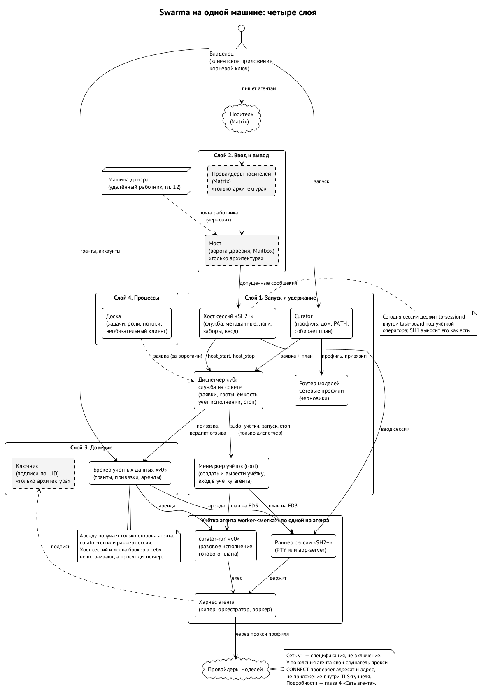
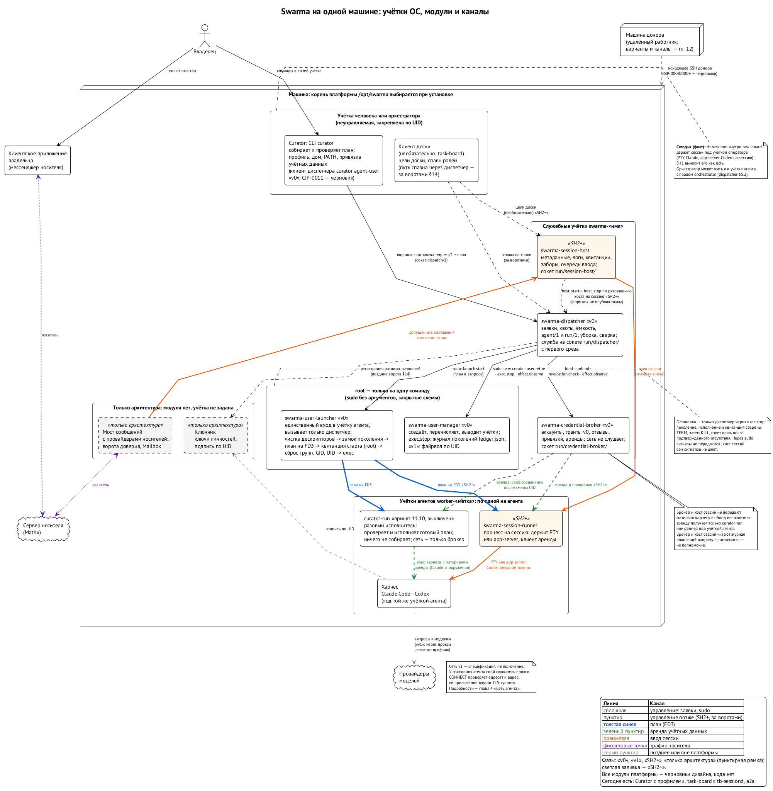

# Система целиком

Прежде чем разбирать детали, посмотрим на всё сразу. Swarma — это небольшие модули, у каждого одна работа и именованный контракт. Их удобно разложить на четыре слоя.

**Слой 1. Запуск и удержание.** Кто-то должен собрать план запуска агента — какая среда, какая модель, какие инструкции и скиллы, какая сеть, — запустить процесс и держать его живым. План собирает Curator на стороне того, кто просит запуск. Диспетчер запусков ведёт учёт и ёмкость машины и через менеджер пользователей заводит учётку агента. Под учёткой агента работу исполняет либо `curator-run` (разовая работа), либо раннер сессии (долгая сессия, которую ведёт служба хоста сессий). Рядом — сервисы: роутер моделей, сетевые профили, реестр проектов.

**Слой 2. Ввод и вывод.** Всё, что агент получает и отдаёт, идёт через одну трубу — мост. К мосту подключаются провайдеры носителей: Matrix сегодня, XMPP потом. Мост проверяет каждое входящее и передаёт его хосту сессий только если можно; агент забирает сообщения из своего почтового ящика.

**Слой 3. Доверие.** Ключи, подписи, гранты, реестр. Он отвечает на вопрос «можно ли этому участнику сделать вот это с вот тем» — одинаково для людей и агентов, для любого носителя. Сюда же относятся ключник, который хранит мастер-секрет и подписывает за агентов, и брокер учётных данных провайдеров, который выдаёт токен подписки только исполнителю под учёткой агента.

**Слой 4. Процессы.** Доска: задачи, их жизненный цикл, роли, спавн по переходам. Это надстройка над слоями 1–3. Доска сама ничего не запускает и не держит, а просит слой 1 и слушает слой 2.

Слои описывают, кто за что отвечает. Работают они на одной машине как набор процессов под разными учётками ОС, и это важнее любой схемы слоёв: граница проходит там, где меняется учётка.

Под всеми слоями лежит то, что делает их честными: **каждый автономный агент — отдельный пользователь операционной системы**. Кипер, оркестратор, воркер, рабочее место удалённого агента — у каждого свой пользователь, свой дом, свои правила файрвола. Ядро ОС не даёт им читать друг друга и писать друг другу в терминал. ⟦решено⟧

## Правила, которые держат модули вместе

- **Один писатель на хранилище.** Ни одно хранилище не пишется из двух модулей; модули говорят через типизированные API; нет общих изменяемых файлов и круговых зависимостей. ⟦предложено⟧
- **Хост сессий принуждает.** Мост — первый фильтр; хост сессий заново проверяет допуск при каждой мутации сессии. В ввод любой сессии пишет ровно один писатель — диспетчер хоста сессий. ⟦предложено⟧
- **Агент не держит секрет.** Он просит привилегированного соседа что-то сделать этим секретом. Всё, чего агент не может сделать физически, инъекция в промпт не вынесет. ⟦решено⟧ Для ключей личности это правило полное. Для токена провайдера модели — нет: среда должна предъявить токен провайдеру сама, поэтому токен лежит в окружении её процесса и она может его прочитать. Брокер ограничивает, кому и на какой срок токен выдан, но не делает его невидимым для среды (глава об учётных данных).
- **Доверие не опирается на транспорт.** Трубы шифруются как гигиена; право — это подпись над точными байтами плюс грант. Откуда пришла команда, неважно. ⟦решено⟧
- **Поток может только сужать.** Процессы на доске описываются конфигурацией, но не могут ослабить неизменные правила ядра. ⟦предложено⟧
- **Одно имя на компонент.** Репозиторий, бинарь и учётка службы называются одинаково, а слово в имени говорит, что компонент делает. ⟦решено⟧
- **Переводы продакшена — операторские.** Ни один агент не перезапускает и не подменяет демоны платформы; это делает человек в окне обслуживания. ⟦решено⟧

## Имена: одно имя на компонент

У каждого модуля платформы одно имя, и оно говорит, что модуль делает. Репозиторий, бинарь и учётка службы называются одинаково — `swarma-<что делает>`, поэтому в `ps` процесс `swarma-dispatcher` работает под пользователем `swarma-dispatcher`, а код лежит в репозитории `swarma-dispatcher`. Учётки агентов — `worker-<метка>`. Имя `curator` остаётся только за самим Curator: CLI `curator`, спецификация `curator-spec` и лаунчер `curator-run`. Людям и агентам виден только CLI `curator`; бинари `swarma-*` лежат в `/opt/swarma/libexec/` и в PATH не попадают. ⟦решено⟧

| Что делает | Репозиторий | Бинарь | Работает под | Сокет |
| --- | --- | --- | --- | --- |
| хранит подписки, выдаёт короткие токены | `swarma-credential-broker` | `swarma-credential-broker` | `swarma-credential-broker` | `/opt/swarma/run/credential-broker/` |
| заводит и убирает учётки агентов; запускает одобренную программу под учёткой агента | `swarma-user-manager` | `swarma-user-manager`, `swarma-user-launcher` | root, через `sudo` | — |
| принимает заявки, выделяет учётки и исполнения, следит за лимитами и уборкой | `swarma-dispatcher` | `swarma-dispatcher` | `swarma-dispatcher` | `/opt/swarma/run/dispatcher/` |
| ведёт сессии | `swarma-session-host` | `swarma-session-host` | `swarma-session-host` | `/opt/swarma/run/session-host/` |
| держит одну сессию | там же | `swarma-session-runner` | `worker-<метка>` | — |
| исполняет разовую работу агента по плану | `curator-agent-launcher` | `curator-run` | `worker-<метка>` или учётка человека | — |

Пара «хост сессий» и «раннер сессии» — две половины одного модуля: служба ведёт учёт, почту и заборы для всех сессий машины, а раннер держит процесс одной среды под учёткой агента (глава о хосте сессий). Слово «хост» без уточнения мы не используем, чтобы не путать службу с машиной. Где лежит каждый файл платформы на диске, показано в главе о пользователях.

## Подробная схема: кто под какой учёткой

На этой схеме те же модули разложены не по слоям, а по учёткам ОС, под которыми они работают, и показаны каналы между ними: заявки, план на дескрипторе 3, аренда учётных данных, ввод сессии, трафик носителя. Главное, что на ней видно: токен провайдера попадает в среду только через исполнителя под учёткой агента — `curator-run` или раннер сессии. Ни брокер, ни хост сессий не передают его среде в обход этой учётки. Мост и ключник нарисованы пунктиром: у них пока есть только архитектура, модулей нет.

{.landscape}

## Что из этого уже есть

Сегодня работают Curator с профилями и управляемыми домами, доска задач со своим демоном сессий `tb-sessiond`, роутер моделей, сетевые профили и связь агентов через Matrix. ⟦работает сегодня⟧ Модули платформы — менеджер пользователей, диспетчер, брокер, хост сессий с раннером — описаны в спецификациях, прошли ревью, но кода у них пока нет. ⟦спецификация⟧ Хост сессий сейчас выносится из доски один к одному (шаг SH1); разделение на службу и раннер — следующий шаг (SH2+). Разовый режим `curator-run` под учёткой агента принят решением владельца 11 октября и будет включён после проверки. ⟦решено⟧

## Как читать дальше

Следующие пять глав — фундамент безопасности: пользователь на агента, сеть агента, ключи и ключник, гранты и словарь действий, три входа и путь сообщения. Без них непонятно, почему модули устроены так, как устроены. Потом идут модули по одному, сценарии сквозь всю систему и итог.
