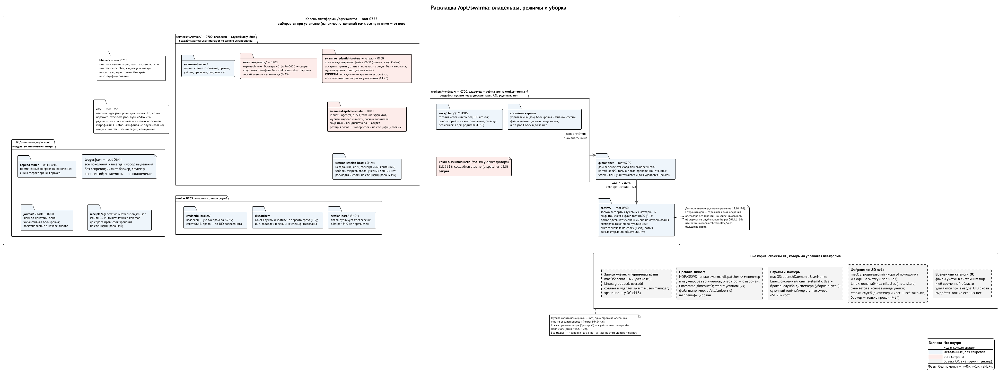

# Пользователь на агента

> Редакция: v0.12 (2026-10-13). Сетевой раздел перенесён в главу 4 «Сеть агента»; исполнитель внешних эффектов репозитория остаётся открытым требованием этапа T. ⟦открыто⟧

Главное решение всей архитектуры простое: **каждый автономный агент работает как отдельный пользователь операционной системы.** Кипер, оркестратор, постоянный специалист, временный воркер, рабочее место удалённого агента — у каждого свой UID. ⟦решено⟧

## Почему пользователь, а не контейнер

Ядро даёт то, чего не даст никакая обёртка. Другой пользователь не может читать файлы этого пользователя, его связку ключей и память его процессов, не может писать в его терминал и посылать сигналы его процессам. Это граница, которую обеспечивает ядро. Она держится, пока выполнены условия, которые от нас зависят: права на файлы и каталоги выставлены так, как описано ниже, сеть агента закрыта, а root и сама установка платформы не скомпрометированы. При этих условиях, чтобы её обойти, нужна ошибка в ядре.

Так устроены системы, которым мы доверяем годами. В Android каждое приложение — отдельный Linux-пользователь, и вся песочница приложений построена на этом. Серверы десятилетиями запускают службы под своими пользователями: база данных под `postgres`, веб-сервер под `_www`. OpenSSH разделяет привилегии, запуская части себя под разными пользователями. Хостинги заводят пользователя на каждый сайт.

Контейнеры решают другую задачу: они изолируют окружение, но обычно делят с хозяином учётные данные и требуют собственного оркестратора. Нам нужна именно граница между агентами одной машины, и пользователь ОС даёт её самым коротким путём — без Docker, без отдельных образов, без виртуальных машин.

Новое в нашем подходе только одно: пользователей создаёт и удаляет сама платформа, по детерминированному сценарию.

## Как создаётся пользователь

Создание пользователя — привилегированная операция, и её делают два маленьких бинаря из модуля `swarma-user-manager`. Ни один из них не принимает произвольных команд, путей или переменных окружения. ⟦решено⟧

- **Менеджер пользователей** (`swarma-user-manager`) заводит, перечисляет и выводит из работы учётки, а в v1 ещё ставит правила сети на учётку. Ничего не запускает.
- **Запускатель** (`swarma-user-launcher`) запускает одну одобренную программу под одной активной учёткой агента. Учёток и правил не создаёт.

Оба вызываются через `sudo` по одному правилу `sudoers` на абсолютный путь и **без аргументов**: в конце правила стоит пустая строка `""`, иначе `sudo` пропустил бы любые аргументы. Сами бинари аргументы тоже отвергают. Запрос приходит одним JSON на stdin и читается не дольше 5 секунд. Предел размера у двух входов разный: запрос менеджеру — до 16 КиБ, запрос запускателю — до 80 КиБ, потому что в нём едет план запуска (сам план — до 48 КиБ, в base64 — до 64 КиБ). Повторяющиеся ключи, лишние поля, второй документ и слишком длинные строки отклоняются. `SUDO_UID` говорит, *кто* позвал, но не доказывает, *какая программа* позвала, и спецификация так и пишет. ⟦предложено⟧

**Роли.** В конфигурации root каждому вызывающему назначена роль:

| Роль | Может |
| --- | --- |
| установщик | создавать и выводить сервисные учётки; ставить и снимать их сетевые правила |
| диспетчер | создавать учётки агентов (и, когда появится, рабочих мест) в пределах квоты; выводить, запускать и ставить правила **только для своих**; останавливать свои исполнения |
| оператор | только UID учётки `swarma-operator`; всё перечисленное, включая вывод защищённых сервисов, но каждое расширяющее действие — с подтверждением человека; запускать не может |

Чужого агента или учётку брокера диспетчер удалить не может. Роли «хост» нет: хост сессий не вызывает ни менеджер, ни запускатель, а просит старт у диспетчера (глава 8). ⟦решено⟧

**Оператор — отдельная учётка.** Подпись оператора живёт не в учётке человека, а в защищённой сервисной учётке `swarma-operator`, где никогда не работает ни одна сессия агента. Рядом обязательная учётка только для чтения `swarma-observer`: через неё человек смотрит состояние, гранты, учётки и привязки без всяких подтверждений, но ничего не меняет. Расширяющие действия — выдача гранта, подключение подписки, постоянная команда, вывод или пересоздание постоянного агента, сохранение дома, полномочия на остановку для обслуживания, продление постоянных грантов — требуют входа и подтверждения точного содержимого действия, и изнутри сессии агента не принимаются. Сужающие — отзыв и отключение — только входа. Как оператор подписывает с телефона, рассказано в главе о ключах. Так решил владелец 12.10 (находка F-23). ⟦решено⟧

**Жизнь учётки.** `creating → active → retiring → removed`. Каждый шаг пишется в журнал, неудачное создание откатывается. `retiring` — точка невозврата: с этого момента запускатель отказывает, брокер не выдаёт аренды, а удаление идёт только вперёд, в том числе после падения. Каждое создание получает **поколение** — свежее случайное 128-битное значение, а не счётчик, поэтому оно не повторяется, даже если повторяются UID или метка, и даже после восстановления журнала из копии (находка F-17). На поколение опираются брокер и гранты, поэтому новый агент не унаследует чужих прав. Запись о поколении остаётся в журнале навсегда.

**Надёжность.** Все операции обоих бинарей идут под одним замком, включая восстановление после сбоя и выбор UID. Номер запроса повторяем: повтор с теми же аргументами возвращает записанный результат вместе с текущим состоянием учётки, повтор с другими — отказ. Номер запроса (`request_id`) связывает всю заявку вызывающего, а у каждого шага ниже по цепочке — создать учётку, привязать её у брокера, запустить, остановить, снять привязку, вывести — свой **идентификатор эффекта**, который диспетчер выводит из номера запроса и шага. Получатель узнаёт повтор по идентификатору эффекта, поэтому сбой посередине чинится повтором тех же шагов и ничего не выполняется дважды.

Восстановление не держит всех в заложниках. Перед каждой операцией менеджер чинит только то, от чего она зависит, и в пределах конечного бюджета; удаление дома идёт ограниченными пачками, и между пачками общий замок отпускается, так что остановка или запуск другого агента не ждут, пока дочистится чужой дом (находка F-25). И общее правило для всех служб платформы: **свой замок состояния никогда не держится во время синхронного вызова другой службы** — вместо этого запись помечается «в полёте», замок отпускается, а после ответа всё проверяется заново. У менеджера такого вызова при выводе нет вовсе. Каждая служба публикует свой граф ожиданий, и он обязан быть без циклов (находка F-28). ⟦спецификация⟧

**Потеря состояния.** Если журнал менеджера пришлось восстановить из копии, это инцидент оператора, а не обычное восстановление после падения. До того как восстановленные байты станут видны, ставится отметка восстановления снаружи и закрываются все, кто читает журнал: брокер, запускатель, диспетчер, хост сессий. Поколение, которое по сохранившимся свидетельствам уже выводится или выведено, никогда не возвращается в `active`; на вопросы о периоде до копии `effect.observe` отвечает «свидетельства нет», а не «не было». Снять закрытие может только оператор после явной сверки (находка F-17). ⟦спецификация⟧

**Файлы без подвохов.** Все операции идут относительно уже открытых дескрипторов каталогов и никогда не следуют ссылкам: на Linux через `openat2` с `RESOLVE_BENEATH` и `RESOLVE_NO_SYMLINKS`, на macOS через пошаговый `openat` с `O_NOFOLLOW`. Дом создаётся пустым через дескриптор, рекурсивного `chown` нет. Ссылки внутри дома — обычные объекты: при удалении дома они отвязываются как ссылки и никогда не разыменовываются.

**Запуск под учёткой.** Запускатель вызывает только диспетчер, в том числе когда старт просит хост сессий (глава 8). Порядок шагов — единый контракт жизни дескрипторов, который ведёт спецификация менеджера; спецификация лаунчера Curator на него ссылается и своего порядка не заводит (находка F-6). ⟦спецификация⟧

1. **Сначала вычистить унаследованное.** Все дескрипторы выше 0–2, пришедшие от вызывающего, закрываются до того, как запускатель откроет что-то своё. Дескриптор 3 резервируется под план.
2. **Взять замок поколения** и проверить в журнале, что поколение активно и создано именно этим диспетчером. Замок держится до конца перехода в учётку агента, поэтому вывод или остановка не вклинятся, пока запускатель ещё root.
3. **Найти и открыть программу** из списка одобренных (путь в каталоге root плюс SHA-256) и сверить хэш. Сегодня это лаунчер Curator `curator-run` для разовых работ, а в SH2+ ещё раннер сессии `swarma-session-runner`. Проверенный дескриптор программы живёт до самого `exec`.
4. **Целиком подготовить план** на дескрипторе 3: ограниченные по размеру неизменяемые байты, только для чтения, готовые до старта программы. Писать план в трубу, которую некому читать, нельзя — так запускатель мог бы зависнуть под замком. Конкретный механизм для каждой ОС ещё не опубликован. ⟦открыто⟧
5. **Собрать окружение** из фиксированного набора.
6. **Ещё будучи root и держа замок**, атомарно записать квитанцию старта с номером исполнения; повторный старт того же исполнения получит отказ.
7. **Сбросить** дополнительные группы, затем GID, затем UID (реальный, эффективный и сохранённый) и проверить, что вернуться в root нельзя. Только теперь замок поколения отпускается.
8. **Запустить программу** проверенным дескриптором (на Linux `execveat`). Программа получает только 0–2 и дескриптор 3 с планом — ни замка, ни дескрипторов каталогов, журнала, брокера или root. При любом сбое внутренние дескрипторы закрываются, а квитанция и запись эффекта остаются для сверки.

Порядок важен: квитанцию пишет root под замком, поэтому агент не может ни подделать её, ни помешать её записи, а программа, запущенная по плану, уже не может ничего, кроме того, что можно учётке агента. Соединения с брокером в запуск не передаются: программа агента открывает своё сама, уже под своей учёткой.

**Спросить, чем кончился шаг.** Если ответ на запрос потерялся, диспетчер спрашивает менеджера операцией `effect.observe` по тому же идентификатору эффекта. Ответ — одно из шести состояний: записан (с результатом и текущим состоянием учётки), ещё идёт, откачен, точно не записывался, свидетельства нет, свидетельства противоречат друг другу. «Свидетельства нет» никогда не значит «не было»; «откачен» и «не записывался» не разрешают сами по себе создать заново (находка F-10). ⟦спецификация⟧

Остановить исполнение может только диспетчер, через операцию `exec.stop`; хост сессий просит его об этом операцией `host_stop` (глава 8). Сигналы получают **все процессы учётки**, а не только дерево исполнения: пока у поколения одно исполнение, остановка и вывод действуют на одно и то же множество — TERM, ожидание, KILL, затем проверка, что за период тишины не осталось ни одного процесса UID, включая ушедших через `setsid`, двойной `fork` и `nohup` (находка F-13). Квитанция об остановке выдаётся только тогда, когда не осталось ни одного процесса. Если процессы остались или исход неизвестен, остановка продолжается под тем же идентификатором эффекта, с теми же аргументами. Чтобы агенту некуда было спрятаться, учёткам агентов закрыты `cron` и `at`, а квалификация проверяет, что они не могут завести себе постоянный пользовательский домен `launchd` или `systemd --user`. На `sudo` как на родителя, который перешлёт сигналы, никто не полагается.

**Что переживает падение службы.** Менеджер ведёт одну таблицу судьбы процессов по классам: демон диспетчера, его надзиратели, корень исполнения с потомками, дочерний процесс брокера для обновления токена, служба хоста сессий. Для каждого класса записано, что его убивает, что переживает перезапуск соседа и чем подтверждается смерть. Главное правило — после замены демона старые писатели не могут писать: каждая запись надзирателя сверяется с эпохой экземпляра демона. Исполнение заканчивается только через журналируемую остановку, вывод или аварийную остановку оператора; смерть от OOM записывается как «потеряно», а не как подтверждённая остановка (находка F-18). ⟦спецификация⟧

Сегодня в спецификации менеджер пользователей решает по роли вызывающего, которую ему сообщает `sudo` и конфигурация root; грантов он в v0 и v1 не проверяет и запрос с грантом отклоняет. Проверка подписанной цепочки грантов и того, что вызывающий — субъект гранта, придёт в v2. Формат подписанного запроса для v2 ещё не выбран: свой у модуля или общий версионированный адаптер. ⟦открыто⟧

## Дома и раскладка на диске

Вся платформа живёт под одним корнем — `/opt/swarma`. На macOS это не требует отключать SIP: `/opt` лежит на томе данных, туда же Homebrew на Apple Silicon ставит `/opt/homebrew`. Права администратора нужны один раз, при установке. ⟦решено⟧

```
/opt/swarma/
├── libexec/          root: swarma-user-manager, swarma-user-launcher, бинари служб
├── etc/              root: роли, диапазоны UID, архив, одобренные программы,
│                     привязка сетевых профилей к профилям Curator
├── lib/user-manager/ root: журнал учёток, квитанции запусков, применённые правила сети
├── run/              сокеты: credential-broker/, dispatcher/, session-host/
├── services/
│   ├── swarma-credential-broker/   владелец swarma-credential-broker, 0700
│   ├── swarma-dispatcher/          владелец swarma-dispatcher, 0700
│   ├── swarma-session-host/        владелец swarma-session-host, 0700
│   ├── swarma-operator/            владелец swarma-operator, 0700: подпись оператора
│   └── swarma-observer/            владелец swarma-observer: только чтение
├── workers/
│   ├── worker-dev-7f3/     владелец worker-dev-7f3 (uid 30412), 0700
│   │   ├── .claude/        настройки среды этого агента
│   │   └── work/           рабочая копия задачи
│   └── worker-review-2kq/  владелец worker-review-2kq (uid 30413), 0700
├── quarantine/       root: дома на выводе
└── archive/          root: экспорты метаданных (формат не опубликован, по умолчанию выключено)
```

Снаружи `/opt/swarma` только то, что ОС требует держать на своих местах: записи пользователей и групп, правило `sudo` в `/etc/sudoers.d/`, описания служб (`/Library/LaunchDaemons/` на macOS, `/etc/systemd/system/` на Linux) и правила файрвола.

**Имена.** Учётки агентов — `worker-<метка>`, где метка обычно составлена из профиля и короткого номера: `worker-dev-7f3`. Сервисные учётки называются так же, как их бинари: `swarma-credential-broker`, `swarma-dispatcher`, `swarma-session-host`; к ним добавились `swarma-operator` и `swarma-observer`. Третий класс учёток — **рабочее место** (`workplace`) удалённого воркера на нашей стороне (глава 12); его имена и номера — как у агентов. Обе схемы укладываются в предел Linux в 32 символа. У каждой учётки своя основная группа с тем же именем и номером, дополнительных групп нет. ⟦решено⟧

**Номера.** Агентам выдаются UID и GID из диапазона 30000–59999 на обеих ОС. Выдача идёт по кругу: менеджер держит курсор и берёт следующий свободный номер после последнего выданного. Номер используется повторно только после полного круга и только если от него не осталось файлов ни под корнем платформы, ни во временных каталогах; иначе отказ `uid_not_clean`. При выводе менеджер чистит временные каталоги учётки. Сервисы получают номера 450–499 на macOS и 900–999 на Linux. Агенты скрыты из окна входа атрибутом, сервисы — диапазоном. ⟦решено⟧

**Дом при выводе удаляется.** Когда агента выводят, его дом не архивируется, а удаляется. Так решил владелец 12.10, по находке F-1 ревью архитектуры, и это заменило прежнее правило «архивировать по умолчанию». ⟦решено⟧

Почему так: доказать, что в доме агента нет секретов, нельзя. Агенту разрешено читать выданный ему токен, а значит, он может спрятать его копию куда угодно: в обычный код, в имя файла, в цель ссылки. Ни список путей, ни сканер токенов этого не исключат. Утренний вариант с «положительной классификацией» каждого файла был бы большим и сложным разборщиком внутри root и всё равно не давал бы обещанного. Удаление проще и честнее.

Как идёт вывод. Под общим замком и журналом менеджера, по шагам. Брокеру менеджер при выводе не звонит: снять привязку — отдельный эффект диспетчера или оператора, и он делается до вывода; если оператор выводит учётку напрямую, пока брокер недоступен, неподтверждённая отвязка остаётся явным долгом, а UID, выданный повторно, старую привязку не наследует (находка F-12). ⟦спецификация⟧

- **Остановить и изолировать.** Процессы UID остановлены, это проверено; дом перенесён в карантин.
- **Сначала уничтожить ключи.** Менеджер уничтожает ключи по объявленным путям через доверенные дескрипторы, не переходя по ссылкам. Если уничтожение не удалось или исход неизвестен, учётка остаётся в состоянии вывода; восстановление продолжает вперёд.
- **Удалить дом целиком.** Обход по дескрипторам удаляет всё содержимое, имена и ссылки; ссылки отвязываются, а не разыменовываются. Пока удаление не подтверждено, учётка не доходит до `removed`. Нечитаемое не считается отсутствующим.
- **Остаются только служебные метаданные.** Экспорт после вывода — запись закрытой схемы, которую сервис составляет из своих собственных записей, без единой строки, имени, ссылки или содержимого, пришедших от агента. Дом для этого не сканируется и не копируется. Схема экспорта и проверки происхождения ещё не опубликованы, и до их публикации экспорт выключен. ⟦открыто⟧
- **Аудит** записывает исход каждого шага, включая неудачи и неизвестные исходы, без содержимого секретов.
- **Срок по часам — не повод удалять.** Если вывод запущен истечением срока, кроме проверки по часам с водяным знаком нужен ещё и настоящий прошедший срок по монотонным часам, считая время сна. Шаг системных часов сам по себе удалить дом не может (находка F-21). ⟦спецификация⟧

Код и результаты агента живут по своим правилам — через git и приёмку задач. Принятие в git не доказывает, что в них нет секретов, и на них не распространяется обещание, данное для метаданных.

**Сохранить дом можно только отдельно.** Если оператору нужен дом выведенного агента, это отдельная явная операция оператора, не вариант вывода. Она прямо говорит, что конфиденциальность сохранённого дома не гарантирована. Ни диспетчер, ни установщик её вызвать не могут. Формат этой операции ещё не опубликован, и до публикации она не принимается. ⟦открыто⟧

Каталог `archive/` и операция `archive.sweep` остались, но теперь относятся только к экспортам метаданных: каталог root 0700, файлы root 0600, экспорты старше недели и сверх общего объёма удаляются при каждом выводе и по суточному таймеру. Свидетельства, которые ещё нужны для сверки эффектов, чистка не трогает. ⟦спецификация⟧

{.landscape}

**Чтение домов детей.** По умолчанию родитель-оркестратор дом ребёнка не читает: дом закрыт режимом 0700, и никаких ACL менеджер не ставит. ⟦спецификация⟧ Когда-нибудь, в v2 менеджера, такое чтение можно будет выдать явно, записью ACL с наследованием:

```
# macOS
chmod +a "orch_a allow list,search,read,readattr,readextattr,readsecurity,file_inherit,directory_inherit" /opt/swarma/workers/worker-dev-7f3
# Linux
setfacl -R -m u:orch_a:rX /opt/swarma/workers/worker-dev-7f3
setfacl -R -d -m u:orch_a:rX /opt/swarma/workers/worker-dev-7f3
```

У ACL есть честные ограничения. На Linux действующие права ограничены маской из режима создаваемого файла: файл, созданный как `0600`, оркестратор не прочтёт. На macOS наследование от режима не зависит, но владелец файла может снять ACL со своих файлов. Поэтому ACL — удобство «заглянуть, что там у ребёнка», а не гарантия. Гарантированная наблюдаемость идёт через хост сессий: транскрипты и журнал сессии принадлежат ему, а результаты возвращаются через доску и пакет передачи. ⟦предложено⟧

## Закрытая сеть

Граница учётки включает сеть: в целевом v1 файрвол ядра пропускает доверенного локального агента только к его собственному слушателю прокси, а рабочее место не выпускает никуда. ⟦спецификация⟧ Машинная привязка профиля, границы CONNECT, служебные учётки и проверка принуждения разобраны в главе 4 «Сеть агента». ⟦спецификация⟧

## Кто от чьего имени работает

Важно различать root и учётную запись администратора. Администратор на macOS — обычный пользователь, который может стать root через `sudo`; его собственные процессы не привилегированы. Root — UID 0, которым становятся на время команды. Мы держим от UID 0 как можно меньше кода.

| Компонент | Работает от | Зачем |
| --- | --- | --- |
| ключник (только архитектура) | root, системная служба | доступ к аппаратному хранилищу; подпись по UID собеседника |
| `swarma-user-manager` | root на одну команду, через `sudoers` | создание и вывод пользователей, правила сети, экспорт метаданных выведенных учёток |
| `swarma-user-launcher` | root на одну команду, через `sudoers` | запуск одобренной программы под учёткой агента |
| `swarma-credential-broker` | `swarma-credential-broker` | держит подписки, выдаёт короткие аренды токенов |
| `swarma-dispatcher` | `swarma-dispatcher` | учёт запусков и ёмкости; зовёт менеджера и запускатель |
| `swarma-session-host` | `swarma-session-host` | ведёт сессии: учёт, почта, заборы; доска — необязательный клиент |
| операторская команда | `swarma-operator` | единственный вход для подписанных действий оператора; без shell |
| чтение для человека | `swarma-observer` | состояние, гранты, учётки, привязки — только чтение |
| прокси сетевых профилей | своя сервисная учётка | единственный выход наружу для агентов и брокера |
| `swarma-session-runner`, `curator-run` | учётка агента `worker-<метка>` | исполняют агента внутри его границы |
| мост (только архитектура) | свой непривилегированный пользователь | держит учётные данные носителя |
| человек-администратор | своя учётная запись | ничего из платформы не запускает и подписи оператора не держит |

Таблица не назначает исполнителя repository effects: ни один агент не достигает code host, а неагентский исполнитель публикации, передачи артефактов и landing ещё открыт. Его топология, custody, маршрут и проверки каждого эффекта войдут вместе с контрактным пакетом этапа T; требование записано в реестре главы 15. Новая строка службы появится лишь если выбранное размещение её требует.

## Стабильная команда и временные воркеры

Проект объявляет свою команду: какие роли закреплены за постоянными личностями (например, iOS-разработчик проекта A), а какие запускаются под задачу. Постоянную команду поднимает диспетчер по описанию, которое подписал оператор: роли, их профили, среды и учётные записи. Для каждой роли он создаёт или сверяет её учётку идемпотентно, так что повтор или восстановление после падения не плодит дублей. Это та же операция и после перезагрузки: те же пользователи, те же ключи. Делать это может только оператор, а не любой, у кого есть право на спавн. Объект заявки называется `swarma-dispatcher team/1`, его формат ещё не опубликован. ⟦спецификация⟧

**У постоянной команды нет срока годности.** У учёток оркестратора и постоянных участников (других оркестраторов, постоянных агентов) нет срока жизни, а у их исполнений — предела по времени. Их останавливает только явная команда или оператор; вывести или пересоздать такую учётку тоже может только оператор подписанной записью. Пределы в 24 часа (до 7 дней) на учётку и 4 часа (до 12) на исполнение касаются всех остальных. ⟦решено⟧ Временный воркер получает пользователя на время запуска, и после завершения пользователь удаляется. ⟦решено⟧ Личность при этом ведёт себя по-разному. Вывод учётки сам личность не отзывает. Личность разового воркера диспетчер отзывает отдельным шагом после вывода — и только если сам зарегистрировал её как разовую. Личность постоянного участника переживает вывод учётки, и отозвать её может только оператор подписанной записью (глава о ключах). ⟦решено⟧

Чтобы временные воркеры не съедали диск, рабочее дерево копируется дёшево: клоном APFS на macOS, `cp --reflink` на Btrfs и XFS. Но `git worktree` между учётками не годится: связанное рабочее дерево — не отдельный репозиторий, его служебные данные ссылаются обратно в общий каталог с общими ссылками, настройками и хуками, и ребёнок мог бы подложить хук родителю. Поэтому ребёнок в другой учётке получает **самостоятельный репозиторий** в своём доме — со своим `.git`, ссылками, индексом, настройками и хуками, без обратных ссылок, исполняемых настроек родителя и помощников учётных данных. Внутри одной учётки рабочие деревья остаются, как и сегодняшний процесс доски. Так решил владелец 12.10 (находка F-16). ⟦решено⟧ Логи сессий в git не попадают.

## Чего это не даёт

Ошибка в ядре ломает песочницу; то, что ниже ядра, не в наших руках. Root остаётся доверенным: тот, кто им завладел, владеет и платформой. Запускатель — единственный переход в учётку агента и работает от root, поэтому он маленький и принимает только закрытый запрос. Токен провайдера, выданный агенту, его среда может прочитать (глава об учётных данных). И граница пользователя ничего не говорит о том, что агент сделает внутри своих прав: агент с правильными правами всё ещё может сделать работу плохо.
