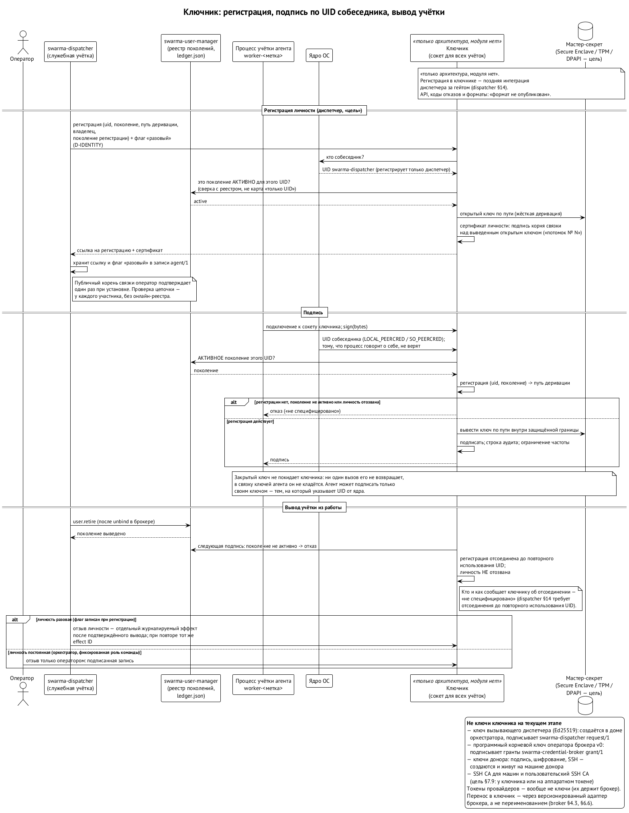
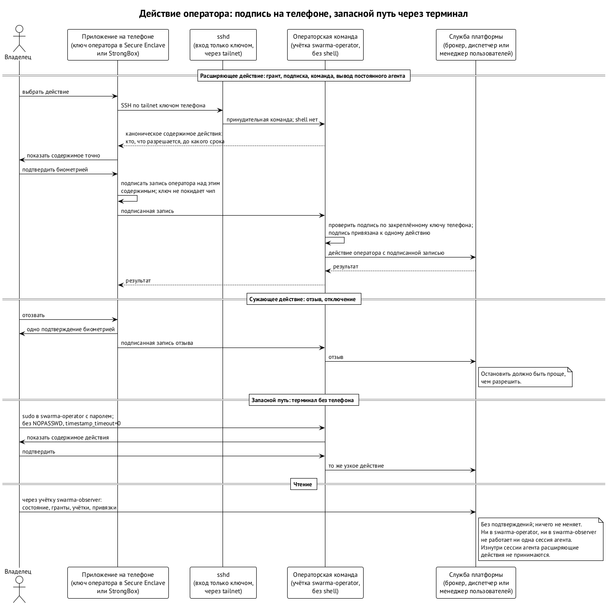

# Ключи и ключник

У каждого агента есть криптографическая личность — пара ключей, которой он подписывает свои сообщения. Вопрос в том, где этот ключ живёт. Ответ архитектуры: **не у агента**.

## Принцип

Инъекция в промпт действует руками самого агента. Если ключ лежит в файле агента или в его связке ключей, достаточно уговорить агента его прочитать — и ключ ушёл. Поэтому агент никогда не держит свой закрытый ключ. Он просит отдельный привилегированный процесс — ключника — подписать или расшифровать что-то за него. Ключ никогда не покидает ключника, и инъекция не может вынести то, чего у процесса никогда не было. ⟦решено⟧

Ключник пока существует только как архитектура: модуля и спецификации у него нет. Поэтому на первом этапе в системе есть ключи, которые живут иначе, и важно не путать их с ключом личности. ⟦спецификация⟧

| Ключ | Где живёт | Что подписывает | Когда |
| --- | --- | --- | --- |
| ключ личности агента | у ключника, выведен из мастер-секрета; агенту не отдаётся | сообщения и квитанции агента | цель; модуля ключника пока нет |
| ключ вызывающего | в доме оркестратора; публичная часть зарегистрирована у диспетчера на поколение его учётки | заявки диспетчеру (`swarma-dispatcher request/1`) | первый этап, до ключника |
| корневой ключ брокера v0 | программный ключ Ed25519 в учётке `swarma-operator`, файл 0600 | гранты и отзывы брокера | брокер v0; с ключником — переход по версионированной процедуре |
| ключ оператора на телефоне | защищённый чип телефона (Secure Enclave или StrongBox); телефон не покидает | одно действие оператора за раз: грант, отзыв, команду, вывод постоянного агента | с первого среза платформы (F-23) |
| ключи донора | на машине донора: подпись, расшифровка пакета, SSH | заявку, финальные конверты работника, вход по SSH | удалённый работник (глава 12) |
| центры сертификации SSH | у ключника или на аппаратном токене | сертификаты наших SSH-серверов и короткие сертификаты работников | удалённый работник |
| токен провайдера модели | у брокера; на запуск — в окружении среды | ничего: это не ключ, а пропуск к провайдеру | глава об учётных данных |

Ключ вызывающего — честное исключение из принципа: пока ключника нет, оркестратор держит его в своём доме, и инъекция в оркестратор может им воспользоваться. Его сила ограничена грантом оркестратора, а отзыв гранта отрезает всех агентов, заведённых по его заявкам (глава о грантах).

## Иерархия под корнем владельца

Ключник хранит один мастер-секрет — там, где можно, в аппаратном хранилище: Secure Enclave на Mac, TPM на Linux, DPAPI или TPM через CNG на Windows. Из мастер-секрета ключи агентов выводятся иерархически (схема BIP-32 и её вариант SLIP-0010 для Ed25519), и только «жёстко»: по ключу ребёнка нельзя вычислить ни родителя, ни соседей. ⟦предложено⟧

Путь деривации кодирует стабильную личность агента — `назначение'/продукт'/проект'/агент'` — а не путь в файловой системе и не UID. Пользователь ОС может быть удалён и создан заново, агент может переехать на другую машину, а его личность при этом останется прежней. ⟦решено⟧

Ключник публикует публичный корень, и владелец один раз, при установке, подтверждает его в своём клиентском приложении. Дальше каждый новый агент — это публичный ключ плюс подпись корня: «это мой потомок номер N». Любой, у кого есть публичный корень, проверит цепочку сам, не обращаясь ни к какому серверу. От подмены защищает именно подпись корня.

## Как агент разговаривает с ключником

Ключник слушает Unix-сокет — файл, доступный всем пользователям машины. Когда процесс подключается, ядро сообщает ключнику UID процесса на другом конце (`LOCAL_PEERCRED` на macOS, `SO_PEERCRED` на Linux). Ключник держит карту «UID → путь деривации» и отвечает только операциями над ключом именно этого агента:

- `sign(bytes)` — подписать;
- `decrypt(blob)` — расшифровать пакет, адресованный этому агенту;
- `pubkey(identity)` — отдать публичный ключ;
- `register` — привязать учётку к личности; это может только диспетчер. Запись — не просто «UID → путь»: в ней UID, **поколение учётки**, путь деривации, владелец и номер регистрации, а также пометка, разовая это личность или постоянная. Ключник принимает подключение, только если поколение этого UID сейчас активно в журнале менеджера пользователей, поэтому учётка, получившая когда-то освобождённый UID, чужой личностью не воспользуется;
- `revoke(identity)` — отозвать личность. Постоянную может отозвать только оператор подписанной записью; разовую — ещё и диспетчер, который её зарегистрировал (ниже).

То, что ключник работает от root, а агент — от своего пользователя, не мешает: так устроены все системные службы. Пару ключей в связку ключей агента не кладут вовсе: инъекция могла бы вынести её системной утилитой.

Расшифровка устроена так же: оркестратор получает пакет, зашифрованный на его публичный ключ, просит ключника расшифровать, и открытый текст возвращается только этому процессу, с записью в аудит и ограничением частоты. Здесь есть тонкость: ключник защищает ключ, а не расшифрованное содержимое. После расшифровки пакет живёт в памяти и доме оркестратора, поэтому пакеты адресуются ровно тому, кому их надо прочитать, и не содержат лишнего.

## Жизнь личности

Вывод учётки и отзыв личности — две разные операции. ⟦решено⟧

- **Вывод учётки** отключает доступ к личности, но саму личность не трогает. Если учётку создать заново — на той же машине или на другой с тем же мастер-секретом — и зарегистрировать на тот же путь, агент вернётся с прежним ключом. Так работает переезд оркестратора и подъём постоянной команды после перезагрузки.
- **Разовый воркер.** Его личность отзывает диспетчер — отдельной операцией, после того как учётка выведена, и только если при регистрации он сам пометил её как разовую. Флаг нельзя вывести задним числом из имени учётки или из запроса на вывод.
- **Постоянный участник** — оркестратор, закреплённая роль команды. Вывод учётки его личность не отзывает никогда. «Похоронить» его можно только записью об отзыве, которую подписывает оператор.

Такое разделение держит две вещи сразу: временные личности не копятся вечно, а постоянную личность нельзя потерять случайной уборкой.

## Оператор: подпись с телефона

Владельцу нужно регулярно делать привилегированные вещи: выдать грант, подключить подписку, поднять постоянную команду, вывести постоянного агента, дать полномочия на остановку для обслуживания. Подпись под этим не должна жить там, где работают агенты, — иначе инъекция в сессию, запущенную от имени человека, подпишет что угодно. Поэтому она живёт в отдельной учётке `swarma-operator`, где не работает ни одна сессия агента, а основной способ ею воспользоваться — телефон. Так решил владелец 12.10 (находка F-23). ⟦решено⟧

Как это устроено:

1. **Ключ в чипе телефона.** Ключ оператора создаётся в Secure Enclave на iPhone или в StrongBox на Android, наружу не выходит и работает только после биометрии. Никакого нового железа, кроме телефона, не нужно.
2. **Вход без shell.** Приложение заходит по SSH через tailnet в учётку `swarma-operator` только этим ключом. Вместо shell там принудительная узкая **операторская команда**: она принимает только действия оператора — ни произвольной команды, ни входа по паролю, ни сессии агента.
3. **Подпись одного действия.** Приложение показывает точное содержимое — кто, что разрешается, до какого срока. После биометрии телефон подписывает запись оператора над каноническим содержимым именно этого действия. Машина проверяет подпись по закреплённому ключу телефона; подпись привязана к действию, и для другого её не используешь.
4. **Расширять — с подтверждением, сужать — сразу.** Расширяющие действия требуют входа и явного подтверждения содержимого. Отзыв — одно касание с биометрией: остановить агента должно быть проще, чем дать ему права.
5. **Запасной путь — терминал.** С компьютера оператор входит в `swarma-operator` через `sudo` с паролем, без `NOPASSWD` и без кэша (`timestamp_timeout=0`), и выполняет те же узкие команды. Без телефона платформа не останавливается.
6. **Чтение — без подтверждений.** Посмотреть состояние, гранты, учётки и привязки можно через обязательную учётку `swarma-observer`. Она ничего не меняет и подписи не держит.
7. **Остановить весь узел — ALLSTOP.** Это одно действие оператора с аутентификацией и одним подтверждением, с телефона или из терминала. Оно доставляется напрямую и с проверкой каждому получателю — менеджеру пользователей, брокеру, хосту сессий, диспетчеру, — поэтому сетевые отсечения и остановки идут, даже когда диспетчер или брокер лежат. Завершить действие целиком и снова открыть узел можно только после сверки всех надёжных частей служб, включая диспетчер. Учётки, которые ни разу не запускались, получают отсутствие под забором по авторитетному покрытию «запуска не было» — без пробного старта и без общего kill по UID. Восстановление после ALLSTOP — отдельное явное действие оператора. ⟦спецификация⟧

Что ещё не решено. Имя и формат операторской команды, точная настройка `sshd`, домен подписи и канонические байты не опубликованы. Регистрация ключа телефона, его смена и потеря телефона — открытый вопрос; предложение — заново зарегистрировать ключ через терминал, по запасному пути. Совместимость подписи телефона с форматом корневого ключа брокера v0 ещё надо согласовать. ⟦открыто⟧

## Внешние агенты

Агенты из другой организации или с чужой машины нашим ключником не пользуются. Они приносят свои ключи — у удалённого работника их три, по ролям: подпись, расшифровка пакета, SSH — и сертификат регистрации с метаданными (имя, роль, срок), подписанный их же ключом подписи над нашим challenge. Мы проверяем подпись — она доказывает, что ключ у них есть. Затем сверяем ключ с тем, что знаем о человеке: с ключом из его подписанной карточки на бирже, если она есть, или с приглашением, к которому привязан одноразовый код. Голосом и по второму каналу ничего не сверяется: у человека, который просто услышал о среде, второго канала нет. Потом ключи закрепляются в реестре, и корень подписывает запись о допуске: «ключ K принят с ролью R». Дальше для проверки оба вида личностей одинаковы. Подробно — в главе об удалённом рабочем месте. ⟦решено⟧

У каждого работника свои ключи. Общего ключа на всех нет и быть не может: свой ключ можно отозвать, не трогая остальных.

На машине донора ключи хранятся по-разному в зависимости от варианта установки:

- **без прав администратора** мост работает в сессии самого донора. Поэтому на Mac ключи создаются в Secure Enclave и неэкспортируемы с первого дня (P-256 для подписи и SSH): копия всех файлов на другой машине бесполезна. На Linux пока файлы с правами 0600, TPM позже;
- **с отдельными учётками** мост работает служебной учёткой, под которой никто не входит в систему, и связка ключей macOS для него не открывается. Этот вариант целиком работает без Keychain: ключи — файлы 0600, которые читает только учётка моста. ⟦решено⟧

## SSH: центры сертификации

Мост удалённого работника ходит к нам по SSH. У SSH два вида ключей, и они отвечают на разные вопросы. **Ключ хоста** — паспорт нашего SSH-сервера: он доказывает подключающемуся, что это действительно наш сервер. Он один на сервер и одинаков для всех, как HTTPS-сертификат у сайта, поэтому публичен и может лежать в DNS. **Ключ работника** — его личный ключ доступа: создаётся на машине донора, закрытая часть её не покидает, открытая закреплена у нас в реестре. ⟦решено⟧

Оба вида заверяют наши центры сертификации:

1. **Центр хостов.** Ключ Ed25519, закрытая часть которого живёт у ключника или на аппаратном токене и никогда не лежит на серверах. Он подписывает ключ каждого SSH-сервера сертификатом: на какие имена и на какой срок (около года, продлевается автоматически). В `sshd` это одна строка `HostCertificate`.
2. **Публикация.** Открытый ключ центра хостов лежит в DNS одной записью `TXT _swarma-ssh-ca.<домен>` под DNSSEC (запись `SSHFP` для ключа центра не подходит) и приезжает в пакете допуска. Клиент донора прописывает у себя `@cert-authority` для наших имён. Добавление сервера не меняет ни одной записи DNS, а записи вообще меняются только при смене наших ключей — не на каждого нового работника.
3. **Центр пользователей.** Отдельный центр подписывает SSH-ключ каждого работника коротким сертификатом (около суток), где принципал — пользователь его рабочего места. Мост продлевает сертификат по уже проверенному каналу. `sshd` доверяет ему через `TrustedUserCAKeys`, и срок с отзывом живут в одном месте, а не в списке разрешённых ключей.
4. **Отзыв.** Список отозванных ключей (KRL) приходит клиентам вместе с политикой (`RevokedHostKeys`) и серверам для ключей работников.
5. **Смена ключа центра.** Новый ключ публикуется рядом со старым, какое-то время клиенты доверяют обоим, потом старый убирается.

## Риск

Компрометация мастер-секрета компрометирует всех агентов установки. Поэтому ключник минимальный, привилегированный и с аудитом, а мастер-секрет по возможности не покидает аппаратного хранилища. Это самое ценное место всей системы, и проектируется оно соответственно. Процедуры восстановления после такой компрометации и плановой смены мастер-секрета пока не описаны. ⟦открыто⟧
