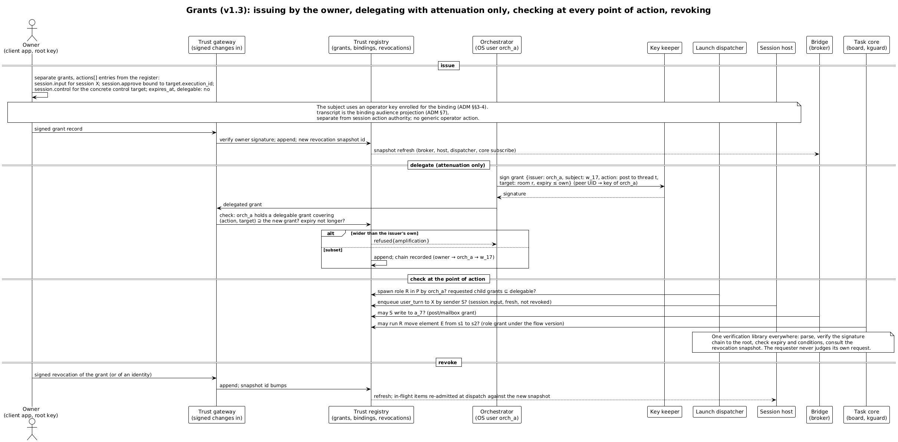
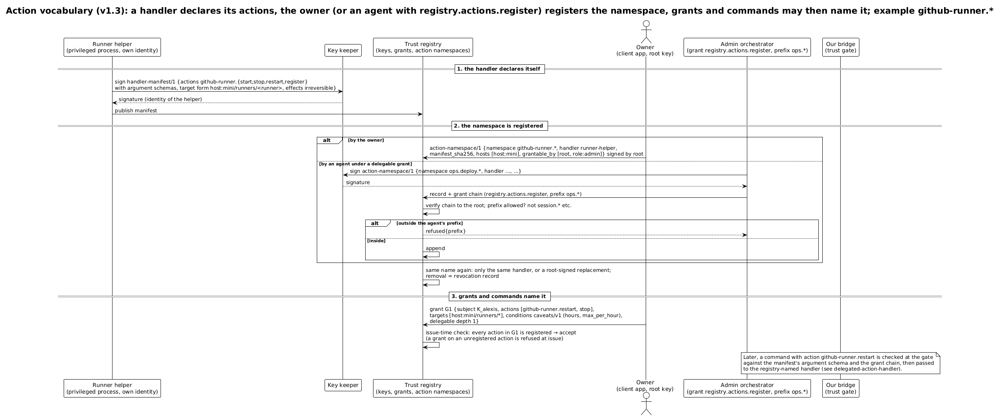

# Гранты, словарь действий, обработчики

> Редакция: accepted architecture-review findings (2026-10-13). Уточнён пример прав сессии в обновлённом upstream figure.

Ключ отвечает на вопрос «кто». Грант отвечает на вопрос «что ему можно».

## Что такое грант

Грант — подписанное утверждение: кто выдал, кому (ключу или роли), какие действия, над какими целями, при каких условиях, можно ли передавать дальше и до какого срока.

```
grant/1
{ issuer: корень владельца,
  subject: ключ Алексея,
  actions: ["github-runner.restart", "github-runner.stop"],
  targets: ["host:mini/runners/*"],
  conditions: { lang: "caveats/v1", hours: "09-21", max_per_hour: 6 },
  delegable: { depth: 1 },
  expires_at, sig }
```

Привязки «участник — роль» — отдельные подписанные записи, поэтому грант роли распространяется на любого, кто её занимает. Права ролей в плейбуке — это гранты ролям. Одна модель описывает и людей, и агентов, и роли на доске. ⟦предложено⟧

Это **общий язык грантов** — архитектура, у которой пока нет своего модуля. Первые модули платформы пользуются более узкими формами, и копировать пример выше как формат на проводе нельзя. ⟦спецификация⟧

| | Общий грант (архитектура) | Грант брокера v0 |
| --- | --- | --- |
| имя на проводе | `grant/1`, формат не опубликован | `swarma-credential-broker grant/1`: доменная метка, перевод строки, каноничный JSON |
| субъект | ключ или роль | ключ или лист агента `agent:<поколение>` |
| действия | словарь пространств имён: `session.*`, `github-runner.*` и так далее | ровно два: `agent.spawn` и `credential.lease` |
| цели и шаблоны | типизированные цели, `*` только в грантах | аккаунты, среды и профили списками, без шаблонов |
| условия | `caveats/v1`, позже язык правил | окно времени; других условий нет |
| роли, делегирование | роли, глубина делегирования, ослабление | без ролей; глубина и ослабление проверяются на каждом звене, не больше четырёх звеньев |
| корень | корень владельца, позже ключник | программный ключ в учётке `swarma-operator` |
| отзыв | снимок отзыва из реестра | `swarma-credential-broker revocation/1` в локальном состоянии брокера |

Переход брокера на общий язык и на ключника — отдельная процедура с версионированным адаптером: переподписать гранты, заменить привязки, сохранить отзывы, какое-то время держать оба корня.

## Люди тоже подписывают

Зеркало делегирования на стороне человека — подтверждение ключом с присутствием: аппаратный ключ, телефон с биометрией, Secure Enclave. Устройство само показывает то, что подписывает. Права устроены как на телефоне: процесс один раз просит право на вид изменений — всегда, один раз или нет, — а касания собираются в пачку. Свой шаг человек может поручить оркестратору доверенностью с потолками и сроком: например, одобрять заказы до 500 евро. Но никогда — право менять сами правила. ⟦решено⟧

Для оператора платформы это уже не замысел, а первый срез: расширяющие действия — выдачу гранта, подключение подписки, постоянную команду, вывод или пересоздание постоянного агента, сохранение дома, полномочия на остановку для обслуживания и продление постоянных грантов — оператор подписывает телефоном после показа точного содержимого, а без телефона подтверждает паролем в терминале. Отзыв — одно касание. Изнутри сессии агента расширяющее действие не принимается, а старое подтверждение не превращается в разрешение на будущее (находка F-23, глава о ключах). ⟦решено⟧

## Где проверяются гранты

Проверка происходит там, где совершается действие, и никогда — у того, кто просит:

| Действие | Кто проверяет | На первом этапе |
| --- | --- | --- |
| сменить статус задачи, назначить роль, принять результат | ядро плейбуков | архитектура доски ⟦предложено⟧ |
| запустить агента с ролью | диспетчер запусков | подпись заявки и цепочка гранта вызывающего ⟦спецификация⟧ |
| выдать агенту учётные данные | брокер учётных данных | обе цепочки — диспетчера и вызывающего — при привязке, аренде и каждом продлении ⟦спецификация⟧ |
| завести учётку, запустить под ней | менеджер пользователей и запускатель | роль вызывающего по `sudo`; гранты — только с v2 ⟦спецификация⟧ |
| доставить сообщение агенту | брокер сообщений (ворота моста) | архитектура моста ⟦предложено⟧ |
| отправить наружу | мост (аудитория) и ключник (подпись) | архитектура ⟦предложено⟧ |
| исполнить действие | обработчик действия | архитектура ⟦предложено⟧ |

Оркестратор ничего не проверяет сам — он проситель, а не судья. Библиотека проверки одна на всю систему: разобрать запись, пройти цепочку подписей до корня, проверить срок и условия, свериться со снимком отзыва.

В примере на рисунке права сессии выдаются отдельно: `session.input` для сессии, `session.approve` для конкретного исполнения и `session.control` для конкретной цели управления. Ключ оператора должен быть зарегистрирован для привязки; transcript — проекция для её аудитории, а не общее право оператора. Это пример архитектуры, не новый формат гранта.



## Делегирование только с ослаблением

Получивший грант может передать часть его дальше — но только меньше, чем имеет сам: подмножество действий и целей, срок не длиннее своего, глубина не больше разрешённой. Каждая запись ссылается на родительскую, так что цепочка читается до корня: корень → ключ Алексея → его оркестратор. Диспетчер отказывает в спавне, если для ребёнка запрошены гранты шире тех, что может делегировать проситель. Агент с узкими правами физически не может создать агента с широкими.

Это известная модель «способностей с ослаблением»; вдохновение — SPKI/SDSI, Macaroons, UCAN, Biscuit. Biscuit, где уже есть язык правил и офлайн-проверка, рассматривается как готовая реализация записей грантов. ⟦предложено⟧

## Условия и язык политик

Условия гранта пишутся в блоке `conditions` с полем `lang`. Сейчас это `caveats/v1` — структурные условия: окно времени, счётчики, требование подтверждения оператора, перечень целей. Позже — язык правил наподобие Datalog для сложных политик. Проверяет одна библиотека с подключаемыми вычислителями, а в сообщениях едут только ссылки на гранты, поэтому появление языка политик не меняет форматов на проводе. ⟦предложено⟧

## Словарь действий

В слое полномочий нет свободного текста. Действие — это зарегистрированное имя со схемой аргументов и обработчиком. Платформа поставляется с базовым словарём: `session.*`, `goal.*`, `board.*`, `user.*`, `spawn.*`, `post`, `inbox`, `terminal.raw`. Цели — типизированные идентификаторы ресурсов: сессия, `host:mini/runners/x`, комната, элемент доски. Шаблоны со звёздочкой допустимы только в грантах; в команде цель всегда конкретная.

Свободный текст тоже ходит — но как данные: агенту он приходит как «вот сообщение от такого-то», и решает, что с ним делать, уже модель. Права он не несёт.

## Как появляется новое действие

Возьмём пример: владелец хочет разрешить Алексею перезапускать GitHub-раннеры на своей машине. Действий `github-runner.*` в базовом словаре нет. Они появляются в три шага, и каждый шаг — подписанная запись реестра.

1. **Обработчик объявляет себя.** Помощник раннеров — процесс со своей личностью — публикует манифест: какие действия он исполняет и с какими аргументами, какие цели понимает, обратимы ли эффекты.

   ```
   handler-manifest/1
   { handler: "host:mini/runner-helper",
     actions: { "github-runner.restart": { args: { runner: "string" } }, … },
     targets: "host:mini/runners/<runner>",
     effects: "irreversible", sig }
   ```

2. **Владелец регистрирует пространство имён.** Запись связывает имя с обработчиком и его манифестом и говорит, кто вправе выдавать на него гранты. Это может сделать и агент-администратор с грантом `registry.actions.register` — но только внутри своего префикса, например `ops.*`; попытка объявить `session.*` будет отклонена.

   ```
   action-namespace/1
   { namespace: "github-runner.*", handler: "host:mini/runner-helper",
     manifest_sha256, hosts: ["host:mini"], grantable_by: ["root", "role:admin"],
     issued_by, expires_at, sig }
   ```

3. **Гранты и команды ссылаются на имя.** Теперь можно выдать грант Алексею. Грант на незарегистрированное действие отклоняется ещё при выдаче, а лишний или неверный аргумент в команде не пройдёт проверку по манифесту.



## Кто исполняет действие

Исполняет тот, кого реестр назвал обработчиком. Вариантов два.

**Обработчик-процесс** — детерминированный помощник. Он нужен для операций на уровне ОС, необратимых и системных. Он не доверяет мосту на слово: заново проверяет цепочку грантов той же библиотекой, выполняет ровно одну из своих зарегистрированных операций, пишет аудит и подписывает квитанцию своей личностью.

**Обработчик-агент** — например, оркестратор-администратор с широкими грантами. Команда приходит в его сессию типизированным элементом вместе с записью проверки. Агент может перепроверить её сам, добавляет суждение («безопасно ли перезапускать прямо сейчас?») и исполняет своими правами. Расширить полномочия он не может: сделать он способен только то, на что есть его собственные права. Пометка `effects: irreversible` в манифесте подсказывает политике, что такое действие должен исполнять процесс. ⟦предложено⟧

## Грант вызывающего как зависимость

Когда диспетчер заводит агента по чужой просьбе, права агента зависят не только от гранта диспетчера, но и от гранта того, кто попросил. ⟦решено⟧

- **Подписанные запросы.** Вызывающий — человек или оркестратор — подписывает запрос ключом, связанным с его учёткой ОС, с доменной меткой `swarma-dispatcher request/1`. Все версионированные имена на проводе платформы строятся одинаково: `swarma-<компонент> <объект>/<n>`. Диспетчер сверяет ключ с учёткой, а не верит полю в запросе.
- **Лист агента.** Агент получает грант `agent:<поколение>`: пересечение запроса, гранта вызывающего и гранта диспетчера, только действие `credential.lease`, глубина 0. Цепочка диспетчера — не длиннее трёх конвертов и с глубиной не меньше 1, чтобы лист уместился в предел из четырёх. Каждое звено проверяется отдельно, включая лист. Если нужную цепочку построить нельзя, запрос получает отказ `grant_unconstructible` ещё до каких-либо эффектов.
- **Отзыв режет сразу.** Брокер хранит разрешение вызывающего как часть привязки агента и перепроверяет его при каждой аренде и каждом продлении токена. Отзыв гранта оркестратора отрезает его агентов немедленно (`lease_caller_revoked`), без ожидания конца их срока. Ещё раньше, до создания учётки и перед каждым стартом, диспетчер спрашивает у брокера вердикт `revocation.check` по точной цепочке: хранилище отзывов одно, брокерское, а диспетчер получает узкий ответ «не отозвано, отозвано или недоступно» на момент проверки, без доступа к закрытому каталогу брокера. «Недоступно» означает отказ (находка F-8). ⟦спецификация⟧
- **Новый оркестратор получает права от того, кто его запросил.** Если оркестратор C просит завести оркестратора O, права вызывающего для O подписывает сам C, сужая свой грант, а не диспетчер. Иначе цепочка O начиналась бы у диспетчера, C из неё выпадал бы, и отзыв гранта C не доходил бы до воркеров, которых потом запустит O. Теперь C стоит в цепочке каждого потомка, и обычная проверка цепочки режет всех. Перед созданием диспетчер проверяет, что глубины хватит: у C не меньше 2, у O не меньше 1, всего не больше четырёх конвертов. Ключ O регистрируется отдельно и права на спавн сам по себе не даёт (находка F-3). ⟦спецификация⟧
- **Восстановление брокера из бэкапа закрыто, пока история отзывов не сверена.** Иначе снимок, сделанный до отзыва, вернул бы уже отозванные права. При восстановлении ставится отметка вне восстанавливаемых данных; пока она стоит, аренды, продления и автозапуск службы закрыты, а вердикт отзыва отвечает «недоступно». Открыть их можно только после сверки с подтверждённой историей отзывов, пережившей сбой. Если такой истории нет, права остаются недоступны или оператор заменяет корни брокера и выдаёт права заново; из старого снимка ничего не восстанавливается автоматически (находка F-9). ⟦спецификация⟧
- **Постоянным агентам права продлеваются, но не расширяются.** У постоянной команды нет срока, а у гранта он есть. Поэтому у диспетчера есть отдельный эффект **E-rebind**: он переподписывает лист агента под текущими цепочками, а брокер делает **замену привязки** для той же учётки и того же поколения — старая привязка снимается с записью об удалении, её аренды кончаются, и только потом публикуется новая. Две привязки сразу не бывает, учётка не пересоздаётся. Каждый E-rebind получает свежий вердикт отзыва. Новый лист — пересечение текущих цепочек с первоначально допущенным запросом: ни новых аккаунтов, ни сред, ни профилей; для расширения нужен новый запуск. Продлевать может только тот, кто уже стоит в продлеваемой цепочке; одной подписи диспетчера мало. Отозванное автоматическая уборка не перевыпускает никогда — для этого нужно новое решение оператора (находка F-14). ⟦спецификация⟧
- **Часам не верят на слово.** Установщик требует проверенный источник времени или источник под контролем оператора (например, NTS). Брокер и диспетчер хранят **водяной знак времени**: срок гранта проверяется по большему из «сейчас» и водяного знака, а начало действия — по меньшему. Поэтому шаг часов назад не возвращает истёкшие права, а шаг вперёд не открывает будущие раньше времени. Водяной знак не двигается по непроверенному времени, а сбросить его может только оператор явным действием. Так решил владелец 12.10 (находка F-21). ⟦решено⟧
- **Для сети отдельного измерения в гранте нет.** Сетевой профиль ребёнка выбирает политика машины по его профилю Curator (глава о пользователе на агента), а гранты и так сужают профили по цепочке (находка F-27). ⟦спецификация⟧
- **Словарь брокера первой версии заморожен:** `agent.spawn` (завести и запустить агента) и `credential.lease` (взять аренду токена). Менеджер пользователей в v0 и v1 грантов не проверяет: заводить учётки ему может только вызывающий с ролью диспетчера; грант `user.create` появится вместе с проверкой грантов в v2. Новые действия добавляются только через процедуру из раздела выше.

## Где живёт реестр

Управлять грантами владелец будет из клиентского приложения; изменения уходят подписанными в реестр, а мост, хост, диспетчер и ядро подписываются на снимки отзыва и перепроверяют допуск при доставке. Где физически живёт реестр — git-журнал, состояние Matrix, отдельный сервис или их сочетание — пока не решено. ⟦открыто⟧
