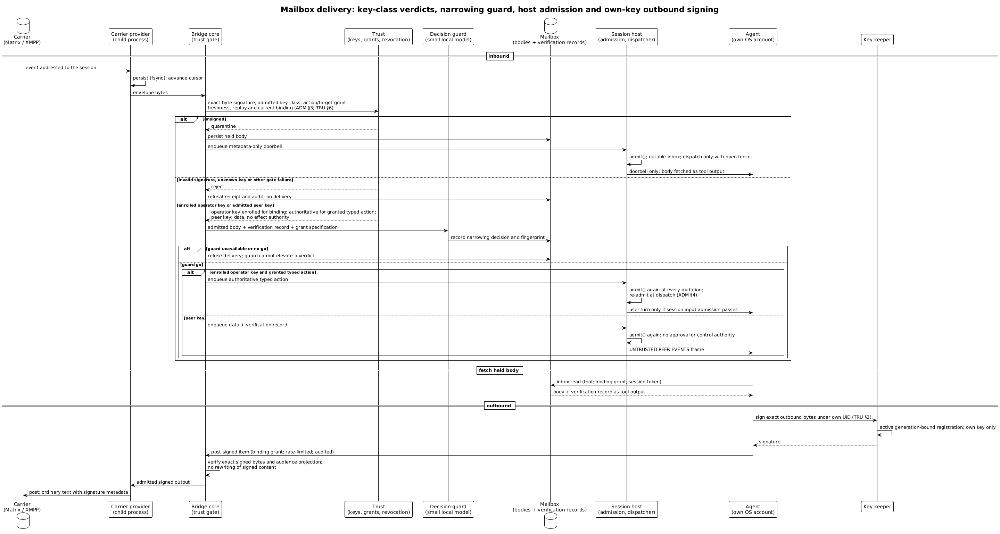
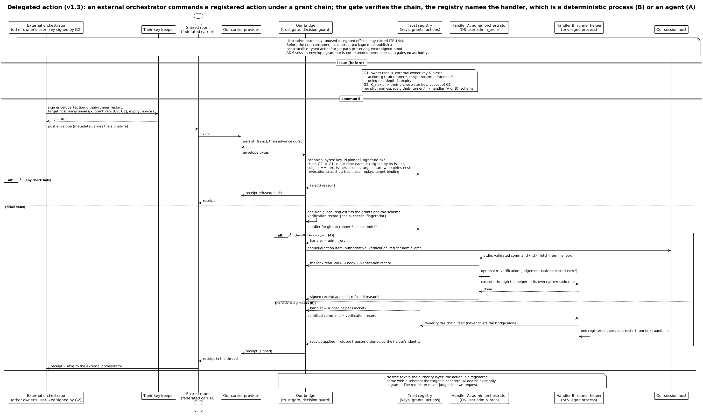

# Три входа и путь сообщения

> Редакция: accepted architecture-review findings (2026-10-13). Текст согласован с upstream figures: класс ключа, сужающий guard и исходящая подпись своим ключом.

> Подпись важнее канала. Провайдеры носителей — недоверенные трубы.

Теперь, когда у агентов есть личности и права, посмотрим, как к агенту попадает сообщение. Решения этой главы приняты владельцами 7 октября, но мост, ворота доверия и почтовый ящик пока существуют как архитектура: спецификации модуля у моста ещё нет. Хост сессий, куда мост доставляет, описан в своей спецификации.

## Три входа

В систему ведут ровно три двери, и их важно не путать. ⟦решено⟧

**Корневой канал.** Только для владельца и только локально. Это подписанная команда или терминал, подключённый к сессии под эксклюзивной арендой ввода (грант `terminal.raw`, только люди). Ввод идёт прямо в псевдотерминал агента, без мультиплексора, куда мог бы напечатать посторонний процесс. Псевдотерминал принадлежит раннеру сессии под учёткой агента, а писать в него раннер соглашается только по команде хоста сессий текущей эпохи (глава о хосте сессий). Сегодня, до разделения на службу и раннер, терминалы держит сам демон сессий доски.

**Внешний канал.** Носитель плюс брокер. Это единственный путь для всех внешних участников — других людей, своих агентов, оркестраторов из других организаций. Внешние никогда не ходят через корневой канал.

**Точка присоединения.** Одноразовая минимальная HTTPS-точка для знакомства: она принимает сертификаты и выдаёт пакеты учётных данных — потому что в момент знакомства у внешней стороны ещё нет ни одной нашей комнаты. Команды через неё не ходят никогда. Если пакет можно передать вне полосы, она не нужна вовсе.

## Агент не читает носитель

Агент не держит учётных данных мессенджера и, благодаря файрволу, не может до него дотянуться. Участник комнаты — брокер. Он принимает сообщение, проверяет его и только потом «звонит» агенту: «для тебя есть проверенное сообщение, забери его». Агент забирает сообщение инструментом — почтовым ящиком (Mailbox), который работает в обе стороны: входящие и исходящие. ⟦решено⟧

## Как сообщение проходит путь

{.tall}

1. **Провайдер носителя сохраняет событие.** Провайдер Matrix — дочерний процесс моста; учётные данные личности агента в Matrix хранятся у него. На каждое новое событие он дописывает его в свой почтовый файл, сбрасывает на диск и только потом продвигает курсор синхронизации. Если мост упал, провайдер переиграет события с курсора; дубликаты безвредны, потому что допуск идемпотентен по паре «отправитель, идентификатор». «Сохранил» здесь значит «записал на диск до того, как сказал серверу „получил“».

2. **Ворота доверия.** Это чистая библиотечная проверка, без сети и без модели. По порядку: привести байты к каноническому виду; найти ключ в снимке реестра; проверить подпись; определить отправителя; загрузить гранты по ссылкам и пройти цепочку до корня — каждое звено подписано своим издателем, получатель звена совпадает с издателем следующего, действия и цели сужаются, сроки вложены; свериться со снимком отзыва; проверить окно времени и журнал повторов; проверить ревизию привязки цели; вынести вердикт и подписать запись допуска ключом моста. Неподписанное тело удерживается как данные: в сессию идёт только звонок с метаданными. Неверная подпись, неизвестный ключ или другой сбой ворот — отказ с квитанцией и аудитом, без доставки. Зарегистрированный для привязки ключ оператора получает authority только для выданного типизированного действия; допущенный peer key несёт данные, без права на эффект.

3. **Decision guard.** После ворот небольшая локальная модель сравнивает просьбу со спецификацией грантов адресата и ищет признаки инъекции. Результат записывается вместе с отпечатком: хэш сообщения, отправитель, использованные гранты, версия модели, вердикт. Если модель недоступна, ответ — «нет». Guard может только сузить вердикт ворот, не повысить его authority. ⟦решено⟧

4. **Звонок и почтовый ящик.** Хост сессий повторно проверяет допуск при каждой мутации и при доставке. Типизированное действие зарегистрированного ключа оператора становится пользовательским ходом только при допуске `session.input`; peer data идут отдельным `UNTRUSTED PEER EVENTS` frame и не дают права approve или control. Звонок допускается в долговечную очередь и доставляется только при открытом fence. Агент читает тело и запись проверки из почтового ящика как результат инструмента, а не как authority.

Неподписанное сообщение в сессию не попадает никогда: агент получает только «звонок» с метаданными и может прочитать тело как недоверенные данные. ⟦предложено⟧

Сам приём «звонок плюс вытягивание» мы используем давно: сегодня агенты в рое получают от хука короткое уведомление «у тебя N сообщений» и сами забирают их из входящих. Почтовый ящик — его обобщение: к звонку добавилась проверка до доставки и запись проверки рядом с телом. ⟦работает сегодня⟧ для звонка и вытягивания.

## Что видят люди

Люди в той же комнате пользуются обычными клиентами — Element или любым другим — и видят обычную переписку. Подпись едет в метаданных события и клиенту не мешает. Защиту от сервера мессенджера даёт его собственное сквозное шифрование; мы добавляем сверху подлинность и право, а второго слоя шифрования не добавляем. ⟦решено⟧

## Кто может писать агенту напрямую

По умолчанию писать в ввод агента и читать его вывод может только родитель — тот, кто его запустил; этот грант выдаётся автоматически при спавне. Все остальные — через брокер. Владелец, как корень доверия, держит все гранты. ⟦предложено⟧

## Исходящие

Агент сам запрашивает у ключника подпись точных исходящих байтов под своим UID. Ключник проверяет активную регистрацию, привязанную к поколению, и подписывает только своим ключом агента. Инструмент `post` передаёт мосту уже подписанный элемент; мост проверяет подпись над точными байтами и проекцию для аудитории комнаты, затем провайдер отправляет без переписывания подписанного содержимого. Посты ограничены по частоте и пишутся в аудит. Право моста подписывать от имени агента этим путём не даётся. ⟦предложено⟧

## Делегированная команда из другой организации

Самый сложный путь — когда команда приходит от оркестратора другого владельца. У Алексея его оркестратор собирает конверт: действие, конкретная цель, ссылки на гранты `[G2, G1]`, срок, случайное число; просит своего ключника подписать и публикует в общую комнату. У нас провайдер сохраняет событие, ворота проверяют подпись, закреплённый ключ, цепочку G2 → G1 → наш корень, ослабление на каждом шаге, сроки, отзыв; decision guard сверяет просьбу с грантами; реестр называет обработчика, и квитанция возвращается подписанной.

Это иллюстрация маршрута, а не открытый допуск к эффектам: неиспользуемые делегированные действия остаются закрытыми. До первого потребителя его контрактный пакет должен опубликовать исполнимый типизированный путь действия и цели, сохраняя точное подписанное доказательство. Грамматика session envelope здесь не расширяется; peer data не получают authority.

{.tall}

## Чего это не обещает

Подписи и гранты не делают модели умнее. Код не прячется от провайдеров моделей участников: что агент прочитал, видит и его провайдер. И ничто здесь не защищает от эксплойта ядра. Протокол отвечает за то, кто и что вправе сделать, и за след того, что сделано.

Два сервера Matrix, две машины, два корня доверия, общая комната — это и есть эталонный тест федерации, который мы проведём после однохостового MVP. ⟦решено⟧
