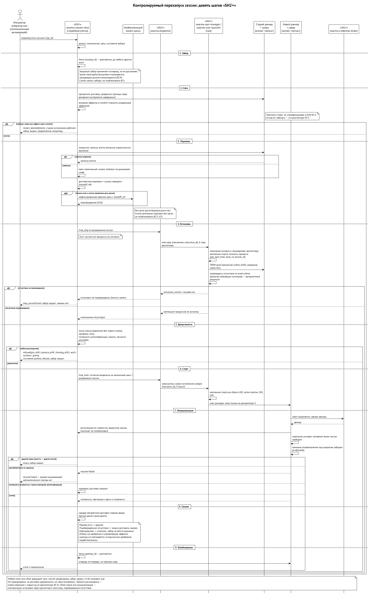
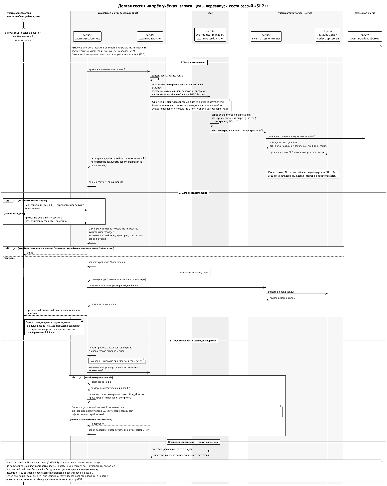
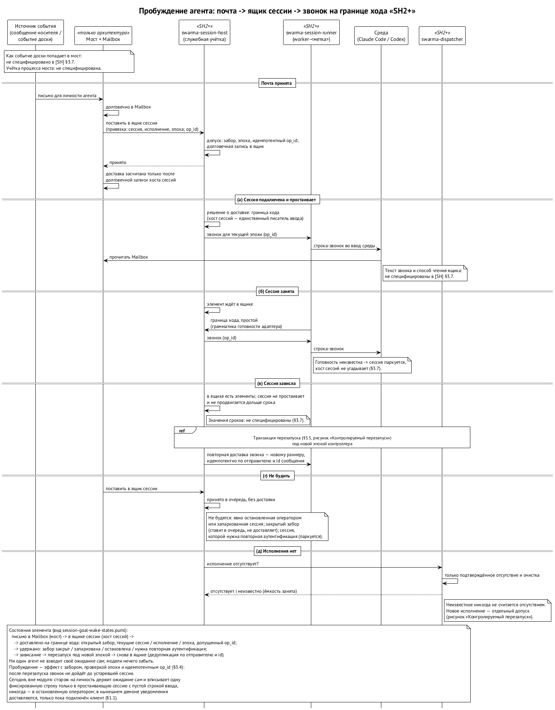

# Хост сессий и контекстный движок

Хост сессий — сердце первого слоя. Он запускает агентские среды, держит их живыми, решает, что и когда попадает им на вход, и умеет перезапустить сессию так, чтобы она продолжила работу.

Одна фраза, которая объясняет философию хоста сессий: **сессия — это кэш**. Авторитетны журнал хоста сессий и заметка о парковке, а если к сессии привязана доска — ещё её задача и цель; не контекст внутри среды. Поэтому сессию можно погасить, пережить перезагрузку или сменить среду — работа продолжится.

Всё, что в этой главе сказано про службу, раннер, заборы, цели и пробуждение, — целевое устройство шага SH2+ из спецификации модуля. ⟦спецификация⟧ Сегодня сессии держит `tb-sessiond` внутри доски, и его вынос идёт первым шагом, один к одному (в конце главы).

## Что делает хост сессий

Хост сессий — служба, одна на машину. Она работает под своей учёткой `swarma-session-host` и слушает сокет в `/opt/swarma/run/session-host/`. Служба принимает готовый план запуска, ведёт реестр сессий и их исполнений, держит «забор допуска» каждой сессии, планирует перезапуски и сверяет состояние после падений. Слово «хост сессий» без уточнения мы не используем: это всегда «хост сессий», чтобы не путать с машиной. ⟦решено⟧

## Две половины: служба и раннер сессии

Хост сессий не держит процессы агентов сам. Каждый процесс агента принадлежит **раннеру сессии** (`swarma-session-runner`) — маленькому процессу, по одному на сессию, под учёткой этого агента. Раннер запускает среду (Claude Code, Codex, Muse), держит её псевдотерминал или app-server, продлевает аренду токена у брокера и делает то, что скажет хост сессий: вписать ввод, сообщить, что ход закончился. О целях, доске и мессенджерах раннер ничего не знает. ⟦решено⟧

```
доска (учётка оркестратора или служебная учётка доски)
   │  сокет /opt/swarma/run/session-host/   ← ядро сообщает, чей UID подключился
   ▼
хост сессий — служба swarma-session-host:
   записи сессий, почтовые ящики, заборы, журнал, связь с доской
   │  проверенный канал
   ▼
раннер сессии — swarma-session-runner под учёткой worker-dev-7f3:
   держит псевдотерминал или app-server среды и аренду токена
   ▼
среда (claude / codex) под той же учёткой агента
```

Почему две половины, а не одна программа: среда должна работать под учёткой агента — это и есть граница, — а служба, которая видит все сессии и говорит с доской, работает под своей. Один процесс не может быть под двумя учётками сразу. Сегодня это одна программа, `tb-sessiond` под учёткой оператора: она и ведёт учёт, и держит терминалы, поэтому сессии Claude умирают при её перезапуске. Раннер переживает перезапуск службы: новая служба переподключается к живым раннерам и продолжает.

Раннер запускает не служба. Привилегированный старт делает только диспетчер (находка F-4, решено владельцем 12.10): ⟦решено⟧

1. Хост сессий сохраняет долговечное намерение сессии и закрывает забор доставки.
2. Он просит диспетчер операцией `host_start`, указывая четыре значения: логическую сессию, номер исполнения, эпоху контроллера и номер операции. Вызвать её может только настроенная служебная учётка хоста сессий.
3. У диспетчера заведено **разрешение хоста на запуск** — долговечная запись на одну логическую сессию, созданная, когда владелец допустил старт с исполнителем «хост сессий». Разрешение живёт столько же, сколько сессия, но каждый физический старт получает свою бронь `(исполнение, эпоха, операция)`, свой забор и свою квитанцию. Если забор сменился, разрешение для этого старта отзывается или уходит на сверку.
4. Диспетчер стартует раннер своим обычным путём — через бронь, эффект и квитанцию root, вызывая запускатель `swarma-user-launcher` под учёткой агента. Отмена до вызова вызов предотвращает; после неясного исхода диспетчер разбирает тот же эффект и ту же квитанцию и, если нужно, останавливает исполнение, но никогда не запускает второй раз.
5. Раннер открывает к хосту сессий свежее аутентифицированное соединение и доказывает, что он раннер именно этой сессии и этого исполнения. Регистрация в текущей эпохе и готовность идут раньше любой доставки; дальше хост сессий говорит только с раннером текущей эпохи.

**Перезапуск без нового допуска — только если владелец разрешил.** Сессия живёт дольше одного процесса, поэтому хосту сессий нужно и останавливать, и запускать преемника. Владелец при допуске старта может явно разрешить преемников этой сессии — это **разрешение жизненного цикла сессии**, оно хранится с допущенным запросом. Без него старт одноразовый. Преемник запускается только под этим разрешением, только после того, как отсутствие предыдущего исполнения подтверждено, и повтор того же запроса возвращает того же преемника, а не второго. План преемник берёт тот же, байт в байт; если пины или поза разошлись, нужен новый допуск владельца. Владелец должен оставаться активным, его цепочка — неотозванной, и каждый старт снова спрашивает вердикт отзыва. Для обычной работы у разрешения есть бюджет перезапусков, чтобы преемники не обнуляли окно времени; у постоянных сессий предела по времени по-прежнему нет. Отмена или вывод владельца, отзыв цепочки, подписанная оператором запись о выводе постоянного агента и остановка для обслуживания отзывают разрешение — и после этого ничего само не повторяется. Сам хост сессий никакой цепочки грантов не получает: привязка агента по-прежнему зависит от цепочки владельца. Так решил владелец 12.10 (находка F-20). ⟦решено⟧

**Остановка по просьбе хоста.** Для остановки у диспетчера есть операция `host_stop`: вызвать её может только служебная учётка хоста сессий и только для исполнения под своим разрешением. Она идёт тем же журналируемым путём, что и любая остановка (`exec.stop`, подтверждённое отсутствие процессов), записывается как остановка по просьбе хоста — это не отмена владельцем — и права запускать не даёт. ⟦решено⟧

Если хост сессий упал посреди старта, бронь диспетчера и закрытый забор сохраняются до сверки. Билетов запуска, роли «хост» у менеджера пользователей и прав хоста на `sudo` больше нет: раньше хост получал от диспетчера подписанный билет и предъявлял его запускателю, теперь этого промежуточного звена нет. Формат разрешения, разрешения жизненного цикла и бюджета перезапусков, аутентификация `host_start` и `host_stop` ещё не опубликованы, и пока их нет, эта связка выключена. ⟦открыто⟧

**Когда диспетчер закрыт для нового.** Если у диспетчера что-то не сверено, новые запуски закрыты, но управление не теряется: статус, списки, наблюдение эффектов, сверка и уже разрешённая остановка текущего исполнения остаются доступны. Неразобранные записи держат свои поколения, учётки и квоты, а остальная работа допускается, только если доказано, что неизвестность заперта в этих записях; иначе закрыт весь узел. Обслуживание и восстановление из копии — по-прежнему общие барьеры (находка F-15). ⟦спецификация⟧

Главный инвариант: **в ввод сессии пишет ровно один писатель** — диспетчер хоста сессий. Он пишет только то, что лежит в долговечной очереди сессии и прошло допуск. Нетипизированного пути в ввод нет. ⟦решено⟧

## Контекстный движок

Внутри хоста сессий живёт контекстный движок — пакет, а не отдельная служба. В нём:

- **адаптеры к средам**: потоковый JSON Claude, сервер приложений Codex, `muse serve`, сохранение живого терминала;
- **нормализация событий**: ход начался, текст, вызов инструмента, ход закончился, ждёт разрешения;
- **журнал** сессии, который принадлежит хосту сессий;
- **диспетчер** — тот самый единственный писатель ввода;
- **экспорт и посев контекста** — пакеты передачи.

Вывод сессии берётся только из нативных транскриптов сред. У каждой сессии Codex свой сервер приложений под учёткой её агента — общего сервера и общего пула учётных данных у службы нет. Claude в режиме сохранения держит живой интерфейс и удалённое управление. ⟦спецификация⟧

## Доставка с квитанциями

Сообщение, которое мост передал хосту сессий, проходит состояния: принято → в очереди → доставлено в среду → применено. «Применено» значит, что среда подтвердила: эхо введённого текста с маркером в потоке Claude, идентификатор элемента у Codex, подтверждение у Muse. Запись в канал сама по себе ещё не «применено». Если раннер сессии умер между доставкой и подтверждением, элемент становится «неизвестным», и до того как сессия снова откроется, хост сессий ищет маркер в нативном транскрипте. Ответы на вопросы среды («разрешить команду?») и команды управления никогда не повторяются автоматически. ⟦предложено⟧

## Диалоги среды

Когда среда спрашивает разрешения, адаптер превращает вопрос в типизированное событие «ожидает ответа» с точным дайджестом вопроса. Ответить может только держатель гранта `session.approve` на это исполнение — родитель-оркестратор или человек; первый действительный ответ побеждает. Обычная команда на такой вопрос ответить не может.

Часть вопросов обёртка может подтверждать сама — но только по списку: например, чтение файлов внутри рабочего каталога. Всё, чего нет в списке, паркуется и ждёт держателя гранта. Каждый автоответ пишется в аудит. ⟦решено⟧

## Забор и контролируемый перезапуск

У каждой логической сессии есть сохранённый на диск «забор»: открыт (можно доставлять), закрыт (принимаем в очередь, но не доставляем), заблокирован на обновление (никаких стартов, это ставит только оператор при подмене бинаря).

{.tall}

Перезапуск идёт девятью шагами: закрыть забор → дать текущему ходу закончиться и дождаться, пока не останется дочерних инструментов и внешних эффектов в полёте → попросить агента о записке и записать пакет передачи → остановить исполнение и **подтвердить его отсутствие** → сравнить пины профиля, привязки и позу → запустить новое исполнение → инициализировать (нативно возобновить или посеять пакет) → разрешить все «неизвестные» доставки → открыть забор. Отсутствие процессов доказывает `exec.stop` менеджера пользователей; он ничего не знает о средах и про нативную блокировку сессии в доме агента не говорит. Её проверяет свежий раннер: он уже работает под учёткой агента, видит её дом и под закрытым забором сообщает хосту сессий, свободна ли блокировка. Если ответ неизвестен, сессия остаётся запаркованной. Формат этого отчёта ещё не опубликован. ⟦спецификация⟧ Любой отказ останавливает путь, забор остаётся закрытым, и отчёт называет шаг. Принять расхождение — это новая операция человека, и она всегда пересобирает сессию. ⟦спецификация⟧

Четвёртый шаг хост сессий сам не делает: сигналов процессам он не шлёт. Он просит диспетчер операцией `host_stop`, а тот вызывает у менеджера пользователей `exec.stop`. Менеджер проверяет, что исполнение принадлежит этому диспетчеру и что это последняя квитанция старта, посылает TERM, потом KILL всем процессам учётки и отвечает только после того, как убедился, что их не осталось. Неподтверждённая остановка оставляет забор закрытым: подменить сессию, не зная, жива ли старая, нельзя.

Заборы и эпохи контроллера — это приём из распределённых баз данных: аренды и номера эпох. Писатель со старой эпохой — например, раннер сессии, который пережил падение своего супервизора, — не может ничего записать, потому что раннер сессии принимает команды только текущей эпохи.

Что переживает падение соседа, записано в общей таблице судьбы процессов менеджера пользователей: если падает служба хоста сессий, доставка закрывается, а раннеры с проверенной изоляцией могут дожить до того, как новая служба их подхватит с тем же номером исполнения; падение диспетчера или брокера закрывает соответствующие права до сверки, но само ничего не запускает (находка F-18). Свой замок состояния хост сессий не держит, пока ждёт диспетчера (F-28). Сеть у службы хоста закрыта полностью, включая loopback, — ей хватает Unix-сокетов (F-24). ⟦спецификация⟧

После перезагрузки машины хост сессий видит сменившийся идентификатор загрузки — это доказательство, что старых процессов нет, — и помечает сессии как ожидающие восстановления. Кто запрашивает восстановление, ещё не выбрано: в ранних набросках это был реестр проектов как единственный автоматический запросчик, но контракты хоста сессий и диспетчера этот вопрос оставляют открытым. Кого бы ни выбрали, он остаётся в пределах допущенного владельцем жизненного цикла сессии: перезапуск после перезагрузки не расширяет разрешение на сессию. Пока запросчика нет, автоматического восстановления нет. ⟦открыто⟧

## Переносимость контекста

Контекст переезжает в виде **пакета передачи** — проекции журнала на зафиксированный момент, сделанной для одного названного получателя. В пакете — краткое содержание, решения, открытые пункты, ссылки на цели и ссылки в защищённое хранилище хоста сессий. Никогда — токены, учётные данные, сырые транскрипты, ожидающие одобрения. Каждый элемент несёт свою отметку: кто его написал и с каким вердиктом, так что чужое содержимое при посеве никогда не превращается в команду пользователя.

Непрерывность и транспорт — разные оси. **Нативное возобновление** — когда среда сама подхватывает свою сессию — возможно на той же машине, в той же среде, том же управляемом доме и с тем же пином профиля. Версия среды при этом может смениться, если по semver изменение не ломающее: тот же major, а для версий 0.x — тот же minor. Иначе возобновление отклоняется. Если среда сама не смогла возобновиться, хост сессий сообщает вызывающему «возобновление не удалось» (`resume-failed`), и дальше решает он; автоматического запасного пути нет. ⟦решено⟧ Всё остальное — другая машина, другой профиль, другая среда — это пересборка из пакета передачи, и отчёт честно перечисляет, что потеряно. Модель, видевшая секрет до передачи, может его повторить: пакет ограничивает то, что пересекает границу, но не стирает того, что знала исходная сессия.

## Гигиена ввода при перезапуске

У Claude Code есть очередь отложенных сообщений, которая пишется в транскрипт, и при возобновлении она и черновик восстанавливаются — клиент удалённого управления может показать давно отправленное сообщение. Инструменты, которые печатают в окна терминалов, могут оставить там недописанный ввод. Хост сессий перед парковкой проверяет незакрытые элементы очереди и показывает их оператору, а после перезапуска напоминает очистить поле ввода в клиенте. ⟦решено⟧

## Цели через границу учёток

Кто вообще может поставить сессии цель? Решение владельца от 10 октября: **цель ставит либо доска, либо тот, кто запустил сессию, — в момент запуска**. У учётки самого агента права на цели в сокете хоста сессий нет. ⟦решено⟧

Почему так. Цель — это то, к чему сессию будут подталкивать, возможно, часами и за чужой счёт. Право ставить её остаётся у того, кто запустил работу и отвечает за неё. Собственные цели агента, которые он ставит себе сам, полезны («умный цикл»), но им нужны свои границы: бюджет, предел подталкиваний, отдельное пространство имён, чтобы цель агента никогда не выдала себя за цель доски. Пока эти границы не спроектированы, агент цели себе не ставит. Выбор — собственные цели агента в отдельном пространстве или только цели вызывающего — отдельный пункт SH2+. ⟦открыто⟧

И второе требование владельца: **хост сессий не зависит от целей, доски и нашего оркестратора**. Сессия без цели запускается, принимает почту, просыпается, останавливается и восстанавливается так же, как с целью. Доска — один из необязательных клиентов общего интерфейса целей, а не зависимость модуля. ⟦решено⟧

Что в интерфейсе целей ещё не описано. Сам интерфейс клиента целей на сокете хоста сессий — действия и форма capability — не опубликован. Не сказано, откуда берётся бюджет подталкиваний и пробуждений сессии и каков он, если доска не привязана. И у агента без доски нет пути предложить «готово». С доской исход от агента — только предложение её владельцу; любой будущий путь такого предложения цель не меняет, потому что права на цели у учётки агента нет. ⟦открыто⟧

Когда цель есть, автор, хост сессий и агент работают под тремя разными учётками:

1. Вызывающий передаёт начальную цель через лаунчер при запуске, либо оркестратор ставит или обновляет цель на доске, как сейчас.
2. Клиент целей автора — например, клиент доски — звонит хосту сессий в сокет: «применить ревизию 7 к сессии S». Хост сессий проверяет, кто звонит: UID и активное поколение учётки ему сообщает ядро. Затем проверяет **capability** на эту сессию — право, которое хост сессий выдал этому клиенту, когда тот создавал сессию: какие действия разрешены, для какой сессии, до какого срока и не отозвано ли. И наконец, открыт ли забор сессии.
3. Хост сессий записывает ревизию в журнал и на границе хода отдаёт её раннеру текущей эпохи. Раннер вписывает цель в ввод среды и возвращает подтверждение.
4. Хост сессий отвечает клиенту: «применено», «отложено» или «откачено» с ошибкой — так же, как сегодня.

{.tall}

Поэтому доска управляет только своими сессиями: на чужие у неё нет capability. Сам агент не может подсунуть себе цель: у его учётки нет права на операции с целями, а раннер принимает ввод только от хоста сессий. Исполнитель под учёткой агента тоже ничего не получает: план ему собрал вызывающий. Отзыв гранта автора или capability сессии сразу прекращает операции с целями; остановить само исполнение может диспетчер через `exec.stop`. «Готово» агента по цели доски — только предложение исхода, которое доска принимает или отклоняет; выход процесса никогда не считается завершением задачи доски.

Для оркестратора команды не меняются: он ставит цель через доску, как и раньше. Меняется только то, где живёт сессия.

## Пробуждение и живость

Сегодня агент сам заводит ожидание почты (`a2a wait`) после каждого пробуждения. Если он забыл, ход упал, случилось сжатие контекста или повис терминал, разбудить его некому. В новой архитектуре такого ожидания у агента нет вовсе. ⟦решено⟧

| Что | Кто отвечает |
| --- | --- |
| принять почту для агента и надёжно её хранить | мост: кладёт в почтовый ящик сессии у хоста сессий и считает доставку только после надёжной записи |
| решить, когда доставить («звонок») | хост сессий — единственный писатель ввода; доставляет на границе хода |
| сообщить о конце хода, простое и живость | раннер сессии по грамматике готовности адаптера: вывод Claude, события хода app-server Codex; неизвестная готовность паркует, а не угадывает |
| заметить зависание | хост сессий: в ящике есть письма, а сессия не свободна и не продвигается дольше срока |
| восстановить | транзакция перезапуска хоста сессий (выше) под новой эпохой и повторная доставка без дублей по отправителю и идентификатору; диспетчер — только при отсутствии исполнения |
| никогда не будить | остановленную или запаркованную оператором сессию, закрытый забор (копит, не доставляет), сессию, которой нужен повторный вход |

Пробуждение — тоже эффект с забором и эпохой: привязка «личность агента → сессия» называет сессию, исполнение и эпоху, поэтому после перезапуска звонок не попадёт в устаревшую сессию. Работает для Claude Code и Codex; Muse — после квалификации.

{.tall}

До того как это появится, мосты временные: сторож на каждую личность, который сам держит ожидание и, когда сессия свободна и строка ввода пуста, вписывает одну строку «проверь почту» — и никогда не будит сессию, которую остановил оператор.

## Вынос из task-board: SH1

Сегодня хост сессий — это `tb-sessiond`, менеджер сессий внутри task-board (пакет `tools/board-cli/internal/sessionmanager` вместе с `musepty`). Его выносят в публичный модуль в два шага: сначала один к одному (SH1), потом приводят к канонам платформы (SH2+). ⟦решено⟧

**Что переезжает.** Полный срез пакета с подпакетами из зафиксированного коммита, без истории и с сохранённым авторством в NOTICE, вместе с тестами и эталонами. Код Muse переезжает, но остаётся выключенным, как и сейчас. Точная опись и шов между модулем и доской — в спецификации модуля.

**Что остаётся в task-board:** доска и её журнал целей, маршрутизация, раннер спавнов, приёмка, команды `task-board claude|codex|session|spawn`. До переключения там же остаётся исполняемый файл `tb-sessiond` со своей точкой сборки. Модуль даёт ему библиотеку. **Две власти** не смешиваются: доска решает о своих фактах (цель, ран, родословная, публикация), а локальная политика машины для контекста остаётся отдельной.

**Проверка в три полосы.** Полоса 1 — неизменённые тесты доски против нового кода, подставленного по старому пути, без пропусков и масок `-run`; идёт в публичном CI модуля на раннерах GitHub, а репозиторий доски CI читает токеном только на чтение (владелец принял, что куски кода доски могут попасть в публичные логи). Полоса 2 — настоящая сборка доски на выпущенном теге модуля, без локальных подмен, с полным CI доски; это закрытый процесс доски и главные ворота выпуска. Полоса 3 — собственные проверки модуля на macOS и Linux. Плюс намеренные поломки: каждая должна валить конкретный тест. Публичные инструменты полос уже сели в модуль, но пока проверены на придуманных данных и сами по себе выноса не доказывают. ⟦работает сегодня⟧ для инструментов.

**Порядок и сроки.** Заморозка пакета у арбитра доски после среза Muse (около 13–14 октября); затем копия с проверкой на утечки, конвертеры, выход из зависимостей и тег. Переключение доски на модуль — в окне обслуживания не раньше 19 октября; на всё окно закрываются все пути, которыми клиенты сами поднимают демон. ⟦решено⟧

## Каноны платформы: SH2+

Каждый пункт ниже — отдельные «ворота»: он проектируется и проверяется до включения, и тесты SH1 его не доказывают. ⟦предложено⟧

- **Своя учётка, сокет и права.** Переезд на `swarma-session-host` возможен только вместе с раннерами под учётками агентов. До него прямую запись доски в почтовый ящик сессии и чтение состояния контекста заменяют вызовы через сокет. Соединения проверяются, как у брокера: UID от ядра, проверка сервера, одна роль на соединение, учётки агентов — по паре «UID и поколение». Старый общий токен после включения не работает.
- **Кто чем владеет.** Псевдотерминал или app-server и клиент аренды токена держит раннер сессии; журнал, логи и квитанции — хост сессий; приём запусков, записи об исполнениях и уборку — диспетчер; остановку — только `exec.stop`.
- **Связка с диспетчером и менеджером пользователей** включается только с согласованными версиями всех трёх: `host_start` и разрешение хоста на запуск у диспетчера, разные идентификаторы для поколения учётки, номера исполнения и эпохи. Интерактивные запуски и возобновление согласуются явно.
- **Заборы для каждого действия.** Доставка, прерывание, цель, подключение, старт, повтор, повторное подхватывание — у каждого своё правило забора и эпохи. Закрытый забор копит, но не доставляет; явная остановка остаётся остановкой. Один допуск на машину связывает брони диспетчера, заборы хоста сессий и разрешения хоста на запуск.
- **Парковка, перезапуск, завершение.** Парковка — долговечная операция хоста сессий: доставка закрыта, записка (или явно помеченный снимок) сохранена. Если к сессии привязана цель доски, парковка дополнительно ждёт, пока доска подтвердит ревизию цели со ссылкой на записку; сессии без доски этого не нужно. Выход процесса не означает, что задача доски завершена: у доски свой барьер. Аварийный стоп — отдельная команда оператора. У постоянных сессий — оркестратора и постоянной команды — нет заранее заданного предела по времени: парковка и перезапуск их не завершают, заканчиваются они только явной остановкой, действием оператора или собственным выходом. ⟦решено⟧ Для обновления диспетчера у оператора есть ограниченная по времени остановка на обслуживание (глава 10): срок ограничивает саму попытку, а не жизнь постоянной сессии.
- **Проверки бинарников.** Существующие пути Muse (`--version`, рукопожатие MSP, откат на последнюю рабочую версию) в SH1 сохраняются как есть; платформенный путь включится только после квалификации каждого.

## Где живёт код

Модуль — публичный репозиторий `swarma-session-host`. Первым в него сел шаг F: публичные инструменты проверки в три полосы, без кода доски. В SH1 это Go-библиотека, которую доска вкомпилирует в свой `tb-sessiond`. В SH2+ тот же репозиторий выпускает два бинаря: службу `swarma-session-host` и раннер `swarma-session-runner`; доска становится клиентом службы по сокету. Адаптеры сред — Claude, Codex, Muse — переезжают в SH1 вместе с менеджером, и раннер собирается из них. Ранняя приватная спецификация `agent-session-host` этим модулем продолжена и заменена. ⟦решено⟧

## Операторская дисциплина

Агенты могут просить перезапустить сессии, на которые у них есть грант. Ни один агент не перезапускает, не обновляет и не подменяет демоны — хост сессий, мост, доску. Это делает человек в окне обслуживания: заблокировать заборы, остановить с подтверждённым отсутствием, подменить, запустить, сверить, открыть. ⟦решено⟧
