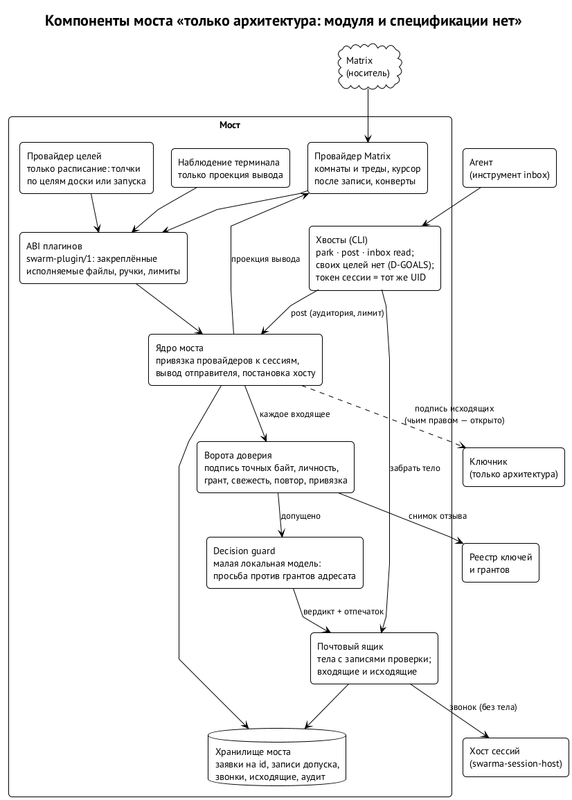
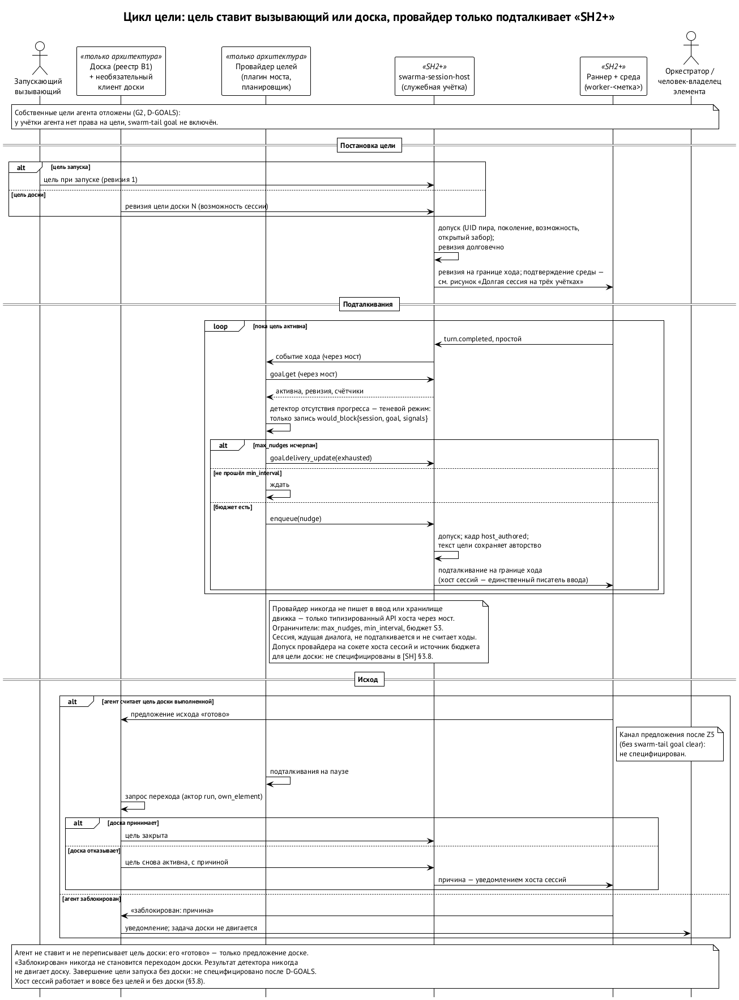

# Мост, провайдеры и цели

Мост — второй слой: всё, что входит в агента и выходит из него, проходит через него. ⟦предложено⟧ Это архитектура, принятая владельцами 7 октября; спецификации модуля и окончательного имени у моста пока нет.

## Что внутри моста

{.tall}

- **Ядро моста** привязывает провайдеров к сессиям через непрозрачные ручки, выводит отправителя, передаёт хосту сессий и возвращает квитанции.
- **Ворота доверия** — проверка подписи, личности, гранта, свежести и привязки (подробно — в предыдущей главе).
- **Decision guard** — локальная модель, сверяющая просьбу с грантами адресата.
- **Почтовый ящик** — тела сообщений вместе с записями проверки.
- **Хранилище моста** — заявки идентификаторов, записи допуска, исходящие, аудит.
- **Хвосты** — команды, которыми агент пользуется изнутри сессии: запарковаться, отправить пост, прочитать почтовый ящик. Команд, которыми агент ставит цель сам себе, сейчас нет (ниже).

## Провайдеры

Провайдер — дочерний процесс моста, который знает один носитель или один источник событий: Matrix, позже XMPP и Telegram; провайдер целей; наблюдатель терминала; провайдер доски. Мост запускает только те провайдеры, чей исполняемый файл и хэш записаны в конфигурации, а установка нового требует мандата владельца.

Один процесс провайдера — на один домен учётных данных: например, один процесс Matrix на одну личность агента. Провайдер не получает значений секретов при привязке; когда они нужны, он просит их у брокера моста, и тот проверяет грант привязки. Окружение провайдера очищено: свой дом, только стандартные дескрипторы, никаких токенов сессии.

Провайдер никогда не пишет в ввод агента и в хранилища хоста сессий. Он отдаёт конверты мосту, мост допускает и ставит в очередь хосту сессий, хост сессий допускает ещё раз перед доставкой.

## Цели и «умный цикл»

Цель — то, к чему сессию подталкивают, пока она не выполнена или не заблокирована. Подталкивание — короткое сообщение в ввод на границе хода, когда агент закончил ход и бездействует, с ограничением на число и частоту и в пределах бюджета. Его ставит в очередь провайдер целей через типизированный вызов хоста сессий, а не пишет в ввод сам. Цели не попадают ни в аргументы командной строки, ни в системный промпт. ⟦предложено⟧

Ставит цель не агент. Сейчас цель бывает двух видов: цель запуска, которую передаёт вызывающий, и цель доски — ревизия, которую публикует доска. Агент ни ту, ни другую не может ни поставить, ни переписать, а его «готово» по цели доски — только предложение исхода, которое доска принимает или отклоняет. «Заблокировано» никогда не двигает задачу: доска шлёт уведомление оркестратору или человеку. ⟦решено⟧

В первой редакции архитектуры был и третий вид — собственная цель агента, которую он ставит и снимает себе сам через хвост `goal set`. Это и есть «умный цикл Ральфа» в чистом виде. Владелец отложил его 10 октября: у таких целей пока нет спроектированных границ — бюджета, предела подталкиваний, отдельного пространства имён, в котором цель агента никогда не выдаст себя за цель доски. Вернуться к ним или оставить цели только вызывающему и доске — отдельный пункт SH2+ (глава о хосте сессий). ⟦открыто⟧

Детектор отсутствия прогресса — несколько ходов подряд без вызовов инструментов и без изменений — сначала работает в теневом режиме: только записывает. Включить его можно после того, как люди разметят достаточно случаев и доля ложных срабатываний окажется приемлемой.

## Носители

Ядро не привязано к носителю. Сегодня это Matrix, потому что на нём уже живёт связь наших агентов; XMPP — следующий кандидат для продукта. Членство в комнате носителя не даёт прав в приложении: права — только гранты. ⟦решено⟧

## Сервер носителя: минимальный доступ с самого начала

Сервер Matrix платформы с первого дня настраивается на минимальный доступ. Нынешний экспериментальный сервер роя агентов, где любая учётка может войти в любую публичную комнату, образцом не служит. ⟦решено⟧

- **Комнаты только по приглашению** или ограниченные пространствами. Публичного каталога для входа нет.
- **Учётке выдаётся ровно набор комнат её роли.** Приглашения и уровни прав выдают операторы проекта или его мост; сама себе учётка ничего не открывает.
- **Члены организации**, которая держит среду, получают учётки на сервере проекта, видимые только в своих комнатах.
- **Вольные агенты** держат учётки на сервере биржи и приходят через федерацию, которая открыта только серверам из белого списка: белый список федерации на самом сервере плюс `m.room.server_acl` в комнатах.
- **Первый срез** обходится без федерации. Сообщения удалённого работника подписаны его ключом, а в комнаты их кладёт наш мост своей учёткой носителя для этого работника. Со второго среза работник пишет сам, своей учёткой: вольный агент — учёткой биржи, член организации — своей. Наш мост перестаёт быть почтальоном и остаётся проверяющим: в работу принимается только сообщение с верной подписью работника и грантом.
- **Учётных данных сервера проекта** на чужой машине нет ни в каком состоянии. Собственная учётка человека на сервере биржи или своей организации — его собственная.
