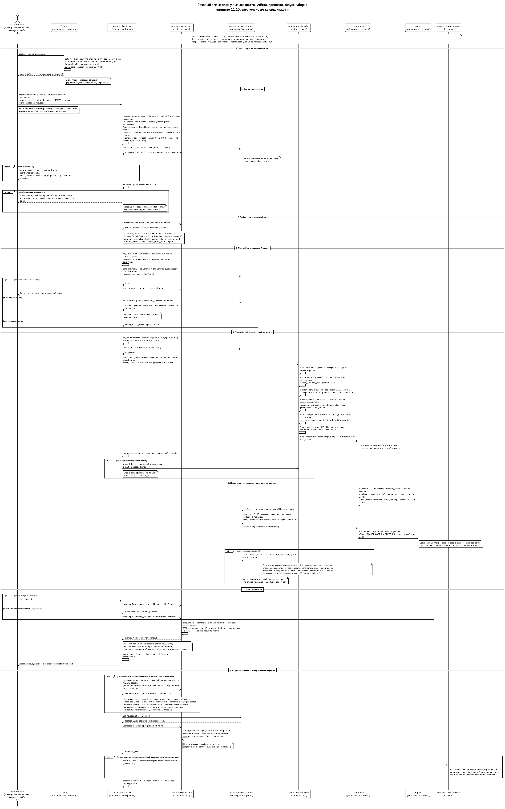

# Запуск: Curator, лаунчер, диспетчер

> Редакция: v0.12 (2026-10-13). Развёрнутый сетевой раздел перенесён в главу 4. ⟦спецификация⟧

Чтобы агент заработал, нужно ответить на несколько вопросов: какая роль, какая модель, какие инструкции и скиллы, какая сеть, на какой машине, от какого пользователя, и есть ли сейчас на этой машине место. Каждый вопрос решает свой модуль.

## Кто за что отвечает

| Вопрос | Модуль |
| --- | --- |
| какую роль запустить | ядро плейбуков или сам оркестратор |
| какая модель и усилие, какие квоты у провайдеров | роутер моделей |
| какой профиль, дом, инструкции, скиллы, MCP, сеть | Curator: единственный сборщик плана |
| есть ли место на этой машине; кто запустил; что с запуском сейчас | диспетчер запусков `swarma-dispatcher` |
| завести учётку агента и запустить программу под ней | `swarma-user-manager` и `swarma-user-launcher` (root, через `sudo`) |
| исполнить разовую работу под учёткой агента | лаунчер Curator `curator-run` |
| держать долгую сессию | хост сессий `swarma-session-host` и раннер `swarma-session-runner` |
| принять результат и отправить на ревью | ядро плейбуков |

Сегодня всё это делает одна команда доски, и поэтому заменить или вынести что-то одно невозможно. В новой архитектуре это шесть разных ответственностей. ⟦решено⟧

## Curator и план запуска

Curator собирает план: разрешает профиль роли, готовит управляемый дом с нужными скиллами и инструкциями, подключает MCP-серверы, выбирает сетевой профиль и режим учётных данных. Результат — один план с пином профиля — хэшем, по которому видно, что собрано ровно то, что заявлено. ⟦работает сегодня⟧

Лаунчер Curator — это `curator-run` из репозитория `curator-agent-launcher`. Его не нужно путать с `swarma-user-launcher`: тот работает от root и только запускает одобренную программу под учёткой агента, а `curator-run` работает с планом. У `curator-run` два разных режима, и граница между ними — главное в этой главе.

- **Вход человека.** `curator run` под учёткой человека разрешает профиль, собирает план и запускает среду — напрямую или отдавая её демону сессий. Так работает сегодня. ⟦работает сегодня⟧
- **Разовый режим под учёткой агента.** Под учёткой `worker-<метка>` `curator-run` ничего не собирает и не разрешает профилей. Он только проверяет готовый план, который вызывающий собрал на своей стороне, и исполняет его: готовит рабочий каталог, берёт у брокера учётные данные и запускает среду. В сеть он ходит только к брокеру. Вход у этого режима отдельный, вида `curator-run exec --plan-fd N`. Режим принят поправкой к решению 0021 и включится только после проверки. ⟦решено⟧

Почему так: учётка агента — граница, и всё, что под ней работает, может оказаться в руках инъекции. Сборка плана читает профили, фрагменты и настройки машины; если бы она шла под учёткой агента, агент мог бы на неё влиять. Поэтому план собирается там, где сидит тот, кто отвечает за запуск, а под учёткой агента остаётся только проверка и исполнение. Раннер долгой сессии `swarma-session-runner` пользуется той же библиотекой запуска, так что проверка плана у них одна.

| Путь запуска | Кто собирает план | Кто исполняет | Под какой учёткой | Где сейчас |
| --- | --- | --- | --- | --- |
| человек запускает сам | `curator run` | `curator run` или демон сессий | человека | ⟦работает сегодня⟧ |
| доска спавнит ребёнка | доска через Curator | раннер спавнов доски | оператора | ⟦работает сегодня⟧ |
| разовая работа агента | вызывающий, через Curator | `curator-run exec` | `worker-<метка>` | ⟦решено⟧, выключено до проверки |
| долгая сессия агента | вызывающий, через Curator | `swarma-session-runner` | `worker-<метка>` | ⟦спецификация⟧, SH2+ |
| удалённый работник | машина донора | харнес донора в запертом режиме | донора | ⟦предложено⟧, глава 12 |

## Слой проекта

Сегодня дом и контекст запуска зависят только от профиля: `dev` в одном репозитории и `dev` в другом получают одно и то же. При этом среды сами читают файлы проекта — `CLAUDE.md`, `.mcp.json`, `.claude/settings.json`, хуки, — и незнакомый репозиторий может подсунуть свой MCP-сервер, хук или разрешения. Curator переворачивает это (предложение CIP-0002): **всё, что в проекте настраивает агента, агент получает только после нашей проверки и одобрения**, в виде защищённых копий. Код проекта агент по-прежнему читает и правит — это его работа, — но код остаётся данными: что бы в нём ни было написано, без одобрения это не становится инструкцией, инструментом или разрешением. ⟦решено⟧

Как это выглядит (имена команд предварительные):

```
curator project register ~/Developer/acme-app      # проект acme; имя по умолчанию — из папки
curator context inspect                            # что нашлось: CLAUDE.md, правила, .mcp.json, навыки
curator context preview                            # что добавится поверх профиля, по пунктам, с хэшами
curator context approve <пункты>                   # одобрить по одному
curator project set acme --profile dev             # композит по умолчанию: dev + слой acme
curator run acme                                   # из любой папки
curator run review --project acme                  # разово с другим профилем
```

- **Слой проекта** — одобренные пункты проекта: правила, знания, MCP-серверы, разрешения, навыки, команды, нативные файлы сред. Skillfile остаётся в проекте как объявление навыков; слой закрывает то, чего Skillfile пока не умеет.
- **Композит** — запись менеджера «профиль, его лок, одобренный слой и их хэши». Профиль при этом не меняется. Сегодня у Curator есть только оверлеи — пакеты, добавленные к профилю на всей машине; композит «профиль + проект» новый.
- **Несколько профилей:** на выбор (`--profiles dev,review,release --default dev`, запуск `curator run acme --as review`) или стопкой, как оверлеи (`--stack dev,security`). Версии навыков в стопке решаются вместе по semver: берётся общая подходящая версия, отказ — только если её нет (`context_range_conflict`), а не две копии.
- **Оператор и агент.** `inspect`, `preview` и `approve` работают для обоих. Агент может осматривать и предлагать, одобрять — только в пределах выданного ему гранта (например, без новых разрешений и сетевых MCP); всё выше — только оператор. Каждое одобрение записывается вместе с тем, кто одобрил.
- **Изменения в проекте** становятся кандидатами: запуск сообщает «проект предлагает изменения» и работает на прежней одобренной версии.
- **Имя, совпадающее и у профиля, и у проекта,** получает отказ, пока его не уточнят `--profile` или `--project`.
- Цена: на macOS каждый новый дом — новый логин Claude. Поэтому реализация идёт после среза 0 брокера: с брокером новые дома логина не требуют.
- Дальше: чем закрыть то, что Skillfile пока не покрывает (правила, знания, особенности сред), и модульные `AGENTS.md`/`CLAUDE.md`, которые лежат главами вне репозитория и склеиваются при запуске. По обоим идут исследования. ⟦предложено⟧

## Инструменты для навыков

Навыку часто нужна обычная программа — например, CLI трекера задач. Сегодня она должна уже стоять на машине, и версии на разных машинах расходятся. Curator ставит её сам, из подписанного реестра (CIP-0007). ⟦решено⟧

- **Навык объявляет только имя и версию**, без ссылок и хэшей:
  ```json
  "dependencies": { "tools": [ { "id": "github.com/cli/cli", "alias": "gh", "version": ">= 2.60, < 3" } ] }
  ```
- **Реестр — отдельный репозиторий** с подписанными записями: на каждую версию и платформу — ссылка на официальный релиз, SHA-256 и путь к файлу внутри архива. Реестров может быть несколько на равных правах: наш, другой компании, внутреннего контура. Порядок задаётся в конфиге, и отзыв сборки в любом подключённом реестре её блокирует.
- **Ключей в бинаре нет.** Доверенные реестры и их ключи лежат в конфигурации контура — в системном слое, который правит администратор или MDM. С релизом приходит набор по умолчанию отдельным файлом, и контур подменяет его своим. Подписывает реестр отдельный набор ключей, не личный ключ человека; ключи меняются по схеме TUF: новый корень подписан старым, можно требовать подпись «2 из 3».
- **Как навык находит программу.** При запуске Curator кладёт ссылку на закреплённый бинарник в каталог `bin` этого запуска и ставит его первым в PATH сессии:
  ```
  ~/.curator/tools/store/github.com/cli/cli/2.62.0/darwin-arm64/gh   закреплённый бинарник, только чтение
  <дом запуска>/.launch/<id>/bin/gh   →  ссылка на него
  PATH запуска = <дом запуска>/.launch/<id>/bin : <допущенный PATH пользователя> : <каталог-диспетчер менеджера>
  ```
  Навык и модель вызывают `gh` и получают ровно версию из лока; системный `gh` в этом запуске не используется. Строгая команда навыка с `exec: [gh]` получает PATH только из своего интерпретатора и `gh`. Глобально ничего не ставится. Сегодня Curator этого ещё не умеет: поле `path_prepend` в формате запуска зарезервировано, но не заполняется.

**PATH управляемого запуска** решён владельцем 11 октября. По порядку: ⟦решено⟧

1. защищённый каталог инструментов этого запуска (тот, что выше);
2. допущенный базовый PATH пользователя, в прежнем порядке;
3. один защищённый каталог-диспетчер менеджера, через который команды проекта запускаются только после проверок.

Каталог `.agents/bin` из репозитория в управляемом запуске не исполняется никогда: иначе любой репозиторий мог бы подложить свою программу под знакомым именем. Итоговый PATH записывается в план и покрыт его дайджестом, поэтому исполнитель под учёткой агента его проверяет, а не собирает заново. Хук оболочки из CIP-0004, который дописывает каталоги в конец PATH интерактивного терминала, — другая область: он не меняет PATH управляемого запуска.

## Транзакция запуска

Разовый запуск агента идёт шагами, и у каждого шага свой идентификатор эффекта, поэтому после сбоя он повторяется, а не выполняется второй раз:

1. **План.** Вызывающий собирает план через Curator на своей стороне: профиль с пином, дайджест, PATH.
2. **Заявка.** Диспетчер проверяет подпись заявки и цепочку гранта вызывающего, спрашивает у брокера свежий вердикт об отзыве этой цепочки (`revocation.check`), затем квоту и ёмкость машины. Квота — постоянный отказ. Нет места сейчас — тоже отказ; очередь появится позже на том же сокете. Здесь же диспетчер по политике машины находит сетевой профиль для профиля Curator ребёнка и фиксирует его ссылку и дайджест в записи заявки; повторы и восстановление применяют ту же пару (находка F-27).
3. **Учётка.** Менеджер пользователей заводит `worker-<метка>` с новым поколением.
4. **Привязка.** Брокер привязывает поколение к аккаунту подписки: лист гранта `agent:<поколение>` и цепочка вызывающего как зависимость.
5. **Запуск.** Перед стартом диспетчер ещё раз спрашивает вердикт об отзыве. Запускатель вычищает унаследованные дескрипторы, под замком поколения проверяет поколение и одобренный исполнитель, целиком готовит план на дескрипторе 3, пишет квитанцию старта от root, сбрасывает права и запускает `curator-run`.
6. **Исполнение.** `curator-run` проверяет план, сам открывает соединение с брокером, берёт аренду и запускает среду; токен — только в окружении её процесса.
7. **Уборка.** После выхода и подтверждённого отсутствия процессов во всей учётке диспетчер освобождает ёмкость исполнения. Если у запуска была рабочая копия, сначала идёт обязательная выгрузка: фиксированная программа под учёткой работника (глава об удалённом рабочем месте). Пока полный результат не сохранён или оператор отдельным действием не снял обязательство, дом не удаляется: отказ, сбой, частичный или неизвестный исход выгрузки удерживают учётку. Потом диспетчер снимает привязку и выводит учётку: ключи уничтожаются, дом удаляется, остаются только служебные метаданные. Личность разового воркера он отзывает отдельным шагом, если сам зарегистрировал её как разовую. Разовые запуски без рабочей копии и компенсации до начала работы идут как раньше.

{.tall}

Сбои у каждого шага свои. Если привязка не удалась после создания учётки, учётка выводится. Если ответ о запуске потерялся, диспетчер сверяется по тому же идентификатору эффекта и квитанции старта, но второй раз не запускает. Чем кончился шаг у менеджера пользователей или у брокера, он узнаёт операцией `effect.observe` (глава о пользователе на агента). Если отозван грант вызывающего, следующая заявка получает отказ ещё у диспетчера, а аренда или продление — у брокера. Отменённое исполнение останавливается через `exec.stop`, и уборка начинается только после подтверждённого отсутствия процессов. ⟦спецификация⟧

Чтобы «повторить» не значило «сделать ещё раз», у каждого получателя есть **таблица исходов** на каждую свою операцию: у менеджера пользователей — создать, запустить, остановить, вывести; у брокера — привязать и отвязать. Она раскладывает исходы на те же шесть состояний наблюдения, без седьмого. Главное различие — между отказом до приёма и начатой, но не законченной работой. Остановка, у которой процессы ещё остались, не превращается в окончательную неудачу: она продолжается под тем же идентификатором эффекта с теми же аргументами. А то, что создаёт права, — создать учётку, привязать — после отказа повторяется только со свежими проверками, и если права за это время отозваны, повтор получит отказ (находка F-22). ⟦спецификация⟧

Долгая сессия устроена так же до шага 5, только запускается не `curator-run`, а раннер сессии, и дальше её ведёт хост сессий (глава о хосте сессий).

Ворота ёмкости машины: свободное место на диске, простой процессора, замок сборки на общей машине, класс работ, создающих исполняемые файлы (на машинах с известной ошибкой системного проверяльщика они запрещены), слоты провайдеров.

## Диспетчер запусков

Диспетчер — необязательный модуль. Если его нет, оркестратор запускает через `curator run` напрямую, без учёта. Если он установлен, через него запускают все: ядро плейбуков, оркестраторы без доски, обычные сессии. ⟦решено⟧

Он ведёт учёт запусков — идентификатор, статус, ожидание, отмена, сверка после падения — и знает локальную ёмкость машины: слоты, диск, процессор. Роутер отвечает «какой моделью», диспетчер — «есть ли здесь место прямо сейчас». Он же проверяет грант на спавн роли и правило ослабления: ребёнок не получит прав шире, чем может делегировать проситель.

Второй долг диспетчера — пользователи ОС. Для нового агента он через `swarma-user-manager` заводит учётку `worker-<метка>`, подписывает ей грант `agent:<поколение>` и привязывает её у брокера, а запускает программу под ней через `swarma-user-launcher`. При выводе агента — снимает привязку, останавливает исполнения через `exec.stop` с подтверждённым отсутствием процессов и выводит учётку — менеджер удаляет её дом.

## Диспетчер изнутри: `swarma-dispatcher`

Диспетчер — отдельный модуль со своей учёткой `swarma-dispatcher`. ⟦решено⟧ С первого же среза это служба на Unix-сокете `/opt/swarma/run/dispatcher/` с протоколом `dispatch/1`, устроенная как брокер: та же проверка соединений и то же кадрирование. Промежуточной «команды через `sudo`» с правилом `sudoers` для вызывающих, веткой `SUDO_UID`, внешним таймером уборки и последующим переездом на демон нет — так решил владелец 12.10 (находка F-5). Служба сначала восстанавливается после сбоя и только потом объявляет готовность и принимает заявки; если её нет или она не готова, заявка получает отказ, обходного пути нет. Очередь, события, долгое ожидание и интеграции придут позже на том же сокете, за флагами возможностей. ⟦решено⟧

- **Кто просит.** Каждый вызывающий — человек или оркестратор — сопоставлен с ключом, и запросы подписаны этим ключом. Права агента — пересечение запроса, гранта вызывающего и гранта диспетчера (глава о грантах).
- **Вердикт об отзыве.** Хранилище отзывов одно — у брокера. Перед созданием учётки, при выходе из будущей очереди и перед каждым стартом диспетчер спрашивает брокер `revocation.check` по точной цепочке, которую проверяет. Ответ — «не отозвано», «отозвано» или «недоступно» вместе с номером состояния отзывов брокера. На «отозвано» и «недоступно» диспетчер отказывает. Вердикт — снимок на момент проверки, а не грант и не разрешение на будущий старт; окончательные проверки привязки, аренды и продления остаются за брокером (находка F-8). ⟦спецификация⟧
- **Записи.** Неизменяемый вход `input/1`; выделение `agent/1` — учётка агента с её сроком; исполнение `run/1` — один запуск программы под этой учёткой, со своей заявкой на ёмкость и квитанцией старта. Выделение и исполнение — разные вещи: одна учётка может пережить несколько исполнений.
- **Эффекты без двойного выполнения.** У каждого внешнего шага — создать учётку, привязать у брокера, переподписать привязку (E-rebind), запустить, остановить, отвязать, вывести — свой идентификатор эффекта из хэша запроса и шага. Сбой посередине чинится повтором тех же шагов, а не вторым запуском. На каждый эффект диспетчер знает четыре исхода наблюдения: сделано, не сделано, неизвестно, противоречие.
- **Сверка.** Раз в минуту служба сама делает внутреннюю уборку: сверяет записи с реальностью — живые процессы, квитанции запускателя, журнал менеджера, привязки брокера — и следит за сроками. Исход шага у менеджера и брокера она спрашивает операцией `effect.observe`: «записан» даёт «сделано» или «не сделано» по текущему состоянию; «откачен» и «не записывался» — «не сделано» только для этого эффекта и не разрешают создать заново сами по себе; «ещё идёт» и «свидетельства нет» — «неизвестно»; противоречие остаётся противоречием (находка F-10). Отсутствие исполнения подтверждается, а не предполагается: «неизвестно» никогда не превращается в «нет». ⟦спецификация⟧
- **Замок не держится во время звонка.** Пока диспетчер ждёт менеджера пользователей или брокер, свой замок состояния он не держит: запись помечается «в полёте», замок отпускается, а после ответа поколение, заборы и версии проверяются заново. Поздний ответ не может снова открыть отменённый старт. Граф ожиданий опубликован и обязан быть без циклов (находка F-28). Каждая запись надзирателя сверяется с эпохой экземпляра демона, поэтому писатель, переживший замену демона, ничего не испортит (F-18). ⟦спецификация⟧
- **Потеря состояния.** Если записи диспетчера потеряны или восстановлены из копии, он не доверяет себе: закрывает новые запуски по всему узлу, составляет обратную опись — какие учётки, привязки и квитанции существуют на самом деле — и не принимает журнал менеджера с эпохой ниже уже виденной. Сирот по имени или UID он не подхватывает и не удаляет; открыть узел может только подписанное решение оператора после внешней сверки (находка F-17). ⟦спецификация⟧
- **Время.** Сроки учёток и грантов диспетчер проверяет по водяному знаку времени, а вывод учётки по сроку требует ещё и настоящего прошедшего времени по монотонным часам (находка F-21). ⟦решено⟧
- **Сеть самого диспетчера закрыта.** Учётка `swarma-dispatcher` не может ходить никуда, включая loopback, — ей хватает Unix-сокетов (находка F-24). ⟦спецификация⟧
- **Ёмкость и ворота.** Слоты, свободный диск, простой процессора, флаг паузы, замок сборки, состояние системного проверяльщика исполняемых файлов. Нет места — отказ; очередь придёт позже. Если чтение состояния паузы не удалось, это считается паузой.
- **Квоты по умолчанию** (меняются в конфиге): ⟦решено⟧

  | Ограничение | На вызывающего | На машину |
  | --- | ---: | ---: |
  | одновременных исполнений | 2 | 6 |
  | живых учёток агентов | 4 | 16 |
  | срок учётки | 24 часа по умолчанию, максимум 7 дней | — |
  | одно исполнение | 4 часа по умолчанию, максимум 12 | — |

  Сверх лимита — постоянный отказ `quota_exceeded`, а не очередь. Два исполнения на вызывающего совпадают с нынешним правилом машины: не больше двух ранов на оркестратора.

  **Постоянных участников это не касается.** У учёток оркестратора и постоянной команды нет срока, у их исполнений нет предела времени, и уборка диспетчера никогда не выводит и не останавливает их по сроку. Их останавливает только явная команда или оператор. ⟦решено⟧ Поднимает постоянную команду только оператор, подписанным описанием (`swarma-dispatcher team/1`, глава о пользователе на агента). ⟦спецификация⟧
- **Обслуживание.** Чтобы обновить диспетчер на машине, где идут постоянные исполнения без срока, у оператора есть ограниченная по времени попытка обслуживания: закрыть приём новых заявок, составить список идущих исполнений, по явному решению оператора — подписанному с телефона или подтверждённому паролем в терминале (F-23) — остановить выбранные через `exec.stop`, дождаться подтверждённого отсутствия процессов и сверки — и только потом менять режим, переносить состояние или подменять бинарь. Срок ограничивает саму попытку, а не жизнь постоянной сессии. Если остановка отказала или её исход неизвестен, обслуживание откладывается. Постоянные выделения и личности сохраняются, перезапуск — только с новыми правами; ни живого подхвата, ни автоматического истечения нет (находка F-2). ⟦спецификация⟧
- **Только фоновые запуски.** Диспетчер запускает агента без терминала: план → работа → выход. Интерактивные сессии под учётками агентов — с терминалом, к которому можно подключаться, — придут вместе с хостом сессий (SH2+), а не во второй реализации внутри диспетчера. До тех пор твои интерактивные сессии работают как сейчас, под твоей учёткой, а цели спавненным агентам по-прежнему идут через доску. ⟦решено⟧
- **Клиент со стороны Curator** — команды `curator agent-user`: `create` заводит агента, `run` запускает план под ним, `run --dispatch` заводит, запускает и убирает, `retire` выводит. Curator собирает план, диспетчер видит его только как байты с хэшем.
- **Оркестратор под учёткой агента.** Оркестратор с правом вызывать диспетчер сам живёт под учёткой агента. Права вызывающего для нового оркестратора подписывает тот, кто его запросил, — сужая свой собственный грант, — после того как ключ нового оркестратора зарегистрирован в его поколении. Диспетчер такую делегацию проверяет и записывает, но сам её не подписывает. Поэтому у каждого потомка в цепочке есть запросивший, и отзыв его гранта доходит до всех агентов, которых этот оркестратор запустил (находка F-3). Регистрация ключа ещё не даёт права на спавн. Пока такая загрузка не опубликована и не проверена, рекурсивный спавн оркестраторов закрыт; первыми идут прямые запуски воркеров и оркестраторы, которых завёл оператор. ⟦спецификация⟧ Планы для своих детей он собирает на своей стороне — своим Curator и своей конфигурацией в своём доме; `curator-run` ребёнка план только проверяет. Какие профили и среды оркестратор может отдавать детям и как это сужает его грант, пока не описано. ⟦открыто⟧

**Как оркестратор спавнит агента в новой схеме.** Диспетчер заводит учётку со своим домом и грантом, брокер привязывает к ней доступ к подписке. Разовую работу диспетчер запускает через запускатель как `curator-run` под этой учёткой и после завершения учётку убирает. Долгую сессию с целями держит хост сессий: раннер под учёткой агента, цели — через хост сессий. Для оркестратора команды остаются прежними.

## Сетевые профили

Сегодня сетевые профили кооперативные: адаптер проверенной сборки среды идёт через прокси по настройке запуска. ⟦работает сегодня⟧ На хосте платформы профиль выбирает машина, а принуждение приходит с файрволом менеджера пользователей v1; модель и её пределы — в главе 4 «Сеть агента». ⟦спецификация⟧

## Роутер моделей

Роутер выбирает модель и усилие по классу задачи и сложности, учитывая квоты подписок. Это не прокси перед API модели, а отдельный проверяемый шаг подготовки запуска, который записывает решение и причину. Он задаёт четыре вопроса, и у каждого свой владелец: разрешено ли (политика владельца и проекта), совместимо ли (реестр и каталог моделей), подходит ли под работу (вопрос самого роутера, по бенчмаркам и нашим результатам), доступно ли сейчас (лимиты, движки, логин). Сам выбор — чистая функция без сети, файлов, часов и вызовов модели, поэтому любое решение воспроизводится повтором; а оценщика задают явно, так что роутер никогда не выбирает модель, которая выбирает модель для роутера. Модуль почти готов. ⟦работает сегодня⟧

## Удалённый запуск

Архитектура предусматривает и запуск на другой нашей машине: запрос с профилем и пином уходит на целевую машину, та собирает план сама и отказывает, если пин не совпал; между машинами всегда пересборка, а не нативное возобновление. ⟦предложено⟧ Спецификации у этого пути пока нет. Удалённый работник на чужой машине устроен иначе: модель думает у донора, а к нам приходят только вызовы инструментов (глава об удалённом рабочем месте).
