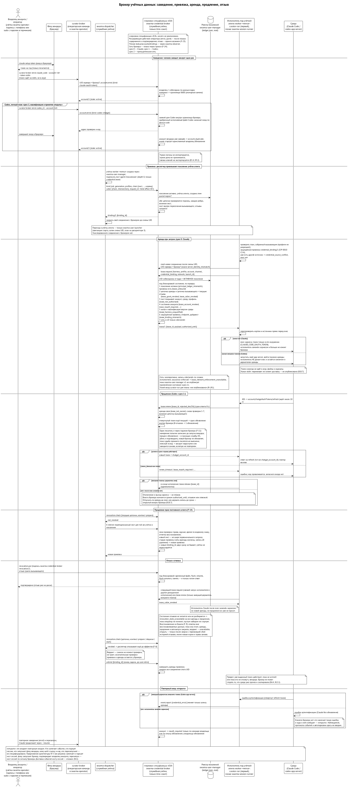

# Учётные данные провайдеров моделей

> Редакция: v0.12 (2026-10-13). Сетевые гарантии и профиль брокера собраны в главе 4. ⟦спецификация⟧

Агентская среда должна войти к провайдеру модели — по подписке или по ключу API. Это самое неудобное место всей системы, потому что правила здесь задают не мы.

## Как устроены логины

Ни один провайдер не выдаёт короткоживущих учётных данных подписки. Обычный вход в подписку — это семейство одноразово обновляемых токенов: при обновлении старый токен перестаёт действовать. Исключение — годовой токен Claude (ниже): он не обновляется вовсе. Если скопировать такой логин нескольким средам, первое же параллельное обновление в одной копии отзовёт остальные. Условия провайдеров к тому же привязывают подписку к одному человеку и обычному индивидуальному использованию. ⟦работает сегодня⟧

По средам картина такая:

- **Claude Code.** `claude setup-token` выпускает годовой токен подписки; его передают через переменную окружения `CLAUDE_CODE_OAUTH_TOKEN`. Он не обновляется на месте и не укорачивается; отозвать его можно только в настройках аккаунта. Команда-помощник `apiKeyHelper` годится только для ключей API, не для подписки. На macOS обычный вход привязан к каталогу конфигурации через Keychain.
- **Codex.** Файл `auth.json` переписывается на месте при обновлении. Провайдер рекомендует одну копию на машину; для бизнес-аккаунтов есть токены доступа с отзывом администратором. Ключ API — самый простой путь. Измерено на нашем мини: несколько серверов Codex, читающих один файл, гонятся при обновлении — без общего замка восемь вызывающих делают восемь обновлений, с замком одно.
- **Muse.** Переменная `META_API_KEY` всегда побеждает вход в аккаунт; есть резервный файл входа.

## Как сегодня

Сегодня Curator не использует годовой токен Claude: на macOS у каждого управляемого дома свой вход через Keychain, общий вход запрещён; файл Codex подключается ссылкой и обновляется на месте. Предложение Curator о режимах учётных данных — черновик. ⟦работает сегодня⟧

## Что выбрано

Позиция владельцев: пока всё на подписках, но архитектурно закладываемся на токены; один человек — одна подписка, и она подставляется только в запуски этого человека. ⟦решено⟧

Ранний план — дать Codex общий файл входа по ссылке, читаемый агентами, — отменён: его заменили единственный владелец обновления внутри брокера и внешние токены (ниже). Сводка того, что выбрано, по провайдерам:

| Провайдер и вход | Откуда берётся | Как доходит до среды | Кто обновляет | Когда |
| --- | --- | --- | --- | --- |
| любой, по умолчанию | свой вход управляемого дома (`per-home`) | нативно, как сегодня | сама среда | ⟦работает сегодня⟧ |
| Claude, подписка | годовой токен `setup-token`, заведённый у брокера | переменная `CLAUDE_CODE_OAUTH_TOKEN` при запуске среды; файла входа в доме нет | никто: токен не обновляется; по истечении — новый токен и перезапуск | брокер, срез 0 ⟦спецификация⟧ |
| Codex, личный план | вход вендора, который брокер сам заводит в свой свежий дом | внешний токен доступа в app-server своей сессии; `auth.json` в доме запуска нет, `codex exec` не обслуживается | единственный владелец обновления внутри брокера | брокер, срез 1 ⟦спецификация⟧; квалификация версии — ⟦открыто⟧ |
| Codex Business и Enterprise | токен доступа | переменная `CODEX_ACCESS_TOKEN` | администратор аккаунта | не в первом выпуске |
| ключи API (Claude, Muse, Gemini, Qwen) | ключ, заведённый явно | переменная среды или stdin, где среда умеет | владелец ключа | ⟦спецификация⟧ |
| Muse, подписка | вход по коду устройства выпускает ключ API | единственный владелец выпуска сдаёт в аренду выпущенный ключ (`META_API_KEY` или stdin), не токены OAuth; запасной вариант (в) — если такой ключ не оплачивается подпиской или повторный выпуск его отзывает | владелец выпуска | приоритет ⟦решено⟧ 13.10; канал ⟦предложено⟧; квалификация ⟦открыто⟧ |

Честная оговорка: агенты в этой схеме держат учётные данные — токен в окружении процесса среда прочитать может. Брокер решает, кому, на какой запуск и на какой срок токен выдан, и может перестать выдавать его, но не делает его невидимым для среды. «Неизвлекаемость» — отдельный дизайн на потом. ⟦решено⟧

## Дизайн Curator: узлы и наследуемые входы

Curator разобрал эту часть в предложении CIP-0010 (вторая редакция после ревью, 8 октября). Главное в нём — четыре вещи. ⟦предложено⟧

**Узел аутентификации.** У пользователя ОС заводится запись `auth/<метка>/` на одну среду и один аккаунт. В ней только ссылки и метаданные: тип, ссылка на защищённое хранилище, когда заведён, когда выдан (если это сообщили), когда истекает или «неизвестно», последний отказ. Сам материал лежит в защищённом хранилище пользователя — в связке ключей у человека, в файле с правами 0600 у служебной личности. Корневой узел называется `root`. Узел другого пользователя ОС недоступен по построению; переход между пользователями — работа брокера.

**Дома, наследующие вход.** Отдельная настройка `credential_source` говорит, откуда управляемый дом берёт учётные данные: свой вход (`per-home`, по умолчанию), узел (`node:<метка>`) или команда-помощник. Дом с источником-узлом своего входа не держит, и исполнитель подставляет его по таблице: Claude — годовой токен в окружении; Codex личного плана — внешний токен доступа от **единственного владельца аутентификации**, который один держит замок на нативном `auth.json` и один его обновляет; Codex Business — токен доступа; Muse — ключ. Нет узла, нечитаемое хранилище или два источника сразу — отказ без запасного пути. Это и есть ответ на вопрос о «голых» домах.

**Ворота для отслеживаемых запусков.** План несёт обязательное расширение «нужны учётные данные». Принять такой план может только исполнитель, объявивший способность их подставлять. Первым таким исполнителем выбран `curator-run` под учёткой агента; раннер доски и хост сессий клиента брокера в себя не встраивают, а просят диспетчер (решение 11 октября). Но одной способности мало: при запуске исполнитель заново разрешает **защищённую привязку** из своего доверенного хранилища — личность исполнителя, профиль, среда, метка аккаунта, канал, адрес провайдера, дайджест бинарника, поколение политики. Имена переменных зарезервированы, окружение среды и её MCP-детей разделено: подставленный токен детям не передаётся.

**Честные события.** `credential_expiring`, `credential_expired`, `credential_error` с классом «аутентификация, права, квота или неизвестно» и `reauth_required`. Если срок не сообщили, система пишет «неизвестно» и не шлёт ложных предупреждений; если ошибку 401 нельзя отличить от нехватки прав, класс — «неизвестно». Реакция — запарковать и уведомить, без бесконечных повторов; восстановление после нового входа — своё у каждой среды, и каждое проверяется в лаборатории.

**Первым — срез 0.** Минимальный интерфейс брокера: защищённая привязка по Unix-сокету с проверкой пира, от пользователя оператора к исполнителю под другим пользователем ОС, доказанная целиком — чужой вызывающий, чужой аккаунт, просроченная привязка отказывают — до обобщения узлов и до любого донора. Без этого не разблокирован минимальный продукт: одна подписка, одна машина, цепочка пользователей ОС. ⟦спецификация⟧

**Решения 10 октября.** ⟦решено⟧

- **Запуск без настроенного источника.** В первой версии он, как сегодня, берёт вход своего дома (`per-home`); брокер, узел или помощник используются только по явной строке. Правильное конечное состояние — явная строка для каждой пары «профиль × среда»: вторая версия откажет в запуске без неё, а миграция на вторую версию сама запишет `per-home` для каждого дома, где вход уже есть, так что ничего работающего не сломается.
- **CIP-0003** принят в суженном виде вместе с этим предложением.

Ещё ждут ответа владельца: принять ли единственного владельца обновления Codex для личного плана с проверкой конкретной версии или отложить эту полосу, А по подписке Muse приоритет решён 13 октября, канал (б) с запасным (в) предложен, но двенадцать строк квалификации открыты: триггер обновления, ротация, сроки и биллинг неизвестны, а семи пробам нужен отдельный тестовый аккаунт в своей учётке ОС, который заводит владелец. Полоса ключа API остаётся отдельной. Сами CIP-0010 и CIP-0011 ждут принятия владельцем. ⟦открыто⟧

## Чего мы не делаем

Можно было бы спрятать токен совсем: среда стартует с заглушкой, весь её трафик идёт через наш прокси, прокси расшифровывает TLS и подставляет настоящий заголовок авторизации. Агент тогда никогда не видит токена. Но провайдеры могут распознавать перехваченный трафик и закрывать аккаунты, а потерять личные аккаунты посреди разработки нельзя. Поэтому подстановка на прокси — только исследование, не первая реализация. И мы никогда не проходим аутентификацию провайдера вместо человека: вход всегда завершается через собственный флоу провайдера. ⟦решено⟧

## Брокер учётных данных

В целевой архитектуре учётные данные держит брокер, а не агент: служба `swarma-credential-broker` под своей учёткой, сокет `/opt/swarma/run/credential-broker/`, сеть не слушает. Каждая подписка заводится у него **один раз**, а запуски получают аренды — право на учётные данные на время одного запуска. Сам токен при этом может жить дольше аренды: годовой токен Claude остаётся годовым. ⟦спецификация⟧

{.tall}

- **Как заводится подписка.** Claude: владелец делает `claude setup-token` обычным входом в браузере и передаёт токен брокеру через stdin (`curator broker enrol claude_code --account ivan/claude/personal --token-stdin`). Codex личного плана — «церемонией»: брокер сам, под своей учёткой, создаёт свежий дом Codex и запускает вход вендора по коду устройства; код приходит владельцу в терминал. Если такой аккаунт вендора уже заведён, брокер отказывает. Токены Business и ключи API — тоже через stdin. Подключение подписки — расширяющее действие оператора: оно идёт из учётки `swarma-operator`, подписью с телефона или паролем в терминале, и изнутри сессии агента не принимается (F-23).
- **Кто пришёл, узнаётся от ядра**, а не со слов процесса: UID и поколение учётки. Право решают подписанные гранты (глава о грантах); привязка «эта учётка — этот агент» живёт до конца задачи и хранит разрешение вызывающего, так что отзыв его гранта отрезает агентов сразу.
- **Аренда.** Перед запуском исполнитель под учёткой агента сам собирает защищённую привязку — профиль, среду, аккаунт, канал, адрес вендора, дайджест одобренного бинарника, поколение политики — и просит аренду. Брокер под замком проверяет привязку, цепочку с учётом отзывов, покрытие гранта, состояние аккаунта, квалификацию версии среды, одобренные адреса и бинарники и сеть. Токен уходит только в процесс среды — переменной окружения при запуске, через stdin или внешним токеном Codex — и никогда в argv, файлы или логи. Продлить или закрыть аренду может только её владелец, и при продлении все проверки повторяются.
- **Конец аренды зависит от канала.** В канале `env` (Claude) исполнитель получает токен до `exec`, а после `exec` его заменяет среда, и клиента брокера больше нет. Отключение и выход среды — не освобождение аренды; власть брокера кончается сроком `authorized_until`, отзывом или отвязкой. В канале внешних токенов (Codex) исполнитель не делает `exec`: он запускает свой app-server, остаётся держателем аренды, продлевает её и в конце исполнения сам вызывает `lease.release`. ⟦спецификация⟧ Отпускать ли аренду `env` до `exec` или держать запись до срока, а также точный порядок уборки для остальных каналов — открытый вопрос брокера. ⟦открыто⟧
- **Codex: один владелец обновлений и внешние токены.** Обновляет токен только владелец внутри брокера, под замком, запуская одобренный бинарник Codex. Запуски работают только через `codex app-server` с внешними токенами; на 401 исполнитель просит новый токен (`lease.renew`) и укладывается в дедлайн app-server, иначе ход падает без запасного входа. Восемь запусков с отклонённым токеном дают одно обновление. `codex exec` в режиме брокера не обслуживается. Единственный писатель должен оставаться единственным и тогда, когда брокер падает посреди обновления: сам процесс вендора замок брокера не соблюдает, и новый брокер мог бы запустить второго писателя рядом с живым старым. Поэтому брокер до запуска сохраняет намерение попытки, держит процесс обновления в границах службы ОС с гарантированным убийством и подтверждением и не начинает новое обновление, пока судьба старого писателя не выяснена. Подтверждённая смерть старого процесса ещё не доказывает, что вендор не успел сменить токен; если исход неясен, аккаунт остаётся недоступным или его заводят заново, вслепую обновление не повторяется. Без этого Codex (срез 1) не включается (находка F-11). ⟦спецификация⟧
- **Отзыв записывается на диск до ответа**, и если файл отзывов не читается, брокер не выдаёт ничего. Отзыв останавливает новые аренды и продления, но не стирает токен, который среда уже получила: тот живёт до своего срока или до отзыва у вендора. Восстановление брокера из бэкапа закрыто, пока не сверена подтверждённая история отзывов (глава о грантах), а диспетчер узнаёт об отзыве через узкий вердикт `revocation.check`.
- **Продление без расширения.** У постоянных агентов привязка переживает срок гранта через замену привязки по эффекту E-rebind: старая снимается с записью об удалении и концом её аренд, новая получает свежий никогда не повторявшийся номер, и две сразу не живут. Брокер сам заново проверяет права, журнал, время и отметку восстановления, а новый лист не шире первоначального запроса (находка F-14, глава о грантах). ⟦спецификация⟧
- **Время.** Сроки грантов и привязок брокер проверяет по водяному знаку времени; истёкшая привязка непригодна сразу, а удалить её по сроку можно только после настоящего прошедшего времени по монотонным часам (находка F-21). ⟦решено⟧
- **Сеть и собственный выход брокера.** До менеджера пользователей v1 профиль только заявлен; аренда, требующая принуждения, ждёт опубликованного применённого состояния. Собственный профиль брокера к проверенным адресатам входа и обновления, без прямого обхода прокси, разобран в главе 4 «Сеть агента». ⟦спецификация⟧
- **Соединения не наследуются.** Сокеты открываются с закрытием при exec; диспетчер закрывает свои соединения, прежде чем запускать агента, а программа агента открывает своё новое.

**Curator и брокер (CIP-0011).** В пользовательском конфиге машины появляется источник `broker:<аккаунт>` — например, `credential_source.dev.claude_code = broker:ivan/claude/personal`. План несёт обязательное расширение `works.relux.curator.credential/1` (режим, аккаунт, канал): исполнитель, который его не понимает, отказывает. Принять такой план может только программа со способностью `credential-injection/1`, объявленной для проверенной версии среды. Первым исполнителем выбран лаунчер Curator `curator-run`, запущенный под учёткой агента; раннер доски и хост сессий клиент брокера в себя не встраивают, а просят диспетчер. ⟦решено⟧ Брокером управляют команды `curator broker enrol|accounts|grant|revoke|bindings|status`. Подключение подписки и выдача гранта — действия оператора: из учётки `swarma-operator`, с телефона или паролем в терминале, с подтверждением точного содержимого. Отзыв — тоже оператор, но без дополнительного подтверждения. Чтение `status`, `accounts`, `bindings` — через `swarma-observer`, без подтверждений (CIP-0011 §5, F-23). ⟦решено⟧ А `curator env status` показывает по каждому дому с брокерным источником аккаунт, срок, доступность брокера и последний отказ, без самих токенов. ⟦предложено⟧

**Порядок.** Срез 0 — один защищённый запуск Claude: менеджер пользователей v0 с запускателем, диспетчер сразу службой на сокете, брокер с хранилищем, грантами, отзывами, привязкой и арендой, `curator-run` под учёткой агента, Curator с источником `broker:` и командами, а также учётки `swarma-operator` и `swarma-observer` с путём через телефон и запасным через терминал. Приёмка — только на раннерах GitHub, через настоящий диспетчер и `curator agent-user`. Срез 1 — Codex, срез 2 — принудительная сеть. ⟦спецификация⟧

Кто отвечает за повторный вход, если среда разлогинилась, сегодня не определено, и это пробел. Предложение: замечает и паркует сессию хост; флоу входа провайдера запускает брокер и пересылает ссылку и код владельцу аккаунта на телефон; владелец подтверждает; хост перезапускает сессию по сигналу брокера. ⟦открыто⟧

Удалённые агенты пользуются своими учётными данными: на машине донора узел заводит её владелец под личностью моста при первом развёртывании, а у нас для них ничего не хранится. ⟦предложено⟧
