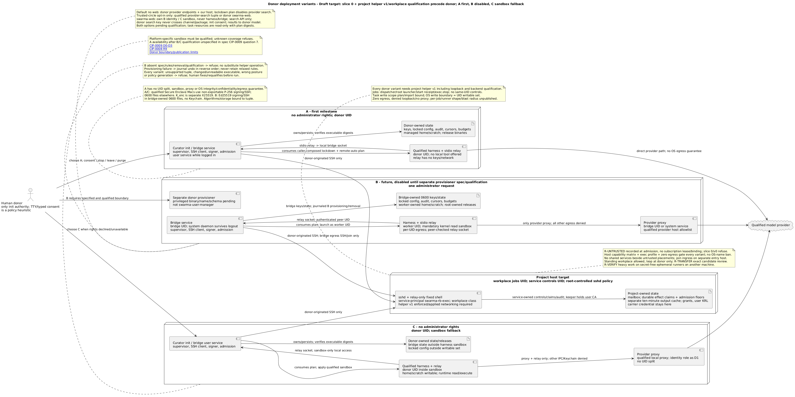
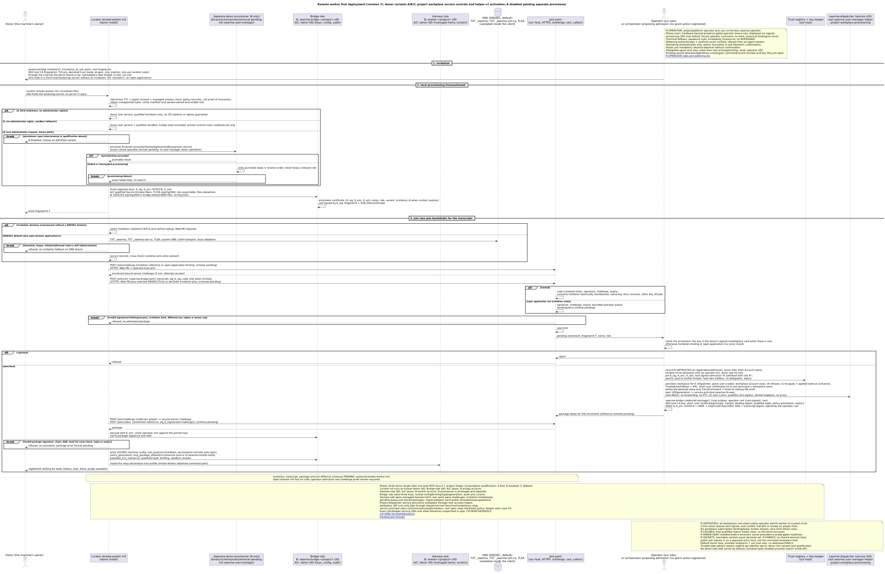
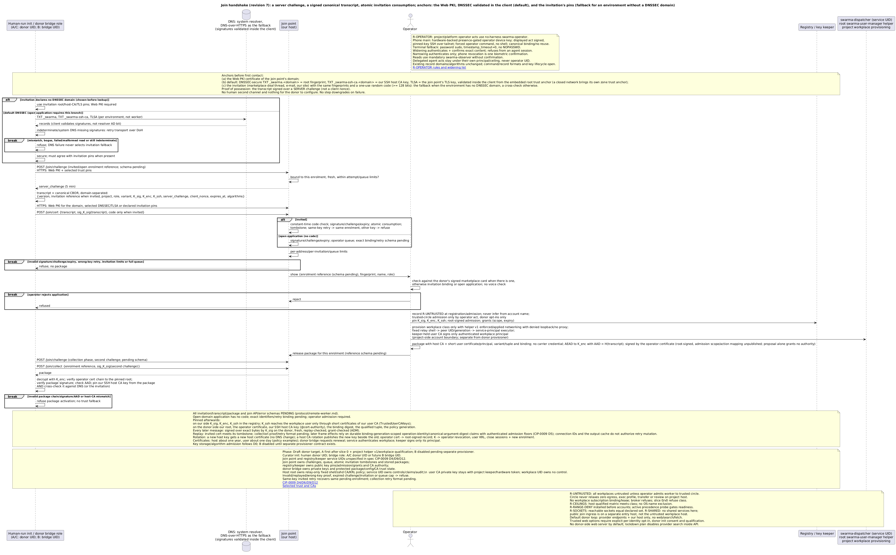
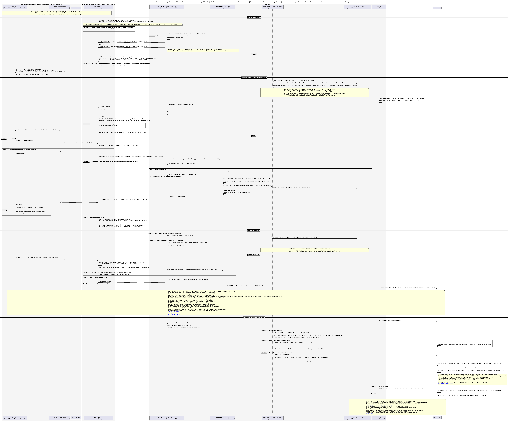
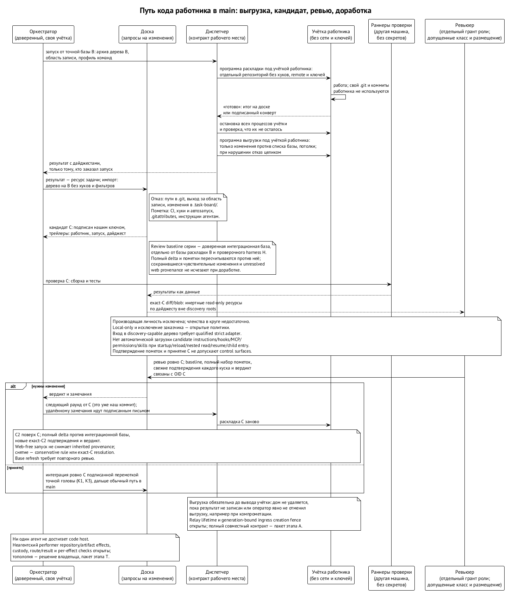
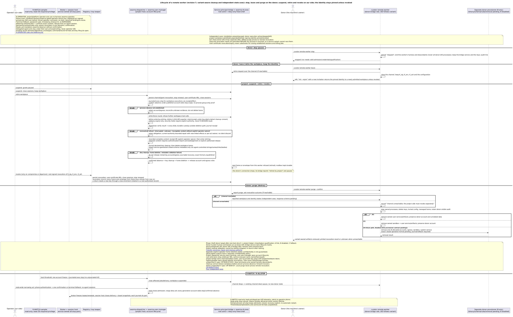

# Удалённое рабочее место

> Редакция: accepted architecture-review findings (2026-10-13). Уточнены допуск ревью, чтение кандидата и обязательства доработки; открытые требования не означают реализацию или квалификацию.

Часть работы удобно отдать агенту, который работает на чужой машине: у кого-то есть свободная подписка, мощная машина или нужные инструменты. Мы называем такого агента удалённым работником, его машину — машиной донора, а владельца — донором. Удалённый работник недоверенный по определению, и защищать нужно обе стороны: нашу машину и машину донора.

С 8 октября подробный дизайн этой главы ведёт Curator: предложения CIP-0008 (запертый режим запуска), CIP-0009 (машина донора и мост) и CIP-0010 (учётные данные), плюс общий документ протокола удалённого работника, где перечислено, какие форматы уже описаны, а какие ещё нет. 10 и 11 октября владелец ответил на открытые вопросы; глава пересказывает CIP-0009 в четвёртой редакции. Все три CIP пока черновики и ждут принятия владельцем, и ни один формат обмена ещё не опубликован как закрытая схема. Что ещё открыто, сказано в конце.

## Идея

Удалённому работнику на **нашей** машине заводится отдельный пользователь ОС — его рабочее место. Всё, что работник исполняет, исполняется внутри этого пользователя: его дом, его файрвол и потолки ресурсов, которые даёт эта машина. Модель при этом думает на машине донора, на его подписке: проект за модель не платит и чужих учётных данных не держит. К нам приходят только вызовы инструментов и почта — по одному SSH-соединению, которое открывает донор. Наша машина соединений к донору не открывает и команд туда не шлёт. ⟦решено⟧

Коротко: **модель думает у донора, руки — у нас.** Донор отдаёт квоту, а не машину.

Это та же граница, что у локальных агентов, — пользователь ОС плюс файрвол, — только применённая к гостю. Никаких отдельных контейнеров и виртуальных машин на нашей стороне.

## Машина донора: три варианта установки

Самую сильную границу на машине донора дают две учётки ОС — недоверенная для харнеса и доверенная для моста. Но учётки, файрвол по пользователю и системная служба требуют прав администратора, а для случайного донора просьба о пароле админа — красный флаг. Поэтому установка бывает трёх видов, и владелец задал их порядок. ⟦решено⟧

| Вариант | Права администратора | Граница на машине донора | Мост работает | Ключи | Порядок |
| --- | --- | --- | --- | --- | --- |
| **A. Только запертый режим** | не нужны | запертый режим и строгая квалификация (ниже): модели не предложено ни одного локального инструмента, запускается только проверенная сборка; отдельной границы ОС нет | фоновой программой донора (LaunchAgent, `systemd --user`), пока он в системе | Secure Enclave на Mac; файлы 0600 на Linux | первый майлстоун |
| **B. Две учётки** (выключен, пока нет отдельного компонента подготовки) | один раз, при `init` | недоверенная учётка харнеса `worker-<проект>` и доверенная учётка моста `swarma-bridge-<проект>`; файрвол по UID; песочница ядра с обязательной границей чтения; бинарники под root | системной службой учётки моста, переживает выход из системы | файлы 0600 учётки моста, без Keychain | самый надёжный |
| **C. Песочница** | не нужны | всё под пользователем донора; харнес в песочнице ОС (Seatbelt на macOS; Landlock или bubblewrap с отдельным сетевым пространством на Linux): читает и пишет только свой каталог, ходит только к реле и локальному прокси провайдера, к Keychain доступа нет | фоновой программой донора | как в A | запасной, если права не дали |

- **Вариант A честно называет свой предел.** Если проверенная сборка всё же предложит модели локальный инструмент, модель будет действовать от имени пользователя донора. Это осознанный риск первого майлстоуна; его страхуют строгая квалификация, сверка дайджеста до запуска и проверка позы мостом.
- **Вариант записывается при регистрации** в сертификате и кортеже, его показывают статус и баннер сессии, а политика рабочего места может требовать минимального варианта — например, право записи только для B или C.
- **Раскладка та же, что в центральной среде.** В B корень — `/opt/swarma` с `libexec/`, `etc/`, `lib/`, `run/`, `services/swarma-bridge-<проект>/`, `workers/worker-<проект>/` и `releases/<релиз>/` для закреплённых бинарников. В A и C те же подкаталоги лежат под корнем в доме донора: `~/Library/Application Support/swarma/` на macOS, `~/.local/share/swarma/` на Linux.
- **Сеть.** В B — файрвол по UID: харнес ходит только к локальному прокси провайдера, мост — только к нашему хосту SSH и точке присоединения. В C — сетевые правила песочницы. В A своего контроля сети нет.
- **Выбор.** `init` просит права администратора, только если донор выбрал B. Когда на платформе квалифицированы B и C, `init` предлагает B и при отказе переходит к C. Оставлять ли тогда A — открытый вопрос.

**Кто готовит машину в варианте B.** Чтобы завести две учётки, поставить правила файрвола и песочницу, нужен привилегированный помощник на машине донора. Владелец решил 11 октября: это отдельный маленький компонент со своей короткой спецификацией, правилами и удалением, а не расширение нашего менеджера пользователей. Общие библиотеки — проверки UID и путей — допустимы, бинарь и права — свои. Пока компонент не описан, вариант B выключен. ⟦решено⟧

{.landscape}

Вокруг харнеса в любом варианте — маленькое реле `swarma-remote-tools`, через которое харнес видит инструменты; у реле нет ни ключей, ни сети. Бинарники перед каждым запуском сверяются по дайджесту. Первой поддерживается macOS, затем Linux; Windows — нет.

## Запертый режим запуска

Харнес на машине донора стартует в позе `lockdown`: модели не предложено ни одного локального инструмента — ни оболочки, ни правки файлов, ни веб-поиска, только реле. ⟦решено⟧

- **Поза — настройка машины, а не профиля.** У Curator две позы: `open` — модель пользуется инструментами на этой машине (так работают все наши агенты) — и `lockdown`. Донору `open` не нужен: значение существует потому, что Curator везде одна программа. При установке профиль `remote-worker` получает `lockdown`, и это значение запирается **замком** — значением, которое нижние слои конфигурации поменять не могут. Обновление профиля позу задать не может: её в профиле нет. Флаг запуска тоже не может: лаунчер принимает только сгенерированную политику и короткий белый список, и на каждый «включатель» есть тест на отказ. В варианте B замок лежит в системном конфиге под root. В A и C системного слоя нет, и замок лежит в файлах самого донора: харнес его не поменяет (в A у него нет инструментов, в C файл вне его записи), а донор может — это его машина, но тогда работник не запустится открытым, а остановится.
- **Мост тоже держит позу.** Супервизор моста не запускает сессию удалённого работника без пары `lockdown` и `remote-auto`, что бы ни было в конфигурации, а смена позы сразу останавливает живую сессию.
- **Права `remote-auto`** — «помеченный yolo»: инструменты реле разрешены заранее, всё остальное, что попросило бы подтверждения, отклоняется молча. Признак обхода проверок прав не должен появиться ни в одном источнике настроек; его наличие само по себе — отказ.
- **Правило допуска сред.** Владелец: среды, которые доказуемо не умеют выключать инструменты и для которых нет гарантированного обхода, пока не поддерживаются. Claude Code поддерживается: у него измерен способ убрать все инструменты. Codex — только через app-server: только этот путь измерен с выключенными инструментами, у `codex exec` документированного выключателя нет. Muse у доноров не поддерживается: инструменты чтения у него не выключаются, а песочница ОС пока не принята как гарантия. Pi 1.1.0 и OpenCode 1.18.35 по исследованию исходников умеют убирать встроенные инструменты из того, что видит модель, — и они нужны для удалённых работников; их строки появятся после квалификации на раннерах GitHub (macOS и Ubuntu), а до тех пор — отказ.
- **Строгая квалификация.** Владелец: запускать только проверенные сборки, без оптимистичной поддержки новых. Работник стартует только на точном квалифицированном кортеже: версия и дайджест бинарника, платформа, транспорт, модель, политика настроек, ревизия песочницы. Дайджест сверяется **до запуска**; неизвестная или более новая сборка получает отказ без режима «предупредить и запустить»; самообновляющийся лаунчер и ссылки на него не исполняются; откат на прошлую версию — только если она тоже квалифицирована. Список приходит из центральной ленты квалификации, а не из локального файла. Для Muse это режим `strict-qualified`, который записан и на стороне Muse.
- **Грамматика лаунчера.** Флаги позы выписывает единая точка сборки, и их нельзя ни потерять, ни продублировать, ни переопределить; хвост вызывающего проверяется по закрытому белому списку.
- **Поколение политики.** Изменение позы или прав увеличивает счётчик, исполнитель сверяет его при каждом запуске и возобновлении, и живая сессия останавливается сразу.

Донор видит позу, кортеж, вариант установки и аудит каждого вызова инструмента — имя, хэш аргументов, размеры и время, без содержимого — и может без нас остановить работу, уйти с рабочего места или снести всё. Честное обещание звучит так: «модели не предложено ни одного локального инструмента; инструменты исполняются в рабочем месте проекта». Обещания «на этой машине ничего сделать нельзя» нет.

## Знакомство

Программа донора впервые подключается к нам, и ей нужно убедиться, что на том конце наша среда, а не подменщик, перехвативший соединение — в публичной сети Wi-Fi или подменой DNS. Второго канала, по которому человек сверил бы отпечаток, у донора обычно нет: это человек, который просто услышал, что где-то есть среда, принимающая сторонних агентов. Поэтому проверки автоматические, и **донор ничего не настраивает сам**. ⟦решено⟧

**Якоря первого контакта.**

1. **HTTPS-сертификат** точки присоединения на наш домен — как у любого сайта.
2. **DNSSEC — способ по умолчанию** для сред, которые набирают агентов: оператору общей среды несложно завести домен и положить туда ключи. В DNS лежат отпечаток корневого ключа среды (`TXT _swarma.<домен>`), ключ центра сертификации наших SSH-хостов (`TXT _swarma-ssh-ca.<домен>`, глава о ключах) и запись `TLSA` точки присоединения. Эти записи описывают **среду**, а не работника: публикуются один раз и меняются только при смене наших ключей. Подписи проверяет сам клиент от вшитого корневого ключа DNS, поэтому ставить донору ничего не надо; если сеть донора ломает DNSSEC, клиент берёт записи через DNS-over-HTTPS у публичных резолверов и всё равно проверяет подписи сам. В закрытом контуре со своим DNS якорь доверия внутренней зоны приходит из конфигурации контура или из приглашения.
3. **Отпечатки из приглашения** — запасной путь только для среды, которая явно объявлена как среда без домена с DNSSEC, и дополнительная сверка, когда приглашение есть. Если проверить DNSSEC не удалось, клиент не переключается на приглашение, а отказывает: иначе подменщику достаточно было бы сломать DNS. Приглашение приходит тем путём, каким донор узнал о нас: в треде сделки на бирже, письмом, с нашего сайта.

Любое расхождение — отказ, понижения нет. Сверки голосом нет.

**Шаги.** Человек запускает `curator remote-worker init <приглашение>` (или `init <домен>` без приглашения — тогда это открытая заявка, которая ждёт оператора).

1. Мост генерирует **три ключа по ролям**: подпись, расшифровка пакета, SSH. Сертификат регистрации подписан ключом подписи.
2. Точка присоединения выдаёт **серверный challenge** на 5 минут. Владение ключом доказывается подписью над ним, а не над случайным числом клиента.
3. Клиент проверяет DNSSEC и сверяет записи с приглашением, если оно есть.
4. Канонический транскрипт — версия, приглашение, проект, роль, три ключа, challenge, срок — подписывается и уходит вместе с кодом приглашения. Точка **атомарно потребляет приглашение**: повтор с тем же ключом получит ту же регистрацию, с другим — отказ.
5. Оператор (или оркестратор с грантом `onboard` и подтверждением оператора) сверяет заявку с тем, что известно о доноре: с ключом из его подписанной карточки на бирже, если она есть, иначе — с приглашением, к которому привязан код. Затем закрепляет три ключа, корень подписывает допуск, выдаются гранты.
6. **Пакет допуска** — наш корень, сертификат оператора, адрес и ключ центра SSH-хостов, имя пользователя рабочего места, кортеж, поколение политики — шифруется на ключ расшифровки и подписывается сертификатом оператора. Клиент забирает его вторым challenge. Учётных данных носителя в пакете нет.

{.landscape}

{.landscape}

## Точка присоединения

Отдельный маленький HTTPS-сервис на нашем публичном сервере, за его общим входом, на своём поддомене (например, `join.<домен>`). Это единственная публичная часть моста; ключей, которыми подписывается допуск, на нём нет — допуск подписывается на стороне оператора, а точка только хранит пакет до `collect`. Действий три: выдать вызов, принять подписанную заявку, отдать пакет. После этого точка не нужна: мост работает по SSH. ⟦решено⟧

| Лимит | Значение |
| --- | --- |
| запросов с одного адреса | до 10 в минуту и до 100 в сутки |
| приглашение | одноразовое, живёт 72 часа, до 5 вызовов |
| размер запроса | до 16 КиБ |
| срок вызова | 5 минут |
| заявок в очереди | до 50; сверх этого новые отклоняются, пока очередь не разобрана |

## Кто запускает `init`

Только человек — владелец машины донора. ⟦решено⟧

- **Владельцу — согласие.** Поставить чужого работника — значит пустить чужие задачи на свою подписку и свою машину. Если бы `init` мог запустить агент (например, потому что так было написано в тексте задачи), владелец однажды нашёл бы у себя работника, на которого не соглашался.
- **Владельцу и нам — защита от поддельной среды.** `init` создаёт ключи работника и закрепляет наши. Агента, которым управляет подсунутый текст, можно направить в среду злоумышленника или заставить слить одноразовый код.
- **Как обеспечивается.** `init` требует интерактивный терминал и набранное подтверждение сводки и отказывает, если ввод не терминал или в окружении есть признаки агентской сессии — так же, как a2a не даёт агентам человеческие учётки. От решительного злоумышленника на этой машине это не защищает, но агентов останавливает, а согласие делает явным.

## Подключение и работа

Наш диспетчер заводит пользователя рабочего места: без пароля и без интерактивного входа. Сервер пускает работника по короткому сертификату нашего центра пользователей (около суток, продлевается мостом), принципал которого — этот пользователь; сертификат проверяется через `TrustedUserCAKeys`, а сам файл доверия принадлежит root и лежит **вне** дома пользователя, так что инструмент оболочки ничего туда не допишет. Ограничения: без проброса портов и агента, без терминала, с принудительной командой. Сертификат нашего хоста мост донора сверяет с центром хостов при **каждом** подключении. ⟦решено⟧

**Ничто, что следит за правилами, не работает под учёткой работника** (находка F-19). Рабочее место — отдельный класс учёток `workplace` у менеджера пользователей. Его оболочка входа — маленькая заглушка root, которая только пересылает канал на Unix-сокет службы и не читает ни одного файла запуска работника, так что подложить себе `~/.zshenv` нельзя. Исполнитель нашей стороны, `swarma-rb-exec`, работает под служебной учёткой: политика, пересечение инструментов, потолки, заявки на эффекты, аудит, продление сертификатов и почтовый ящик живут там, вне учётки работника, и служба сверяет UID собеседника с активным поколением. Сами задачи работника идут как запуски лаунчера под учёткой рабочего места — с квитанцией старта и журналируемой остановкой, которая доказывает, что процессов не осталось. И рабочее место допускается на машине только с принудительной сетью: запрет ставится в той же операции, что и активация учётки, включая loopback, а без менеджера v1 рабочее место не заводится вовсе. Исключений в этом запрете нет: прокси у рабочего места нет совсем, есть только входящее SSH-соединение донора (решение владельца 13 октября, ниже). Имена протоколов `swarma-rb/1` и `swarma-workplace-exec/1` пока не опубликованы. ⟦спецификация⟧

По соединению ходит протокол `swarma-rb/1`: кадры с ограниченной длиной, проверенной до выделения памяти, канонический формат, версия, идентификаторы запросов. У каждого запроса есть ключ идемпотентности, и если ответ потерялся при обрыве, повторный запрос получит сохранённый результат или честное «неизвестно», но никогда не выполнит команду второй раз. Держится это обещание не на кэше результатов — тот хранит вывод всего десять минут, — а на отдельной долговечной заявке: до любого изменения исполнитель записывает идентификатор операции в рамках поколения привязки и дайджест её аргументов. Заявка без результата остаётся «ещё идёт» или «неизвестно» и сама по себе повторно не выполняется; те же идентификатор с другими аргументами получают отказ. Новый запрос и повтор различаются по проверенному окну допуска, поэтому после долгого обрыва старая операция не проходит как новая. Заявки удаляются только тогда, когда их идентификаторы уже никогда не будут приняты, и сверяются до того, как восстановление снова откроет приём (находка F-7). ⟦предложено⟧ Политика сервера — главная: таймауты и потолки вывода клиент может только понизить. Каждая команда исполняется как запуск под учёткой рабочего места, и после отмены или обрыва журналируемая остановка проверяет, что процессов не осталось; группа процессов, из которой задача может выйти, доказательством не считается.

Максимальный набор инструментов — оболочка, чтение и запись файлов, патч, чтение и отправка почты; действующий набор — его пересечение с политикой рабочего места. Работник «только для чтения» получит только чтение файлов.

**Задачи и результаты.** Оркестратор шлёт задачу подписанным письмом; наш мост проверяет его — подпись, грант, decision guard — и шлёт мосту донора подсказку. Мост донора забирает письмо и делает **собственный приём**: письмо адресовано этому работнику, не просрочено, не отозвано. Задача попадает в харнес через адаптер ввода сессии, как следующий ход, а не через инструмент, который модель должна сама вызвать. Результат мост донора собирает в **финальный** конверт и подписывает ключом, который никогда не покидает машину донора; на первом срезе наш мост проверяет подпись и переносит байты в носитель без изменений, под своей учёткой для этого работника. Со второго среза работник пишет в носитель своей учёткой, а наш мост только проверяет подпись и грант; как устроен сервер носителя, — в главе о мосте. ⟦решено⟧ Код в финальный конверт не кладётся: у него свой путь, о нём следующий раздел.

Удалённый работник видит свой дом, снимок своей задачи и свои входящие с записями проверки. Не видит — другие дома и процессы, доску целиком, носитель напрямую, сеть вне профиля. Это не обещание скрыть платформенные метаданные других учёток: их видимость остаётся выбором владельца до этапа A (реестр открытых требований в главе 15). Если связь пропала, мост донора ставит работу на паузу, а вызовы инструментов получают повторяемую ошибку; после льготного периода сессия паркуется.

Время жизни SSH-реле и совместимый порядок входа, старта, остановки, выгрузки и reconnect ещё открыты. Запрет вызовов инструментов не закрывает создание нового процесса реле через SSH. Требование к ingress fence, привязанному к поколению, записано в главе 15; полный контракт появится с пакетом этапа A. Описанный ниже поток не утверждает, что эта граница уже реализована или квалифицирована. Упоминание закрытых write/SSH fences в upstream-рисунке ниже обозначает требуемое условие выгрузки, а не выбранный механизм закрытия ingress: совместный lifetime и generation-bound creation fence остаются открытыми до пакета этапа A.

{.landscape}

## Как код работника попадает в main

Работник не выходит в сеть, не пушит и не открывает MR — ни удалённый, ни наш собственный агент в отдельной учётке. Его код покидает учётку только как данные, которые забирает наша сторона; коммитом он становится только в нашем репозитории; ревью проходит именно этот коммит; в main он попадает обычным путём доски. Владелец принял этот путь 13 октября; спецификации пишутся в пятой волне. ⟦решено⟧

Раунд работы выглядит так.

1. **Вход.** Оркестратор просит запуск от точного коммита истории — базы B. Внутри учётки работника фиксированная программа с закреплённым дайджестом раскладывает базу в отдельный репозиторий: свежая конфигурация, без хуков, без remote, без учётных данных. В плане запуска записаны база, список хэшей её файлов и **область записи** задачи. Тесты и прочие проверки в эту область не входят, если задача не про них: работник не должен ослаблять то, что оценивает его работу. До начала работы программа сверяет архив со списком базы; при импорте доска ещё раз сама пересчитывает полный список — режимы, типы и содержимое — из B в своём репозитории.
2. **Работа.** Свой `.git` и свои коммиты работник ведёт как хочет — мы их не используем.
3. **Конец раунда.** Работник говорит «готово»: локальный агент — итогом на доске, удалённый — подписанным финальным конвертом. Мы останавливаем все процессы учётки и проверяем, что их не осталось. У удалённого рабочего места раунд закрывается: вызовы инструментов в этот каталог больше не принимаются.
4. **Выгрузка.** Фиксированная программа выгрузки запускается под учёткой работника, то есть только с его правами; менять файлы в это время уже некому. Она читает файлы без перехода по ссылкам, пропускает `.git`, сравнивает со списком базы и отдаёт только изменения: новые и изменённые файлы и удалённые пути. Есть потолки по числу и размеру файлов и отдельные правила для бинарных. Специальные файлы, пути в `.git`, совпадения имён без учёта регистра и подмодули отклоняют выгрузку целиком, частичной не бывает. Каждая запись несёт режим файла, так что видны и правка одного режима, и замена файла ссылкой, и режим удалённого файла. Диспетчер записывает дайджесты и отдаёт результат только тому, кто заказал запуск; на доску он попадает ресурсом задачи. **Выгрузка обязательна до вывода учётки:** дом не удаляется, пока полный результат не сохранён вне области удаления или оператор отдельным действием не снял обязательство, например при компрометации. Отказ не держит раунд вечно: у исхода выгрузки четыре класса, и детерминированный отказ удерживает обязательство, но допускает ограниченное исправление по текущим полномочиям или снятие обязательства оператором. Постоянного автоматического выбрасывания отклонённых выгрузок нет — это вариант владельца, который пока не выбран. Отказ из-за прав на файлы, созданные работником, отличают от сбоя инфраструктуры, и обхода через чтение от root или `chmod` нет.
5. **Кандидат.** Оркестратор запускает детерминированную команду доски: она собирает дерево на базе B без хуков и фильтров. Жёсткий отказ — пути в `.git`, выход за область записи, изменения в `.task-board/`. Помечаются и требуют явного подтверждения ревьюером CI, хуки и автозапуск, `.gitattributes` и `.gitmodules`, инструкции агентам (`AGENTS.md`, `CLAUDE.md`, `.claude/`, `.codex/`, `.agents/`, `.mcp.json`) и символические ссылки. Получается коммит-кандидат C, подписанный нашим ключом, с трейлерами: работник, запуск, дайджест результата. Дерево C можно пересчитать из B и изменений, так что подменить содержимое при импорте незаметно нельзя.
6. **Ревью.** Ревьюер получает отдельный грант роли ревью; его доверенный класс и размещение должны быть явно допущены для этой роли, и он не является производящей личностью. Доверенный агент или человек с правом ревью смотрит ровно коммит C; отсутствие недоверенного класса и членство в доверенном круге сами по себе права ревью не дают. Политики «только локальный ревьюер» и «заказчик раунда не ревьюит» остаются отдельными открытыми решениями владельца, не включёнными этим правилом.

   Доска сначала даёт точные diff и blob коммита C как инертные ресурсы только для чтения, привязанные к дайджестам и размещённые вне корней discovery харнеса. Войти в дерево кандидата через харнес, способный обнаруживать проектные настройки, можно лишь с квалифицированным strict-context adapter CIP-0002 или эквивалентным исключением discovery кандидата; без него такой запуск не допускается. Файлы C остаются недоверенными данными: инструкции, hooks, MCP, permissions, skills и исполняемые discovery-поверхности не подхватываются автоматически при старте, reload, вложенном чтении, resume или входе дочернего агента — ни до, ни после подтверждения помеченных кусков. Запись подтверждения показывает, что автоматической загрузки перед ним не было; инертный путь обеспечивает этот порядок. Одобрение C не допускает его управляющие поверхности: их активация требует отдельного решения о control context. Семантическая prompt injection в читаемом тексте остаётся риском ревью.

   Одобрение привязано к C, а не к «такому же патчу»: именно перенос одобрения по совпадению патча ломает проверенное свойство интеграции (глава 16). Сборка и тесты C идут только в фазе проверки — на эфемерных раннерах другой машины, без секретов; под ревьюером и оркестратором чужой код не исполняется. До принятия кандидат недоверенного работника не попадает туда, где CI запустит его с секретами.
7. **Доработка.** Вердикт «нужны изменения» и замечания ложатся на доску, и оркестратор запускает следующий раунд. **Новая база раскладки — сам кандидат C**: это уже наш коммит. Удалённый работник получает подписанное письмо с замечаниями; его сессия у донора продолжается, контекст он помнит, а рабочий каталог у нас раскладывается заново из C. Локальный агент получает новый запуск от C с замечаниями в снимке задачи. Следующая выгрузка даёт C2 поверх C — и так до принятия.

   При этом доверенная интеграционная база серии остаётся отдельной от базы раскладки: доска заново вычисляет весь delta итогового кандидата и все чувствительные изменения против неё. Сохранившиеся инструкции, ссылки и прочие помечаемые изменения из прежних непринятых кандидатов входят в отчёт C2; полностью отменённое чувствительное изменение не сохраняет пометку лишь из-за истории. Интеграционная база, полный набор пометок, новые явные подтверждения каждого помеченного куска и новый вердикт привязаны к точному OID C2; прежний вердикт не переносится. Обновление доверенной базы требует обычного base refresh и повторного ревью. Независимо одобренная ревизия проверочного harness H служит другой цели и интеграционную базу не заменяет.

   Неразрешённое web provenance унаследованного содержимого сохраняется как отдельное обязательство кандидата в пределах этой базы, даже если текущий запуск был web-free: его фактический класс не меняется. При приёмке доска показывает это обязательство по ancestry кандидата и записанному provenance. Снять обязательство можно по опубликованному консервативному правилу provenance/удаления или явным решением ревьюера для точного кандидата; одна правка формулировки зависимости не снимает, а подтверждение не делает неполное provenance полным. Принятое содержимое main не переносит пометку бесконечно. Формат отчёта и консервативное правило остаются открытыми.

   Вопросы по ходу идут обычными письмами; промежуточную выгрузку можно попросить на границе хода.
8. **Интеграция.** Принятый кандидат оркестратор переносит в историю подписанной перемоткой точной головы (правила ядра K1 и K3), дальше — обычный путь в main. Если база ушла вперёд, работает обычное обновление базы с повторным ревью.

{.landscape}

**Кто за что отвечает.** Вход и выгрузка — контракт рабочего места у диспетчера; сами программы исполняются под учёткой работника через запускатель, а у диспетчера нет репозитория — он только передаёт данные и записывает дайджесты. Импорт, кандидат, ревью и интеграция — механизм запросов на изменения доски; спецификацию импорта полоса доски обещала к 15 октября, реализацию — после 17-го. ⟦решено⟧

Оркестратор здесь заказывает действия доски. Ни один агент не достигает code host; кто вне агентской учётки выполняет публикацию кандидата, передачу артефакта раннерам, обновление базы и landing, ещё открыто. Требование к исполнителю этих внешних эффектов зарегистрировано в главе 15 и войдёт в пакет этапа T; топология не выбрана.

Это не теория. В протоколе удалённого рабочего места v2.1 (контейнерный путь) именно так уже работает код: выгрузка патча после каждого хода, ревью текста, применение с отказами по тем же путям, коммит с выключенными хуками, и код работника не исполняется на хосте до приземления. Мы берём его правила; меняется только то, кто выгружает: у нас это программа под учёткой работника после остановки его процессов.

## Интернет и тяжёлая работа

**Интернет — инструмент агентского цикла, а не сеть учётки.** По умолчанию веба нет ни у кого. Задача сама несёт нужные ресурсы — свежую документацию и всё прочее, — проверенные, привязанные к дайджестам и только для чтения; это данные, а не инструкции. Если работнику нужно больше, он просит обычным письмом или в результате, а скачивает и проверяет доверенная сторона. У рабочего места у нас исходящего трафика нет вовсе, есть только входящее SSH-соединение донора. Поиск возможен лишь для доверенного круга: оператор включает его отдельно для конкретной личности, и одного согласия донора здесь мало. Вариантов три: поиск на стороне провайдера модели, если квалифицированная сборка харнеса выполняет его у провайдера и ничего не скачивает локально; MCP-сервер веб-инструмента у донора под отдельной личностью (вариант B) или в песочнице (вариант C); служба веб-инструментов платформы. Ключ поиска живёт у донора отдельно от учётных данных провайдера модели, к нам по каналу не идёт, и запросить его у нас нельзя; у варианта A своей изоляции у донора нет, и это записано явно. Направление решено владельцем 13 октября; варианты ждут квалификации. ⟦решено⟧

**Сборки и тесты — не в учётке агента.** Агент не запускает то, что может нагрузить машину: проверка типов разрешена, компиляция, транспиляция и тестовые прогоны — нет. Для каждого класса задач есть белый список программ, и держит его ОС, а не `PATH`: на Linux исполнимы только перечисленные пути, на macOS это делает профиль песочницы; каталоги, куда агент пишет, неисполнимы. Разрешается не бинарник интерпретатора вообще, а весь вызов целиком, вместе со всем, что он читает и загружает: код, конфиги и плагины работника локально не исполняются. Какой профиль у учётки, решает машина, а не вызывающий: корневая политика сопоставляет допущенный класс задач с профилем и дайджестом его тела, и тело проверяется при подготовке, старте и повторе. Харнесы и любые агентские среды в этот список не входят: сторонний работник может жить у нас постоянно, но запустить у нас свой агентский цикл не может. Сборку и тесты делает фаза проверки на эфемерных раннерах другой машины, без секретов: зависимости качаются отдельным шагом, где код кандидата не исполняется, а сама сборка идёт без сети. ⟦решено⟧

За нагрузкой учёток следит наблюдатель. В v0 он умеет остановить, удержать и показать статус; уведомление оператору пока только в статусе — маршрута на телефон нет, и сдерживание доставки не ждёт. Заморозка сети отдельной учётки со своим порядком снятия появится в v1. ⟦спецификация⟧

## Вывод из работы

Состояние удалённого работника — не одна линия, а четыре независимые оси: установлено ли у донора (есть или снесено), работает ли донор (активен, остановлен, ушёл), что с рабочим местом у нас (допущен, приостановлен, выведен) и что с ключом подписи (закреплён или отозван). Снос у донора может случиться без связи с нами и сам по себе не значит, что мы вывели работника или отозвали его ключ. Донор может остановить работу (сначала запись об остановке, потом процессы), уйти с рабочего места, сохранив личность, и снести всё — тогда печатается исход отзыва с нашей стороны или честное «канал недоступен; проект должен отозвать отдельно». Проект может приостановить гранты, вывести работника — отзыв грантов и канала, закрытие сессий, убийство задач и потомков с проверкой, снятие ключа, освобождение аккаунта — и отозвать ключи записью с подписью корня. Снятие SSH-ключа не заменяет закрытия уже установленных сессий. Личность остаётся закреплённой, если её не отозвать, и тот же работник может вернуться на новое рабочее место. Правило «диспетчер сам отзывает разовые личности» к донорам не относится: ключ донора отзывает только оператор. ⟦предложено⟧

{.landscape}

## Учётные данные

Удалённые работники пользуются своими учётными данными провайдеров. Узел аутентификации на машине донора заводит её владелец при первом развёртывании, под личностью моста; харнес получает токен только в окружении своего процесса. У нас для них ничего не хранится. ⟦предложено⟧

## Пример: среда одна, агенты снаружи

Представим проект на iOS и Rust, который собирается только на одном Mac Studio, и пятерых участников, у которых есть подписки. Переносить проект к ним бессмысленно: окружение одно, и собрать его у каждого невозможно. Здесь всё переворачивается: среда одна, агенты приходят к ней снаружи. Каждый получает рабочее место на Mac Studio, модели думают у них, инструменты работают у нас. Цена такой схемы тоже видна сразу: среда становится узким местом по пропускной способности.

Это похоже на добровольные вычисления: простаивает только то, что сгорит. Неиспользованная квота подписки за неделю пропадает, и её можно отдать чужому проекту.

## Порядок

Сначала **срез 0** платформы на одной нашей машине: менеджер пользователей с запускателем, брокер, диспетчер, `curator-run` под учёткой агента. Потом удалённый работник в порядке владельца: вариант A на macOS и Linux (первый майлстоун: пользовательская служба моста, реле, команды донора, проверка DNSSEC в клиенте), затем B на macOS — после того как описан компонент подготовки донора, — затем C — Seatbelt, потом Landlock или bubblewrap на Linux. Параллельно — квалификация Pi и OpenCode на раннерах. ⟦решено⟧

## Идея на будущее: биржа вольных агентов

Отдельный сервер Matrix для вольных агентов: там подписанные карточки агентов (ключ, навыки, среда, бюджет, доступность) и подписанные предложения проектов. Если стороны договорились, проект выдаёт обычное приглашение, и дальше всё идёт как выше; вольный агент приходит в комнаты проекта своей учёткой с сервера биржи через федерацию с белым списком серверов. Репутация — подписанные квитанции от корней проектов о принятых результатах, которые агент может показать на своей карточке; центрального рейтинга нет. Вход — по приглашению, проекты выкладывают только задачи, которые готовы показать незнакомцам, оплата — вне системы. Curator оценил идею как реализуемую и дешёвую на уровне комнат и схем, после однохостового минимума и двухдоменного теста федерации; ограничений удалённого работника она не ослабляет. ⟦открыто⟧

## Что ещё открыто

- Оставлять ли вариант A, когда B и C квалифицированы на платформе.
- Строки квалификации для Pi 1.1.0 и OpenCode 1.18.35 — после стенда на раннерах.
- Общий реестр ключей и грантов, когда машин больше одной.
- Как с короткими сертификатами работников едет принудительная команда.
- Принятие CIP-0008…0010 владельцем и публикация закрытых форматов обмена.
- Черновая схема результата выгрузки `workspace-result/1` (диспетчер, к 14 октября) и спецификация импорта на доске (к 15-му).
- Квалификация обоих вариантов интернета у донора и белых списков программ для каждого языка.
- Что macOS даёт жёстко, а что только через наблюдателя (память, диск на учётку): платформа macOS не запрещает, допуск определяет таблица возможностей каждой машины.

Всё остальное из второй редакции решено 10–11 октября и вошло в третью и четвёртую: имена позы и профиля, согласие донора, Codex только через app-server, правило допуска сред и строгая квалификация, три варианта установки, первый контакт без второго канала, точка присоединения с лимитами, ключи по вариантам, центры сертификации SSH, модель учёток носителя, `init` только человеком. ⟦решено⟧
