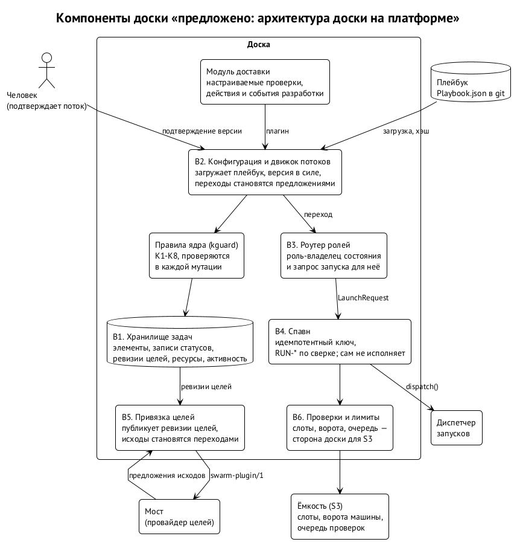
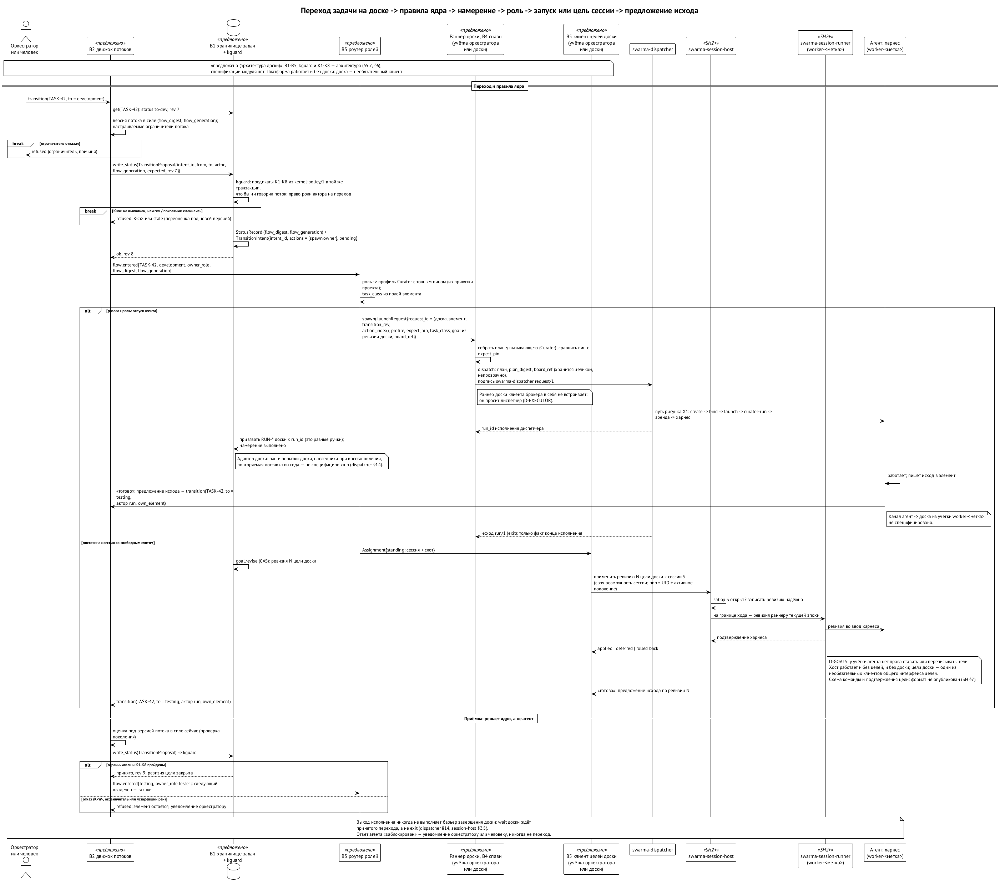

# Доска как надстройка

> Редакция: accepted architecture-review findings (2026-10-13). Внешний исполнитель действий доски зарегистрирован как открытое требование, без выбора топологии.

Всё, что описано до сих пор, работает без доски: доска — необязательный клиент платформы, и ни один модуль от неё не зависит. Голый хост сессий умеет запускать и держать сессии, мост — доставлять проверенные сообщения, слой доверия — отвечать, кому что можно. Доска добавляет процессы: задачи, их жизненный цикл, роли и спавн по переходам. ⟦решено⟧

## Из чего состоит

{.tall}

| Часть | Работа |
| --- | --- |
| хранилище задач и правила ядра | элементы, иерархия, записи статусов, ревизии целей, ресурсы, активность; неизменные правила K1–K8 |
| конфигурация и движок потоков | загружает плейбук, держит версию в силе, превращает переходы в предложения |
| роутер ролей | при входе задачи в состояние находит роль-владельца и превращает её в запуск |
| спавн | один интерфейс над диспетчером запусков; сам не исполняет |
| привязка целей | публикует цели доски сессиям и превращает «готово» в предложение перехода |
| валидация и лимиты | слоты, ворота машины, очередь проверок — это сервис платформы |

Главный оркестратор знает все процессы, но их работу не делает: он раскладывает, запускает и принимает. Оркестратор просит, а не судит.

## Плейбуки

Процесс описывается файлом-плейбуком: какие типы задач есть, какие у них состояния, кто владеет каждым состоянием, какие переходы допустимы и с какими проверками. Сегодняшний поток разработки и поток дизайна — это два плейбука, а не код:

- задача: бэклог → оркестратор · анализ → архитектор · разработка → разработчик · тестирование → тестировщик · ревью → ревьюер · интеграция → оркестратор · готово;
- дизайн: открыта → оркестратор · анализ → продакт · дизайн → дизайнер · ревью → продакт · готово.

Плейбуки собираются из опубликованных частей и закрепляются хэшами. Новая версия вступает в силу только после проверки и подтверждения человеком; до тех пор целиком работает предыдущая. ⟦предложено⟧

## Правила ядра

Поток может только сужать. Под всеми настраиваемыми проверками лежит фиксированный слой правил ядра, скомпилированный в бинарь доски: жизненный цикл запроса на изменения, изоляция рабочих деревьев, транзакции интеграции с подписанной перемоткой точной головы, очередь проверок и потолки машины, свидетельства ревью, ревизии целей, журнал аудита, базовые инварианты хранилища. Ни плейбук, ни человек, подтверждающий поток, не может отменить предикат ядра. Защищённые состояния именуются классом, а не именем, поэтому переименованное состояние не ускользнёт. ⟦предложено⟧

| Правило | Что гарантирует |
| --- | --- |
| K1 | задача с запросом на изменения доходит до интеграции и «готово» только с принятым запросом |
| K2 | работа идёт в рабочем дереве своей истории, с контрольной точкой; устаревшее дерево не интегрируется |
| K3 | интеграция и приземление — подписанная перемотка точной головы с доказательством стыка; другого пути в целевую ветку нет |
| K4 | свидетельства проверок берутся из очереди проверок; лимиты не выше потолков машины |
| K5 | в терминальное состояние ревью — только со свидетельством ревью этой ревизии |
| K6 | цели доски — неизменные ревизии с CAS; парковка и возобновление — только с зафиксированной ревизией |
| K7 | каждая мутация пишет строку аудита в той же транзакции; журналы только дописываются |
| K8 | уникальные идентификаторы, существующий родитель, оптимистичная ревизия, чистые имена ресурсов |

{.tall}

## Ревью как механизм безопасности

Цикл «исполнитель → ревьюер», который в одной команде нужен для качества, в рое становится защитой. Если часть агентов злонамеренна, ревьюера выбирает случайность с весом по репутации, а не оркестратор; тесты гоняет третий узел; слияние в основную ветку подписывают только доверенные узлы. Иллюстрация: если десять процентов агентов злонамеренны, а честный ревьюер ловит подсаженную уязвимость в семидесяти процентах случаев, она проходит одного ревьюера с вероятностью 0,37, двух — 0,14, трёх — 0,05. Расчёт предполагает, что ревьюеры выбираются и ошибаются независимо друг от друга; на практике ревьюеры с одной моделью и одними инструментами ошибаются похоже, и вероятность пропуска выше. Это иллюстрация, а не оценка, и измерений за ней нет; главный вывод из неё — качество и независимость ревьюера важнее доли злоумышленников. ⟦предложено⟧

Почему вообще нужны ревью и доска? У формальной математики есть оракул приёмки — проверка доказательства. У кода его нет. Поэтому приёмку приходится строить: контракты задач, независимое ревью, журнал решений. Доска — это и есть построенный оракул.

## Как доска живёт на платформе

Переход задачи — это предложение. Ядро проверяет правила и грант роли, записывает статус и намерение, роутер ролей превращает роль-владельца в запрос запуска: профиль Curator с точным пином, класс задачи, привязки ввода-вывода, кусок контекста родителя. Для разовой роли раннер доски просит диспетчер, и дальше всё идёт по пути из главы о запуске; клиента брокера доска в себя не встраивает. Для постоянной сессии со свободным слотом клиент доски публикует ревизию цели в хост сессий по своему праву на эту сессию. «Готово» от агента — предложение исхода; ядро принимает или отклоняет. Выход процесса никогда не считается завершением задачи: у доски свой барьер.

Роли — это скилл плюс профиль; права ролей — гранты ролям; команда проекта — роли, закреплённые за постоянными личностями. Спавны уходят из доски в диспетчер, а доска сохраняет свой интерфейс и вызывает его. ⟦решено⟧

Владение процессом не даёт агенту repository transport: ни один агент не достигает code host. Неагентский исполнитель публикации кандидата, передачи артефакта на проверку, обновления базы и landing, его custody, маршрут запроса/результата и проверки на границе эффекта ещё открыты. Требование внесено в реестр главы 15; полная правка войдёт в контрактный пакет этапа T. Новая служба или восстановление сервера доски из этого требования не следуют.

## Что меняется для сегодняшней доски

Сегодняшняя доска задач остаётся основой: хранилище, язык запросов, CLI, сервер доски, словарь вердиктов, машинерия запросов на изменения. Заменяются зашитые типы и статусы (на плейбук), исполнение спавна (на диспетчер и хост сессий), уведомления (на привязку целей), лимиты (на сервис ёмкости). Вынесенные части становятся публичными модулями: доска берёт модуль по выпущенному тегу и переключается на него только операторским переводом в окне обслуживания. Так уже идёт вынос хоста сессий. Доска становится удалённой — одна на продукт, проекты как разделы с проекциями по узлам дерева, — а логи сессий уходят из git. ⟦решено⟧
